# Vulkan backend development

## Final player graphics controls (2026-10-19)

The unified [Video Settings](video-settings.md#vulkan-water-and-lighting) now adds
Water Quality: Ray Traced (the corrected `d03ed0c` implementation) and independent
Volumetric Lighting Off/On (the corrected `aadbc5e` implementation). Standard and
Enhanced retain their four-component mappings; neither automatically enables RT
or volumetric lighting. Supported ray-query and FSR device capabilities are now
detected automatically on normal launches (see [Video Settings](video-settings.md)).
The startup opt-ins described in historical implementation/validation entries
below are superseded; explicit `=0` overrides remain useful for diagnostics and
require restart when removed. Unsupported saved RT components fall back
individually without erasing preferences. Water/sunlight share their existing
bounded scene and dynamic resources until the last consumer is disabled.
No shaders, ray counts, sample counts, new rendering systems or private SDKs are
changed. See the [integration verification](evidence/graphics-controls/README.md).

## RT-water reflection transitions (2026-10-19)

The [focused transition report](rt-water-transitions.md) traces the conspicuous
coastal strip to scalar stock detail incorrectly decoded as an RGB normal,
followed by a hard nonzero-Fresnel back-face rejection. The correction uses the
actual water geometry normal and existing rain slopes, continuous grazing/range
fallback, and coverage-correct filtering. Receiver/ray/scene bounds stay unchanged.
Matched stock Malden/Everon views, current RTX 4060 Ti measurements and live
validation receipts are linked there. That correction made no menu, GL33, asset,
private SDK, additional ray system or temporal framework changes; subsequent
player-control exposure is documented above.

## Graphics quality and visual tuning pass (2026-10-14)

[Graphics-quality design and evidence](graphics-quality.md) audits the existing
effects and proposes compact Standard/Enhanced groups, optional RT sunlight,
automatic bounded improvements and separate display/reconstruction controls.
New RTX 4060 Ti measurements cover Malden/Everon daylight, sunset, rain,
coastline and night at 1080p/1440p. RT water's visible transition and volumetric
lighting's road interaction remain menu-exposure gates; bloom did not earn a
first-menu toggle. Stronger numerical tuning was evaluated but not adopted.
This pass changes documentation/evidence only: no menu, persistence, new rendering
algorithm, SSR, asset change or private DLSS/NGX work is included.

## Faithful texture-enhancement feasibility (2026-10-13)

A local-only three-texture rock/roof experiment compared conservative 2x/4x
resampling in actual Malden/Everon gameplay, with AA Off, TAA and FSR Quality,
movement, existing modern lighting and 1080p/1440p profiling. The existing finest
source mip and 16x anisotropic path work; no sampling correction was justified.
The built-in loose bank-patch mechanism was sufficient, so no engine change or
asset framework remains. Original assets and authored lower mip payloads were
preserved; experimental derivatives and captures remain local.

**Do not expand this method into a texture pack:** it smooths magnified texel
contours but supplies no missing artwork and offers little normal-distance gain.
For the three resident images, device allocation grows from 531,968 bytes to
2,104,832 / 8,396,288 bytes at 2x / 4x; measured GPU differences were small and
settled uploads remained zero. See the [full feasibility report](texture-enhancement-feasibility.md)
for exact assets, methods, measurements, limitations and local evidence paths.
Reflection hit appearance and high-frame-rate shimmer are not fully qualified.

## Focused RTGI gameplay coverage review (2026-10-13)

Reviewed public main `8539d7d`, verified against the current remote, in an isolated
worktree. **No rendering correction was justified by this pass.** The existing
one-bounce implementation behaves reasonably in the sampled stock scenes, but
its practical benefit is modest, especially in sheltered areas. This is a
coverage assessment, not a new GI milestone or production qualification.
No gain, saturation, range, material eligibility, history, geometry budget,
default or setting was changed. The original checkout's private DLSS/NGX edits
were left untouched.

### Findings and evidence

Stock `01TakeTheCar.ABEL` and `06Ninjas.EDEN` were launched through the existing
local diagnostic launcher with isolated profiles and original assets. This was
not Steam-route acceptance or mission completion. Developer positioning,
day/time changes and invulnerability established the scenes. Actual keyboard
strafing and mouse turns then exercised simulation with GI Off and On, including
AA Off, TAA and FSR Quality on both islands. Malden rocks also received the
existing four-AA movement check. Short paths changed player position by about
2.5 m; the longer rock paths changed it by about 7.5 m. Paths and aim differed
between repetitions, so moving frames are qualitative evidence, not matched
pixel-error or performance comparisons.

Representative raw movement frames: [Malden rock](evidence/rtgi-coverage/malden-moving-rock.png),
[Everon entrance/yard](evidence/rtgi-coverage/everon-moving-entrance.png),
[Jeep in motion](evidence/rtgi-coverage/everon-moving-jeep.png) and
[Jeep settled](evidence/rtgi-coverage/everon-jeep-settled.png).
Start/end positions and completed-frame counters are included in the
[measurement record](evidence/rtgi-coverage/measurements.json).

| Scene | Observed behavior and completed-frame diagnostics |
|---|---|
| Malden rock beside yellow ground, `[7215,7708,0]` | A small warm ground-colored lift. One settled sample had 348,995 receiver rays, 133,850 hits and 86,648 eligible hits. Movement retained valid hits and TAA/FSR history; fine non-temporal grain remains. |
| Malden shaded house wall / fenced entrance, camera `[3092,6339,1.7]` toward `[3080,6350,1.7]` | Warm lift strongest low on the wall; the nearby fence, window openings and ground shadow did not acquire a broad glow. 147,479 of 155,516 secondary hits were eligible, so weak magnitude here is not explained by wholesale secondary-material rejection. |
| Malden village foliage and buildings, player near `[7253,8020,0]` | Little useful bounce in foliage-heavy views. One moving sample rejected 9,589 of 9,960 hits. The existing policy deliberately excludes alpha-tested contributors; aggregate rejection is not evidence that these should all become diffuse emitters. |
| Everon brick building beside green terrain, camera `[4903,7090,1.7]` toward `[4930,7107,1.7]` | Small green/yellow ground-colored lift on the lower shaded facade. The matched sample had 97,114 eligible hits out of 98,962, with 22,182 of 89,345 sunlight tests blocked. No uniform exposure or obvious wrong-color patch was found in the reviewed views. |
| Everon open barn / sheltered entrance and adjoining stone-walled yard, `[5264,9372,0]` | Almost no visible GI inside the opening. The fixed entrance sample still had 34,519 eligible hits, but 26,035 of 27,290 secondary sunlight rays were blocked (95.4%). This supports limited incoming light as a major cause, rather than a failed GI dispatch. Actual movement and turns covered the doorway, adjacent wall and yard; no obvious broad light leak was observed in the sampled frames. |
| Moving stock Jeep and soldier beside the Everon brick building | Script-assisted vehicle velocity and ordinary AI movement advanced their positions. A sampled frame recorded 7,514 dynamic bounce hits and 40,335 dynamic-unsafe history neighborhoods. The reviewed passage/settled captures showed no obvious persistent colored stain. This is not a high-frame-rate temporal-error measurement. |

Source review followed receiver flags in `EngineVK_Mesh.cpp` and
`EngineVK_Software.cpp`, raster/depth agreement in `rtgi_receiver.glsl`, secondary
classification in `ray_surface.glsl`, and plane/history rejection in the GI
filter/resolve shaders. Cutout and blended materials, suppressed-light surfaces
and unsupported geometry remain deliberate exclusions. Receiver reflectance
comes from the base texture, not lit scene color; secondary sunlight remains
shadow-tested. No observed surface was traced to an accidental eligibility or
classification error that justified relaxing those rules. Existing aggregate
counters do **not** identify the reason for every individual rejected wall
pixel; this review does not establish complete raster/RT material parity.

The main remaining practical weakness is low benefit in sheltered and
foliage-heavy gameplay. More brightness would not correct the causes above.
Changing the one-bounce/material scope or weakening filtering without a
demonstrated surface error would exceed this focused correction pass. No such
change was made. Thin geometry, excluded proxies/damaged objects, approximate
terrain UV/albedo, disocclusion noise and conservative dynamic history remain
limitations; the sampled doorway checks do not certify all interiors as leak-free.

Unretouched matched GI Off/On captures are linked below. These are **same-build
comparisons**, not before/after-fix evidence; there is no implemented fix.
Simulation was frozen only for these still comparisons, separately from the
movement checks above. All are native 1080p game windows; window chrome is retained.

| View | GI Off | GI On |
|---|---|---|
| Malden rock (TAA) | [Off](evidence/rtgi-coverage/malden-rock-off.png) | [On](evidence/rtgi-coverage/malden-rock-on.png) |
| Malden wall (AA Off) | [Off](evidence/rtgi-coverage/malden-wall-off.png) | [On](evidence/rtgi-coverage/malden-wall-on.png) |
| Everon brick (AA Off) | [Off](evidence/rtgi-coverage/everon-brick-off.png) | [On](evidence/rtgi-coverage/everon-brick-on.png) |
| Everon barn (AA Off) | [Off](evidence/rtgi-coverage/everon-barn-off.png) | [On](evidence/rtgi-coverage/everon-barn-on.png) |

The subsequent Off captures are pixel-exact with the initial Off images for
the wall, brick and barn. The TAA rock pair has a tiny nonzero restoration
difference (mean absolute RGB below 0.000008 display levels/channel), not an
exact parity claim. An initial first-person Everon TAA still sequence retained
camera/temporal differences and was excluded from these matched comparisons.
See the [capture hashes](evidence/rtgi-coverage/capture-manifest.json) and
[measurements](evidence/rtgi-coverage/measurements.json).

### Focused performance and verification

RTX 4060 Ti, driver 617.14, RelWithDebInfo, validation disabled during timings.
The same frozen Malden house view used GI Off/On/On/Off, two seconds warm-up and
four seconds sampling per state, VSync off, static RT and RT sunlight On, RTAO
Off. Swapchain logs confirm 1920x1080 and 2560x1440; FSR Quality uses its normal
lower internal resolution. Values are medians of the existing profiling samples,
in milliseconds. GI total sums trace/filter/temporal pass medians; whole-GPU
measurements include other work and are not interchangeable with that sum.

| Output / AA | GI trace + filter + temporal | GI total | Whole GPU Off / On | CPU commands Off / On | GI CPU recording |
|---|---:|---:|---:|---:|---:|
| 1080p / Off | .138 + .180 + 0 | .318 | 1.808 / 1.991 | 1.782 / 1.796 | .0046 |
| 1080p / TAA | .139 + .111 + .076 | .326 | 1.935 / 2.234 | 2.023 / 2.065 | .0066 |
| 1080p / FSR Quality | .089 + .062 + .041 | .192 | 1.806 / 1.920 | 2.151 / 2.174 | .0065 |
| 1440p / Off | .216 + .315 + 0 | .532 | 2.415 / 3.275 | 1.797 / 1.901 | .0047 |
| 1440p / TAA | .219 + .204 + .131 | .554 | 3.069 / 3.701 | 2.114 / 2.250 | .0067 |
| 1440p / FSR Quality | .116 + .087 + .060 | .263 | 2.513 / 2.813 | 2.161 / 2.202 | .0064 |

CPU frame time remained externally paced at approximately 6.172-6.175 ms;
these samples do not establish an uncapped FPS penalty. All sampled steady
streaming allocation rates were zero. Short windows and automatic GPU clocks
limit precision. These are current baseline costs, **not** a speedup or a
before/after-regression measurement; no rendering implementation changed.

Vulkan-enabled and GL33-only incremental builds succeeded at `8539d7d`.
Focused `[ray-surface],[vulkan-aa],[Shaders]` tests passed in each configuration:
33,459 assertions / 12 cases. The Vulkan driver-free policy/lifetime executable
passed 504 checks; its intentional teardown validation-error injection is expected.
Default GL33 launched the stock Malden mission without a renderer override,
returned `UNSUPPORTED: RTGI requires Vulkan`, and exited normally through the
harness. This is a GL33 startup/control smoke check, not another compatibility sweep.

Live core/synchronization validation was enabled for the gameplay runs.
The completed Malden run shut down normally with 44,933 submitted/presented
frames and zero errors/warnings. A fresh rebuilt Everon replay repeated
Off/On movement and turns near the barn in AA Off/TAA/FSR Quality, then brick
captures and TAA day/night/weather transitions: 10,990 submitted/presented
frames, normal harness exit, zero errors/warnings. Night had zero bounce and
sunlight rays; history reset counts advanced on day/night/weather changes.
The earlier barn night Off/On/Off comparison was pixel-exact; midday, sunset
and overcast returned exactly to Off too.

One initial Malden diagnostic exited before capture and was not used as
gameplay evidence. The longer first Everon run ended in a malformed inspection
expression (`str nearestObject ...`, unknown operator in test mode), exit 2;
its zero-validation teardown is not counted as a normal gameplay exit. Its
completed captures/counters remain useful, and the clean replay above provides
the normal-exit result. No renderer crash was attributed to either launch.

The initial public executable hash starts `6D907784748A415B`; rebuilding the same
clean commit refreshed build metadata and produced `7FE02BF2B9A1B466`, used for
both performance runs and the final validation replay. Build logs are in the
existing clean `cwr-vulkan-rtgi/build/coverage-build-{vk,gl}.log`. Raw movement,
actions, profiles, diagnostics and timing windows remain under the original
checkout's ignored `build/shadow-live/gi-coverage-*` directories. The review
worktree contains only this report, roadmap wording and evidence additions.
No renderer, game assets, gameplay rules, AA controls or private integration
files were edited. This investigation is closed with a documentation-only commit;
no rendering fix is proposed by this review.

## RTGI short-history / filter quality milestone (2026-10-13)

Built on `393e6eb` (including the SSAO ordering correction), compared against an
independently built exact `c8a582f`. The original checkout's private DLSS/NGX
work remains untouched. This is still a default-Off one-bounce experiment,
not production GI or a general denoiser. Controls and capability opt-in are
unchanged; TAA/FSR are optional, not prerequisites for GI.

### Implementation

The old full-resolution nine-tap filter reconstructed each neighbor's position
and depth normal. The ray pass now caches its already computed world normal and
view depth in the existing RGBA32F result's alpha: 14 depth bits at 1/256 metre
and two five-bit octahedral normal coordinates, exactly representable as a
24-bit float integer. Its sign marks dynamic secondary hits or dynamic sunlight
blockers. Zero still means ineligible. This is metadata in an existing image,
not a new G-buffer, material target or geometry collection pass.

AA Off/MSAA retain the original deterministic world-hash ray and nine spatial
taps. Neighbors now need one cached-data fetch/position calculation rather than
five depth reconstructions. The full-resolution receiver still reconstructs its
own reliable geometric normal. Normal, view-depth and tangent-plane rejection
keep unrelated surfaces separate. Receiver texture reflectance is still applied
**after** filtering, in linear HDR before ordinary AA and tone mapping.

TAA/FSR additionally use one small half-resolution compute resolve:

- Nine cached-data, plane-aware spatial taps at half resolution, followed by
  four bilateral bilinear taps in the full-resolution composition pass.
- Two RGBA16F ping-pong histories store incident bounced radiance and effective
  sample count. Existing motion XY (including jitter), expected previous depth
  Z and reliability W reproject history. The preceding fence slot's existing
  raw GI image supplies previous depth/normal; there is no extra metadata image.
- Effective count saturates at four, limiting old weight to 75%. This is a short
  exponential average, **not** a strict four-frame sliding window. Current local
  min/max and 1.25-sigma bounds clamp old RGB before reuse.
- Reject out-of-bounds reprojection, >2 cm / 0.2% previous-depth mismatch,
  normal disagreement, invalid motion anywhere in the half-resolution footprint,
  or dynamic-hit neighborhoods. Unsupported native animated receivers do not
  accumulate. Conservatively rejected samples still display current spatial GI.
- Reuse the existing TAA/FSR camera-cut/FOV reset. Also invalidate on GI toggles,
  target recreation/resolution/AA changes, missed GI frames, empty scenes and
  significant changes in original ambient/sun inputs, sun direction or weather.
  Existing dynamic-RT toggles already reset temporal validity.
- Eight deterministic rotations/shifts vary the one cosine-weighted sample only
  in temporal modes. There are no extra hemisphere rays or recursive bounces.

Transport is otherwise unchanged: 25 m rays, 45 m receiver cutoff, shadow-tested
secondary sunlight, approximate stock albedo, daylight gating and the original
gain/ambient coefficients. No brightness boost, new coverage, PBR conversion,
material assets, UI setting, ReSTIR/SVGF or independent motion-vector system.

`triRTGI "status"` now separates trace/filter/temporal GPU times and reports
accepted/rejected/clamped/dynamic-unsafe history samples, reset count, sample
phase, actual allocated history bytes and cumulative history-image allocations.
GPU counters/timings are read after fence completion, not assumed from selection.

### Fixed-scene performance

RTX 4060 Ti, driver 617.14, public RelWithDebInfo builds, validation disabled for
timings. Native 1920x1080 / 2560x1440 were verified in swapchain/world logs; FSR
Quality uses its normal lower internal extent. Identical frozen midday camera
poses, static RT, GI alone, two seconds warm-up then four-second measurement
windows per setting. Values below are medians in milliseconds; total is the sum
of pass medians, excluding shared BLAS/TLAS costs. Automatic GPU clocks and
short runs mean these are representative measurements, not precision benchmarks.

| Scene / output | AA | Old trace + filter | New trace + filter + temporal | Old / new GI total |
|---|---|---:|---:|---:|
| Malden rocks / 1080p | Off | .270 + .495 | .252 + .318 + 0 | .765 / .570 |
| | TAA | .230 + .413 | .222 + .171 + .105 | .644 / .499 |
| | FSR Quality | .131 + .197 | .121 + .077 + .050 | .328 / .248 |
| | MSAA4 | .176 + .824 | .223 + .314 + 0 | 1.000 / .537 |
| Malden building / 1080p | Off | .216 + .420 | .224 + .305 + 0 | .636 / .529 |
| | TAA | .192 + .362 | .189 + .156 + .098 | .553 / .442 |
| | FSR Quality | .121 + .176 | .115 + .077 + .050 | .296 / .242 |
| | MSAA4 | .170 + .802 | .197 + .288 + 0 | .972 / .485 |
| Malden rocks / 1440p | Off | .262 + .518 | .278 + .384 + 0 | .780 / .663 |
| | TAA | .228 + .444 | .224 + .193 + .121 | .672 / .538 |
| | FSR Quality | .127 + .199 | .126 + .085 + .054 | .326 / .266 |
| | MSAA4 | .266 + 1.460 | .268 + .431 + 0 | 1.726 / .699 |
| Malden building / 1440p | Off | .225 + .468 | .243 + .357 + 0 | .693 / .600 |
| | TAA | .219 + .451 | .216 + .203 + .129 | .670 / .548 |
| | FSR Quality | .125 + .202 | .128 + .087 + .058 | .327 / .273 |
| | MSAA4 | .268 + 1.449 | .269 + .448 + 0 | 1.717 / .718 |

The building scene includes houses, fences and foliage (423 RT instances,
34,963 triangles), not a maximum-geometry stress test. TAA whole-frame GPU and
CPU command recording remained comparable or lower:

| Scene / output | Whole GPU old / new | CPU commands old / new | GI CPU recording old / new |
|---|---:|---:|---:|
| Rocks / 1080p | 1.824 / 1.492 | 1.500 / 1.519 | .012 / .014 |
| Building / 1080p | 1.726 / 1.593 | 1.956 / 1.968 | .013 / .015 |
| Rocks / 1440p | 2.108 / 1.961 | 1.489 / 1.504 | .012 / .014 |
| Building / 1440p | 2.388 / 2.248 | 1.993 / 1.973 | .014 / .016 |

These runs remained externally paced around 6.17 ms CPU frame time; do not
interpret the pass savings as measured uncapped FPS gains. Whole-frame timings
are noisier: e.g. 1080p building FSR was 1.521 / 1.636 ms despite lower GI time.
Every fixed-scene steady measurement interval reported zero streaming resource
allocations/frame. GI adds two one-time history allocations per temporal target
lifetime, none per steady frame. Driver image allocation requirements were:

| Output | TAA history bytes / MiB | FSR Quality history bytes / MiB |
|---|---:|---:|
| 1080p | 9,830,400 / 9.375 | 3,932,160 / 3.750 |
| 1440p | 15,728,640 / 15.000 | 7,012,352 / 6.688 |

AA Off/MSAA add no history images. Two extra timestamps and four counters per
frame slot, a resolve pipeline and five extra descriptor bindings are the other
small additions. Actual bytes include driver alignment; logical RGBA16F history
storage is `2 * ceil(worldWidth/2) * ceil(worldHeight/2) * 8` bytes. Existing raw
GI images are unchanged in size. Target recreation frees history; the cumulative
allocation counter intentionally does not reset.

### Movement, visual checks and remaining limits

Actual player strafe input and mouse turns were exercised in `01TakeTheCar.ABEL`
(Malden rocks, from `[7215,7708,0]`) and `06Ninjas.EDEN` (Everon brick building,
from `[4903,7085,0]`), with simulation running and dynamic RT On. Teleporting only
established the start; the measured movement was real keyboard input, about
7.5 metres per trial. All four AA modes were exercised on both islands. These
are short local diagnostic gameplay runs, not a mission-completion soak.

| Moving scene / AA | Old trace / filter | New trace / filter / temporal | GI total old / new | Whole GPU old / new | CPU commands old / new |
|---|---:|---:|---:|---:|---:|
| Malden 1440p / Off | .215 / .464 | .222 / .326 / 0 | .678 / .549 | 2.016 / 1.905 | 2.010 / 1.851 |
| Malden 1440p / TAA | .208 / .459 | .199 / .194 / .126 | .667 / .518 | 2.467 / 2.295 | 2.307 / 2.089 |
| Malden 1440p / FSR Quality | .108 / .207 | .111 / .086 / .056 | .315 / .253 | 2.300 / 2.219 | 2.013 / 1.929 |
| Malden 1440p / MSAA4 | .262 / 1.594 | .262 / .462 / 0 | 1.856 / .724 | 4.091 / 2.980 | 1.749 / 1.510 |
| Everon 1080p / Off | .109 / .373 | .110 / .253 / 0 | .482 / .363 | 1.382 / 1.404 | 2.932 / 2.807 |
| Everon 1080p / TAA | .118 / .382 | .121 / .155 / .102 | .500 / .377 | 1.536 / 1.497 | 2.999 / 2.881 |

Movement values use the first four pass samples and first two whole-frame
profiling windows during input, excluding subsequent PNG encoding waits.
Capture overhead and non-identical simulation/frame phase limit precision.
Everon FSR/MSAA trials diverged in view/trajectory and are retained in the
[raw movement measurements](evidence/rtgi-quality/movement-measurements.json),
but are deliberately not presented as like-for-like speedups. GI CPU recording
was roughly .013–.020 ms; sampled streaming allocations/frame remained zero.

A representative Malden TAA moving result had 562,008 bounce rays, 207,591 hits,
175,478 eligible hits, 32,113 rejected materials, 530,627 accepted history samples
and 31,381 rejections (12,920 dynamic-unsafe neighborhoods). Everon TAA recorded
491,307 rays, 114,863 hits, 22,526 material rejections, 435,692 history accepts
and 55,615 rejections. These are actual completed-frame counters, not budgets.

The inspected wall/rock sequences show calmer fine bounce variation with TAA/FSR
and preserved surface boundaries; the improvement is modest on heavily textured
stock terrain where the existing AA already does much of the work. No obvious
persistent colored trails or cross-silhouette halos were found in these short
checks. This does not prove absence at every camera speed or frame rate. A
continuous Malden wall ROI retained mean GI-added display RGB near
`(1.98,1.43,.39)` before versus `(1.90,1.41,.44)` after, rather than becoming
brighter. Its horizontal first-difference RMS decreased .645 to .603 channel
levels. That is a spatial screenshot statistic, **not** a temporal-error metric.

Additional live checks:

- Moving Jeep and AI soldier beside the Everon building: actual positions
  advanced, dynamic bounce hits were recorded, and about 39–41k affected
  neighborhoods/frame refused history. No lingering visible color stain after
  their passage in the reviewed captures. Native unsupported motion and the
  sampled dynamic-hit sign are intentionally conservative; they trade smoothing
  for responsiveness.
- Midday, sunset, overcast, night, GI toggles, dynamic-RT toggles, large camera
  jump to the open barn, reversed viewing direction, and 1080p→720p resize:
  reset counters advanced and history targets resized. Night rays/hits were zero.
  A settled night GI Off/On/Off comparison with SSAO On, RTAO Off and RT sunlight
  On was pixel-exact (zero changed pixels), preserving the composition fix.
- RTAO, soft RT sunlight, dynamic geometry, PBR, atmosphere, volumetric fog/clouds,
  cloud shadows, water refraction/reflections and shoreline foam were selected
  together in Off/TAA/FSR Quality/MSAA4. The Malden coast additionally verified
  actual water execution: 1,097,619 water rays and 245,283 shaded hits in a sampled
  frame, rather than counting an enabled but empty water pass as coverage.
- GI-Off AA-Off/MSAA world-region pixels matched the exact old executable in
  fixed Malden captures; sky-only differences came from cloud phase. Unmatched
  temporal jitter/FSR captures are not claimed pixel-exact across processes.
  No GI/history dispatch occurs with GI Off.

Remaining limitations: AA Off/MSAA single-sample grain is essentially unchanged
(the benefit there is cost), five-bit cached normals/depth quantization can
conservatively drop taps, half-resolution filtering softens small bounce detail,
and disocclusions/unsupported motion fall back to noisy current samples. The
short RGB clamp is biased and may trim a rare bright bounce. Existing TAA/FSR
can still contribute its own ghosting/softness. Dynamic contributors not sampled
by the current ray cannot be identified perfectly; short history plus local
clamping bounds their persistence, rather than promising perfect invalidation.
Stock texture/LOD seams, first-person shoulder animation clipping and incomplete
RT material/geometry coverage remain outside this milestone.

### Evidence and verification

Matched, unretouched TAA screenshots (same camera/settings; normal jitter and
simulation phase are not frame-locked):

| Scene | Old GI Off / On | New GI Off / On |
|---|---|---|
| Malden wall | [Off](evidence/rtgi-quality/wall-base-taa-off.png) / [On](evidence/rtgi-quality/wall-base-taa-on.png) | [Off](evidence/rtgi-quality/wall-new-taa-off.png) / [On](evidence/rtgi-quality/wall-new-taa-on.png) |
| Everon brick building | [Off](evidence/rtgi-quality/brick-base-taa-off.png) / [On](evidence/rtgi-quality/brick-base-taa-on.png) | [Off](evidence/rtgi-quality/brick-new-taa-off.png) / [On](evidence/rtgi-quality/brick-new-taa-on.png) |

Short Everon TAA movement sequences:
[c8a582f](evidence/rtgi-quality/everon-base-taa-motion.webp) /
[updated](evidence/rtgi-quality/everon-new-taa-motion.webp).
These are 20 original frames sampled at 4 FPS across five seconds, encoded as
lossless animated WebP, with every decoded RGB pixel checked against the raw
capture. No retouching, amplification, resizing or frame interpolation. They
are low-rate motion evidence, not a high-frame-rate flicker measurement.
The original 40-frame/8-FPS sequences and logs remain locally under
`build/shadow-live/gi-quality-*` in the original checkout. The 1440p desktop
sequence helper clipped the off-screen window area; those sequences are not
used as full-frame published evidence. WGC still captures cover the full window.
File hashes are in the [capture manifest](evidence/rtgi-quality/capture-manifest.json).

Focused Vulkan and GL33 builds passed; graphics/shader tests passed 35,503
assertions / 95 cases and 35,257 / 91 cases respectively, including stock-data
fixtures. The Vulkan driver-free policy suite passed 504 checks (its deliberate
teardown-only validation-error injection is expected). Tests cover the shipped
scalar history policy, phase diversity, exact metadata bit capacity, composition
order and shader integration guards. All generated GI shader variants compiled.
Final live Vulkan + synchronization validation runs completed 46,137 Everon
frames and 9,833 Malden frames with **zero errors and zero warnings**.
A separate launch without the ray-query opt-in rejected `triRTGI "on"` with
the explicit `CWR_VK_RTAO=1` restart prerequisite; it did not silently enable RT.
Measured executable SHA-256 prefixes: baseline `80065E313D005AFE`, updated
`6D907784748A415B`. Production RTGI remains incomplete.

## RTGI / SSAO composition-order correction (2026-10-13)

Corrects `c8a582f` with SSAO On, RTAO Off and RT sunlight shadows On: GI had
moved SSAO ahead of the unattenuated sunlight subtraction, changing
`(color - shadow) * AO` to `color * AO - shadow` even with zero bounce.
SSAO now runs after sunlight/contact shadows and water composition, immediately
before GI. A per-call completion flag preserves exactly-once SSAO fallback for
empty scenes and failures before/after that point. GI-Off and RTAO paths retain
their ordering; no shader, resource, sampling or lighting-parameter changes.

Added source-order and arithmetic regression checks. Focused Vulkan/GL33 builds
passed, with 504 policy checks and 2,622 / 2,376 graphics assertions respectively.
A direct diagnostic Malden rock-view comparison reproduced 13,956 darkened
pixels (maximum 16 channel levels) on the old executable, considering only
pixels identical in both Off captures. The fixed, settled AA-Off/MSAA4 pairs
restored Off pixel-exactly; only 23/24 pixels had residual one-level negative
differences. RTAO coexistence was also exercised. The fixed run completed
19,638 frames with zero Vulkan validation errors/warnings. Raw local evidence
is retained in `build/shadow-live/gi-order-before` and `gi-order-after` in the
original checkout; this is a targeted regression check, not a new full matrix.

## One-bounce diffuse RTGI prototype (2026-10-13)

Built from public main `9d8886b` in an isolated worktree, preserving the original
checkout's private DLSS/NGX changes. `triRTGI "on"`, `"off"`, `"status"` controls
this default-Off, Vulkan-only experiment. Ray-query device capabilities are now
detected automatically at startup; missing capabilities or independent MRT blending
are reported as unsupported. Enabling GI does not select AO, RT sunlight,
dynamic geometry, water effects, PBR or any AA mode. Resource failures disable
GI and expose the reason. There is no persistent option or graphics-menu change.

### Transport and receiver data

One cosine-weighted hemisphere ray per eligible half-resolution sample uses the
existing alpha-tested BLAS/TLAS scene and `hitSurface()`. Its direction is hashed
from a 1/32 m world-space cell, without frame randomness. Receivers fade over
31.5–45 m, secondary rays over 20–25 m. No recursive trace, sky-miss illumination,
geometry expansion or new material assets are introduced. The existing 160 m
hit-color scene and optional `triRTDynamic` geometry are reused unchanged.

Hit albedo, incoming light and reflected radiance remain separate. Incoming
light is `0.15 * rayAmbientLinear() + raySunlightLinear() * NdotL * visibility`.
Only diffuse-eligible non-cutout hits contribute; unknown materials absorb the
sample. Sunlight requires a positive geometric and shading-normal cosine plus
an alpha-tested, 80 m shadow ray from the secondary surface. Existing weather
sunlight/cloud visibility applies. The 45 + 25 + 80 m envelope fits within the
existing 160 m scene radius, subject to its existing geometry/budget omissions.
No fogged, tone-mapped, eye-adapted or previously GI-lit color feeds the bounce.

The receiver shader already has the linear base texture before legacy lighting.
The existing surface attachment can store RGB reflectance times fog
transmittance with **negative view depth** in otherwise unused non-water pixels.
Positive depth remains water; zero remains ineligible. This avoids a new full
material G-buffer, normal target or geometry pass. Native and software opaque
world draws explicitly opt in; alpha-tested/blended draws, special lighting,
untextured draws and water do not. Unsupported visible draws invalidate the
record. Projected shadows preserve receiver identity. Rain's existing negative
red marker also invalidates GI. Cockpit, weapon overlays and HUD are rendered
after composition. MSAA requires eligible, matching receiver/depth samples.

Both approximate albedos are capped at 0.8 and transport gain is 0.65. The
cosine-weighted PDF cancels the receiver Lambertian cosine/pi factor; no
additional distance-squared attenuation is applied to radiance. These caps,
distance tapers, reduced secondary ambient and gain are deliberate biased
prototype bounds on uncalibrated stock lighting, not a calibrated GI solution.
Receiver texture RGB omits exact material reflectance, detail modulation and
baked-light separation. Hit terrain UVs and stock albedo retain the foundation's
limitations. No metallic/roughness values are invented. Daylight weighting
suppresses the entire contribution at night; local-light and moon bounce are
outside this prototype.

A 3x3 half-resolution neighborhood is filtered using reconstructed geometric
normals, depth and receiver-plane distance, with hard rejection at corners and
silhouettes. Receiver reflectance is applied **after** filtering to prevent
color halos across receiver textures. The additive HDR pass follows AO, before
volumetrics, existing TAA/FSR reconstruction and tone mapping. There is one new
half-resolution RGBA32F image per fence slot and one compute/filter pair (plus
the existing surface attachment when it was not otherwise needed). No separate
temporal history, ReSTIR, SVGF or adaptive sampling is introduced. AA Off retains
world-anchored grain; camera movement can cross sampling cells. TAA/FSR can
soften it but cannot recover missing coverage or guarantee temporal convergence.

`status` separates current dispatch from completed-fence counters: bounce rays,
triangle hits, eligible hits, rejected materials, secondary sun rays/blockers,
eligible receiver samples and dynamic hits. With `CWR_VK_PROFILE=1`, it reports
trace/filter GPU timestamps, shared BLAS/TLAS costs and CPU recording time.
Unavailable timing is explicit. These are latest completed samples, not averages.

### Gameplay evidence and limitations

Tested on Malden (`01TakeTheCar.ABEL`) and Everon (`06Ninjas.EDEN`) in the
actual game, including first-person walking, turning, a vehicle interior and
multiple rock/building/coastal views. These were direct diagnostic launches of
the newly built executable, **not Steam-launch qualification**. Player damage
was disabled; comparison views used the existing camera/time/weather commands,
and stock Jeeps were spawned for dynamic coverage. No game assets were edited.
Frozen-camera comparisons isolate lighting; they are not a completed mission or
a continuous-motion benchmark.

The following are matched **unretouched window captures** (1920x1080 client,
including the window border), copied byte-for-byte. Open each pair at full size;
the effect is intentionally subtle. All five pairs restore the original image
exactly in the final Off leg of Off/On/Off.

| Actual scene | GI Off | GI On | Observation |
| --- | --- | --- | --- |
| Malden shaded wall beside yellow/brown ground | [Off](evidence/rtgi/malden-wall-off.png) | [On](evidence/rtgi/malden-wall-on.png) | Small warm lift on the lower wall, not uniform exposure. |
| Malden rock, combined RT/AO/PBR/atmosphere | [Off](evidence/rtgi/malden-rock-off.png) | [On](evidence/rtgi/malden-rock-on.png) | Restrained ground-colored bounce on the rock; existing shading remains dominant. |
| Everon brick barn beside green ground | [Off](evidence/rtgi/everon-brick-off.png) | [On](evidence/rtgi/everon-brick-on.png) | Greener indirect on the shaded wall; not the same warm tint as Malden. |
| Everon partially open, shaded barn | [Off](evidence/rtgi/everon-barn-off.png) | [On](evidence/rtgi/everon-barn-on.png) | Very little bounce; the interior does not become a light source. |
| Malden water/pier with combined water effects | [Off](evidence/rtgi/malden-water-off.png) | [On](evidence/rtgi/malden-water-on.png) | Small land-only change; sea and reflections remain unchanged. |

For scale, whole-image mean absolute RGB differences in 8-bit output levels were
`(0.752, 0.526, 0.148)` for the Malden wall and `(0.166, 0.174, 0.036)` for
the Everon brick barn. In the latter wall rectangle `(900,400)-(1450,600)`,
the mean positive increment was `(0.722, 0.760, 0.116)`. This is some colored
bounce, **not dramatic red spill from every brick**. Secondary albedo is sampled
from the actual ray hit; there is no warm screen-space term. The sheltered barn
blocked 26,034 of 27,290 secondary sun rays in its recorded frame, with only
`(0.006, 0.007, 0.011)` whole-image change. Shadowed hits cannot bounce the
unoccluded sun term. The reduced ambient approximation can still contribute.

Both islands were compared at midday (12:00), sunset (18:00), fully overcast
midday and midnight, on 5 July 1985. Malden's corresponding mean RGB differences
were `(0.752,0.526,0.149)`, `(0.299,0.139,0.056)`,
`(0.110,0.094,0.088)` and **zero**. Everon also produced zero at midnight:
eligible receivers remained counted, but bounce rays were zero. No night glow
or uniform brightening was observed. Thin/missing geometry is still a possible
leak source; these views do not establish leak-free coverage of every building.

AA Off, TAA, FSR Quality and MSAA4 were each compared with dynamic RT Off/On on
both islands. Dynamic eligible hits changed (for example 8,742 in the Everon
MSAA4 vehicle view); toggling GI did not toggle dynamic RT or another effect.
AA Off has fine world-anchored grain, especially at close range. MSAA rejects
mixed-coverage pixels conservatively and may leave unlit edge samples. Static
AA-Off/MSAA4 Off/On/Off pairs returned pixel-exactly to Off. TAA/FSR reset/reuse
the existing history; differing jitter phases left approximately 0.2-4 RGB
levels of whole-image Off/Off variation in several captures. Those frames are
compatibility checks, not exact GI-difference measurements or proof of temporal
convergence. Camera motion changes the sampled surface cells; fine crawling
remains a prototype limitation. No new history or denoiser was added to hide it.

Combined gameplay exercised RT sunlight/soft RT sunlight, RTAO, textured water
reflections, refraction/foam, atmosphere/volumetric fog/clouds and the limited
PBR prototype. The actual Malden sea rectangle `(300,850)-(1900,1100)` was
pixel-identical Off/On. HUD and vehicle-interior rendering remained visually
unchanged; GI affected the world outside the vehicle. SSAO-only plus GI, resize
to 1280x720 and minimize/restore also recovered with continuing ray dispatch.
Blended particles/cutouts are excluded by receiver eligibility and invalidation;
this is not exhaustive testing of every particle or cockpit asset. Existing
baked lighting, approximate terrain UVs, missing/proxy/damaged geometry and
bounded sun coverage limit accuracy. This establishes working bounded transport,
not a production material model, robust temporal GI or a complete indoor solver.

To reproduce the strongest comparisons, freeze simulation after setting the
date/weather and use these existing script-camera views (OFP position order;
the third position component is height above ground):

```sqf
setDate [1985,7,5,12,0]; triCheatWeather 0; 0 setFog 0; setAccTime 0;
triAA "off";
// Malden wall; on Everon substitute [4903,7090,1.7] / [4930,7107,1.7].
giCam = "camera" camCreate [3092,6339,1.7];
giCam cameraEffect ["internal","back"]; showCinemaBorder false;
giCam camSetTarget [3080,6350,1.7]; giCam camCommit 0;
triRTGI "off"; // Capture after settling, then repeat with "on", then "off".
```

### RTX 4060 Ti measurements

Windows, NVIDIA driver **617.14**, Vulkan, SDR, AA Off, render scale 100%,
`CWR_VK_RTAO=1`, `CWR_VK_PROFILE=1`, validation disabled for timing, VSync Off.
Other optional ray/water/PBR effects were Off, showing GI's independent cost.
Each entry is a median over a roughly six-second settled collection after a
three-second warm-up. Resolutions were verified from the actual world targets.
The rock view is an ordinary Malden mission location; the more complex town
view had 424 TLAS instances / 37,448 instanced triangles with dynamic RT On.
A nearby stock Jeep was present in both views. Cameras and simulation were
frozen for repeatability, so these are steady scene costs, not animated BLAS
update or cold-start costs.

All times below are milliseconds. CPU commands include scene/geometry work;
the narrower GI recording interval excludes shared collection and AS updates.

| Resolution / scene | Dynamic RT | GI GPU trace | GI GPU filter | Whole GPU Off / On | CPU commands Off / On | GI CPU record |
| --- | --- | ---: | ---: | ---: | ---: | ---: |
| 1080p rock | Off | 0.236 | 0.428 | 2.009 / 2.146 | 1.110 / 1.203 | 0.010 |
| 1080p rock | On | 0.238 | 0.428 | 1.819 / 2.143 | 1.087 / 1.262 | 0.011 |
| 1080p town | Off | 0.177 | 0.362 | 1.983 / 2.183 | 1.713 / 2.121 | 0.011 |
| 1080p town | On | 0.195 | 0.359 | 1.934 / 2.181 | 1.698 / 2.173 | 0.011 |
| 1440p rock | Off | 0.230 | 0.448 | 2.115 / 2.251 | 1.101 / 1.191 | 0.011 |
| 1440p rock | On | 0.230 | 0.446 | 1.963 / 2.247 | 1.065 / 1.252 | 0.011 |
| 1440p town | Off | 0.202 | 0.450 | 2.098 / 2.648 | 1.697 / 2.117 | 0.012 |
| 1440p town | On | 0.223 | 0.451 | 2.092 / 2.668 | 1.697 / 2.163 | 0.011 |

The isolated GI pair costs **0.54-0.68 ms** in these samples. Whole-GPU Off/On
deltas are not additive pass budgets: GPU clocks were not locked, and changes
in scheduling/clock state affect the other passes. In particular, nearly equal
rock timings at different resolutions must not be read as resolution-independent
scaling. CPU frame intervals stayed around 6.172-6.173 ms despite VSync Off and
an engine cap of 240; this paced run does not demonstrate uncapped FPS impact.
CPU command overhead was approximately 0.09-0.48 ms. Shared cached AS timestamp
intervals were effectively empty (about 0.000064-0.000096 ms), **not** measured
rebuild costs.

A separate live first-person walk repeated eight bounded forward-key holds
with simulation running and dynamic RT On, at both resolutions. Position
receipts verified movement from approximately `[7129,8009]` to `[7143,8023]`.
The repeated path is not frame-identical (AI/animation and player acceleration
continue), so the medians below are representative gameplay overhead, not a
deterministic A/B subtraction. This open view mostly misses useful bounce
geometry and is **not** the visual-benefit benchmark.

| Live Malden walk | GI GPU trace / filter | Whole GPU Off / On | CPU commands Off / On | CPU frame Off / On |
| --- | ---: | ---: | ---: | ---: |
| 1080p | 0.096 / 0.153 | 1.864 / 2.017 | 3.004 / 3.739 | 6.174 / 6.203 |
| 1440p | 0.080 / 0.069 | 1.950 / 2.074 | 2.893 / 3.598 | 6.176 / 6.201 |

GI CPU recording was 0.013 ms in both walking runs. Costs varied with view and
clock state; a last-completed 1080p sample was trace/filter/BLAS/TLAS
`0.137/0.512/0.350/0.159` ms, and the 1440p sample was
`0.138/0.582/0.238/0.114` ms. This exposes the live AS cost hidden by the frozen
cache case. Those frames traced 313,979 / 558,002 bounce rays, hit 3,632 / 6,188
triangles, accepted 483 / 615 diffuse hits, rejected 3,149 / 5,573 materials,
and included 131 / 176 eligible dynamic hits respectively. The lower 1440p
median is not a scaling claim; do not extrapolate these short, paced trials to
worst-case performance.

Representative completed-frame counters from the same runs:

| Resolution / scene | Dynamic | Bounce rays / eligible receivers | Triangle hits | Eligible hits | Rejected materials | Secondary sun rays / blocked | Dynamic eligible hits |
| --- | --- | ---: | ---: | ---: | ---: | ---: | ---: |
| 1080p rock | Off | 329107 | 116960 | 74795 | 42165 | 67430 / 2526 | 0 |
| 1080p rock | On | 329107 | 117062 | 74897 | 42165 | 67470 / 2596 | 177 |
| 1080p town | Off | 322317 | 152208 | 146740 | 5468 | 129246 / 3879 | 0 |
| 1080p town | On | 322317 | 160207 | 154657 | 5550 | 127915 / 8455 | 21311 |
| 1440p rock | Off | 585109 | 207873 | 132941 | 74932 | 119855 / 4428 | 0 |
| 1440p rock | On | 585109 | 208089 | 133157 | 74932 | 119923 / 4556 | 354 |
| 1440p town | Off | 573957 | 271366 | 261697 | 9669 | 230668 / 7062 | 0 |
| 1440p town | On | 573957 | 285645 | 275848 | 9797 | 228334 / 15242 | 38155 |

### Build and validation

Focused Vulkan and GL33 game/test builds succeeded. Vulkan driver-free policy
and lifetime tests passed **504 checks**, including default-Off, prerequisite
rejection, invalid controls, dispatch truthfulness, independent AO selection
and resource-failure reporting. The focused graphics/shader/decoder/factory/
window tests passed **2,606 assertions / 92 cases** on Vulkan and **2,360 /
88 cases** on GL33, with `CWR_STOCK_DATA` pointing to the authorized game data
(no skipped stock-bank test). Both single-sample and MSAA GI shader variants
compiled; compute SPIR-V validation passed.

Live Vulkan validation ended with **zero errors and zero warnings** in the
Malden matrix (29,942 submitted/presented frames), Malden walking/coast/rock
(10,403), Everon matrix/gameplay (53,473), and final cockpit/SSAO/resize recovery
(9,463 submitted / 9,462 presented). The one unpresented resize/recovery frame
is not a validation error. A separate missing-opt-in launch explicitly rejected
`triRTGI "on"`; GL33 likewise returned `UNSUPPORTED: RTGI requires Vulkan`
and continued normal rendering. One earlier diagnostic script used an invalid
command and exited cleanly in test mode; it is excluded from these results.

Local full captures, command receipts, executable hashes, counter samples and
timing logs are retained under `build/shadow-live/gi-*` in the original checkout;
the matched representative images above are committed. Main visual-matrix and 1080p timing runs
used executable SHA-256 `7FD4624AB333E3AF584C67AD146DCEFCE0043FE8E62EF00B64F81C1D7C9E2D9E`;
the error-path-only SSAO fallback guard and 1440p/compatibility/walking runs used
`992658277DB8E3957C66E24C26C54BD34285FA22EEEF47EF4A2AB50F4D154CDE`.
The final status-only addition (zero eligible/material counters before any scene
exists) was rebuilt as
`04AED84E3588175453CC0C00F27DA08BCA988CCFE83F799BE133EC01AFDE3340` and
passed another 7,645-frame live validation run with zero errors/warnings,
independent-effect status checks, and pixel-exact Off/On/Off restoration.
None of these builds includes private DLSS/NGX integration. Production RTGI remains
explicitly incomplete in the roadmap.

## RT water hit-shading fast path (2026-10-13)

Follow-up to `7514b69`: ordinary water now calls `reflectionSurface()`, which
fetches the existing section/triangle, transformed geometric face normal,
barycentric UV and linear sampled texture color. It does not reconstruct hit
position or interpolated normals, fetch the inverse-transpose transform, classify
diffuse eligibility, or run full-surface validation. Missing material/color,
invalid UV and degenerate-face guards retain the sky fallback. Alpha traversal,
geometric-normal lighting, texture filtering, fog and water composition are
unchanged. Shared triangle, face-normal, UV and color helpers also serve the
complete `hitSurface()` API; no second scene or material system is introduced.

Full reconstruction and its existing real-ray checks remain available by launching
with **`CWR_VK_RT_HIT_DIAGNOSTICS=1`**. This is a process-local developer opt-in,
not a saved option or menu. Restart to change it. A specialization constant on
the two existing water pipelines selects the full path and counters; it does
not create additional pipelines/passes or perform both reconstructions per hit.
Without the opt-in, `triRTReflections "status"` reports
`hitSurface=unavailable (diagnostics disabled)`. Enabled diagnostics with no
completed water dispatch report that condition instead of misleading zeros.
Counts are associated with the existing completed fence slot. Original water,
terrain, alpha and dynamic hit counters remain available in normal operation.

Both specialized SPIR-V variants validate. Freezing/optimizing the disabled
variant removes the world-to-object fetch, transpose and ten diagnostic
atomic-add instruction sites (24 to 14 total sites in the water shader).
BLAS/TLAS collection, caches, budgets, material coverage, color-demand gating,
resource sizes and lifetimes are unchanged. At this historical foundation
milestone, full diffuse inputs remained separate from legacy water lighting and
RTGI transport was not yet implemented; the prototype above adds that transport.

### Verification against the foundation

Vulkan/GL33 builds and focused tests pass: **1,636 assertions / 75 cases** and
**1,596 / 74**, plus **497** Vulkan driver-free policy/lifetime checks. The
additional policy check requires unavailable, rather than zero, disabled
diagnostic counts. Existing shipped normal-math tests retain nonuniform-scale,
reversed/invalid normal and material-fallback coverage.

Actual Malden `01TakeTheCar.ABEL` and Everon `06Ninjas.EDEN` gameplay used the
existing launcher/harness and isolated profiles. Player movement changed world
position on both islands. Saved coastal states were loaded into the retained
`7514b69` executable, optimized normal build and explicit diagnostic build.
Each island exercised AA Off, TAA, FSR Quality and MSAA4, with dynamic RT Off/On.
Terrain slopes, static pier/building surfaces, alpha-tested soldier/vehicle
sections and dynamic reflections retained their textures and geometric lighting.
In both islands, the sampled 1600x260 water region was pixel-identical to
`7514b69` for AA Off and MSAA4, with dynamic RT Off and On, for both optimized
paths. TAA/FSR were visually checked; independent history/jitter phases prevent
claiming general cross-process pixel identity. Full diagnostic normals,
positions and albedo reported **zero invalid hits** throughout the AA matrices.
Unavailable diffuse materials in Malden remained explicitly unavailable, not
invented albedo. Terrain retained its documented approximate UVs/face normals.

Malden also exercised moving/rotating vehicles and soldiers, range/removal/damage
and camera transitions, PBR On/Off, water/sky/refraction/foam, cloud/rain/wet/
underwater/atmosphere and soft-sunlight coexistence. AO-only, sunlight-only and
all-RT-off transitions retained their existing behavior; full counters became
unavailable when no water diagnostic dispatch ran. Accepted optimized Vulkan
validation runs on both islands shut down with **zero errors and warnings**.
GL33 launched stock gameplay and exited normally. These are gameplay/rendering
checks, not mission completion or Steam-launch qualification.

### Coastal performance comparison

RTX 4060 Ti, driver 617.14; AA Off, VSync Off, validation Off. All four
executables/modes loaded the same saved Malden coastal state, camera and stock
dynamic actors. The existing timestamps/profile logger supplied the measurements:
three-second warmup per dynamic setting, then 40 status polls with 250 ms sleeps
(approximately 12 seconds; 12 water samples and six frame-profile intervals).
Values below are medians in **milliseconds**. Resolutions were confirmed from
the active swapchain, not merely launch arguments.

| Resolution | Dynamic RT | Build / mode | Water trace/shade GPU | Whole GPU frame | CPU frame |
| --- | --- | --- | ---: | ---: | ---: |
| 1920x1080 | Off | Pre-foundation `f28723f` | 0.485 | 2.447 | 7.104 |
| 1920x1080 | Off | Foundation `7514b69` | 0.808 | 2.502 | 7.036 |
| 1920x1080 | Off | Optimized normal | 0.482 | 2.395 | 7.058 |
| 1920x1080 | Off | Optimized, diagnostics enabled | 0.807 | 2.500 | 7.022 |
| 1920x1080 | On | Pre-foundation `f28723f` | 0.551 | 2.538 | 7.397 |
| 1920x1080 | On | Foundation `7514b69` | 0.847 | 2.599 | 7.267 |
| 1920x1080 | On | Optimized normal | 0.543 | 2.487 | 7.291 |
| 1920x1080 | On | Optimized, diagnostics enabled | 0.858 | 2.611 | 7.320 |
| 2560x1440 | Off | Pre-foundation `f28723f` | 0.837 | 3.386 | 7.134 |
| 2560x1440 | Off | Foundation `7514b69` | 1.625 | 4.127 | 7.214 |
| 2560x1440 | Off | Optimized normal | 0.837 | 3.389 | 7.120 |
| 2560x1440 | Off | Optimized, diagnostics enabled | 1.679 | 4.132 | 7.165 |
| 2560x1440 | On | Pre-foundation `f28723f` | 0.898 | 3.459 | 7.391 |
| 2560x1440 | On | Foundation `7514b69` | 1.578 | 4.171 | 7.462 |
| 2560x1440 | On | Optimized normal | 0.897 | 3.457 | 7.388 |
| 2560x1440 | On | Optimized, diagnostics enabled | 1.631 | 4.203 | 7.367 |

Normal water recovers about **0.30--0.33 ms at 1080p** and **0.68--0.79 ms at
1440p** relative to the foundation, returning close to pre-foundation cost.
Explicit diagnostics add about **0.32 ms / 0.73--0.84 ms** at these resolutions;
they are deliberately not included in normal rendering. Sampled graphics clocks
varied from 2115 to 2655 MHz in the 1080p runs and were 2850 MHz at the 1440p
sample points. Whole-frame timing includes other work and scheduling; small CPU
or sub-0.01 ms water differences are not isolated speedup claims or hard gates.

All steady tail intervals reported **0.0 resource allocations/frame** and all
sampled intervals reported zero texture uploads. Some first intervals contained
0.2--0.3 allocations/frame around the transition, including pre-foundation,
foundation, normal and diagnostic runs; later intervals were zero. There are no
new GPU buffers/images/descriptors, and the foundation's 80-byte counter and
160-byte lighting payloads are unchanged. Only small CPU diagnostic-state flags
and existing pipeline specialization data were added; no frame allocation or
new readback mechanism was introduced.

Ignored evidence lives under `build/shadow-live/hitopt-*` (including the
foundation/normal/diagnostic AA matrices, `hitopt-perf-{baseline,foundation,
normal,diagnostics}-{1080,1440}` and `hitopt-gl33`). Each performance run retains
its executable hash, status samples, screenshots and raw profiler intervals in
`hit-perf.json`. The existing local qualification scripts were reused; no
benchmarking framework or debug UI was added to the repository.

## RTGI hit-shading foundation (2026-10-13)

The original `7514b69` milestone below used always-on full reconstruction and
diagnostics in water; the fast path above supersedes that execution policy.

Built from public main `f28723f` in an isolated worktree, preserving the original
checkout's private DLSS/NGX work. This is a hit-input prerequisite, **not RTGI**:
no indirect illumination, additional rays, new pass, temporal history, denoiser,
new controls or broader geometry coverage.

### Reusable intersection inputs

`ray_material.glsl` holds the existing 64-byte ray-material ABI, index/UV fetch
and alpha traversal. `ray_surface.glsl::hitSurface` consumes a **committed**
triangle query from the same BLAS/TLAS scene. It returns:

- World position reconstructed from triangle vertices, barycentrics and the
  query's current object-to-world transform.
- Separate geometric and shading normals facing the incident ray. The
  geometric normal comes from transformed triangle edges. Shape normals use
  the existing 32-byte position/negated-normal/UV layout, barycentric
  interpolation and the transpose of the query's world-to-object matrix.
  Reversed source normals/winding are aligned to the geometric hemisphere.
  Nonfinite, zero, cancelling, near-tangent or ray-backfacing interpolated
  normals fall back to the face normal. Terrain's placeholder up-normals are
  explicitly excluded from interpolation.
- UVs and linear texture color using the existing 16/32-bit indices, section
  offsets, wrapping/clamping, point/bilinear filtering and decoded RGBA storage.
  Texels are sRGB-decoded **before** bilinear interpolation. No texture
  re-upload, new texture set or guessed white albedo is used.
- A diffuse-albedo **proxy**, availability bits, the existing static/extended
  alpha/terrain/dynamic scene kind, alpha-test and approximate-UV flags, and
  `diffuseEligible`. Consumers must check availability/eligibility; zero
  initialization does not mean a missing material is a known black surface.

Ordinary supported base-texture lighting modes can supply the proxy. Unknown
render flags, colored/tinted modes, suppressed sunlight, emissive/blended modes
and specular-texture modes do not become diffuse materials. Actual texture RGB
remains separately available for legacy water shading. Cutouts retain their
existing alpha-tested traversal, UVs and color, but are **not diffuse-bounce
eligible**: no leaf transmission or two-sided material response is invented.
Missing color addresses/dimensions leave albedo unavailable.

Coverage is exactly the existing local scene: stock terrain patches, eligible
static rocks/buildings and supported live vehicles/on-foot soldiers when
`triRTDynamic` is enabled. Crew/equipment proxies, destroyed objects, blended
effects, dynamic textures and previously excluded shapes remain excluded.
Terrain retains the existing land-grid UV jitter/interpolation and texture
grouping; the UVs are explicitly approximate, without raster detail layers,
terrain LOD blending or ray-footprint mip selection.

`RTHitDataEnabled()` centralizes the demand for color and terrain material
preparation. Water reflections are currently its only consumer; a subsequent
bounce prototype can reuse this gate. AO-only and shadow-only collection still
prepares only the alpha data needed for traversal, not opaque color textures.
Previously uploaded pixels retain their existing texture-owned lifetime.
Metadata occupies unused high sampler bits; low sampler bits and the 64-byte
material stride are unchanged. BLAS/TLAS cache matching, geometry budgets,
per-fence dynamic snapshots, retained texture ownership and retirement are
unchanged. Dynamic attribute uploads already include current normals and UVs,
even when only position changes require a BLAS rebuild.

### Lighting boundary and preservation

`ray_lighting.glsl` exposes the engine's ambient and diffuse sunlight separately,
before `GetAccomodateEye()`, fog or night-eye response. Existing `ao.sun`
provides direction and the daylight availability factor. The existing
`legacyLightToLinear` conversion decodes display-authored coefficients below
white and preserves linear headroom above white. These are **not calibrated
radiometric inputs**. Albedo, ambient illumination, direct sunlight, visibility
and directional response must remain separate in a future bounce evaluation.
No BRDF, fog, eye adaptation or tone mapping is applied by the surface helper.

Water now calls that helper but intentionally retains its original face-normal
lighting, combined legacy-light conversion, cloud response, eye response, fog
and composition. Its use of texture color does not depend on diffuse
eligibility. `triPBR` is independent; no PBR allowlist, roughness or metalness
is required or inferred. AO/sun traversal and GL33 rendering code are unchanged.

The existing `triRTReflections "status"` adds completed-frame
`hitSurface(eligible/vertex/face/unavailable/invalid)` counts from actual water
rays. Invalid checks compare barycentric world position with the ray hit
(1 cm tolerance at stock world coordinates), unit/hemisphere/ray-facing normals
and finite bounded albedo. Face counts include terrain. Unavailable includes
unsupported diffuse material modes; alpha ineligibility is also visible in the
existing shaded-alpha count. These are read-only diagnostics, not a debug view.

### Verification and cost

Vulkan and GL33 builds pass. Focused shape/shader tests pass **1,636 assertions
in 75 cases** and **1,596 in 74 cases**, respectively; driver-free Vulkan
policy/lifetime tests pass **496 checks**. Tests compile the shipped normal
math and exercise interpolation, nonuniform scale, reflected/rotated transforms,
reversed normals, NaN/infinite/zero normals and conservative material flags.
Shader builds cover single-sample and MSAA AO, sunlight and water variants.

Actual `01TakeTheCar.ABEL` and `06Ninjas.EDEN` gameplay used the existing
diagnostic launcher/harness, with developer coastal views and spawned stock
vehicles/soldiers. Physical movement changed the player position on both
islands; reload/map input and return to gameplay worked. This is not a mission
completion or Steam-launch qualification. Representative water-hit frames:

| Scene | Shaded hits | Terrain | Dynamic | Alpha-tested | Invalid |
| --- | ---: | ---: | ---: | ---: | ---: |
| Malden pier | 353,967 | 265,523 | 29,332 | 2,328 | 0 |
| Everon close coast | 526,136 | 465,895 | 60,241 | 4,522 | 0 |

The final executable also traced Malden's stock `data3d\skala.p3d` object 3808
near world X/Z 9912.8/4358.0: 104,235 shaded hits (416 terrain),
92,646 interpolated-normal hits and zero unavailable/invalid hits. The rock
texture and transformed silhouette were visible in the reflection. PBR
Off/On/Off changed only the above-water rock region and restored exactly;
the reflected rock remained independent of PBR. This final validation run
shut down at 8,938/8,938 submitted/presented with zero errors/warnings.

Malden exercised moving/rotating vehicles and soldiers, dynamic Off/On/Off,
AA Off/TAA/FSR Quality/MSAA4, PBR On/Off, water refraction/sky/foam, cloud,
rain/wet/underwater/atmosphere and soft RT sunlight coexistence. Everon repeated
dynamic, PBR and environmental checks; its frozen dynamic Off/On/Off restored
the image exactly. Terrain slopes, pier/building textures and vehicle/soldier
colors remained coherent in the reflections. The baseline/new coastal images
were visually compared, not asserted pixel-identical across independent
mission starts (water time and simulation poses differ). AO-only and
shadow-only transitions still dispatched their existing rays with zero surface
diagnostic counts. GL33 launched stock gameplay, rejected Vulkan-only controls
and exited through the harness. Both Vulkan validation runs shut down with
**zero errors/warnings** (16,865/16,865 and 9,278/9,278 submitted/presented).

RTX 4060 Ti, driver 617.14, 1920x1080, AA Off, VSync Off, validation Off:
existing timestamps/profile intervals over warmed ten-second windows at the
Malden coast, compared with the clean `f28723f` executable:

| Dynamic RT | Water trace/shade GPU, before / after | Whole GPU frame, before / after | CPU frame, before / after |
| --- | --- | --- | --- |
| Off | 0.478 / 0.806 ms | 2.348 / 2.498 ms | 7.037 / 7.272 ms |
| On | 0.544 / 0.842 ms | 2.445 / 2.605 ms | 7.276 / 7.486 ms |

These observations include full-hit normal reconstruction and diagnostic
atomics/checks: about **0.30--0.33 ms additional water-pass GPU time**. Whole
frame/CPU differences are noisy and not an isolated collection-cost estimate.
No new steady allocations or texture uploads were reported in the warmed
windows. The material/vertex stride, images, descriptors and allocation count
are unchanged; counter payload grows 64 to 80 bytes and lighting payload 128
to 160 bytes per fence slot (**96 bytes total for two slots**, excluding driver
allocation granularity). Process private bytes were approximately 2.599/2.595 GB,
with 785 handles in both runs; that variation is not a memory saving claim.

Ignored evidence is under `build/shadow-live/hit-{malden-validation,everon-validation,
rock-final-validation,baseline-perf,foundation-perf,gl33}`; builds/test logs are under the isolated
`build/worktrees/cwr-rtgi-hit/build`. Nonuniform scaling and invalid-normal
fallbacks have numerical coverage; no particular nonuniform stock instance or
deliberately broken stock texture is claimed as live-tested.

Remaining RTGI inputs/work: a bounded sampling/transport estimator, illumination
and visibility at the hit, an explicit policy for baked lighting/mixed atlases
and alpha surfaces, receiver/composition selection, and later temporal stability
and filtering. Stock base RGB is only an approximate albedo, not a measured
material set. This milestone does not establish an indirect-light energy scale
or implement any bounce.

## Targeted PBR expansion: roof tiles and exterior wood (2026-10-13)

Built from public main `cc08b1d` in the isolated public worktree. The original
checkout's private DLSS/NGX and unrelated work are not changed or published.
This extends the existing opt-in prototype, **not the whole PBR milestone**.
`triPBR "on"`, `"off"`, `"status"` are unchanged; default remains Off, Vulkan
only, without an RT requirement. Status now identifies `stock-dielectric-v2`,
all five exact textures and a total native draw count since the last toggle.
The old roughness-based stone/paint counter would mislabel the new rough surfaces,
so it is replaced by that total; this is not a material registry.

### Three additional textures, two material families

Original `Dta/Data.pbo`, `Data3D.pbo` and Malden/Everon object tables were inspected
read-only with PoseidonTools, including decoded pixels, model sections and LODs.
The selection is deliberately smaller than a building conversion:

| Exact stock texture | Assumption | Evidence / boundary |
| --- | --- | --- |
| `data\strecha_tasky_vln.pac` | Weathered, diffuse-dominant roof tiles; roughness 0.90 | Dedicated repeated tile image, not a wall/window atlas. Opaque native roof sections on stock `dum_mesto2l`, `cihlovej_dum` and related models. No glossy glaze or precise tile composition inferred. |
| `data\strecha_tasky_vln90.pac` | Same roughness 0.90 | The stock rotated tile variant; selecting both avoids treating adjacent orientations of the same roofing differently. This is not a third distinct physical material. |
| `data\prkna_dark.pac` | Dark weathered exterior wood; roughness 0.85 | Dedicated wood grain, used separately for roof-edge/fascia/eave geometry on `dum_mesto2l`, `dum_mesto`, farm buildings and barns. Not their wall, window or gutter textures. No varnish inferred. |

All three use existing **F0=0.04, metallic=0**, independent of legacy specular
power. These are conservative, unmeasured perceptual roughness assumptions, not
recovered optical properties. The original rock at 0.85 and painted signpost
default/mapping at 0.60 / 0.50–0.65 are unchanged. Exact extension and addon-path
mismatches still fall back to legacy; there is no prefix or category matching.

No BRDF, shader, uniform layout, lighting composition or GL33 code is changed.
The existing GGX/Smith/Schlick native Shape branch still replaces legacy direct
sun/specular, evaluates in linear HDR, and uses existing transformed normals,
ambient/emissive, local-light visibility, CSM/RT/cloud sunlight, fog and tone
mapping. It does not add light after shadows. Eligibility gates remain intact:
CPU-lit geometry, blended/transparent textures, special/suppressed-light modes,
terrain secondary modes, foliage and water do not become PBR. RT reflection-hit
shading is unchanged. Existing wet surfaces still classify ground/roads, **not
these roofs**; rainy tests verify coexistence, not a new wet-roof BRDF.

### Rejected candidates and useful obstacles

- `kamennazed.pac`: an identifiable stone/mortar wall with a brick cap strip,
  but the actual Malden `zed_kamenna` sample took the CPU-lit software path.
- `telegraf_sloup.pac`: identifiable weathered wood on utility/lamp poles, with
  separate hardware textures, but the sampled Malden pole also used software
  geometry. An initial wall/pole Off/On/Off capture changed zero pixels. Temporary
  path instrumentation confirmed both routes and was removed, not shipped.
- `drevo_dirkate.pac`: plausible weathered boards, but pallet LODs switch to
  differently authored side/front/top cutout textures; not a useful first choice
  for consistent coverage. `newplot.pac` combines fence metal, masonry and columns;
  its mixed atlas and transparent lower LODs are excluded.
- `beton_universal.pac` / concrete obstacles: no suitable placed obstacle sample
  was established in the inspected Malden/Everon tables. No invented placement
  or software-path promotion is used to justify selection.
- Mixed building/vehicle atlases and interior suppressed-light furniture remain
  excluded. No sufficiently justified dedicated metallic example was selected.

### Visual and integration verification

Actual stock `dum_mesto2l.p3d` placements include Malden object **37880** at raw
world `(5425.9,48.0,2805.8)` and Everon **16968** at `(1262.9,70.3,5955.2)`.
Stock single-player missions `01TakeTheCar.ABEL` and `06Ninjas.EDEN` were launched
through the existing diagnostic harness, not claimed as Steam-route acceptance.
Close diagnostic views include Malden `[5439,50,2811,-1,0.2,0]` and Everon
`[1283,72,5952,-1,0.2,0.1]`; additional sides/grazing views check transformed
instances and boundaries against neighboring legacy walls, gutters and roofs.

Both islands were exercised at midday, sunrise/sunset, overcast, night, light/
heavy rain and fog. Existing CSM, soft CSM, RT sunlight, soft RT, cloud shadows,
atmosphere, local shadows and wet-ground effects were exercised. Live status
confirmed populated CSM and actual RT ray dispatch/hits, not just enabled flags.
AA Off, TAA, FSR Quality and MSAA4 were checked; Malden combined sunlight effects
and Everon shadowed local lights provide the AA matrices. Internal FP16 HDR and
SDR tone mapping work; requesting HDR10 used the existing SDR fallback because
the current surface/display did not expose HDR10. Physical HDR10 is unverified.

Night tests use the stock Jeep's existing headlights. Ordinary ground-facing
headlights did not reach the roof: that correctly did not create a roof highlight.
A separate frozen, upward-aimed Jeep fixture exercises the roof directly, with
two active 1024-square shadow maps and populated casters. This is a diagnostic
light-angle test, not a claim about a normal level-road headlight pose. No new
light type, texture, reflector or asset edit is introduced.

Representative images are matched, unretouched full-window PNGs. Both tile
orientations and the dark wood fascia are visible in the Malden close view.

| Example | Legacy | PBR |
| --- | --- | --- |
| Malden tiles and wood fascia, midday | [PNG](evidence/pbr-expansion/malden-wood-close-off.png) | [PNG](evidence/pbr-expansion/malden-wood-close-on.png) |
| Malden sunrise | [PNG](evidence/pbr-expansion/malden-sunrise-off.png) | [PNG](evidence/pbr-expansion/malden-sunrise-on.png) |
| Malden rain and wet-ground coexistence | [PNG](evidence/pbr-expansion/malden-heavy-off.png) | [PNG](evidence/pbr-expansion/malden-heavy-on.png) |
| Everon roof, neighboring legacy surfaces | [PNG](evidence/pbr-expansion/everon-roof-wood-off.png) | [PNG](evidence/pbr-expansion/everon-roof-wood-on.png) |
| Everon upward-aimed stock headlights/local shadows | [PNG](evidence/pbr-expansion/everon-headlight-front-off.png) | [PNG](evidence/pbr-expansion/everon-headlight-front-on.png) |

Settled AA-Off/MSAA4 Off/On/Off captures restore exactly. The initial Malden
`malden-tiles` capture includes changing mission UI; Everon's first sunrise
transition also was not settled. Neither is a parity pass; the later settled
sunrise/close captures restore identically. TAA/FSR retain expected jitter/history
differences and are qualitative checks, not pixel-identical or exhaustive
ghosting certification. Raw comparison records: [Malden](evidence/pbr-expansion/malden-pairs.jsonl),
[Everon](evidence/pbr-expansion/everon-pairs.jsonl).

In the Malden close pair, neighboring legacy wall `(1000,850)-(1200,1000)`,
chimney `(810,415)-(865,490)` and sky `(200,100)-(500,250)` ROIs change **zero
pixels**. The selected wood fascia and both roof orientations change. The original
rock and painted post were rechecked in separate pairs, both with exact Off return.

Vulkan and GL33 RelWithDebInfo builds pass. Focused `[vulkan-shape]`, `[vulkan-aa]`,
`[ShadowMath]` tests pass: **1,580 assertions / 70 cases** for Vulkan and
**1,540 / 69** for GL33; driver-free Vulkan policy/lifetime suite **496 checks**.
The latter's intentional teardown-error fixture is not a live validation error.
The runtime executable SHA-256 is
`927436B4DA7537ECB6D973807DAB0717C57F8438F281D654F650006D5AEED01F`.
Malden's matrix presented **59,301** frames and Everon's **71,502**, each with
**zero Vulkan validation errors or warnings**. Everon exited through the harness;
Malden exited normally after a player relocation crossed the stock mission's
`VzdalujeSeMoc E4` / END4 boundary, not a renderer failure. A fresh in-area
Malden physical-input run presented another **3,686** frames with zero validation
errors/warnings and exited through the harness. Physical forward input moved the
PBR-enabled soldiers about **4.9 m on each island**, with Caps Lock restored.
That fresh no-RT-capabilities roof comparison restored the world exactly; a
fading stock HUD panel differed only inside `(39,53)-(423,333)`, so it is not
claimed as full-frame parity ([record](evidence/pbr-expansion/no-rt-pairs.jsonl)).
GL33 launched, returned unsupported for all three PBR commands, and its
Off/On/Off images changed **zero pixels** ([record](evidence/pbr-expansion/gl33-pairs.jsonl)).

### Cost and remaining limitations

Windows, RTX 4060 Ti 8 GB, driver 617.14, Core i7-12700F. Existing periodic GPU
timestamps and CPU profiler, AA Off, 100% scale, vsync off, validation and RT
capabilities disabled. No builds ran during timing. Each view uses four
Off/On/On/Off blocks, discarding three seconds then sampling eight seconds per
block. Values below are medians in milliseconds, measuring the whole `triPBR`
toggle (including original materials), not an isolated marginal shader cost.

The ordinary gameplay view is the actual first-person player camera in Everon
at SQF `[1283,5990,0]`, direction 210, frozen after settling in the stock village.
It contains roof tiles, wood trim, a painted signpost and neighboring legacy
building/ground/vegetation/weapon surfaces: [Legacy](evidence/pbr-expansion/gameplay-off.png),
[PBR](evidence/pbr-expansion/gameplay-on.png). The heavier roof close-up uses
`triSetView [1280,74,5957,-1,0,0]`. No benchmark scene or new assets were created.

| View / extent | GPU Off -> On | GPU delta | CPU frame Off -> On | CPU command Off -> On | Samples |
| --- | --- | --- | --- | --- | --- |
| Gameplay / 1920x1080 | 1.37190 -> 1.37245 | +0.00055 | 6.1740 -> 6.1740 | 0.9420 -> 0.9415 | [JSON](evidence/pbr-expansion/1080-gameplay.json) |
| Roof close / 1920x1080 | 1.38940 -> 1.39935 | +0.00995 | 6.1720 -> 6.1720 | 0.7320 -> 0.7345 | [JSON](evidence/pbr-expansion/1080-close.json) |
| Gameplay / 2560x1440 | 1.54595 -> 1.54630 | +0.00035 | 6.1745 -> 6.1750 | 0.9530 -> 0.9505 | [JSON](evidence/pbr-expansion/1440-gameplay.json) |
| Roof close / 2560x1440 | 1.56295 -> 1.57450 | +0.01155 | 6.1725 -> 6.1720 | 0.7400 -> 0.7370 | [JSON](evidence/pbr-expansion/1440-close.json) |

These small deltas are workload-specific: gameplay is within clock/driver noise;
the close view costs about **0.010–0.012 ms GPU**, with no meaningful measured CPU
increase. Allocations/frame remain **0.0**. The CPU frame is near the existing
162 Hz pacing floor; negative command-time deltas are not claimed as speedups.
The 1440p world targets and swapchain were verified as 2560x1440. The oversized
window exceeds the 1080p desktop, so this is workload timing, not physical 1440p
display/capture qualification. Local journals, raw captures and profiling logs
are retained under the original checkout's `build/shadow-live/pbr2-*` directories.

The useful visual benefit is modest, continuous material response on the roof
planes and dark fascia, especially changing light angle, and per-fragment local
light falloff instead of vertex-interpolated light across large roof triangles.
There is no metallic cast or polished-plastic lobe. Wood occupies relatively few
pixels at ordinary gameplay distances; this is not a dramatic visual conversion.

The original tile image already contains strong baked ridge shading. PBR does
not turn that into geometry or change its direction; flat original roof normals,
UV seams, LOD simplification and low-resolution texture detail remain visible.
The wood trim disappears in some lower model LODs; no replacement detail is
invented. Legacy ambient and CSM darkness/sun-factor calibration remain artistic,
not radiometric (default CSM tuning retains some direct light in shadow).
No environment/indirect specular exists. Wider adoption is worthwhile selectively,
not as a texture-name sweep: it needs reliable per-section identities across LODs,
an explicit policy for authored baked lighting and special materials, and original
normal/light inputs for software-lit geometry. Those obstacles are not addressed
by making mixed atlases metallic or replacing the legacy renderer in this patch.

## PBR feasibility prototype: two stock dielectric surfaces (2026-10-13)

Historical first-prototype record; the targeted expansion above supersedes its
two-texture coverage/status description, not its original verification results.

`triPBR "on"`, `"off"`, `"status"`. Default **Off**, Vulkan only, no hardware
RT requirement, no persistent setting. Status identifies `stock-dielectric-v1`,
the two exact texture identities and native draw counts since the last toggle.
Invalid arguments leave the setting unchanged; GL33 reports unsupported.
This work starts at public main `123d5e8` in an isolated worktree. Private
DLSS/NGX changes in the original checkout are neither modified nor published.

The **limited feasibility prototype is completed**, not the wider PBR
roadmap. No new assets, material database, renderer framework, environment maps,
reflection probes, dependencies or ray-tracing passes are introduced.

### Asset evidence and deliberately limited selection

Stock Data/Data3D PBOs, material configuration and island object tables were
inspected read-only using the existing PoseidonTools. Original texture pixels,
UVs, geometry and normals are reused without modification.

| Exact stock texture | Selected response | Inference and boundary |
| --- | --- | --- |
| `data\skala_piskovec2.pac` | Matte rock, perceptual roughness 0.85 | Opaque mottled rock texture on stock `kamen*_zula` and `skala_new` geometry (also reused on barrier masonry). No optical roughness was supplied by the asset; this is an intentionally broad dielectric lobe. |
| `data\sloupek_bily_orezly_.pac` | Worn painted signpost, default roughness 0.60 | Dedicated opaque post surface in `znacka_*` road signs, not the sign-face atlas. Paint/oxidation is treated conservatively as dielectric, not as exposed metal. |

Both use neutral normal-incidence reflectance **F0 = 0.04**, metallic = 0.
There is no defensible stock metallic mask for mixed vehicle/building atlases;
none is invented. No optional metallic example was selected. The exact-name
allowlist does not match replacement extensions or similarly named addon paths.

Existing positive specular power is only a lobe-width hint for the painted
surface: `clamp(pow(2/(power+2), 1/4), 0.50, 0.65)`; missing/zero power uses
0.60. It is **not** power-as-roughness, nor a calibrated conversion between
legacy and GGX highlights. The stock tested draws have zero legacy power, so
their response uses the defaults. Rock remains 0.85 independently of power.
Existing specular color is not interpreted as metallic reflectance.

Only opaque, depth-tested/writing native world Shape sections with original
normals and ordinary material lighting qualify. Blending, transparent textures,
water, detail/secondary shader modes, overlays, shadow geometry, disabled-sun
and authored suppressed-light materials remain legacy. A post can inherit a
cutout flag from its sign object while its own texture is fully opaque; the
opaque post qualifies, the separate cutout sign face does not. Software-lit
geometry never qualifies. Diagnostic barrel samples used that software path;
an interior sink proxy had `MSInShadow` with zero diffuse sunlight. Neither was
silently promoted to native lighting or given invented sun highlights.

### Lighting integration

`ShapeLightingVK.hpp` retains TLMaterial/light preparation and the existing
inverse-transpose normal transform. Two vec4s extend its std140 payload to
1488 bytes: selected roughness/F0 and original material diffuse for eligibility.
The native vertex shader passes the transformed normal for interpolation and
fragment renormalization. The software vertex shader supplies a zero normal
and always uses the original fragment branch.

The fragment BRDF is isotropic GGX, exact separable Smith masking-shadowing,
Schlick Fresnel, and Lambert diffuse multiplied by `(1-F)`. Texture sampling is
already sRGB-decoded; lighting coefficients are converted with the existing
HDR-aware legacy-to-linear conversion. All BRDF evaluation/composition is in
linear HDR. The legacy light scale represents a Lambert response, not measured
irradiance, so incident direct light is multiplied by pi. TLMaterial's ordinary
over-white object-brightness gain (1.6 in these draws) remains an incident-light
multiplier, **not** an albedo clamped to white. No exposure or color-grade change
is used to make the comparison look better.

Selected fragments replace, rather than add to, legacy vertex sunlight and
specular. Ambient is retained with a conservative `(1-F0)` diffuse allocation;
emissive is retained unchanged. Forced diffuse is removed from ambient and
included with shadowed sunlight. Local lights use their original positions,
colors, range cutoff, inverse-square-clamped attenuation, cone and night scale,
with per-fragment BRDF response and the existing selected local shadow maps.
No fake ambient specular or environment reflection is added.

Sun diffuse and specular share CSM and cloud visibility. The existing sunlight
MRT carries their combined contribution to RT/contact/soft-shadow composition,
which retains the existing `min(CSM, RT)` rule. Ambient/emissive/local light are
not relabeled as sun. Night-eye response, world fog/atmospheric fog, temporal
motion outputs and world tone mapping follow surface shading as before.
Selected rock/post textures have no classified wet-ground response; wetness on
surrounding terrain retains its original path. This prototype does not invent
a second wet-clearcoat lobe or optical roughness from gameplay surface friction.

Off selects the original legacy calculations. Toggle changes only reset existing
temporal history; no new image, pass, descriptor or frame allocation is needed.
Raster PBR is not implemented again in simplified RT reflection-hit shading.

### Verification, evidence and limits

Assisted real-game rendering checks use stock `01TakeTheCar.ABEL` (Malden) and
`05HeavyMetal.Eden` (Everon), copied profiles, diagnostic camera/weather controls
and exact-window captures. These are direct developer launches, not a Steam
launch qualification or mission-completion test. Game audio was disabled.
Raw camera coordinates use engine X/Y-up/Z and direction XYZ:

| Surface | Existing island object | Diagnostic view |
| --- | --- | --- |
| Malden rock | 83921, `kamen3_zula` near 7219.9 / 166.3 / 7705.7 | `[7215,168.8,7708,1,-.35,-.6]` |
| Malden post | 37429, `znacka_prednost` | `[7264.1,169.3,7943.5,-1,-.15,-.2]` |
| Everon rock cluster | 31998 and neighboring `skala_new` instances | `[9220,199,1065,1,-.2,-.4]` |
| Everon post | 23553, `znacka_prednost` | `[7613,134,4531,-.5,-.2,-1]` |

Both islands/surfaces were compared in midday sunlight, overcast/rain, sunset,
sunrise, midnight and fog, with additional oblique/opposite Malden views.
Weather was advanced before freezing each comparison; requested rain is not
misreported as instantaneous actual rain. Populated CSM and CSM+RT comparisons,
cloud shadows/volumetric clouds, atmosphere and wet ground were exercised.
The first Malden CSM setup had no casters because object shadows were disabled;
it was repeated with `triEnableShadows` as well as `triEnableShadowMaps`.
Everon's subsequent CSM recorded about 13,017 caster vertices/frame.

Stock Jeep headlights illuminated the Malden rock and Everon post; both selected
local shadow maps were active. These temporary Jeep instances supplied ordinary
engine lights, not new light models or authored assets. AA Off, TAA, FSR Quality
and MSAA4 ran with PBR; Everon's AA sweep also included the combined shadow/
weather effects. Existing HDR negotiation reported linear RGBA16F composition,
exposure 1 and the unchanged SDR fallback: **physical HDR10 was unavailable**.

Matched Legacy/PBR examples below are original PNG window captures, not crops,
retouched images, generated comparisons or exposure-adjusted marketing shots.
Full local matrices include Off -> On -> Off returns. All settled AA-Off/MSAA4
pairs restored identically; TAA/FSR have jitter/history differences and are
qualitative comparisons, not pixel-equality or exhaustive ghosting certification.

| Example | Legacy | PBR |
| --- | --- | --- |
| Malden matte rock, sun | [PNG](evidence/pbr/malden-rock-dry-off.png) | [PNG](evidence/pbr/malden-rock-dry-on.png) |
| Malden painted post, sunrise with weather effects | [PNG](evidence/pbr/malden-post-sunrise-off.png) | [PNG](evidence/pbr/malden-post-sunrise-on.png) |
| Malden rock, rain/wet ground/cloud/RT | [PNG](evidence/pbr/malden-rock-wet-off.png) | [PNG](evidence/pbr/malden-rock-wet-on.png) |
| Everon transformed stock rocks, sun | [PNG](evidence/pbr/everon-rock-sun-off.png) | [PNG](evidence/pbr/everon-rock-sun-on.png) |
| Everon post; sign face excluded | [PNG](evidence/pbr/everon-post-sun-off.png) | [PNG](evidence/pbr/everon-post-sun-on.png) |
| Everon rock self/neighbor shadows, CSM+RT | [PNG](evidence/pbr/everon-rock-csm-rt-off.png) | [PNG](evidence/pbr/everon-rock-csm-rt-on.png) |
| Everon post, shadowed headlights at midnight | [PNG](evidence/pbr/everon-post-headlights-off.png) | [PNG](evidence/pbr/everon-post-headlights-on.png) |
| Malden rock, headlight cone and local shadows, no RT capabilities | [PNG](evidence/pbr/malden-rock-headlights-off.png) | [PNG](evidence/pbr/malden-rock-headlights-on.png) |

The headlight rock comparison is particularly useful: per-fragment evaluation
resolves the light cone across the original large triangles instead of smearing
it through vertex lighting. It does not add finer geometry or texture normals.

Both Vulkan and GL33 RelWithDebInfo builds pass. Focused `[vulkan-shape]`,
`[vulkan-aa]`, `[ShadowMath]` tests pass: Vulkan **1,559 assertions / 70 cases**,
GL33 **1,519 / 69**; driver-free Vulkan policy/lifetime tests **493 checks**.
These cover selection/defaults, controls, uniform ABI and existing transformed
inverse-transpose normals, including nonuniform scale. The policy suite's
intentional `TEST-teardown-only` validation error is an injected assertion fixture,
not a live renderer error. All six shape fragment variants and both vertex
shaders compile and pass `spirv-val --target-env vulkan1.0`.

Final implementation executable SHA-256:
`EB8551B4EB486628B68A98D7D2B6A3EA23CBFB940321D901F338B490ED7D9343`.
Malden's validation run presented 79,103 frames with zero errors/warnings.
Everon's matrix presented 47,968 with zero errors/warnings; its later cleanup
attempt used unsupported `moveOut` script syntax, causing test-mode exit 2.
That helper error is not counted as a successful gameplay-exit test; a fresh
supported-command no-RT smoke run presented another **8,730 frames**, exited
normally and reported zero validation errors/warnings. Physical forward input
moved the soldiers about **4.9 m on each island** with PBR enabled; diagnostic
cameras are distinct from those input checks. GL33 launched successfully and
returned unsupported for PBR; Off/On/Off images were all identical (zero changed
pixels). Ray capabilities stayed disabled during the no-RT checks, including
all four requested AA modes. Local journals, raw captures and profiler
logs are under `build/shadow-live/pbr-*` in the original checkout. Representative
[Malden](evidence/pbr/malden-pairs.jsonl) and
[Everon](evidence/pbr/everon-pairs.jsonl) pixel statistics are retained here.

Disabled-PBR pixels also match the clean pre-prototype `123d5e8` executable
(SHA-256 `528AF0B8AE4C8DA5C74B31A5AA4FB057466A8A4A6C47E0AD520D0899102EFBC1`)
exactly in the tested rock ROI `(600,350)-(1350,850)` and post ROI
`(832,350)-(875,800)` of the raw 1922x1112 window captures. Full separate-launch
images have subtitle/HUD and simulation-phase differences; they are not claimed
pixel-identical. Same-session settled off/on/off frames supply full-frame parity.
The first Malden `post` entry predates subtitle settling and is excluded from
that claim; subsequent named surface/weather pairs are the acceptance evidence.

### RTX 4060 Ti cost

Windows, RTX 4060 Ti 8 GB, driver 617.14, Core i7-12700F. Validation and ray-query
capabilities disabled for timing; AA Off, 100% scale, vsync off, frozen midday
views above. No builds ran during sampling. Four alternating Off/On/On/Off
blocks each discard three seconds then sample eight seconds; entries are medians
of the engine's periodic GPU timestamp and CPU profiler records (milliseconds).

| Scene / extent | GPU Off -> On | Delta | CPU frame Off -> On | CPU command Off -> On | Raw samples |
| --- | --- | --- | --- | --- | --- |
| Rock / 1920x1080 | 1.8374 -> 1.8649 | +0.0275 | 6.1720 -> 6.1720 | 1.0590 -> 1.0560 | [JSON](evidence/pbr/1080-rock.json) |
| Post / 1920x1080 | 1.9335 -> 1.9678 | +0.0343 | 6.1725 -> 6.1725 | 1.7585 -> 1.7380 | [JSON](evidence/pbr/1080-post.json) |
| Rock / 2560x1440 | 1.9463 -> 1.9758 | +0.0295 | 6.1720 -> 6.1720 | 1.0640 -> 1.0650 | [JSON](evidence/pbr/1440-rock.json) |
| Post / 2560x1440 | 2.0750 -> 2.0810 | +0.0060 | 6.1725 -> 6.1720 | 1.7435 -> 1.7435 | [JSON](evidence/pbr/1440-post.json) |

These are small-scene estimates, not a universal cost or a claim that negative
CPU deltas are speedups. GPU clock/driver noise is appreciable at this scale;
the CPU frame is limited around the existing 162 Hz pacing floor. Command cost
shows no meaningful increase and allocations/frame remain **0.0**. The close
rock covers a substantial portion of the frame; cost for wider material coverage
has not been measured. The 1440p world targets and swapchain were verified at
2560x1440, but the oversized window exceeds the 1080p desktop: this is render
workload timing, not physical 1440p display/capture qualification.

### What this establishes, and what it does not

The useful improvement is a restrained, continuous view/light-dependent response
on the painted post, including headlights, and a broad diffuse-dominant response
on rock. Original markings, dirt, cracks and color identity remain visible;
neither sample acquires a metallic appearance or a polished-plastic sheen.
Direct highlights are attenuated with their direct light, rather than being
added after shadowing. Existing CSM darkness/sun-factor tuning deliberately
allows residual direct light; this prototype preserves it, not a new physically
opaque-shadow calibration. This is deliberately a small change, not a dramatic
before/after makeover.

The engine's lighting coefficients are not calibrated radiometric quantities.
Moving NdotL, local falloff and BRDF evaluation into linear space does change
brightness relative to legacy gamma-domain vertex lighting; the biggest rock
differences are at low-angle evening light. Neighboring legacy surfaces do not
magically acquire the same response. Texture-baked shading and low-poly normal
facets remain, as do the existing CSM/RT bias and geometric shadow artifacts.
Roughness/F0 are plausible defaults, not measurements. Constant diffuse ambient
is not directional sky irradiance, and there is no specular environment response:
the post can still look dull away from direct lights. No new normal detail,
rust/paint masks, per-pixel material variation or wet coating is inferred.

Broader adoption is worth a **targeted native-material follow-up**, not blanket
enablement. It would first need reliable per-section material identity and
documented linear albedo/light intensity conventions, an explicit policy for
legacy inside/shining/forced-light modes and texture-baked illumination, and
consistent handling of the remaining CPU-lit geometry. The latter lacks the
original per-fragment normal/material/direct-light inputs; merely running its
already-lit color through this BRDF would double-light it. Animated/deformed
eligible materials, environment illumination and parity with RT hit shading
would require separate design and validation. None is smuggled into this
feasibility milestone, and none of the broader PBR roadmap is marked complete.

## Optional wet surfaces and underwater rendering (2026-10-13)

`triWetSurfaces "on"`, `"off"`, `"status"` and independently
`triUnderwater "on"`, `"off"`, `"status"`. Both default **Off**, are Vulkan-only,
need no hardware ray tracing, and have no persistent setting. GL33 returns
unsupported. This milestone starts from public main `2596bcb` in an isolated
worktree; the original checkout's private DLSS/NGX work is not included.

### Wet surface selection and lighting

Texture loading caches a small response from the existing `CfgSurfaces.files`
identity, using the engine's own surface lookup. Asphalt/road/runway/concrete,
dirt tracks/field soil/village ground, rock and sand receive different bounded
responses. Physical simulation roughness is **not** reinterpreted as optical
roughness. Grass, foliage, cloth, water, unknown materials and known mixed grass
ground tiles are excluded. Stock mixed tiles encode several constituents in one texture;
without a material mask, applying a sheen to the whole tile would wet painted
grass. No replacement textures, normal maps or masks are introduced.

Stock road textures have blended edges. These explicitly classified roads retain
their original alpha/depth behavior while receiving the same response as their
interior; other transparent surfaces are excluded. General building and vehicle
atlases lack reliable exposed-material identification and remain unchanged.
Upward-facing eligibility fades on steep surfaces, and submerged terrain is
excluded using the current animated sea height. This is not a rain-occlusion
simulation: no shelter tracing, puddles or retained water storage is added.

`Landscape::GetRainDensity()` feeds a two-simulation-second exponential response;
`Glob.time` controls its advance. Pause freezes it, time acceleration scales it,
and a clock rewind resets it. Weather continues to evolve in the original engine;
status reports the smoothed rain actually used, not merely a requested script
rain value. Off bypasses wet shading immediately. Toggle changes reset existing
temporal history, without changing AA selection or allocating new render targets.

One `vec4` extends the existing native/software shape lighting uniform. Maximum
diffuse darkening is 10-16% in linear light, with original texture detail and hue
retained. A small broad sunlight lobe follows geometric normal, view direction
and existing direct sunlight, with a bounded grazing response. Wet diffuse and
sunlight separation share the same scale, so eligible opaque receivers preserve
CSM/RT/cloud composition. Road edges retain the existing CSM path and their new
sheen also follows cloud coverage. Night-eye response and world fog remain after
surface shading. Local lights retain their existing lit diffuse response; this
milestone does not invent local specular data missing from software-lit terrain.
Wetness affects raster receivers; the existing simplified RT water hit-material
shading is unchanged, not a second wet-material implementation.

### Underwater optical path

The renderer samples `Landscape::GetSeaLevel()` (including tide and stock wave
animation), actual camera height and terrain height. The camera must be between
the seabed and sea plane; inland/underground camera positions are excluded.
Nothing changes gameplay fog ranges, AI, movement, physics or camera constraints.

The existing final world/AA composite reconstructs distance from world depth.
Upward rays stop their water path at the actual sea plane. RGB transmittance is
`exp(-distance * [0.14, 0.065, 0.045])`, preferentially absorbing red. In-scattering
uses the existing weather/time/eye-adapted fog color, with restrained channel
weights and decreasing energy at depth; there is no emissive nighttime floor.
This happens in linear HDR before existing tone mapping, after existing world
fog, water optics and AA reconstruction. HUD, menus, weapons and cockpit overlays
follow the world boundary and are excluded. No extra pass, image, descriptor,
history buffer or post-processing framework is added.

A smooth 0-0.25 m **submerged** transition prevents a tint discontinuity at the
surface; at or above the plane the shader is an exact no-op. Only the explicitly
identified stock fullscreen rain texture fades over that same interval. Water
rain ripples are independent. Existing above-water refraction, RT/sky reflections,
foam and wave geometry retain their original paths. Upward optical attenuation
improves the view through the surface, but stock one-sided/missing water geometry
is not replaced: no new underside geometry, total-internal-reflection model,
caustics or offscreen reconstruction is claimed. Transparent world effects share
the existing opaque depth, as in other depth-based world effects.

### Verification and performance

Diagnostic cameras/weather use real stock
`01TakeTheCar.ABEL` and `05HeavyMetal.Eden`, copied profiles and the existing
local harness. These are assisted gameplay rendering checks, not mission wins
or Steam launch qualification. Stock assets and missions remain unchanged.

Both islands were exercised through dry, light/heavy rain, sunset, night and fog,
with actual simulated rain recorded. Roads, pure rock/sand/soil and excluded
grass/foliage/building textures were inspected. Underwater checks cover shallow
and approximately 13 m depths, horizontal/down/up views, repeated crossings,
simulation speeds 0/1/4 and camera movement. The original seafloor, distant
above-water silhouettes and one-sided water remain visible where the stock
geometry allows them; this is optical attenuation, not a geometry replacement.

AA Off, TAA, FSR Quality and MSAA4 were checked on both islands. CSM, RT sunlight,
atmosphere, cloud shadows/clouds, RT/sky water reflections, refraction, rain
ripples and shoreline foam were exercised with the new controls independent and
together. Settled AA Off/MSAA4 frozen Off/On/Off comparisons restore exactly. Temporal
AA has its normal history/jitter differences and is not claimed pixel-identical.
Above-water underwater-toggle pairs are identical. Four successive frozen-time
Malden captures are identical; the actual pause menu also froze simulation time
and was unchanged by both toggles. No HUD tint or simulation/AI change is added.
Everon also exercised a driven Jeep at night with two active local shadow maps:
the headlight-lit road retained its original diffuse lighting, the vehicle and
stock beam meshes were excluded, and the wet toggle restored exactly.

Matched, unretouched 1920x1080 client captures (soil: 2560x1440), including the
original window border, are below. Each pair holds camera, simulation time,
weather, AA and other effects fixed; the combined pair changes only the two new controls.

| View | Off | On |
| --- | --- | --- |
| Malden rainy road; grass/buildings excluded | [Original](evidence/wet-underwater/malden-road-off.png) | [Wet](evidence/wet-underwater/malden-road-on.png) |
| Malden stock rock; original colors/detail retained | [Original](evidence/wet-underwater/malden-rock-off.png) | [Wet](evidence/wet-underwater/malden-rock-on.png) |
| Malden village ground and dirt track | [Original](evidence/wet-underwater/malden-soil-off.png) | [Wet](evidence/wet-underwater/malden-soil-on.png) |
| Everon rainy road and foliage | [Original](evidence/wet-underwater/everon-road-off.png) | [Wet](evidence/wet-underwater/everon-road-on.png) |
| Malden submerged, clear daylight | [Original](evidence/wet-underwater/malden-underwater-off.png) | [Underwater](evidence/wet-underwater/malden-underwater-on.png) |
| Everon submerged, clear daylight | [Original](evidence/wet-underwater/everon-underwater-off.png) | [Underwater](evidence/wet-underwater/everon-underwater-on.png) |
| Malden rainy coast, both controls | [Both off](evidence/wet-underwater/malden-combined-off.png) | [Both on](evidence/wet-underwater/malden-combined-on.png) |

Focused Vulkan and GL33 builds pass. Current focused shape/AA/shadow suites pass
1,545 assertions / 69 cases with Vulkan and 1,505 / 68 with GL33; Vulkan policy
guards pass 488 checks, including independent controls, pause/rewind rain,
rain-film crossing and default/off behavior without a ray-capable device.
The policy suite deliberately injects a teardown failure; its mock error is not
a live Vulkan validation finding.

Final live validation (including synchronization validation) closed normally with
zero errors and zero warnings: Malden 56,027 submitted/presented frames, Everon
89,563, and a no-ray-capability Malden run 7,378. The latter exercised both
controls and all four requested AA modes without enabling ray-query capability.
A separate Vulkan-disabled GL33 build returned unsupported for both controls;
its combined Off/On/Off images were pixel-identical and it exited normally.

The final Vulkan executable SHA-256 is
`528af0b8ae4c8da5c74b31a5aa4fb057466a8a4a6c47e0ad520d0899102efbc1`.
Local raw action journals, statuses, screenshots, profile intervals and shutdown
receipts are in `build/shadow-live/environment-{malden-verified,everon-verified,no-rt,gl33}`.
Focused build/test logs are in the isolated worktree's `build/` directory.
An initial capture-focus failure was retried after re-verifying the exact game
window; the failed batch is not counted. A late Malden vehicle relocation exited
the stock mission normally, so the successful headlight check used Everon instead.

### Whole-frame cost

RTX 4060 Ti, NVIDIA 617.14, Core i7-12700F; RelWithDebInfo, validation off,
AA Off / 100% native scale, SDR, no ray capability or other optional effects.
Each fixed real-Malden view uses Off/On/On/Off blocks: 3 s settling, then 8 s
sampling per block. The table gives medians of eight existing-profiler samples
per state. GPU values are **whole-frame timestamps**, not an isolated shader
estimate; CPU frame values are wall-frame intervals, with command recording
reported separately. Simulation is frozen to isolate rendering. VSync was
requested off, but wall frames remained paced near 6.17-6.19 ms; these CPU
frame numbers cannot establish an uncapped FPS gain.

| View / resolution | GPU Off -> On (ms) | GPU delta (ms) | CPU frame Off -> On (ms) | CPU command Off -> On (ms) | Raw samples |
| --- | --- | --- | --- | --- | --- |
| Rainy road / 1080p | 1.928 -> 1.927 | -0.001 | 6.172 -> 6.172 | 0.573 -> 0.578 | [JSON](evidence/wet-underwater/1080-wet.json) |
| Rainy road / 1440p | 2.034 -> 2.035 | +0.000 | 6.172 -> 6.172 | 0.729 -> 0.727 | [JSON](evidence/wet-underwater/1440-wet.json) |
| Clear underwater / 1080p | 1.397 -> 1.253 | -0.144 | 6.175 -> 6.175 | 3.426 -> 3.451 | [JSON](evidence/wet-underwater/1080-underwater.json) |
| Clear underwater / 1440p | 1.906 -> 1.925 | +0.019 | 6.185 -> 6.188 | 3.416 -> 3.415 | [JSON](evidence/wet-underwater/1440-underwater.json) |
| Rainy coast, both / 1080p | 1.661 -> 1.743 | +0.081 | 6.172 -> 6.173 | 1.702 -> 1.735 | [JSON](evidence/wet-underwater/1080-combined.json) |
| Rainy coast, both / 1440p | 2.017 -> 1.917 | -0.100 | 6.173 -> 6.173 | 1.796 -> 1.813 | [JSON](evidence/wet-underwater/1440-combined.json) |

GPU timing noise is significant in the CPU-heavy coastal view: for example,
1080p underwater Off samples span 0.940-2.005 ms and On 0.711-1.962 ms.
Negative deltas are **not** a claimed shader speedup. In rain, enabling underwater
also omits the stock fullscreen rain film, so combined cost is a net comparison,
not a pure absorption-shader measurement. The measured positive median delta
peaks at 0.081 ms GPU / 0.033 ms CPU command time; wet-only GPU differences are
below the sampling resolution. Every sampled interval reports **0.0 Vulkan
allocations/frame**. The implementation adds no steady-frame allocation path.

Reproduction camera arrays (engine XYZ, then direction XYZ) are
`[7116,78,6100,0,-0.12,1]` for the road, `[3500,0,3240,1,0,0]` underwater, and
`[3500,3,3240,1,0.05,0]` combined. Date is 1985-07-05 noon, fog zero. Road/coast
use requested overcast/rain 1; underwater uses clear/dry weather. After weather
settling, actual smoothed rain was 0.949/0.810 (road, 1080p/1440p), zero
(underwater), and 0.956/0.931 (combined). Actual underwater depths were
3.337/3.260 m and 0.456/0.543 m respectively; stock tide/waves explain the
differences. Native drawable extents were verified in the runtime logs.

## Optional shoreline foam (2026-10-12)

`triShoreFoam "on"`, `"off"`, `"status"` selects subtle coastal foam. Default
**Off**, Vulkan only, **no hardware RT requirement**. Refraction remains
independently selectable, including Off while foam is On. There are no new
assets, dependencies, menus or persistent settings. GL33 reports unsupported.
Status distinguishes requested/active resources and shared capture/composition
execution; it does not claim that eligible coastline pixels were visible.
The reported capture/optics GPU times are the last completed shared-pass samples.

### Depth, pattern and composition

Landscape draws terrain before water and objects. The existing first-water
capture (`water_capture.frag`) therefore contains terrain color and view depth,
not vehicle or boat bottoms. Foam and refraction share this one capture and the
existing water normal/visibility/depth MRT. Either request enables the resources;
with both Off, their capture and composition do not execute. Capability/resource
failure disables both requests with a concrete fallback while retaining ordinary
water and resources independently required by RT. Toggles recreate resources
and reset temporal history; no new steady-frame allocations are introduced.

The existing `water_refraction.frag` composition reconstructs the real water and
terrain positions. Foam requires a valid captured bottom within 0.65 m vertically
of water, then projects eight probes on a 2.2 m **world-space** neighborhood.
At least one must find actual terrain above the local water surface. Shore
distance is estimated from the sampled rise/run, fading between 0.9 and 1.9 m.
Flat shallow bays cannot qualify from depth alone. Missing/offscreen depth,
foreground samples, excessive projection error, large jumps and steep slopes
are rejected. The existing capture's FP16 contact tolerance, 200 m depth limit,
MSAA mixed-depth rejection and full-water-coverage guard remain in force.

Integer-hashed smooth noise at three world-space scales creates sparse patches
with holes and soft edges. Low-frequency dissolution uses `Glob.time`, as does
the bounded drift using the stock water animation's half-speed sine. The actual
animated water normal supplies a small extra displacement. The band follows the
existing animated surface depth; no water/terrain geometry or independent wave
simulation changes. Fine variation fades with a 0.045-0.16 m pixel footprint;
the entire effect fades at 30-65 m and 0.12-0.30 m footprints. Derivatives execute
before nonuniform exits. Pausing the simulation freezes the procedural clock.

Foam color is a restrained neutral scattering tint derived from the already
lit, night-adapted, fogged captured terrain. There is no emissive white floor.
Opacity is bounded to 0.48 before the coastal/noise/depth/visibility fades.
Foam and transmission are algebraically combined in the existing one blend;
the original Fresnel, distortion, absorption, RT/sky reflection and ripple
calculations remain. With foam Off, the original transmission result is used.

Stock fullscreen rain normally invalidates the optical water mask. While foam
is enabled, only draws using the identified stock rain texture receive a small
pipeline variant: MIN blending writes an out-of-range normal-X marker containing
rain opacity while preserving water depth and fog visibility. Foam can use that
depth with reduced visibility; refraction and RT **still reject** marked samples,
including any marked MSAA sample. This avoids changing reflections across the
whole sea merely by enabling foam in rain. Object/boat/soldier draws retain
ordinary water-mask invalidation. Off uses the original rain pipeline and mask.

### Verification record

Verified in stock `01TakeTheCar.ABEL` (Malden) and `05HeavyMetal.Eden` (Everon),
using direct diagnostic launches, copied profiles, scripted camera/weather/time
controls and actual game terrain/water. These are gameplay rendering checks,
not Steam launch qualification or completed missions. No game data was edited.
Work started from public main `ddc3998` in an isolated worktree; private DLSS/NGX
history and uncommitted changes in the original checkout were not incorporated.

Malden's coastal village/beach, rocky outcrop and steep cliff, and Everon's sandy
bank, rocky headland, steep bank and broad shallow bay were inspected. Main
`triSetView` positions/directions (engine XYZ, Y up):

| Scene | Position | Direction |
| --- | --- | --- |
| Malden beach | 3545, 8, 3225 | 1, -0.3, 0 |
| Malden rock / cliff | 3128, 10, 3100 / 2850, 13, 7240 | -1, -0.4, 0 / 0, -0.4, 1 |
| Everon sandy bank | 5100, 8, 3780 | 0, -0.35, 1 |
| Everon rock / steep bank | 10925, 12, 8950 / 10850, 12, 8890 | -1, -0.4, 0 / 0, -0.5, -1 |
| Everon broad bay | 4300, 10, 9305 | 0, -0.4, 1 |

Foam appears as small, soft, separated patches along eligible terrain contacts,
not a continuous white contour. The broad shallow bay and open-water views have
zero changed pixels on toggling foam. Steep banks receive much less foam;
vertical/unreliable contacts deliberately do not get a forced outline. Nearby
Jeep and BoatW test objects retain their foreground silhouettes without a foam
halo, including MSAA4. They were spawned only in the disposable diagnostic scene.

Both islands were checked in clear weather, heavy rain, fog and at midnight;
night foam stays dark. Normal and 4x simulation-time sequences change the patches
gently with the stock water; frozen-time A/B images are identical. Malden's actual
pause menu also holds simulation time and identical captures (the existing menu
path suppresses world effects). Low-angle and underwater views safely suppress
foam. Camera traversal/return was checked in AA Off, TAA, FSR Quality and MSAA4
on both islands. The AA-Off camera return is pixel-identical in the coastal
region (not the HUD or distant terrain at the top of the frame); no conspicuous
screen-edge trails or fine-pattern crawling were seen in the sampled sequences.

Independent refraction, RT reflections, sky fallback and rain-ripple selections,
and all together, retain the original water outside the foam patches. In the
settled rainy Off/On/Off matrix, all six combinations on each island restore
**zero different pixels**. Clear-weather AA-Off pairs change 14,511 Malden /
14,695 Everon coastal pixels and restore exactly. MSAA4 round trips also restore
exactly. The clear-weather six-combination matrix at 1440p also restores exactly.
TAA/FSR comparisons are qualitative: jitter/history reset on toggles,
so their whole-image differences are not a foam mask. Occasional mission hint
and radio fades were excluded from scene-parity conclusions. A separate Vulkan
launch without ray-query opt-in verifies foam-only capture in all four AA modes,
with refraction Off and the RT capability explicitly unavailable.

Matched **unedited** 1920x1080 gameplay window captures (including window border):

| Scene / other water effects | Foam Off | Foam On |
| --- | --- | --- |
| Malden, clear, ordinary water | [Off](evidence/shoreline-foam/malden-clear-off.png) | [On](evidence/shoreline-foam/malden-clear-on.png) |
| Everon, clear, ordinary water | [Off](evidence/shoreline-foam/everon-clear-off.png) | [On](evidence/shoreline-foam/everon-clear-on.png) |
| Malden, rain, refraction + RT/sky + ripples | [Off](evidence/shoreline-foam/malden-rain-all-off.png) | [On](evidence/shoreline-foam/malden-rain-all-on.png) |
| Everon rocky bank, refraction | [Off](evidence/shoreline-foam/everon-rock-off.png) | [On](evidence/shoreline-foam/everon-rock-on.png) |
| Everon broad shallow bay, refraction | [Off](evidence/shoreline-foam/everon-bay-off.png) | [On, identical](evidence/shoreline-foam/everon-bay-on.png) |
| Malden Jeep/boat, refraction, MSAA4 | [Off](evidence/shoreline-foam/malden-objects-off.png) | [On](evidence/shoreline-foam/malden-objects-on.png) |

### Performance and automated checks

RTX 4060 Ti, driver 617.14, Core i7-12700F; RelWithDebInfo, validation disabled,
AA Off, 100% world scale, VSync requested Off, fixed Malden beach camera and
simulation. Each table row uses Off / On / On / Off, three seconds settling and
eight seconds sampling per trial (eight existing two-second intervals per mode).
Standalone uses clear weather; shared uses heavy rain with refraction, RT/sky
reflections and ripples requested On. Standalone includes enabling the existing
water MRT/capture/composition; shared reuses those resources. Values are medians
of whole-frame GPU timestamps and CPU command-recording times, not a new isolated
foam timer. GPU clocks remain automatic; short toggle/clock transients and
coverage affect these numbers. This is not an FPS guarantee.

| Resolution / water effects | GPU Off / On (ms) | Added GPU (ms) | CPU commands Off / On (ms) | CPU frame Off / On (ms) |
| --- | ---: | ---: | ---: | ---: |
| 1080p, standalone | 1.801 / 1.936 | 0.135 | 2.892 / 2.895 | 6.175 / 6.178 |
| 1080p, shared, rain | 2.067 / 2.105 | 0.038 | 1.842 / 1.830 | 6.173 / 6.173 |
| 1440p, standalone | 1.836 / 2.062 | 0.225 | 2.953 / 2.942 | 6.176 / 6.174 |
| 1440p, shared, rain | 2.426 / 2.549 | 0.122 | 1.856 / 1.833 | 6.173 / 6.172 |

CPU differences are within run-to-run noise; no CPU speedup is claimed. Frame
wall time is presentation-paced in these runs. Steady-state allocation counters
remain **0.0/frame** in every sampled interval. MSAA, render scale and near-shore
coverage can increase cost. Shared capture/optics timings remain available in
`triShoreFoam "status"`, including when refraction itself is Off.

Vulkan-enabled and GL33-only focused builds pass. The
`[vulkan-shape],[vulkan-aa],[ShadowMath]` suites pass **1,532 assertions / 68 cases**
with Vulkan and **1,492 / 67** without. Driver-free policy/lifetime tests pass
**479 checks**, including default Off, invalid-command preservation, independent
refraction/ripple/RT selection, foam-only shared-capture failure and fallback.
Batch/pipeline tests cover the rain-overlay distinction. The policy suite's
intentional teardown-error injection is expected, not a live validation error.

Live core/synchronization validation shutdowns on the final game binary:
Malden **44,870**, Everon **91,724**, no-ray-capability **8,636** submitted/presented
frames; each reports **0 errors / 0 warnings** and was closed normally.
Vulkan executable SHA-256:
`C35D1F40D2A6C86BA9BD95314CEE200628F55DBE8C905AAF1B1F5042B366BCBC`.
GL33 live `on`, `off`, `status` all report unsupported; the settled Off/On/Off
coast images are pixel-identical. GL33 executable SHA-256:
`48EA31ACA78E05CCEB0573FDF4BE5522A146EFA9E3D4F4BF7F7156BF9229462B`.
Raw action journals, runtime/validation logs, matched captures, traversal/time
sequences and timing JSON are retained under ignored
`build/shadow-live/foam-{malden-verified,everon-verified,nort-verified,perf-1080,perf-1440,gl33-verified}`.
Committed representative screenshots are from that same executable.
The four sampled performance records are also committed beside the screenshots
as `1080p-standalone.json`, `1080p-shared.json`, `1440p-standalone.json` and
`1440p-shared.json`. A later player relocation in the 1440p session triggered the
stock mission's off-course ending; it is not a mission win or a walking test,
and occurred after all timing and matched-effect captures. Shoreline traversal
coverage here is camera traversal, not a full mission playthrough.

### Deliberate limits

This is a conservative visible-depth effect, not simulated surf. Although the
pattern and probes are world-anchored, the available terrain depth is still
screen-space: missing/offscreen/occluded data, grazing views, distant shores and
steep discontinuities fade or omit foam. Very flat coasts can have no qualifying
nearby dry-terrain probe. There are no wakes, object-contact foam, breaking waves,
underwater foam, persistent foam history, new geometry or shoreline assets.
Stock low-poly coastal corners remain visible. Night/dark terrain can make foam
barely visible; it is intentionally not brightened to an emissive outline.
Ordinary stock-wave aliasing and temporal-AA history behavior are not replaced.

## Optional rain ripples (2026-10-12)

`triRainRipples "on"`, `"off"`, `"status"` controls rain impacts on actual
landscape water. Default **Off**, Vulkan only, **no hardware RT requirement**.
The selection is process-local; there is no menu, config entry or environment
switch. Status reports `requested`, `active` and current `rain` intensity even
when disabled. Active means requested with positive actual rainfall; it does
not mean every visible pixel receives a ripple. Dry weather leaves a requested
On dormant. Invalid commands preserve the selection; GL33 reports unsupported.
RT reflections, sky reflections and coastal refraction retain their independent
controls and existing prerequisites. Enabling ripples enables none of them.

### Water integration

Native `EngineVK_Mesh.cpp` water and software shoreline water pass one additional
`vec4` through the existing shape lighting uniform: `Landscape::GetRainDensity()`,
`Glob.time.toFloat()` and the camera's world X/Z. This is the same simulation
time used by stock water animation, not wall time or a second weather clock.
The explicit landscape water boundary excludes terrain, models, rain particles
and other transparent materials. No geometry, original water UV animation,
passes, targets, textures, particles, simulation objects or dependencies are added.
The existing bump texture is reused when preparing the water normal.

`rain_ripples.glsl` evaluates a bounded 3x3 neighborhood of 0.8 m cells. Integer
hashes vary each cell's phase and 1.1-2.4 simulation-second impact interval, and
each event's position and rainfall threshold. A compact circular slope expands
from 0.025 to 0.365 m radius over 0.8 simulation seconds, with a smooth onset and
decaying amplitude. Neighboring impacts can overlap without clipping at cell
edges; neither the cell centers nor a common frame phase appear as a pattern.
Rainfall smoothly controls both event occupancy and slope strength. No random
frame seed or camera-relative noise is used.

The slope perturbs the **existing animated bump/geometric normal**. Ordinary
water applies a broad response from the change in normal to its existing lit
color, bounded to +/-22%, before the original night response and fog. It adds
no emissive light or sharp specular lobe. The same resulting normal is written
to the existing water buffer for RT reflected rays, sky/cloud reflection
directions and coastal refraction. Any separately captured direct sunlight
uses equally modulated full/base colors, preserving ambient separation.
Fresnel, absorption, reflection/refraction fades, fog, displaced-footprint
rejection at shores, MSAA edge guards and underwater exclusions are unchanged.

Detail fades from 12 to 55 m and as the largest world-space pixel footprint
grows from 0.015 to 0.075 m. Derivatives are evaluated before nonuniform exits.
Underwater or fully faded samples leave the original normal intact. With Off
or zero rain, the procedural branch and ordinary-water modulation are bypassed;
dry On also retains the original water preparation/temporal eligibility.
Ripple-only rendering does not allocate the reflection/refraction water MRT.

### Gameplay and image checks

Built from public main `c679ec3` in an isolated worktree. Direct, muted diagnostic
launches use copied profiles and stock **Take the Car / Malden** and **Heavy Metal /
Everon** missions, with live game simulation and developer camera/weather/time
controls. These are real stock terrain/water/objects, not a synthetic water test
mesh; camera comparisons are assisted, not claims of mission completion or Steam
launch acceptance. Private DLSS/NGX edits in the original checkout were untouched.

Both islands cover dry, approximately 0.2 light rain and approximately 1.0 heavy
rain, day/night, coastal and open-sea views, grazing angles, underwater views,
normal simulation and 4x accelerated time. AA Off, TAA, FSR Quality and MSAA4
were checked with the water effects combined. Refraction-only, RT-only, sky
reflection and ordinary-water combinations were also toggled separately.
The final no-ray-capability run repeats all four AA modes with standalone ripples.
Final combined validation additionally exercises CSM/PCSS, RT sunlight,
atmosphere, active cloud shadows, volumetric fog/clouds and TAA during live and
accelerated simulation.

Frozen AA-Off comparisons change **176,999 pixels** in Malden heavy rain versus
**16,008** in light rain; Everon changes **201,110 / 15,240** respectively.
These are different simulated weather snapshots, not a fitted density ratio.
All four Off -> On -> Off comparisons restore every pixel. Malden dry weather
with RT/sky/refraction On and Everon dry ordinary water have **zero changed
pixels**. Underwater views on both islands and the Malden inland view are also
identical. The final Everon camera-away/return images are byte-identical, as
are the two AA-Off frozen captures on each island. The real Malden pause menu
holds simulation time at 37.989 s and produces identical captures across the
pause; resume, 1x and 4x simulation advance the water normally. A five-second
rain transition smoothly reduced reported density from about 0.76 toward zero;
stock overcast weather subsequently began another small rain increase, which
the effect followed. Clear weather reports exactly zero and restores parity.

No new coastal seam, reflection boundary, synchronized ring grid or excessive
ripple sparkle was observed in these bounded checks. Stock rain streaks and
the large animated water texture remain visible and are not new ripple geometry.
TAA/FSR screenshots have ordinary jitter/history differences and are qualitative
checks, not pixel-parity evidence. GL33 starts without a renderer argument and
rejects On/Off/Status; its scene pixels are unchanged (the weapon HUD's existing
real-time fade changes a small upper-left rectangle between captures).

Unretouched matched window captures; open at full resolution to inspect the
small rings in the near water. Each pair changes only ripple selection:

| Scene | Off | On |
| --- | --- | --- |
| Malden, heavy rain, ordinary water | [Off](evidence/rain-ripples/malden-heavy-off.png) | [On](evidence/rain-ripples/malden-heavy-on.png) |
| Malden, light rain, ordinary water | [Off](evidence/rain-ripples/malden-light-off.png) | [On](evidence/rain-ripples/malden-light-on.png) |
| Malden, dry, all three water effects | [Off](evidence/rain-ripples/malden-dry-off.png) | [On, identical](evidence/rain-ripples/malden-dry-on.png) |
| Malden, heavy rain, RT/sky/refraction | [Off](evidence/rain-ripples/malden-optics-off.png) | [On](evidence/rain-ripples/malden-optics-on.png) |
| Everon coast, heavy rain, RT/sky/refraction | [Off](evidence/rain-ripples/everon-optics-off.png) | [On](evidence/rain-ripples/everon-optics-on.png) |
| Everon open sea, RT/sky/refraction | [Off](evidence/rain-ripples/everon-sea-off.png) | [On](evidence/rain-ripples/everon-sea-on.png) |

### Cost and verification

RTX **4060 Ti**, driver **617.14**, Core **i7-12700F**, RelWithDebInfo, native
1920x1080 and 2560x1440, AA Off, VSync Off, validation **off for timing**.
Fixed Malden coast `[3520,5,3240,1,-.5,.2]` in raw engine camera coordinates,
noon, heavy rain, simulation frozen, CSM and other lighting enhancements Off.
Each configuration uses Off / On / On / Off, three seconds warm-up and eight
seconds sampling per trial: eight existing two-second GPU profile intervals
per mode. Values below are medians of **whole-frame GPU timestamps**, including
the effect of changed reflection rays where enabled, not isolated ripple-pass
timings. There is no new pass or profiling infrastructure.

| Resolution / water effects | GPU Off / On (ms) | Added GPU (ms) | CPU frame Off / On (ms) |
| --- | ---: | ---: | ---: |
| 1080p, ordinary water | 1.854 / 1.949 | 0.095 | 6.174 / 6.172 |
| 1080p, RT + sky + refraction | 2.011 / 2.097 | 0.086 | 6.173 / 6.173 |
| 1440p, ordinary water | 1.964 / 2.064 | 0.100 | 6.172 / 6.176 |
| 1440p, RT + sky + refraction | 2.224 / 2.361 | 0.137 | 6.173 / 6.173 |

The measured increment is small in these views; clock/scheduling variation and
water coverage prevent interpreting the table as an isolated shader cost or
FPS guarantee. CPU pacing dominates these runs; no CPU speedup is claimed.
Steady-state profile allocation counts remain zero. Near-water coverage, sample
count, render scale and the evolving impact pattern can change the cost.

Vulkan-enabled and GL33-only builds pass. Focused `[vulkan-shape],[vulkan-aa],
[ShadowMath]` suites pass **1,529 assertions / 68 cases** with Vulkan and
**1,489 / 67** without. Uniform-layout checks cover the added weather vector;
driver-free policy tests pass **473 checks**, including default Off, dry dormant
state, actual rain reporting, invalid commands, no RT/resource prerequisite
and independent water controls. The policy suite's deliberate teardown-error
injection is expected, not a live validation finding.

Live core/synchronization validation shutdown receipts: Malden **47,383**,
Everon **34,140**, final no-ray-capability run **12,265**, final combined-effects
run **19,816** submitted/presented frames; every run has **0 errors / 0 warnings**.
The no-ray run subsequently exited 0 after an assisted player relocation
triggered the stock mission's off-course ending; that is not a mission win.
All other listed sessions were closed normally. No game data was edited.

Raw captures, command journals, timing JSON and runtime logs are retained in
ignored `build/shadow-live/rain-{malden-02,everon-01,perf-1080,perf-1440,
no-rt-final,gl33-final,combined-final}`. Committed matched images precede the
final sunlight-separation correction, with RT sunlight/cloud shadows disabled;
their ripple/optics math is unchanged. The corrected executable was rebuilt,
retested and used for timing, no-ray and combined-effects validation. SHA-256:
`A1636C96E6746B8FDCEC10A285AE2855CE85EEE777F69BF7B2948A055E374A63` (Vulkan),
`59F6CA7A9540449341F94AA8926B10205C3407CA66A93AA6B8434E6AC3018392` (GL33).

Limits: these are inexpensive normal-only impacts, not a fluid simulation or
particle-to-surface collision system. They fade out at distance and may be
hard to distinguish against strong stock waves, particularly in light rain or
at reduced internal resolution. Existing temporal water behavior and stock
shoreline geometry remain. No foam, puddles, wet terrain, underwater rendering
or new rain particles are included. Arbitrary mods, other GPUs and multi-hour
sessions are not qualified by this run. Keep the feature opt-in.

## Optional soft RT sunlight (2026-10-12)

`triSoftRTShadows "on"`, `"off"`, `"status"` controls sun-disc sampling in
the existing hardware sunlight pass. Default **Off**, Vulkan only. On
ray-query-capable hardware, explicitly enable
`triRTShadows "on"` first. An unsupported/missing prerequisite is reported,
never enabled implicitly. `triSoftShadows` still independently controls CSM
PCSS; neither soft-shadow command changes the other.

The selection is retained while RT sunlight is disabled, but is ineligible and
executes no extra rays. Status distinguishes the selection, prerequisite,
eligibility, configured sample count, last completed frame's sample/ray/hit
counts, world dispatch and existing GPU trace/composition timestamps. Completed
statistics can lag a toggle by the frames in flight; they are not predictions.

### Sampling and composition

The new branch of `rtao.comp` traces **four total rays per eligible receiver**
across a uniform solar disc with a **0.4-degree half-angle** (the existing PCSS
sun size). Two opposite pairs occupy equal-area inner and outer annuli. Each
receiver's sample centroid is exactly on the original sunlight direction and
the mean squared disc radius is 1/2. A deterministic hash of 1/64 m world-space
light-plane cells varies rotation and radius, breaking up four-copy silhouette
bands without a frame seed, screen-space pattern, image blur or extra history.

Visibility is the mean of the four binary, alpha-tested ray results. Penumbra
width comes from actual caster/receiver separation: the disc's geometric radius
grows approximately as `separation * tan(0.4 degrees)`, approaching zero at
contact. The shader does not estimate blocker distance and then blur the image.
Disabling the option takes the original single-ray code, with its original
direction, origin bias, hit counters and visibility arithmetic intact.

The pass uses the **same TLAS, BLAS, materials and alpha-cutout confirmation**
as hard RT sunlight, including terrain, static buildings/foliage and supported
live vehicle/soldier geometry when `triRTDynamic` is enabled. No scene collection,
upload, AS ownership or lifetime policy changes. Receiver MRT eligibility,
MSAA coverage rejection, 100 m ray length, mask 255, 40-50 m receiver fade,
sunlight intensity and normal/directional bias are unchanged. The spare
`jitter.z` push component selects sampling; the existing 128-byte ABI is retained.

The existing direct-light reduction remains `min(CSM, RT)`, with contact
composition taking the maximum reduction (equivalent to `min(CSM, RT, contact)`),
not multiplying independent visibility estimates. Ambient/material detail is
untouched. Cloud attenuation remains in the existing sunlight source; volumetric
fog remains CSM-shadowed. This does **not** add volumetric ray queries. A darker
CSM/contact shadow may therefore dominate a softer RT edge when combined; valid
shadows are never erased to make the new effect appear more prominent.

### Gameplay evidence and limits

Verification uses the built executable launched directly in muted diagnostic
sessions with copied profiles, stock **Take the Car / Malden** and **Heavy Metal /
Everon** missions, stock objects, live AI/animation and fixed developer camera
views for matched captures. It is not a synthetic mesh fixture or Steam-launch
acceptance. Diagnostic placement/rotation and helicopter altitude resets make
comparisons repeatable; these are not claimed as independent human-driven runs.

CSM and legacy object/vehicle projected shadows were independently disabled for
RT-only evidence (`CSM passes/frame=0`, native/software shadow draws zero).
Malden's elevated helicopter silhouette spreads while nearby truck, Jeep and
soldier contacts stay narrow. Building/chimney and alpha-cutout foliage shadows
also work with dynamic collection disabled. Everon covers soldiers walking,
turning and crouching, rotated vehicles, raised helicopter and tree silhouettes.
Both islands exercise AA Off, TAA, FSR Quality and MSAA4, and combinations with
CSM/PCSS, contact shadows, cloud shadows, atmosphere and volumetric fog/clouds.

In Malden's AA-Off near/far comparison, Hard -> Soft changes 27,074 pixels;
Hard -> Soft -> Hard restores **every pixel**. An unshadowed truck-body region
has zero changed pixels. Everon's stationary foliage Soft captures and a
camera-away/return pair are also pixel-identical. These checks demonstrate
determinism, not a guarantee of alias-free motion at all viewing distances.

Four visibility samples are intentionally bounded, not ground truth. Fine
spatial grain and subpixel aliasing can remain in wide penumbrae/thin foliage,
especially without AA; existing TAA/FSR can smooth it but no new reconstruction
or denoiser is introduced. The feature does not soften unsupported receivers,
RT range boundaries, legacy projected shadows or volumetric shadows. The
existing dynamic-geometry exclusions (crew/equipment proxies, blended effects,
destroyed objects) remain. Zero-separation self-shadow bias is unchanged.

Unretouched window captures (open at full resolution; each pair changes only
the soft RT selection, not PCSS or shadow strength):

| Scene | Hard | Soft | What to inspect |
| --- | --- | --- | --- |
| Malden, RT only, AA Off | [Hard](evidence/soft-rt-shadows/malden-contact-hard.png) | [Soft](evidence/soft-rt-shadows/malden-contact-soft.png) | Raised helicopter penumbra versus sharp soldier/vehicle contact; terrain texture and truck detail are not blurred. |
| Malden village, dynamic Off | [Hard](evidence/soft-rt-shadows/malden-static-hard.png) | [Soft](evidence/soft-rt-shadows/malden-static-soft.png) | Chimney/roof, building edges and cutout vegetation; no dynamic scene prerequisite. |
| Everon, RT only, AA Off | [Hard](evidence/soft-rt-shadows/everon-casters-hard.png) | [Soft](evidence/soft-rt-shadows/everon-casters-soft.png) | Turned vehicles, crouched soldier, raised helicopter and tree silhouettes. |
| Everon foliage, dynamic Off | [Hard](evidence/soft-rt-shadows/everon-foliage-hard.png) | [Soft](evidence/soft-rt-shadows/everon-foliage-soft.png) | Alpha-tested holes remain; branch/leaf shadows soften with separation from the ground. |
| Everon, 1440p, combined, TAA | [Hard](evidence/soft-rt-shadows/everon-combined-hard.png) | [Soft](evidence/soft-rt-shadows/everon-combined-soft.png) | CSM/PCSS/contact/cloud/volumetric coexistence, not RT-only proof; conservative composition intentionally retains darker coverage. |

### Measured cost and verification

RTX **4060 Ti 8 GB**, driver **617.14**, Core **i7-12700F**, RelWithDebInfo,
native 1920x1080 and 2560x1440, AA Off, VSync Off, validation **off for timing**.
Stock Malden coastal scene, five nearby objects (Jeep, Ural, M1, UH60, soldier),
all three RT effects and dynamic geometry On, CSM/contact/cloud shadows Off.
For each resolution and frozen/live state: Hard / Soft / Soft / Hard runs,
3 s warm-up then 8 s sampling per run, 64 completed-frame status samples per
mode. Live trials use actual soldier/vehicle animation and quarter-second
position/rotation/velocity commands, resetting helicopter altitude to prevent
impact. They are repeatable workload windows, not deterministic simulation
replays. Existing GPU timestamps are used; no benchmark framework was added.

| Resolution / workload | Sun trace Hard / Soft (ms) | Added sun trace (ms) | Whole GPU frame Hard / Soft (ms) | CPU frame Hard / Soft (ms) |
| --- | ---: | ---: | ---: | ---: |
| 1080p frozen | 0.337 / 0.630 | 0.293 | 2.323 / 2.434 | 6.772 / 6.741 |
| 1080p moving | 0.333 / 0.597 | 0.264 | 2.579 / 2.629 | 7.348 / 7.266 |
| 1440p frozen | 0.590 / 1.009 | 0.419 | 3.407 / 3.899 | 6.835 / 6.741 |
| 1440p moving | 0.588 / 1.019 | 0.431 | 3.684 / 4.193 | 7.358 / 7.533 |

Numbers are medians. Composition remains about 0.040-0.052 ms at 1080p and
0.072 ms at 1440p. Frozen scenes rebuild neither BLAS nor TLAS; live 1440p
BLAS/TLAS medians are essentially identical (0.198/0.075 ms) across modes.
1080p live BLAS timings vary (0.249 hard / 0.207 soft), so whole-frame deltas
must not be substituted for the isolated sunlight cost. GPU scheduling, live
animation and clock variation mean component timings need not sum to the
whole-frame difference; these are not FPS guarantees or CPU speedups.

Receiver coverage and alpha traversal matter. The close Everon foliage
validation view observed roughly **0.44 / 1.70 ms** hard/soft sunlight at 1080p;
the closer vehicle/raised-helicopter validation view at 1440p was about
**0.59 / 1.46 ms**. These are individual validation-on observations, not the
paired benchmark medians above. Four rays remain practical in the measured
scenes, but the cost is not a universal 0.3 ms. The balanced spatial pattern
and fixed four-ray cap were retained; no extra filtering/history was needed.

Focused Vulkan and GL33-only builds passed. Driver-free Vulkan policy tests:
**466 checks** (the deliberate `TEST-teardown-only` validation-error injection
is expected). `[vulkan-shape],[vulkan-aa],[ShadowMath]`: Vulkan **1,527 assertions /
68 cases**, GL33 **1,487 / 67**. The new scalar shader-math test checks the disc
angle, bounds, annular stratification, opposite-pair centroid, second moment
and separation-proportional offsets. Control tests cover default Off, rejected
capabilities, invalid commands and prerequisite/PCSS independence.

Live validation receipts: Malden **21,588**, Everon **22,536**, final 1440p
Everon **20,074** submitted/presented frames, each **0 errors / 0 warnings**.
The final run includes active cloud coverage, live dynamic animation, camera
changes, dynamic Off/On, removal/destruction and RT effect toggles. A Vulkan
launch without `CWR_VK_RTAO` correctly rejects On (5,230 frames, also zero
validation messages). With ray capability but RT sunlight Off, On rejects
without changing the prerequisite. GL33's command is unsupported and a live
before/after screenshot is pixel-identical. Test games exited normally and
used disposable profile copies; private DLSS/NGX work was not touched.

Evidence/build receipts under ignored `build/shadow-live/soft-rt-*` retain raw
screenshots, commands, runtime logs, `soft-perf.json` and `soft-summary.json`.
Sampling/evidence/performance executable SHA-256:
`5220FA9E58D2A32EAC9BFB8E6C87FFC0AD9996AEEED92755A88B3D3C17526427`.
Final rebuild after C++ changed-line formatting (no algorithm change):
`6F35AAD889DF7EDF9860821663F4549F88F2F80E7C1F5846418C7DA5F3817CEB`;
this is the final 1440p and missing-opt-in validation build. GL33:
`1799EE60F8519A54C0AE16992939CACBE2A156C086B60BDB93C97A2A547C3071`.

## Optional dynamic ray-query geometry (2026-10-12)

`triRTDynamic "on"`, `"off"`, `"status"` extends the **existing shared RT
scene** used by `triRTAO`, `triRTShadows` and `triRTReflections`. Default **Off**;
Vulkan and capable hardware are required; startup detects support automatically.
Selecting dynamic geometry does not enable any of those effects.
With all three effects disabled it performs no collection or uploads. Off
restores the original static-only selection, instance budget and TLAS policy.
GL33 has only the base engine's unsupported command/no-op capture hook.

### Geometry, animation and ownership

The collector scans the existing world vehicle/fast-vehicle lists, deduplicates
by the engine's monotonic render identity, then selects nearby `Transport` and
on-foot `Person` objects by distance. It does not maintain a second scene
database. Hidden, destroyed and incompatible material/geometry cases are
excluded. Collection uses the existing 80 m AO / 160 m sunlight-or-reflection
coverage; the effects retain their original ray lengths and distance fades.

`Object::Draw` supplies the actual graphical LOD, live animated `Shape`, and
render transform **after Animate and before Deanimate**. This reuses wheel,
turret, rotor and soldier deformation already performed by the engine. Nearby
objects outside the raster view use the existing graphical-LOD selection and
bounded Animate/Deanimate caster pattern, as the local-shadow collector does.
No collision hull, view-pilot LOD or unanimated stand-in is substituted.

Unmodified rigid meshes reuse existing raster `MeshBuffers` and cached BLAS
where available. Other geometry is copied using the existing Shape extraction
(positions, normals, UVs, triangle ranges). The same texture-alpha sampling,
material descriptors and textured geometry-hit shading serve all three effects.
Static scenery, terrain patches and foliage/alpha-extension instances retain
their existing paths. Dynamic objects use one instance, not one per effect.

Writable meshes and reusable BLAS/scratch/material/TLAS allocations belong to
one existing frame-fence slot. Only after that slot's fence completes may its
geometry be changed. Old mesh/BLAS references remain retained by in-flight
slots. Identical geometry uploads nothing; normals/UV-only changes do not
rebuild BLAS. Position/index or geometry-range/opacity-layout changes rebuild
it; material-only changes update material data. Transform-only movement changes
the shared TLAS without rebuilding the mesh BLAS. A BLAS bounds change also
forces TLAS rebuilding even when instance transform bytes are unchanged.
Removed/out-of-range objects disappear from the next scene; unused per-slot
meshes and dynamic cache entries are retired, not traced at their last position.

Live destruction exposed an older raster invariant: a formerly immutable
`VertexBufferVK` could become dirty after damage. It now replaces changed data
with a new shared snapshot, retaining the previous allocation for raster/BLAS
users. Byte-identical restored data does not allocate another snapshot. Clean
static buffers take the unchanged fast path; no GL33 buffer code changed.

Hard limits are **32 selected objects, 12 people, 65,536 captured vertices,
8,192 vertices/object, 2,048 scanned list entries/frame**, plus 16,384 faces and
256 sections/object. Each deformed upload is capped at 256 KiB vertices and
192 KiB indices; at most 32 dynamic BLAS builds can be recorded per frame.
The original shared scene remains capped at 1,024 instances, reserving 32 only
while dynamic coverage is active. Over-budget objects are excluded, not rendered
with a stale pose. These limits intentionally trade distant/crowded coverage for
bounded work, including in modded missions.

`status` reports last-completed-frame instances, changed transforms, dynamic
BLAS builds, selected/captured/off-screen cases, excluded proxies/materials,
budget exclusions, vertices and actual upload bytes. GPU hit counts separately
identify dynamic AO, sunlight, water intersections and textured water hits.
CPU collection and shared build-recording times accompany the existing shared
BLAS/TLAS/trace GPU timestamps. A stationary warmed scene correctly reports
zero transform updates, uploads and rebuilds; GPU timing requires profiling.

### Explicit exclusions

- Seat/crew, weapon, equipment and other recursively rendered **proxies** are
  not expanded. Mounted people are excluded rather than placed using an
  incorrect independent body transform. A soldier body can therefore reflect
  without its separately rendered rifle/backpack.
- Blended glass, particle/effect sections, dynamic textures, light sprites,
  no-shadow material sections and terrain-fitted models are excluded. Opaque
  and alpha-cutout body sections remain eligible. Blurred translucent rotor
  disks are not solid RT geometry.
- Destroyed objects/wrecks and corpses are excluded once the engine identifies
  them as destroyed. Supported live damage deformation uses the current pose;
  excluded wrecks never retain their previous intact reflection.
- Animated buildings/doors, vegetation animation and arbitrary non-transport,
  non-person entities are not added. Huge/modded models can exceed the budget.
  Existing half-resolution ray effects, conservative material exclusions and
  distance/LOD changes can still produce missing detail or coverage popping.
  There is no new denoiser, animation pipeline or rendering framework.

The historical static-only RT limitations in the earlier milestone notes below
are superseded only for the explicitly supported dynamic cases above.

### Gameplay and matched evidence

Direct muted diagnostic launches used copied profiles and stock **Steal the
Car / Malden** and **Heavy Metal / Everon** gameplay. Developer commands placed
stock objects, protected actors, selected cameras, and froze comparisons; this
is not a mission-completion or Steam-release test. Jeep/Ural/M1 driving used
bounded keyboard input, with position/direction changes checked. Helicopter
airborne motion was developer-assisted and simulated; it is not claimed as an
unassisted takeoff test. Walking used live AI simulation; standing, turning and
crouching also exercised the engine's real animation selection.

For the evidence below, CSM and legacy projected object/vehicle shadows were
independently disabled (zero CSM passes and projected-shadow draw counters).
The sunlight-only pairs additionally disable AO, contact shadows and RT water.
Static RT shadows/reflections remain visible in the Off images. No generated,
painted or composited evidence is used; these are original client captures with
the window border retained.

| Scene / isolated effect | Dynamic Off | Dynamic On |
| --- | --- | --- |
| Malden: vehicle and soldier water reflections | [Off](evidence/rt-dynamic/malden-water-off.png) | [On](evidence/rt-dynamic/malden-water-on.png) |
| Everon: walking soldier, Jeep, truck and tanks; sunlight only | [Off](evidence/rt-dynamic/everon-sun-off.png) | [On](evidence/rt-dynamic/everon-sun-on.png) |
| Everon: vehicle/body contact AO; RT sunlight and water Off | [Off](evidence/rt-dynamic/everon-ao-off.png) | [On](evidence/rt-dynamic/everon-ao-on.png) |
| Everon coast: actual textured geometry hits | [Off](evidence/rt-dynamic/everon-water-off.png) | [On](evidence/rt-dynamic/everon-water-on.png) |

The [crouched/turned body and its sunlight shadow](evidence/rt-dynamic/everon-crouch-on.png)
replace the walking pose above. The [moved/turned coastal geometry](evidence/rt-dynamic/everon-water-moved-on.png)
changes the reflection rather than leaving an old instance behind. The Everon
water pair records 43,719 dynamic textured hits; the moved view records 29,046.
The AO-only scene records 53,081 dynamic hits. These counters confirm actual
ray intersections, not an inference from ordinary raster shading.

Malden camera: `[3515,4,3240,1,-.12,.15]`; Jeep `[3535,3245,0]`, Ural
`[3543,3247,0]`, soldier `[3538,3240,0]`. Everon land camera:
`[6627,84,5302,-.25,-.25,.93]`, with actors near `[6618,5318,0]`.
Everon water camera: `[5096,3,3785,.3,-.04,1]`, Jeep `[5102,3800,0]`, Ural
`[5110,3810,0]`. Cameras use engine x/absolute-y/z; actor positions use script
x/z/AGL. Clear weather, July 5 1985 09:00, AA Off for the published pairs.

Verification includes AA Off/TAA/FSR Quality/MSAA4, independent RT toggles,
range exit/return, deletion, destruction, camera relocation, and coexistence
with CSM, soft/contact/local shadows, atmosphere, volumetric fog/clouds, cloud
shadows, sky reflections and coastal refraction. Everon -> menu -> Malden in
one process returned zero dynamic instances at the empty Malden coast, with
no retained Everon objects. Validation runs `rt-dynamic-malden-5` (24,753
submitted/presented frames) and `rt-dynamic-transitions` (26,939) exited normally
with zero core/synchronization errors or warnings through shutdown.

Earlier failed trials are not clean-pass evidence: one impact exposed the
immutable-buffer exception fixed above; an unsupported developer `moveOut`
command caused a test-mode script-error exit; initial seat-change attempts did
not actually move the newly selected tank/helicopter. Those were corrected and
retested. Raw actions, profiles, screenshots and executable SHA-256 receipts
remain locally under `build/shadow-live/rt-dynamic-*`.

### Measured costs and final checks

Core i7-12700F, RTX 4060 Ti 8 GB, driver 617.14. Final timing runs
`rt-dynamic-perf1080-final` and `rt-dynamic-perf1440-final` used native
1920x1080 / 2560x1440, AA Off, VSync Off, all three RT effects On, CSM/projected
shadows Off and **validation Off**. The existing frame cap was not reached.
Each frozen/live scene ran Off -> On -> On -> Off, with 3 seconds of warm-up
and 8 seconds sampled per segment (64 status samples per mode). Five nearby
stock objects: Jeep, Ural, M1, helicopter and soldier. Live simulation continued
between bounded developer position/velocity/turn commands; AI supplied soldier
motion. Repeated paths and helicopter altitude resets prevented impacts from
changing scenery between segments. This is an assisted gameplay workload,
not a replay benchmark or five independently driven vehicles.

Median milliseconds, **On**. Build recording and GPU intervals are for the
shared scene, not an independently timed dynamic-only acceleration structure:

| Resolution / scene | Dynamic CPU collection | Shared CPU build recording | GPU BLAS / TLAS | GPU AO / sun / water trace-shade |
| --- | --- | --- | --- | --- |
| 1080p frozen | 0.184 | 0.044 | <0.001 / <0.001 | 0.157 / 0.337 / 0.551 |
| 1080p moving | 0.192 | 0.229 | 0.244 / 0.094 | 0.141 / 0.333 / 0.556 |
| 1440p frozen | 0.182 | 0.044 | <0.001 / <0.001 | 0.194 / 0.590 / 0.903 |
| 1440p moving | 0.206 | 0.229 | 0.199 / 0.075 | 0.194 / 0.588 / 0.911 |

All frozen samples had five instances and **zero updates, BLAS builds or uploaded
bytes** after warming both fence slots. Moving samples had five instances,
3-4 changed transforms, 2-3 dynamic BLAS builds and 218,784-248,832 uploaded
bytes/frame. These are actual per-frame counts, not a configured capacity.
At Off, dynamic collection/upload/build counts are zero. Shared static BLAS/TLAS
GPU intervals were below 0.001 ms in the matched warmed Off samples.

Whole-frame interval medians, Off / On (existing two-second profiler intervals):

| Resolution / scene | CPU frame ms | GPU frame ms |
| --- | --- | --- |
| 1080p frozen | 6.458 / 6.731 | 2.217 / 2.322 |
| 1080p moving | 6.849 / 7.291 | 2.285 / 2.579 |
| 1440p frozen | 6.570 / 6.859 | 3.315 / 3.395 |
| 1440p moving | 6.893 / 7.404 | 3.321 / 3.688 |

These are scene-dependent observations, not guaranteed FPS deltas. Clocks,
simulation/LOD, ray visibility and CPU/GPU overlap vary; the two resolutions do
not imply fixed BLAS cost scaling. Full-frame and pass medians cannot be added.
The initial impact-contaminated timing trial is excluded from these tables.

An additional live crowd added 24 Jeeps and 16 requested soldiers to the same
scene. Both resolutions held **32 actual instances**, about 61,269 captured
vertices and 6-7 reported budget exclusions. Over 32 samples, 1080p collection /
build recording medians were **0.871 / 0.669 ms**, GPU BLAS/TLAS **0.517 / 0.207
ms**; 1440p was **0.898 / 1.148 ms**, GPU BLAS/TLAS **0.396 / 0.138 ms**. The AI
poses were not identical: 1080p observed 2-13 BLAS builds, 1440p 13, with at most
510,784 uploaded bytes in either run. This supports retaining the conservative
32-object/12-person/65,536-vertex bounds, not expanding them to every unit.
Tuning reused fence-slot AS/scratch capacity, selected fast-build BLAS for
deformation, suppressed redundant uploads/snapshots, and rate-limited dynamic
build diagnostics instead of logging every rebuilt frame.

Timing executable SHA-256 begins `22DA3DFD564E3BD6`. Its 1440p validation run
`rt-dynamic-final-validation` repeated AA modes, moving transforms, range,
removal/destruction and combined effects, including the impact regression:
**normal exit 0, 7,229 submitted/presented frames, zero core/synchronization
errors or warnings**. The no-opt-in Vulkan run rejected On with a restart
instruction and exited cleanly (428 frames, zero validation messages).
GL33-only startup rejected the command and exited 0; before/after world pixels
were identical, with only the fading top-left weapon HUD changing. Malden
Off -> On -> Off captures were pixel-identical on return at both resolutions;
Everon return differences were confined to changing HUD/radio text.

The final diagnostic correction counts only accepted uploads/off-screen poses,
not rejected attempts. Executable SHA-256 `0E17518440DA6BD9...` repeated the
32-instance crowd, live animation, lifecycle and effect-toggle checks in
`rt-dynamic-final-counters`: **exit 0, 1,710 submitted/presented frames, zero
core/synchronization errors or warnings**. Geometry/rendering policy is unchanged
from the timing build; the focused suites were rerun after this correction.

Both builds pass. Focused Vulkan tests: **1,146 assertions / 67 cases**;
GL33-only: **1,106 / 66**; driver-free Vulkan policy/lifetime tests: **461 checks**.
The latter's intentional synthetic teardown error is not a live validation
failure. Original game assets/profiles and private DLSS/NGX work are untouched.

## Optional shadowed local spotlights (2026-10-12)

Built from public main `3d8e28e` in an isolated worktree; the dirty private
DLSS/NGX checkout was not edited. Default **Off**, Vulkan only, process-local:

```sqf
triLocalShadows "on"
triLocalShadows "off"
triLocalShadows "status"
```

No RT requirement, menu, persistent setting, asset or dependency. GL33 returns
`UNSUPPORTED`. CSM, contact shadows, RT sunlight and weather controls remain
independent. Status reports the completed active-light count, fixed limits,
submitted caster vertices and selected engine light positions/directions.
`depthGPUms` is the sum of the two depth passes, read after the ordinary frame
fence; it requires `CWR_VK_PROFILE=1`, otherwise zero is not a measurement.

### Engine integration and bounds

The scene's existing active `LightReflector`/`LightDescription` objects supply
position, direction, color, attenuation distance and cone description. No lights
are synthesized. Among relevant, enabled spotlights, at most two are selected
using brightness/distance, scene insertion order for ties and a 30% incumbent
score advantage. A retained pair keeps its slot order. Conservative camera/cone
bounds keep off-screen headlights that illuminate visible ground; daytime,
disabled/out-of-range lights and empty selections skip the depth passes.
Ordinary point lights remain unshadowed.

Each selected light uses a light-anchored, camera-relative perspective map:
1024 squared D32, 0.1 m near plane, far plane limited to the smaller of the
engine's attenuation cutoff and 160 m. Shadow visibility fades out over the
last 20% of that range. The original vertex-light cone/falloff equations stay
unchanged; the depth frustum conservatively encloses that cone. Camera motion
does not recenter the map. Object caster LOD distance is measured from the light.

The existing CSM solid/cutout depth pass, streaming buffers, texture-alpha
classification and proxy traversal are reused. Local variants use no culling,
constant/slope depth bias 1/1, and fragment 3x3 PCF with bounded receiver-plane
depth correction and approximately 6 cm receiver bias. Alpha cutouts use the
existing 0.5 threshold. Terrain comes from a bounded `SurfaceY` patch at the
engine terrain grid (minimum 3.125 m). Landscape spatial buckets and existing
vehicle/entity lists also include nearby off-screen casters, filtered against
each light's range/cone. Existing `Animate`/`Deanimate` supplies available live
poses; there is no new animation system or persistent local-caster cache.

Two maps per fence-owned frame slot consume 16 MiB of depth storage with two
frames in flight, allocated only after an eligible light renders. They reuse
CSM render-pass infrastructure but not CSM images, matrices, settings or counters.
The existing weather descriptor set carries the two extra samplers, preserving
the four-set device limit. Descriptor variants are keyed by CSM/local-map mask
so already-recorded draws are not retroactively updated.

### Preserve lighting, separate only the selected contribution

`shape.vert` still evaluates the original engine-selected local lights. It
additionally exports the two selected direct contributions. `shape.frag` removes
only their occluded portion before HDR conversion, night-eye response and fog.
Unoccluded samples therefore retain the original colors, brightness and cone
attenuation. Ambient, other local lights, sunlight, emissive and fog terms are
not multiplied by spotlight visibility.

CPU-lit terrain, roads and animated/material shapes carry the corresponding
prepared direct contributions through `TLVertexTable`, CPU clipping and the
screen-vertex path. `LightReflector::ApplyDirect` matches the prepared cone and
attenuation, including material forced-diffuse but excluding actual ambient.
The original `Apply` result is unchanged. Disabled rendering has no selected
contributions or shadow sampling. Emissive flares, UI, overlays and unsupported
software projections retain their existing path.

### Measurements

RTX 4060 Ti 8 GiB, driver 617.14, i7-12700F; stock nighttime Malden street,
Jeep headlights and a Ural caster. AA Off, 100% scale, VSync and validation Off,
existing 240 FPS cap not reached. Final-build 12-second samples per state,
Off/On after three-second warmups, for both stationary and moving scenes.
Values below are medians of the existing two-second profiler intervals; depth timestamps were sampled
separately. Both actual swapchain/world extents were verified in the logs.

| Resolution / scene | GPU frame Off / On (ms) | Two depth maps (ms) | Recorded frame interval Off / On (ms) |
| --- | --- | --- | --- |
| 1920x1080, stationary | 1.767 / 2.205 | 0.283 | 6.189 / 7.158 |
| 1920x1080, moving/turning | 1.861 / 2.293 | 0.299 | 6.188 / 7.046 |
| 2560x1440, stationary | 1.887 / 2.269 | 0.213 | 6.188 / 6.758 |
| 2560x1440, moving/turning | 1.979 / 2.272 | 0.211 | 6.191 / 6.731 |

Moving samples repeatedly translate/turn the actual Jeep and turn the Ural in
a controlled, paused-simulation sweep. Logged headlight transforms confirm the
engine lights move too; this is not a driving-FPS benchmark. Separate live
keyboard driving checks exercise simulation. GPU clocks were not locked, so
the depth-pass difference between resolutions is not a resolution-speedup claim.
Typical submissions were approximately 38k-48k vertices per light, with zero
new steady Vulkan streaming allocations/frame in these runs. CPU collection
still costs time; dense modded scenes can cost more. Raw evidence is under
ignored `build/shadow-live/local-shadow-release-perf1080` and
`local-shadow-release-perf1440` (executable SHA-256 begins `E20C08C89443`). Earlier
repeated Off/On/Off/On trials, before the final bias/section guard refinements,
showed approximately 0.4-0.5 ms GPU overhead too (`local-shadow-perf1080b`,
`local-shadow-perf1440`). These are short controlled samples, not a universal
frame-rate or dense-battle guarantee.

### Verification and limitations

Native Windows development builds, stock **Steal the Car / Malden** and
**Heavy Metal / Everon**, actual mission geometry and simulation. These were
direct diagnostic launches with copied profiles and muted audio, not Steam
release qualification or mission-completion tests. Developer commands placed
stock vehicles/units and set nighttime/weather; frozen matched views supplement
live driving/turning and existing animation, rather than replacing them.

- Malden: Jeep headlights, Ural, soldier, building/wall/fence and cutout foliage.
  The soldier's silhouette appears on the truck; the truck blocks light on the
  building and vegetation behind it. Unobstructed illumination is retained.
- Everon: stock UH60 spotlights over terrain with truck, soldier and the
  mission's moving Abrams tanks. Distinct vehicle and human silhouettes fall
  onto the ground. A modest bias increase removed observed slope speckling.
  Turning/moving light and caster transforms move those silhouettes. Multiple
  nearby tank lights remain bounded to two selected sources; turning the UH60
  lights off allows the tank lights to replace them. No dedicated standalone
  searchlight class was found in the stock config; arbitrary mod searchlights
  are not qualified.
- AA Off, TAA, FSR Quality and 4x MSAA: final-build matched pairs and movement
  checks. Day/night transitions, camera-out-of-range and return, no eligible
  lights, fog/overcast, atmosphere, cloud shadows and volumetric clouds exercised.
  At 19:00 both local maps, soft CSM, RT sunlight rays and CSM volumetric
  scattering were active together. At night sunlight rays/scattering naturally
  stop while the local maps continue.
- Final validation runs `local-shadow-release-malden` (15,132 frames) and
  `local-shadow-everon-bias` (8,506 frames): normal shutdown, equal submitted /
  presented counts, **zero core/synchronization errors or warnings**. Earlier
  malformed developer-script trials exited test mode and are not counted as
  successful runtime checks. No hardware fault/resource-exhaustion injection.
- Focused Vulkan suite: 1,038 assertions / 65 cases; GL33-only build: 998 /
  64; driver-free Vulkan policy/lifetime suite: 457 checks. Projection/camera
  translation, cone/direct/ambient separation, forced diffuse, clipping and
  default-Off/control independence are covered. The policy suite's intentional
  synthetic teardown error is separate from real Vulkan validation.
- GL33-only nighttime runtime: the new command returns `UNSUPPORTED`, world
  pixels stay identical across the command (only the timed help overlay fades).
  Everon Off -> On -> Off is pixel-identical on return; Malden's return differs
  only in the timed action-menu overlay. This is not a claim of cross-renderer
  pixel parity. Private NGX files, stock assets and original profiles are intact.

Raw, unretouched 1920x1080 client captures (window border retained):

| Scene | Off | On |
| --- | --- | --- |
| Malden: soldier onto vehicle; vehicle onto building/foliage | [Off](evidence/local-shadows/malden-off.png) | [On](evidence/local-shadows/malden-on.png) |
| Everon: UH60 spotlights, truck/soldier/tank onto terrain | [Off](evidence/local-shadows/everon-off.png) | [On](evidence/local-shadows/everon-on.png) |

For the Malden pair: Jeep near `[7210,7897,0]`, Ural `[7208,7923,0]`, soldier
`[7210,7916,0]`; developer camera `[7215,174,7910,-.18,-.18,.96]`.
For Everon: UH60 `[6620,5280,12]`, engine reflector lights On, vehicle direction/up
`[[0,1,-.2],[0,.2,1]]`; Ural `[6616,5325,0]`, soldier `[6618,5318,0]`, camera
`[6627,84,5302,-.25,-.25,.93]`. Vehicle/actor coordinates use script x/z/AGL;
camera coordinates use engine x/absolute-y/z. Both use July 5, 1985, 00:00,
clear weather, zero fog, AA Off and CSM Off for these comparisons. No synthetic
light or altered game asset is used. Local receipts include build hashes and
the complete developer-command log.

Limits: two important spotlights, not every nearby light; 160 m maximum shadow
coverage; fixed small PCF rather than area-light penumbrae. Legacy local ambient
is deliberately preserved, so shallow-angle ground shadows can be subtle.
Stock translucent light-cone meshes remain emissive and are **not** volumetrically
occluded by this feature. Transparent particles/glass, procedural effects,
model `NoShadow`/`CastShadow` exclusions and proxies opted out by their parent
do not gain new caster support. Terrain triangulation/LOD and cutout alpha are
the existing geometry approximations. No cubemaps, clustered lighting, RT local
rays, general shadow manager, animation framework or mod-wide caster guarantee.

## Optional volumetric clouds (2026-10-12)

Built from main `33b7499` (including `02bd402`) in an isolated worktree, without
editing the private DLSS/NGX checkout. This is a **default-Off, Vulkan-only,
process-local** replacement for the visible stock cloud layers:

```sqf
triVolumetricClouds "on"
triVolumetricClouds "off"
triVolumetricClouds "status"
```

No RT hardware, new assets, dependencies, menus or persistent settings are needed.
The control is independent of `triCloudShadows`, `triSkyReflections` and volumetric
sunlight. GL33 returns `UNSUPPORTED` and continues using its original renderer.
Status distinguishes requested/active state, half-resolution extent, sample bounds,
shared weather position and resource fallback. Changes take effect next frame.

### Density, placement and lighting

`Landscape::DrawClouds`, `EngineVK_Weather.cpp`, `weather.glsl`, stock cloud shadows
and water sky reflections were traced before changing the draw path. The existing
three stock coverage maps remain the source of cloud types, alpha, tint, seeded
placement and rotation. `Weather::MoveClouds` remains the only animation clock.
Layer positions, independent velocities, weather-dependent height, sunlight,
ambient light, eye accommodation and time-of-day colors come from the live engine.
There is no second weather or shadow simulation.

`cloud_volume.glsl` extrudes coverage into three disjoint shallow volumes centered
on the original layer heights: thickness 1200/1100/1000 in stock unscaled cloud
coordinates (120/110/100 apparent metres with the original 0.1 `CloudScale`). The
view ray is evaluated in the inverse camera-relative scale, preserving the stock
apparent positions rather than interpreting the layer heights as ordinary world
altitudes. Two inexpensive, smooth value-noise scales perturb top/bottom profiles
and erode margins. Noise coordinates subtract each layer's original drift, so
billows move with the coverage and stop with simulation time.

The visible pass takes at most 32 stratified samples per layer, 96 in total, with
empty-density, missed-layer and low-transmittance exits. Two sunward density taps
approximate self-shadowing; height-dependent ambient fill and a restrained forward
scattering lobe produce lit edges/tops and darker interiors. Stock accommodated
cloud color retains its original UNORM energy ceiling before linear-HDR shading,
avoiding a uniformly white HDR shoulder. Night/dawn/sunset use engine lighting,
not a separate sun model. Alpha follows the original cloud fog range plus a smooth
finite-distance fade. The authored skydome, including its overcast backdrop, stays.

Coverage receives five additional mip levels, down to 36 square. Premultiplied
filtering avoids dark empty-texel borders; the original base-level bytes are
unchanged. Ray-step footprints select the mip and suppress unresolved procedural
detail. The mip grids remain aligned across stock 6 km cell recentering. This and
fixed spatial stratification replace the rejected low-sample horizontal banding
and distant grain without introducing a history buffer or denoiser.

### Rendering and existing effects

The replacement is invoked at the original cloud draw point, after the skydome,
stars, sun and moon, before terrain/objects. It suspends the world pass, ray marches
into half-world-resolution RGBA16F, resumes the existing LOAD pass and composites
premultiplied color. Terrain is then drawn normally: silhouettes never depend on
upsampling a half-resolution depth mask. Existing sunlight/water MRTs are preserved.
The original `Landscape::DrawClouds` body is untouched and runs when the feature is
Off, unavailable, or night vision requires the legacy path. No legacy cloud meshes
are drawn on top of a successful volume pass.

TAA and FSR use their existing world integration. Cloud pixels invalidate the
skydome's temporal correspondence (wind and volume parallax make it inappropriate),
which rejects old TAA cloud history and marks FSR pixels reactive. There is no
dedicated cloud accumulation. MSAA composites into the existing multisampled world
target; FSR uses half of its *internal* render size. This favors stable soft clouds
over high-frequency detail or trails. Resize, AA changes and toggles use the normal
idle resource-recreation and history-reset lifecycle. Cloud resource creation
failure records a fallback and retains the original draw; missing weather also
retains it. Real device-memory exhaustion was not injected.

Cloud shadows continue sampling the original shared coverage at the same positions
and weather phase, including their contribution to CSM volumetric sunlight. They
approximate the broad footprint, not each new procedural density lobe. Enabling
volumes does not enable shadows. Existing water-ray misses can reuse the same
density/scattering functions with 16 samples per layer (48 maximum), the same
weather buffer, and inverse camera-relative `CloudScale`. This requires the
existing independent RT-reflection and sky-reflection controls; the visible cloud
effect does not. No additional RT dispatch or environment probe was added.

### Real captures and verification

These are unretouched exact-window PNGs from real stock Malden/Everon missions,
not generated reference art. Each pair freezes the same camera, date, weather and
simulation phase, changing only `triVolumetricClouds`. Window chrome/HUD are kept.

| Scene | Original Off | Volumetric On |
| --- | --- | --- |
| Malden coast, partial overcast, noon | [Off](evidence/volumetric-clouds/malden-noon-off.png) | [On](evidence/volumetric-clouds/malden-noon-on.png) |
| Malden, heavy overcast | [Off](evidence/volumetric-clouds/malden-overcast-off.png) | [On](evidence/volumetric-clouds/malden-overcast-on.png) |
| Malden, sunset | [Off](evidence/volumetric-clouds/malden-sunset-off.png) | [On](evidence/volumetric-clouds/malden-sunset-on.png) |
| Malden water, existing RT/sky reflections and atmosphere effects | [Off](evidence/volumetric-clouds/malden-water-off.png) | [On](evidence/volumetric-clouds/malden-water-on.png) |
| Everon, elevated viewpoint | [Off](evidence/volumetric-clouds/everon-elevated-off.png) | [On](evidence/volumetric-clouds/everon-elevated-on.png) |
| Moving weather, shared phase 8.427530 | [Off](evidence/volumetric-clouds/weather-0-off.png) | [On](evidence/volumetric-clouds/weather-0-on.png) |
| Same view after accelerated weather, phase 69.653786 | [Off](evidence/volumetric-clouds/weather-3-off.png) | [On](evidence/volumetric-clouds/weather-3-on.png) |

The visual improvement is rounded silhouettes and visible shaded volume instead
of flat bright sheets; it deliberately remains soft and close to the stock art.
Both islands were tested at ground/coastal and elevated views with clear (0),
partial (.45) and heavy (1) overcast, at noon, 05:35 dawn, 19:30 sunset and midnight.
Moving-camera sequences covered AA Off, TAA, FSR Quality and MSAA4. Paired tests also
enabled cloud shadows, sky/water reflections, water refraction, atmospheric
perspective, sunlight shafts, volumetric sunlight, CSM/soft/contact/RT shadows and
RTAO together. No obvious terrain-edge seams, double mesh clouds or persistent
cloud trails were seen in those sequences. Both missions also ran with actual
player walking (approximately 15 m), not only fixed developer cameras.

A separate run with ray-query and FSR opt-ins absent rendered active volumes in
AA Off/TAA with both independent weather effects Off. A timed overcast transition
advanced coverage .490 -> .654 -> .822 at normal time, then reached 1.000 at 20x;
a subsequent fog transition also rendered correctly. Its 2,862 submitted/presented
frames ended with zero Vulkan/synchronization-validation errors or warnings.
The GL33-only executable started normally and returned `UNSUPPORTED` for all three
new command selectors. These checks used the Windows game-automation workflow's
exact executable/PID targeting and isolated profiles.

Normal time, 30x accelerated weather, `setAccTime 0` and actual simulation pause
were checked. The shared phase advanced during motion and remained identical
across both paused captures. Twelve AA-Off Malden weather/time sky regions were
pixel-identical on Off -> On -> Off return; this is a bounded sky-region comparison,
not a claim that every HUD/temporal-AA pixel is identical. TAA/FSR still jitter.

Final Vulkan/synchronization-validation runs submitted/presented 21,031/21,031
frames on Malden and 71,272/71,271 on Everon, with **zero errors and zero warnings**.
The latter includes resize and minimize/restore (one submitted frame not presented).
The loaded Vulkan executable SHA-256 was
`A2BE2EF07E7F1DD6C7634DB63DB9BE55E2E95004609987874C8AF96EA6E28EFF`.
These were muted, isolated-profile **direct development launches**, not Steam-route
qualification. Full Vulkan and GL33-only builds passed; policy tests passed 451
checks, Vulkan focused tests 1,115 assertions/77 cases and GL33 focused tests 1,075
assertions/76 cases. New cloud shaders and both water-reflection shader variants
passed explicit SPIR-V validation. Private DLSS/NGX integration was not qualified.

### Performance and limits

RTX 4060 Ti, driver 617.14, validation disabled, VSync off, July 5 noon, partial
overcast, frozen simulation, 1400 m visibility. Runtime status verified actual
1920x1080 and 2560x1440 outputs. The sky test uses Malden camera
`[3520,8,3240,1,.12,.2]`; the water-heavy test uses `[3200,6,3150,0,-.08,-1]`.
Other optional shadow/AO/volume/refraction effects are Off. Only the water test
enables RT reflections and sky reflections. Each state warms for three seconds
then collects approximately five seconds of completed GPU profiling intervals
and 20 status samples. AA Off was repeated Off/On/On/Off; other rows are paired.
Times below are means in milliseconds, **GPU execution, not wall-clock FPS**.

| Output / AA | Whole frame Off | Whole frame On | Visible cloud pass On |
| --- | ---: | ---: | ---: |
| 1080p / Off (repeated mean) | 1.613 | 2.083 | 1.415 |
| 1080p / TAA | 2.116 | 2.365 | 1.510 |
| 1080p / FSR Quality | 1.995 | 2.381 | 0.821 |
| 1080p / MSAA4 | 1.627 | 2.228 | 1.426 |
| 1440p / Off (repeated mean) | 1.816 | 2.269 | 1.470 |
| 1440p / TAA | 2.158 | 2.559 | 1.476 |
| 1440p / FSR Quality | 2.052 | 2.269 | 0.713 |
| 1440p / MSAA4 | 1.808 | 2.697 | 1.596 |
| 1080p water-heavy / Off | 1.747 | 2.633 | 0.429 |
| 1440p water-heavy / Off | 1.908 | 4.624 | 0.732 |

Visible-pass timestamps include the world-pass interruption, half-resolution march
and composite, not the removed stock cloud draws or RT reflection work. In the
water-heavy views, the existing trace/shade stage measured 0.444 -> 1.646 ms at
1080p and 0.593 -> 2.926 ms at 1440p. The reflection volume is appreciably more
expensive than the old planar miss shader; leave sky reflections Off if that cost
is undesirable. Filter times were respectively .216 -> .081 and .244 -> .216 ms.

GPU auto-boost was **not locked**: sky trials ranged from 525 to 1815 MHz at 1080p
and 870 to 2850 MHz at 1440p; memory also switched between 5001 and 9201 MHz.
This explains both the small net frame deltas versus pass cost and the apparently
cheaper 1440p FSR result. Do not interpret these as fixed-clock scaling, universal
budgets or guaranteed frame-rate gains. No power/clock policy was changed.

Half targets were 960x540 / 1280x720 for native rendering; FSR Quality reduces
them to 640x360 / 853x480. With three swapchain images, RGBA16F cloud targets add
approximately 11.9 / 21.1 MiB at native 1080p / 1440p. Shared cloud coverage with
mips is 20.25 MiB instead of 15.19 MiB (plus the existing sky lookup). Steady frozen
profiles report zero per-frame allocations/texture uploads. Coverage creation or
recenter still performs the existing synchronous CPU raster/upload, now including
mip generation; these uncommon stalls and initial pipeline compilation are not
included in the steady-state GPU numbers.

The effect does not engulf terrain/aircraft in near-cloud fog: it retains stock
background ordering. Cameras inside/above slabs have sorted bounded intervals,
but flying through clouds, multi-hour sessions and arbitrary modded skies are not
qualified. Fine density does not produce fine terrain cloud shadows. Water uses
a cheaper integration and the existing water-filter footprint, not exact mirror
matching. Low coverage-map resolution and history rejection limit sharp detail,
especially under FSR. This is an intentionally bounded extension of stock weather,
not a physically based atmospheric framework.

## Early refraction allocation recovery (2026-10-12)

The outer AA-resource recovery handler now disables requested water refraction
through `FailWaterRefraction` before falling back from FSR, then uses the existing
cleanup/retry loop. This covers extra world sunlight/water attachment allocations
that precede the narrower `CreateWaterResources` guard. Existing RT-first recovery
order and default-Off behavior are unchanged; genuine baseline failures still throw.
Vulkan build, 444 policy checks and 2,050 focused assertions pass. A local host-only
harness using the production retry-loop source reproduces the old escaping
`std::bad_alloc` and passes seven before/after/retry cases, including preservation
of FSR and terminal failure when baseline allocation also fails. Its allocator and
cleanup are stubs: this is control-flow verification, not real GPU exhaustion or
a new live Vulkan-validation run.

## Moving cloud shadows and weather-sky water reflections (2026-10-12)

Built from main `f7e9507` in an isolated worktree, leaving the private DLSS/NGX
checkout untouched. Both effects are **Off by default**, independent, Vulkan-only
and process-local. There are no new menus, saved settings, assets or dependencies.

```sqf
triCloudShadows "on"       // also "off" and "status"; no RT prerequisite
triSkyReflections "on"     // also "off" and "status"
```

Sky reflections require the existing `triRTReflections "on"` path and
automatically detected hardware ray-query support. Enabling the new control does not enable
RT reflections implicitly; its reply/status explains an unavailable prerequisite.
Status reports requested/active state, shared cloud position and resource fallback.
Updates take effect on the next rendered world frame. GL33 returns `UNSUPPORTED`.

### Shared stock weather, not another cloud simulation

`Weather::MoveClouds(deltaT)` remains the sole animation clock. The placement math
formerly inside `Landscape::DrawClouds` is exposed as `GetCloudLayer/GetCloudCell`
and used by both the original cloud draw and `EngineVK_Weather.cpp`: the same
seeded four stock cloud meshes/textures, empty cells, rotations, offsets, three
layer heights, layer velocities and weather-dependent height. No wall-clock wind,
new random pattern or copied animation state is introduced.

The Vulkan cache flattens those textured mesh triangles into three RGBA coverage
maps, each 1152 square over 72 km (96 texels per original 6 km cell). Seed-space
maps are immutable while in use; uniforms supply the actual animated world offset
and current height every frame. Maps recenter only after a three-cell displacement,
on the same texel grid; a soft edge fade prevents clamped border stripes. Mesh
vertical billow is deliberately approximated by the original layer plane.

Cloud alpha/brightness, ambient/diffuse/sky/sun-sky colors, eye accommodation,
sun direction, night effect and sky transmission come from the live engine.
The stock skydome's mesh UV mapping is resolved into a small 256x128 directional
upper-hemisphere lookup. Its texture is refreshed when the weather blender
replaces the source image, including changes made through the same texture object.
Missing sky samples retain the previous horizon/zenith fallback.

### Lighting and water integration

Opaque and alpha-tested eligible world surfaces project toward the sun through
the three layer planes. Bilinear texture alpha produces broad, soft coverage;
the modest transmission factor is applied only to the existing separated direct
sunlight term. Ambient, local lights, emissive/no-sun surfaces and fog are not
multiplied by cloud coverage. Terrain, buildings and foliage use the same world
coordinates. UI, cockpit/weapon overlays and true alpha-blended effects are excluded.

Cloud transmission is independent of geometry visibility. CSM/soft CSM operates
on the direct term, and the existing contact/RT composition still combines geometry
visibility with `min`, not another multiply. Its captured sunlight is already
cloud-weighted, so the later pass cannot apply cloud attenuation twice. Existing
CSM volumetric sunlight samples the same coverage at each short ray's midpoint;
there is no second volumetric system. Strength tapers with `SkyThrough`, low sun
elevation and `NightEffect`, avoiding extra darkening at full overcast or night.

Water-ray misses sample the directional stock sky and the same cloud maps along
the reflected ray. The ray origin accounts for `DrawClouds`' camera-relative
`CloudScale=0.1`; original cloud alpha-distance fade and lighting are reused.
Hardware sRGB decoding precedes filtering; the sky lookup wraps at its azimuth
seam. Textured geometry hits, animated bump normals, restrained Fresnel, 60-80 m
receiver fade, existing water fog/eye response and coastal refraction are retained.
When cloud shadows are enabled, reflected geometry's direct sunlight also uses
the hit position's coverage. Turning sky reflections off restores the original
gradient miss path without disabling cloud shadows or refraction.

Weather and CSM share descriptor set 3, preserving Vulkan's four-set minimum.
Fallback/active-CSM snapshots are frame-fenced and never rewritten after binding;
retained image references protect uploads and weather changes across frames.
There is no added rendering pass or per-frame cloud-map rasterization. Maps use
about 15.2 MiB plus a 128 KiB sky texture; replaced images can temporarily overlap
in flight. Initial map creation/recentering uses transient CPU memory and synchronous
uploads. Neither map generation nor sky conversion runs while both controls are
off (or only sky is requested without the RT prerequisite).

### Gameplay and matched captures

Tests used actual stock `02Infantry.Abel` (Malden) and `05HeavyMetal.Eden` (Everon),
isolated profiles and the established muted direct-development launch, not a
synthetic scene or a Steam-route qualification. Assisted fixed cameras covered
terrain, forest, buildings, shorelines and open water. Normal infantry movement
in both missions advanced the player approximately 26 m, including third-person
views. This is graphics gameplay coverage, not mission completion.

Both islands were compared Off/On/Off at overcast 0, 0.45 and 1, at noon, dawn
(05:35), sunset (19:30) and midnight. AA Off, TAA, FSR Quality and MSAA 4x were
checked with CSM, soft/contact shadows, RT sunlight, volumetric fog, RT water and
refraction together. Normal-time camera motion and accelerated time (30x) were
checked separately from frozen comparisons. One initial Everon camera was below
water; those captures were rejected and replaced with verified above-water views.

The final Malden animation series reports shared cloud positions
`1.025802 -> 21.300497 -> 41.656162 -> 62.032154 -> 82.358841`.
At every frozen epoch the two effects report the same position; both `setAccTime 0`
and the simulation pause kept `102.698578` unchanged across three-second samples.
The screenshots below are original window captures, with no relighting or contrast
enhancement. Each Off/On pair freezes the same camera, weather and cloud epoch.

| Frozen Malden comparison | Off | On |
| --- | --- | --- |
| Terrain/cloud position 62.032154 | 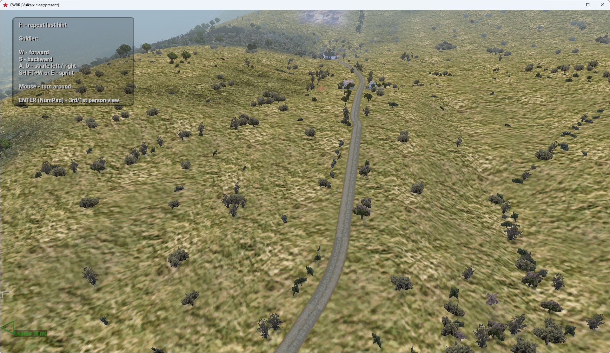 | 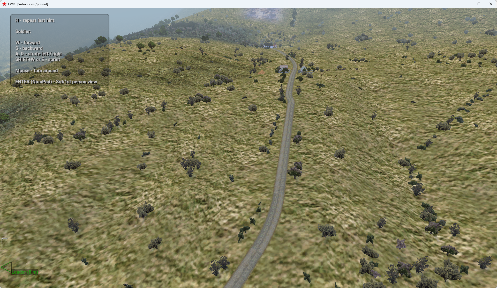 |
| Same terrain after cloud movement, position 82.358841 | 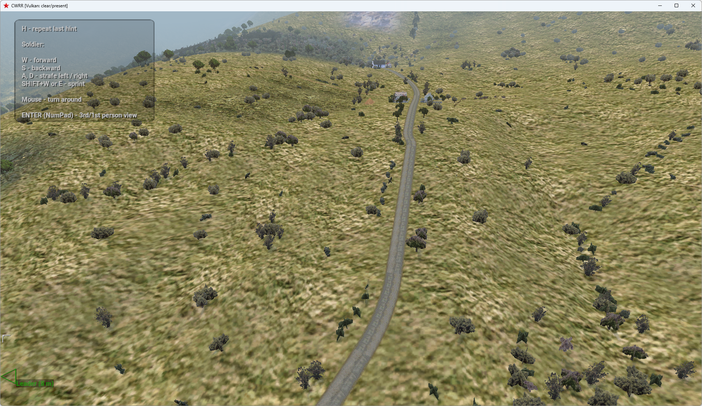 | 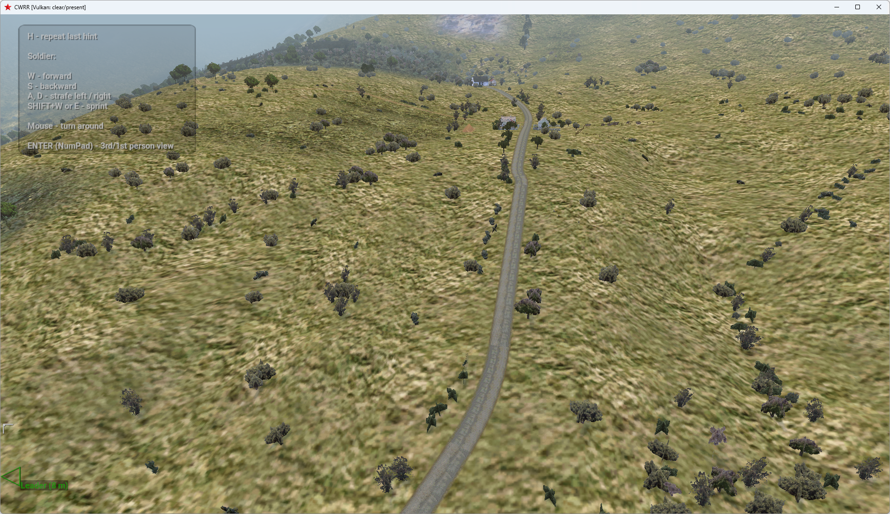 |
| Open water/cloud position 41.656162 | 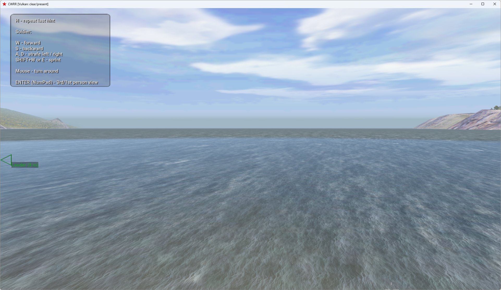 | 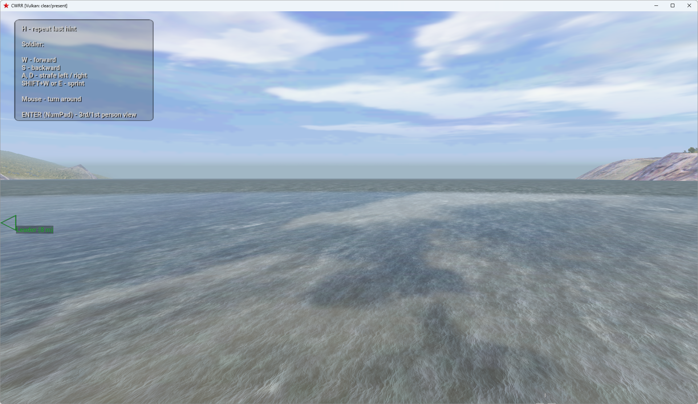 |
| Same water after cloud movement, position 62.032154 | 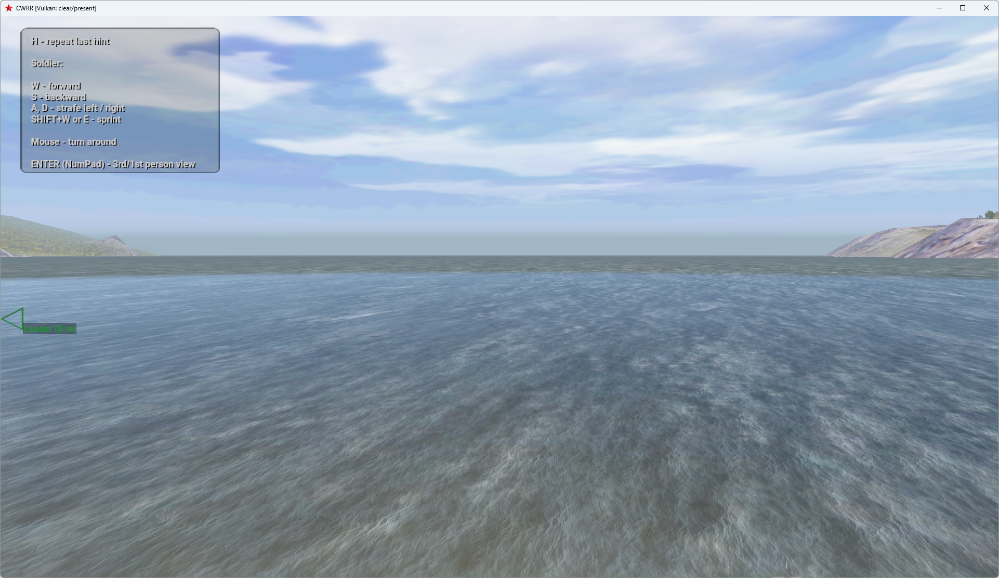 | 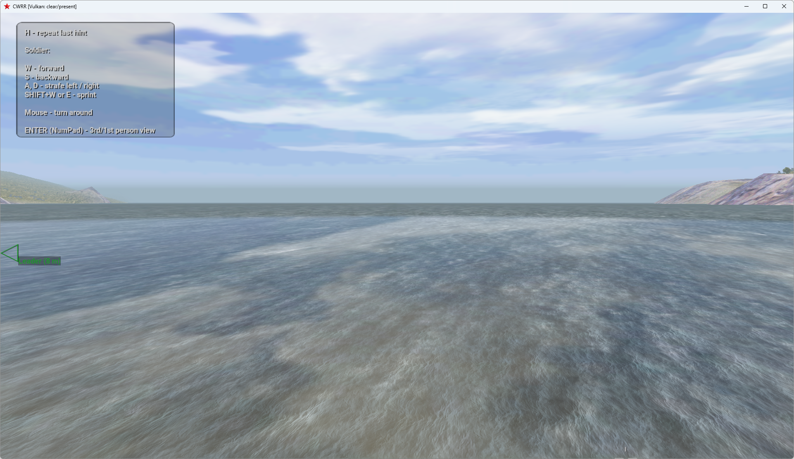 |

### Measured GPU cost

RTX 4060 Ti, driver 617.14, final executable SHA-256
`57AA133C83BF63AE4721373CEAD1C381D56C52E9F486B473E7820389864E3B22`.
Actual 1920x1080 and 2560x1440 outputs, VSync/validation off, stock Malden,
noon/overcast 0.45, fixed camera and paused simulation. Each selection warms for
three seconds, then records approximately six seconds of existing GPU timestamps.
Cloud-only terrain and sky-only open-water runs use Off/On/On/Off; combined coast
runs use Off/On for each AA mode. Values below are means of the existing two-second
whole-frame GPU intervals, not wall-frame/FPS estimates or a synthetic shader cost.
Other optional shadow/AO/volume/refraction effects are off for this timing isolation;
they were enabled together in the separate compatibility comparisons.

| Effect and AA | 1080p GPU ms Off / On | Observed delta | 1440p GPU ms Off / On | Observed delta |
| --- | ---: | ---: | ---: | ---: |
| Cloud only, AA Off, RT reflections Off | 1.695 / 1.853 | +0.158 | 1.843 / 1.978 | +0.135 |
| Sky only, AA Off, RT reflections On | 2.006 / 2.007 | +0.001 | 2.110 / 2.118 | +0.007 |
| Both, TAA, RT reflections On | 2.174 / 2.305 | +0.131 | 2.339 / 2.425 | +0.086 |
| Both, FSR Quality, RT reflections On | 2.112 / 2.125 | +0.013 | 2.215 / 2.239 | +0.023 |
| Both, MSAA 4x, RT reflections On | 2.230 / 2.262 | +0.032 | 3.087 / 3.278 | +0.191 |

For sky-only water, the existing trace/shade timestamp averages are
0.413 -> 0.450 ms at 1080p and 0.607 -> 0.613 ms at 1440p. Cloud sampling is inline
in surface shading, so it has no separate pass timestamp. These are small **observed
differences**, not a fixed hardware-independent budget: automatic graphics clocks
varied from 450-1920 MHz during the 1080p cases and 750-2850 MHz at 1440p. For example,
cloud-only clocks rose from about 450 to 540 MHz and 750 to 960 MHz respectively;
the 1440p MSAA pair stayed at 2850 MHz. Memory clocks also changed between 5001
and 9201 MHz. No clocks or persistent power settings were modified. This CPU-heavy
game can leave the GPU underclocked, and sub-0.02 ms differences are within noise;
do not infer that the feature gets cheaper as resolution rises. Initial/cache
rebuild uploads are excluded from these steady-state measurements.

### Verification and limits

Vulkan and GL33 builds pass. Focused suites pass 2,050 assertions/89 cases (Vulkan)
and 1,804/85 (GL33); driver-free policy/lifetime guards pass 444 checks, including
default-off, selector validation, independence and missing-RT behavior. Six focused
single/MS shader combinations compile and pass `spirv-val` for Vulkan 1.2.
Live Vulkan with ray-query capability disabled still casts cloud shadows and
reports sky reflections inactive. GL33 startup and both unsupported replies pass.

Core and synchronization validation remained clean through normal shutdown:
the broad Malden/Everon runs submitted 27,886/45,658 frames; final-build repeats
submitted 13,696/22,589; the non-RT-capability run submitted 1,396. All five report
zero errors and warnings. Each of the two resize/minimize-restore runs has one
submitted frame without presentation during swapchain recreation. Final Everon
also repeated CSM Off/On and TAA-to-FSR switching after resize. Frozen terrain
Off/return image crops are pixel-identical at the two published cloud epochs.
Local raw profiles, status samples, timing JSON and captures remain under the
original checkout's ignored `build/shadow-live/cloud-validation-{malden,everon}`,
`cloud-final-{malden,everon}`, `cloud-no-rt`, `cloud-gl33` and
`cloud-perf-{1080,1440}`. No stock game assets or user profiles were modified.

This is a restrained approximation, not volumetric clouds, a general environment
probe or exact reflected cloud geometry. The low-resolution maps omit vertical
billow and fine silhouette detail; cloud opacity overlaps are flattened. Sun/moon
discs and stars are not captured. Unsupported sky samples keep the old fallback;
below-horizon directions clamp to the horizon. Very low-angle sun rays can leave
the finite map and fade out.
Weather maps may cause a one-time upload/recenter hitch; their peak CPU cost is
not part of steady GPU timings. Existing RT geometry/ray-range exclusions remain.
No multi-hour flight, arbitrary mod-cloud assets, AMD/Intel GPU or physical HDR10
display qualification is claimed. All enhancements remain opt-in.

## Terrain-cache and refraction-fallback follow-up (2026-10-12)

Two narrow corrections on `138e8c4`: the volumetric terrain-shadow cache key
now includes the actual terrain subdivision grid as well as its clamped sampling
grid; Ultra (6.25 m) and Extreme (3.125 m) no longer collide at a stationary
8 m sampling cell. If optional refraction resource creation fails, AA creation
now explicitly retries after destroying the selected targets, before declaring
the swapchain ready. Attachments still required by RT reflections are retained.
The rendering algorithms, default selections and GL33 are unchanged.

Verification: Vulkan build, 434 driver-free policy/lifetime checks and 673
settings/AA/shape assertions in 49 cases passed. A temporary diagnostic build
threw immediately after water-resource creation: RT-Off recovered with neither
water nor sunlight MRT; RT-On/MSAA4 recovered with both MRTs and working RT
reflections. A frozen Malden camera logged rebuilds at the same cell `(440,405)`
for terrain grids `6.25 -> 3.125 -> 6.25`, with sampling grid/extent unchanged.
These two runs closed with zero validation errors/warnings after 7,742 and
2,395 frames. This verifies invalidation, not a quantified visual difference
from the original stale-mesh bug. All fault injection/log instrumentation was
removed before the final build. Raw evidence remains in ignored
`build/shadow-live/surgical-*` in the original development checkout.
The final uninstrumented build passed Malden Off/On/Off comparisons with RT
Off/On and AA Off/TAA/MSAA4, closing after 6,656 frames with zero validation
errors/warnings (SHA-256 `D5770564140011886B933515EC9C1DD07186F17C826B46BEA9B647C87D10D0BF`).

## Optional coastal water refraction (2026-10-12)

Built on main `db3895d`, in an isolated checkout to preserve the private
DLSS/NGX work. Default **Off**, Vulkan-only, runtime-only:

```sqf
triWaterRefraction "on"
triWaterRefraction "off"
triWaterRefraction "status"
```

No ray-query device, RT opt-in, new assets, dependencies, menus or saved settings
are required. `triRTReflections` remains independent. GL33 returns
`UNSUPPORTED: water refraction requires Vulkan`; its rendering is unchanged.
Status distinguishes the requested/active selection from this frame's actual
capture/composition, counts completed recordings, reports the last completed
GPU capture/optics intervals when profiling, and exposes resource fallback reasons.
Changing the selection recreates the existing world targets and resets AA history.

### Rendering and conservative boundaries

`Landscape::DrawRect` submits terrain, then water, then horizon/objects. Water
overwrites the depth needed to recover the bottom. On the first actual water
draw, `VulkanContext_Water.cpp` ends/resolves the world pass, draws an immutable
pre-water snapshot, then resumes the existing world pass with LOAD. The snapshot
stores already-lit, already-fogged linear HDR RGB and positive view depth in one
FP16 RGBA image. MSAA capture rejects mixed sky/depth discontinuities. It never
samples a color/depth attachment while that attachment is being written.

The existing explicit landscape-water identity, animated stock bump texture,
geometric normal and surface-depth MRT are shared with RT reflections. This
does not infer water from arbitrary specular materials. Later visible geometry
invalidates the water record, so pier decks/posts, foreground objects and
transparency are preserved. MSAA requires water coverage in **every** sample;
mixed boundary pixels retain their original resolved color.

Before RT reflections and the remaining world effects, one fullscreen blend
reconstructs surface-to-bottom optical path length from both actual depths and
the camera ray. Shallows reveal the original terrain; exponential absorption
attenuates red more than green/blue, while increasingly retaining the original
weather-lit animated water with depth. No constant bright or tropical water
color is introduced. Transmission is capped at 72% before Fresnel/depth/fog
attenuation, preserving the authored surface even in very shallow water.
Its Fresnel term matches the existing restrained RT-water curve; independently
selected RT reflections are composed afterward and are never replaced by the
bottom. Existing fog is not applied twice. Volumetric sunlight, world AA,
bloom/tone mapping and native-resolution cockpit/HUD/UI retain their boundaries.

Animated normal perturbation offsets the background by at most 2.5 internal
pixels per axis, fades to zero at contact, and rejects the entire displaced
bilinear footprint at foreground silhouettes, shorelines or large bottom-depth
jumps. An invalid offset uses the valid undistorted bottom. An invalid base
sample retains the original water. FP16 depth-rounding tolerance at contact
avoids a dark opaque shoreline ribbon. This is a subtle screen-space effect,
not a displaced water mesh or an underwater renderer.

The effect fades out between 55 and 80 m from the camera, rejects sky/missing
bottom, upward/grazing rays and paths longer than 35 m, and adds no invented
seabed. Dry views issue neither capture nor optics draws. With the feature Off,
it allocates no refraction images and issues no refraction work.

### Coastline verification

Direct developer launches of stock GOG `02Infantry.Abel` (Malden) and
`05HeavyMetal.Eden` (Everon), isolated profiles, RTX 4060 Ti 8 GB / driver 617.14,
900 m visibility. These are actual island terrain and pier assets, not smoke-test
geometry or Steam-route qualification. Off/On/Off pairs pin the same camera and
freeze simulation. Mission overlays, tree transitions and RT sampling can still
differ between captures; this is not a deterministic replay of the entire game.

| Identical camera and RT selection | Refraction Off | Refraction On |
| --- | --- | --- |
| Malden shallow beach / pier, RT Off | 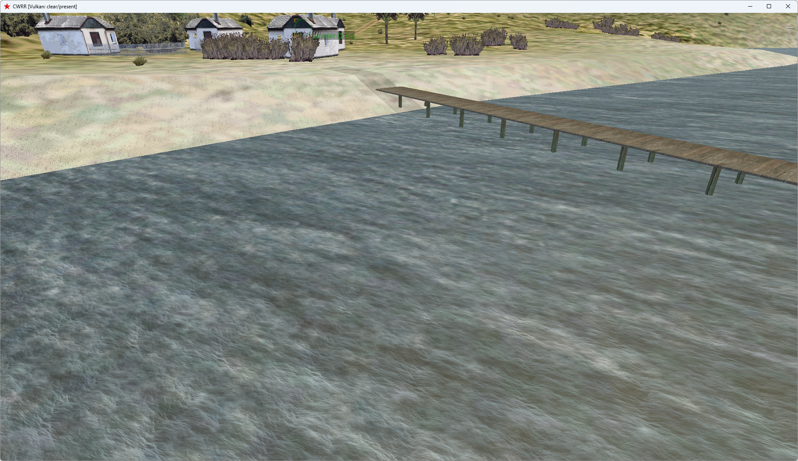 | 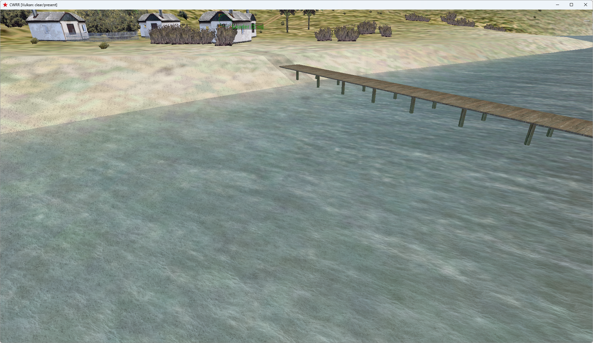 |
| Malden beach / pier, RT On | 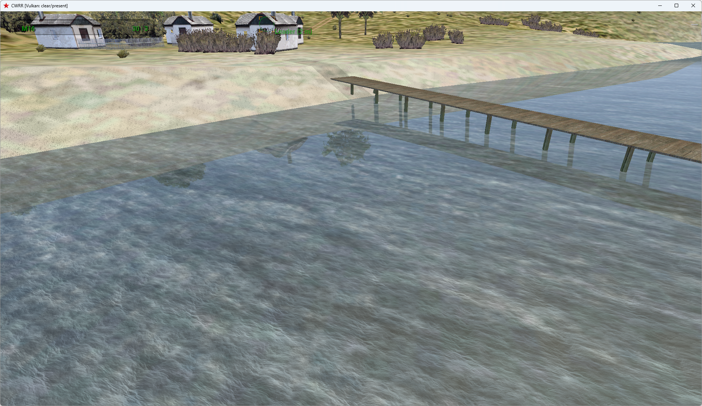 | 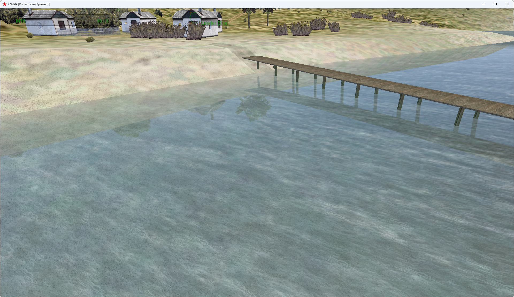 |
| Everon steep coastal bank, RT Off | 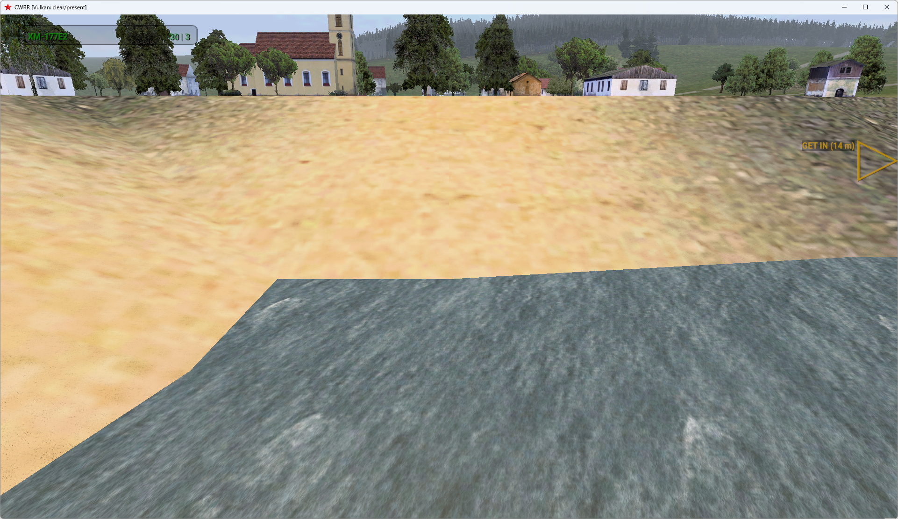 | 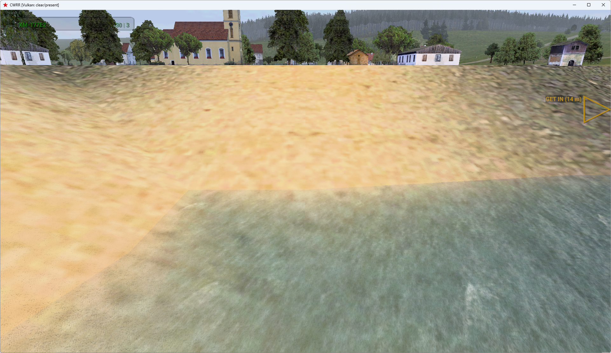 |

Malden camera `[3520,8,3240,1,-.5,.2]` and Everon
`[5100,16,3780,0,-.35,1]` use engine X/up/Z position and direction. Sand/terrain
continues visibly below the surface, loses contrast with depth, and retains
the original water animation. Pier geometry and RT pier/tree/building
reflections remain visible. Low coastal, open/deep water, dry inland and
below-water views were also checked. Malden's frozen RT-Off beach, deep and
inland Off-return captures were pixel-identical. Its below-water Off/On pair
was also identical; no new underwater behavior is provided.

Both islands exercised AA Off, FXAA, SMAA, TAA, FSR Native/Quality and MSAA
2x/4x/8x, with independent RT-Off/On comparisons, noon/dawn/night,
overcast/fog, and moving-camera sequences with animated water in Off/TAA/FSR/
MSAA4. Combined CSM, soft/contact shadows, RTAO, RT sunlight/reflections,
atmosphere, volumetrics and bloom were exercised; SSAO and sun shafts were
checked separately. Malden additionally passed odd-size resize to 1281x721
and minimize/restore. HUD and overlays remain outside water composition.
HDR requested the existing SDR fallback: FP16 composition was tested,
**physical HDR10 output was unavailable** on this display/compositor.

After fixing an initial RT double-EndRenderPass integration error, the main
Malden run closed normally after **90,564 submitted / 90,563 presented frames**,
and Everon after **34,597 / 34,597**, both with **zero core/synchronization
validation errors or warnings**. The initial failed run is retained separately,
not counted as passing evidence. Refraction also ran with `CWR_VK_RTAO` absent,
reporting zero BLAS/TLAS/rays. The GL33-only build opened the stock mission,
rendered its original coastline and rejected all three refraction commands.
The final 2560x1440 build repeated all nine AA Off/On/Off pairs without RT
capability opt-in, then closed normally after **11,478 submitted/presented
frames**, again with **zero core/synchronization errors or warnings**.

Both Vulkan+FSR and GL33-only builds passed. Focused rendering/AA/material/
texture/factory/window tests, including authorized stock PAA banks, passed
**2,011 assertions / 82 cases** for Vulkan and **1,765 / 78** for GL33.
The driver-free Vulkan policy/lifetime suite passed **431 checks** (its intentional
teardown-error fixture is not a live validation failure). Both single-sample and
MSAA variants of both new shaders passed `spirv-val --target-env vulkan1.0`.

### Measured GPU cost

RTX 4060 Ti, driver 617.14, windowed 1920x1080 / 2560x1440, same frozen Malden
beach camera, noon/clear, 900 m visibility, VSync Off. Validation was disabled
for timing; CSM, SSAO, RTAO and RT sunlight were Off. Each case warmed for 3 s,
then sampled 20 completed-frame timestamp pairs over approximately 5 s.
AA-Off cases used Off/On/On/Off at each RT selection. Whole-frame numbers are
means of the renderer's GPU log intervals, not CPU frame time or FPS.

| Resolution | AA | RT reflections | Refraction capture / optics (ms) | Sum (ms) | Whole GPU frame, refraction Off / On (ms) |
| --- | --- | --- | --- | --- | --- |
| 1080p | Off | Off | 0.118 / 0.197 | 0.314 | 1.185 / 1.546 |
| 1080p | Off | On | 0.077 / 0.136 | 0.213 | 1.674 / 1.764 |
| 1080p | TAA | On | 0.072 / 0.140 | 0.212 | — / 2.086 |
| 1080p | FSR Quality | On | 0.036 / 0.058 | 0.094 | — / 2.061 |
| 1080p | MSAA 4x | On | 0.148 / 0.225 | 0.373 | — / 2.212 |
| 1080p | MSAA 8x | On | 0.273 / 0.773 | 1.046 | — / 4.669 |
| 1440p | Off | Off | 0.128 / 0.229 | 0.357 | 1.411 / 1.630 |
| 1440p | Off | On | 0.102 / 0.168 | 0.270 | 1.896 / 2.035 |
| 1440p | TAA | On | 0.117 / 0.179 | 0.296 | — / 2.483 |
| 1440p | FSR Quality | On | 0.032 / 0.068 | 0.100 | — / 2.054 |
| 1440p | MSAA 4x | On | 0.292 / 0.342 | 0.634 | — / 3.645 |
| 1440p | MSAA 8x | On | 0.562 / 1.353 | 1.915 | — / 8.237 |

FSR Quality uses 1280x720 / 1706x960 internal buffers. Automatic graphics clocks
ranged from 615–2850 MHz across the 1080p cases and 930–2850 MHz at 1440p;
they were **not locked or modified**. Thus the whole-frame Off/On difference
is not an isolated incremental cost, and lower pass times with RT On reflect
different clock states. Capture timing includes the pre-water end/resolve and
resume boundary. These direct pass timings do **not** include the extra raster
MRT bandwidth when RT reflections were previously Off. Conservative all-sample
depth/coverage checks make MSAA 8x materially more expensive. This is one GPU,
one coastal workload, not a general performance guarantee.

Timing evidence: `refraction-perf1080/refraction-perf.json` and
`refraction-perf1440/refraction-perf.json`. Final Vulkan executable SHA-256:
`A0F48D64A4E546F741A6211314E86F76EE4EE12B4ED361C2DB02DE285FD4FDE6`.

### Limitations

- Legacy ocean-only tiles and texture-index-zero cells omit bottom geometry.
  They retain original water. Bottoms outside the captured view, deeply submerged
  terrain and objects drawn after water cannot be reconstructed. Submerged pier
  extensions are not fabricated; visible foreground pier geometry is preserved.
- Forced `--sw-tl` startup fails **before enabling this feature** on both this
  build and the unchanged main executable with `unsupported flags 0x1000000`
  in the existing terrain software material path. Runtime PAUSE also leaves
  native-centered terrain segments unusable in the forced software view.
  The shared software-water identification/projection hook is wired where valid,
  but full forced-software refraction is **not qualified**; no legacy material,
  cache or draw-order restructuring was added to claim support.
- At mixed MSAA coverage, conservative original-color pixels can remain along
  a thin shoreline edge. Temporal modes retain their existing reactive-water
  treatment; no separate refraction history or promise of shimmer-free water
  is introduced. Native coarse coastline triangulation and pre-existing tidal/
  dawn shoreline changes remain visible.
- One snapshot per swapchain image adds about 47.5 MiB at 1080p or 84.4 MiB at
  1440p for three images. With RT reflections Off, the existing water/sun MRT
  pair is also enabled: total additional image storage is about 142.4/253.1 MiB
  at 1x, and grows with MSAA. With RT reflections already On, that pair is reused.
  No resources are persisted across shutdown.

Raw profiles, actions, screenshots and failed-attempt evidence are retained under
ignored `build/shadow-live/refraction-*` in the original development checkout;
the representative unedited screenshots above are committed with this document.

## Optional contact-hardening CSM (2026-10-12)

Built on `28139f7`; the existing contact-shadow, RT, volumetric and MSAA fixes
remain in place. Default **Off**, runtime-only and Vulkan-only:

```sqf
triSoftShadows "on"
triSoftShadows "off"
triSoftShadows "status"
```

No hardware RT or `CWR_VK_RTAO=1` requirement. No new menu, saved setting,
dependency, shadow map, fullscreen pass, history or denoiser. Status reports
the switch, current CSM/source availability, sampling budget, radius cap and
the explicitly unchanged hard-RT behavior. Toggling resets ordinary world-AA
history but does not recreate render targets. Enabling this does not enable
CSM, RT or `triContactShadows`; these remain independent controls.

### Surface filtering and lighting

`shadow_sample.glsl` retains the existing cascade selection, coverage
fallthrough, quadratic cascade bias, 15% transition bands and far fade. Off
executes the original nine nearest-depth comparisons and their original
arithmetic. On adds a bounded directional-light PCSS-style branch:

- Search 13 depths: the original 3×3 footprint plus four wider light-space
  probes. The wider search targets 60 cm, limited to 1–8 shadow texels. No
  blockers returns lit; small estimated penumbrae reuse the original 3×3 result.
- Recover UV/metre and depth/metre from the lengths of the orthographic
  light-matrix rows. Average positive receiver-to-blocker depth separation is
  converted to metres, then multiplied by `tan(sun radius) = 0.007` (about
  0.4 degrees). This is a modest gameplay-tuned sun size, not a calibrated
  physical area-light solution. Cascade depth padding does not set softness.
- Clamp the resulting filter radius to 1–8 texels. Smoothly transition from
  the contact filter over the first two texels, avoiding a kernel switch at
  the threshold. Larger penumbrae use eight fixed disk positions, each with
  a four-depth gather and bilinear comparison weights: at most 21 texture
  operations / 45 fetched depth values per sampled cascade. Cascade blending can
  sample two cascades. The initial sparse search could miss narrow casters;
  retaining the complete 3×3 neighborhood fixed that during tuning.
- Derive receiver-plane gradients before divergent cascade selection. Correct
  each comparison's receiver depth while retaining the original base bias;
  bound correction to max(2×bias, 5 cm in light-depth units). Narrow kernels
  near map edges and clamp footprints inside the map so the white sampler
  border cannot become a spurious penumbra light source.

The pattern is fixed in light space with the existing snapped cascade maps;
there is no frame-varying noise. World AA sees the result normally, including
jittered TAA/FSR input and MSAA. Resolution is the actual CSM texel size, not
the screen/output resolution.

Soft surface shadows use the existing separated-direct-sun lighting path,
including CPU-lit terrain, without requiring a sunlight MRT. Ambient, local
lights and emissive terms are not passed through the soft filter. This matters
visually: the original non-RT legacy CSM path attenuates the whole surface;
the sunlight-only branch can have **lighter shadow interiors**, especially
on ambient-heavy terrain/foliage. The comparisons therefore show both the
penumbra change and this existing lighting-path distinction, not just a blur.
Off restores the legacy path exactly; RT-enabled lighting keeps its existing
separation. Water, blended/unsupported sunlight receivers and volumetric
scattering keep their original shadow sampling. Night/zero-source/full-overcast
use the original path, with no additional soft filtering or sun separation.

### Hybrid RT and contact shadows

At the time of this PCSS milestone, raw RT visibility/reduction and its
off-screen caster coverage were unchanged. Existing conservative
`min(CSM, RT, contact)` composition remains;
there is no multiplication of independent darkening factors. A hard RT result
can dominate the softer CSM edge. This PCSS milestone itself adds neither
multiple area-light rays nor RT denoising; the later independent
`triSoftRTShadows` option is documented at the top of this file.
Disable RT sunlight to inspect the CSM penumbrae independently. Short-range
screen-space contact shadows remain separate and can reinforce feet/tracks
without widening their own rays or changing their sampling budget.

### Gameplay evidence and checks

Muted, isolated developer launches used stock GOG 3.05 missions
`02Infantry.Abel` (Malden) and `05HeavyMetal.Eden` (Everon), not a Steam-route
or mission-completion qualification. Final tested executable SHA-256:
`99edc54f9e95e9e57ca08d524fb8f94ee2f4bb1ff2a27a21adc3b131eb1f94d7`.
Subsequent source changes to the tested implementation are comments only.

Frozen Off → On → Off views cover soldiers, jeep wheels, tank tracks, building
edges, fences, poles, bushes, forest floor and terrain. Tested noon, 06:00,
18:00, full overcast and midnight; CSM and RT sunlight independently Off/On;
AA Off, TAA, FSR Quality, MSAA 2/4/8; separate contact shadows; SSAO/RTAO,
atmosphere/volumetric fog and water reflections. The Malden water run reported
96,994 shaded reflection hits in the sampled completed frame, not merely an
enabled toggle. Actual walking inputs moved the player on both islands;
camera sweeps and distance sweeps crossed the leading approximately 20/50 m
omni-cascade transition regions. Also checked CSM resolutions 1024/2048/4096
and odd 1281×721 resize/minimize/restore.

Native-resolution crops, with no brightness enhancement; RT sunlight and
screen-space contact shadows are Off in these pairs:

| View | Original CSM | Soft CSM |
|---|---|---|
| Malden dawn building edge | 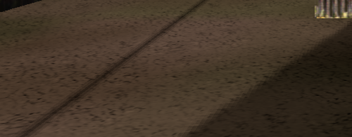 | 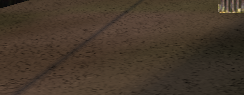 |
| Everon dawn forest floor | 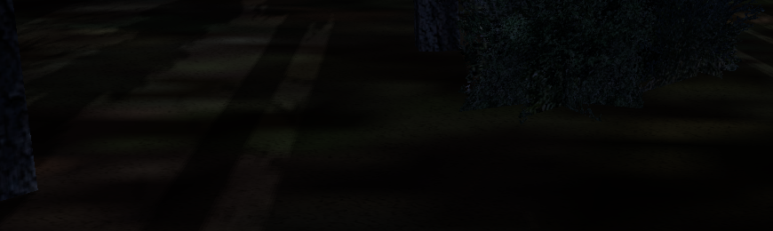 | 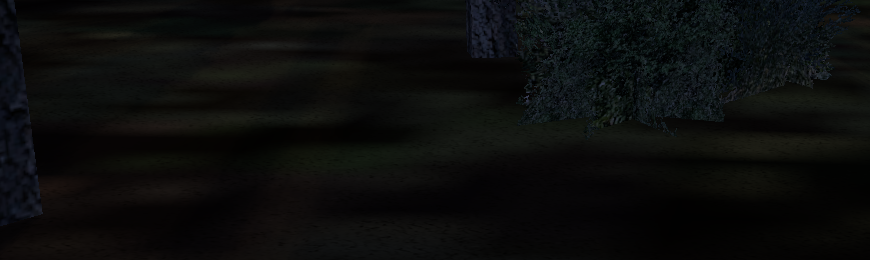 |
| Everon noon track contact | 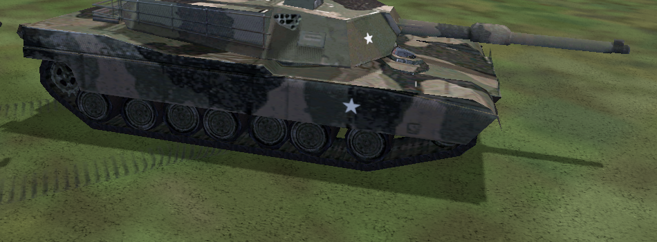 | 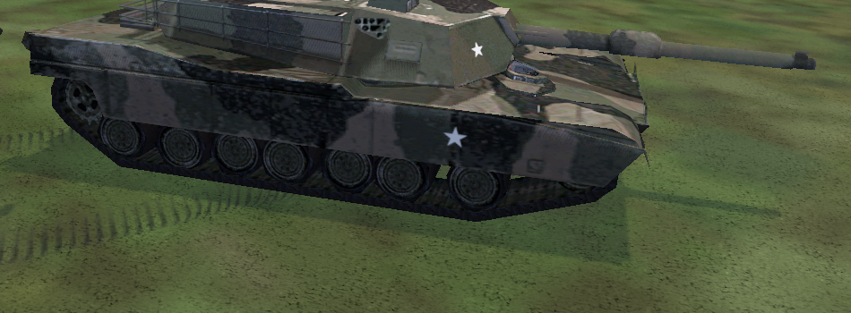 |

Raw local captures, action receipts, hashes, status responses and logs are
under the original checkout's `build/shadow-live/soft-malden-final` and
`soft-everon-final`. Final validation/synchronization-validation shutdowns:

- Malden: 23,372 submitted / 23,371 presented; **0 errors, 0 warnings**.
- Everon: 60,160 submitted / 60,158 presented; **0 errors, 0 warnings**.
- Fixed 1800×550 scene crops returned pixel-identically after disabling the
  effect in the Malden village/dawn/noon and Everon forest/dawn comparisons.
  Night, full overcast and CSM-Off views (RT independently Off/On) also had zero
  Off/On changed pixels in those checked regions. This excludes changing UI
  and does not claim arbitrary full-frame temporal-AA bitwise equality.
- Cross-executable check against the original `28139f7` build: a fixed
  730×80 terrain region was pixel-identical with this feature Off, both with
  CSM enabled and disabled. The larger cross-launch view was not identical
  (moving scene/UI elements); this is a scoped check, not a full-frame claim.

The stale system Epic overlay manifest still emits a loader message, separate
from the zero live validation counters. Vulkan+FSR and Vulkan-disabled GL33
builds passed. Focused results: **425** driver-free policy/lifetime checks,
**949 assertions / 67 cases** for shader/shadow-math/Vulkan-shape tests, and
**909 assertions / 66 cases** in the GL33-only equivalent. The policy suite's
deliberately injected teardown validation error is expected. New tests cover
default/invalid/independent controls, sun-source gating and the actual shared
GLSL penumbra scalar math (contact floor, cap, monotonicity and cascade units).
The GL33-only executable also returned `UNSUPPORTED: soft shadows require
Vulkan` for all three runtime commands.

### Performance

RTX 4060 Ti, driver 617.14; validation disabled for timings. Fixed Malden
village camera, CSM 2048, AA Off, 100% render scale, VSync Off, RT/contact/AO/
volumetrics Off. No RT opt-in environment variable was present; status showed
zero BLAS/TLAS/instances. Two Off/On cycles per condition, each with four
seconds settling and eight seconds measurement (four existing two-second
GPU profiling windows). Each table cell is the median of eight windows.

| Actual world/output extent | Sun | Original CSM, ms | Soft CSM, ms | Observed whole-frame delta |
|---|---|---:|---:|---:|
| 1920×1080 | Noon | 1.592 | 1.659 | +0.067 ms / 4.2% |
| 1920×1080 | Dawn | 1.609 | 1.692 | +0.082 ms / 5.1% |
| 2560×1440 | Noon | 1.848 | 1.925 | +0.077 ms / 4.1% |
| 2560×1440 | Dawn | 1.867 | 1.956 | +0.090 ms / 4.8% |

These are **whole-frame GPU timestamps, not isolated PCSS cost**. Automatic
GPU clocks increased with the added load: 1080p noon 1155→1365 MHz, dawn
1230→1500 MHz; 1440p noon 1680–1695→1995 MHz, dawn 1725–1785→2130–2145 MHz.
Memory clocks were stable within each resolution (5001 / 9201 MHz reported).
Consequently the observed delta understates added work at equal clocks; no
fixed-clock cost or cross-GPU performance claim is made. The unchanged CSM
depth pass also became faster with higher clocks. All sampled windows reported
zero allocations/frame. There is no separate soft-shadow pass or new image
memory. The 1440p window's actual render/output extent was verified by status
on a 1080p desktop; this is not a native-1440p display-quality qualification.

Raw profiling windows and clock readings are retained locally in
`build/shadow-live/soft-perf1080` and `soft-perf1440` in the original checkout,
as `soft-timing.json` and `soft-timing-dawn.json`.

### Limitations

This is a small-budget shadow-map approximation. The average blocker can mix
several caster depths; the bounded search can miss thin distant blockers and
the eight-texel cap deliberately limits very long low-sun penumbrae. Existing
CSM caster coverage, rasterization bias, resolution and foliage alpha/LOD
limitations remain. The contact floor and transition bands preserve detail
but cannot make different cascade resolutions identical. Camera sweeps did
not reveal new gross seams or frame-noise crawling in the checked views;
subpixel foliage/fences can still alias with AA Off, and existing temporal AA
has its own motion limitations. Ambient-heavy scenes can show a larger change
in shadow intensity than penumbra width, as explained above. Hard RT edges
remain hard. These checks do not establish artifact-free rendering for every
mod, grazing angle, GPU or extreme shadow tuning.

## Optional screen-space contact shadows (2026-10-12)

Built on `8b25bd1`, including the volumetric/MSAA follow-up below. Default **Off**:

```sqf
triContactShadows "on"
triContactShadows "off"
triContactShadows "status"
```

Vulkan only; **no `CWR_VK_RTAO=1` or hardware ray tracing requirement**. GL33
returns `UNSUPPORTED` without changing rendering. There is no menu, persistent
setting, new SDK, scene database, denoiser, or separate temporal history. Status
reports requested/active state, whether the last world drew, cumulative draws,
sunlight source, actual world extent and fixed ray parameters. Changes take
effect at the next frame's ordinary resource recreation and reset world AA
history. Independent MRT blending is required.

### Implementation and tuning

`VulkanContext_Contact.cpp` draws one full-resolution triangle using existing
world depth and the separated-sunlight MRT. `contact_shadows.frag` reconstructs
camera-space positions from the actual depth texture extent, pixel centers,
projection and current projection jitter. The engine's current sunlight vector
is transformed through the camera rotation; no guessed screen-space direction
or output-resolution assumption is used. The existing atmosphere frame carries
these inputs even with atmosphere/volumetric effects disabled.

There are 16 deterministic uniform samples over a 1.2 m ray. The origin moves
2 cm along a depth-derived normal and 1 cm toward the sun. A bounded 16–20 cm
view-depth slab, a near-hit ramp, receiver-plane height confidence (fade from
20 to 50 cm), and diminishing confidence along the ray suppress self-hits and
detached silhouette bands. Contact fades at grazing receivers, within 3.5% of
screen edges, and between 25 and 40 m from the camera. Off-screen samples stop
the ray. These are gameplay-tuned heuristics, not geometric ray intersections:
an initial thinner slab missed feet; longer/nonuniform steps produced separated
pole marks, and raised tank hulls needed the receiver-plane confidence guard.

Opaque/cutout raster depth includes animated soldiers without adding them to an
RT scene. Receiver capture excludes water, blended surfaces and unsupported
legacy lighting paths. The shared `sunlight_depth.glsl` retains the existing RT
MSAA coherence guard: reject mixed background/depth/light samples instead of
subtracting a full sample's sunlight from resolved foreground color.

Only the extracted direct-sunlight contribution is subtracted. Contact-only
capture preserves the original legacy CSM scene result, including its existing
ambient/fog behavior, wherever no additional occlusion is found. Visibility is
`min(CSM, RT, contact)`, not multiplied darkening: when RT sunlight runs, the
contact triangle takes the componentwise maximum of its sunlight reduction and
the existing raw RT reduction, replacing the RT sunlight composition triangle.
RT still supplies hidden/off-screen casters and longer shadows. Without RT, the
same pass runs independently, before AO, reflections, volumetrics and world AA;
it does not darken local lights, emissive/ambient terms, scattering, sky or UI.

No fullscreen contact draw or sunlight capture runs when the engine's current
sun source is below 0.001 or sun color is negligible (including tested full
overcast/night). While enabled, the shared sunlight attachment remains allocated
and cleared even then. Off creates no contact pipelines/descriptors, requests no
additional sunlight target and submits no contact draw. Enabling it without an
existing sunlight MRT adds an 8-byte-per-sample world attachment: about 47.5 MiB
at 1080p or 84.4 MiB at 1440p for three single-sample swapchain images, multiplied
by MSAA sample count. No contact result image/history is allocated.

### Gameplay evidence and regression checks

Local muted developer launches used stock GOG 3.05 content, isolated profiles,
Malden `02Infantry.Abel` and Everon `05HeavyMetal.Eden`. This is gameplay/render
qualification, not a Steam launch or mission-completion claim. Frozen cameras
were compared Off → On → Off; physical input also moved soldiers approximately
10 m on Malden and 16 m on Everon. Checked feet, jeep wheels, tank tracks,
buildings, walls/fences, poles, bushes and forest floor at noon, 06:00, full
overcast and midnight; CSM/RT sunlight independently Off/On; AA Off, TAA, FSR
Quality and MSAA 2/4/8. Volumetric fog, atmosphere, SSAO/RTAO and RT water
reflections were exercised, plus 1281×721 resize and minimize/restore.

Native-resolution crops below are from the final shader, identical frozen
Off/On cameras with CSM and RT sunlight Off so the added short contact is visible.
No brightness adjustment or enhancement was applied.

| View | Off | On |
|---|---|---|
| Malden boots |  | 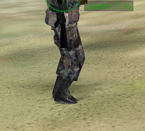 |
| Everon tracks | 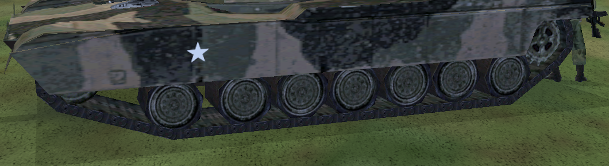 | 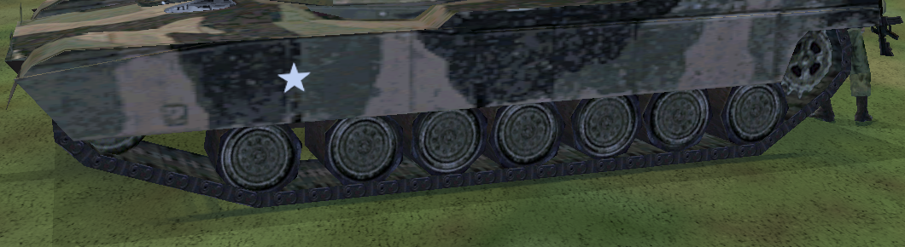 |

Final executable SHA-256:
`36bcb2609eb622b6572d09b60923ffb4c98891218fa8595b0bfea6c4218bb78a`.
Local raw captures, command receipts, launch hashes and logs are under
`build/shadow-live/` in the original `cwr-vulkan` checkout:

- `contact-malden-final`: broad Malden matrix during tuning, 32,409 submitted /
  32,408 presented, zero Vulkan validation errors/warnings. The final receiver
  confidence adjustment was subsequently rechecked on Malden in
  `contact-perf1080` (feet, village, vegetation, no RT opt-in).
- `contact-everon-v2`: final shader, complete Everon AA/weather and tank/CSM/RT
  pairs, forest fog and camera motion; 20,655 submitted/presented, zero errors
  or warnings. Frozen tank-region Off-return differences were zero with CSM
  Off, CSM On and RT On; full-overcast/night Off/On differences were also zero
  in that region and status reported no contact draw.
- `contact-combined1440`: final shader, all AA modes with CSM, RT sunlight,
  RTAO and volumetrics enabled, walking, forest fog and odd resize/minimize;
  34,478 submitted / 34,477 presented, zero errors/warnings.
- `contact-baseline` versus `contact-perf1440`: pre-change `8b25bd1` executable
  versus new executable with contact Off at 1281×721, CSM Off and On. The fixed
  1040×240 terrain crop was pixel-identical in both cases. Whole frames were
  **not** identical (NPC/cloud/UI changes and a few building pixels); this is
  not a claim of full-frame cross-process bitwise equivalence.
- `contact-gl33`: Vulkan-disabled build; all three commands returned unsupported.

The system's stale Epic overlay manifest emitted a loader message; the Vulkan
validation and synchronization-validation counters above remained zero. The
policy test's deliberately injected teardown validation error is an expected
driver-free test, not a live validation failure.

Vulkan+FSR and GL33-only builds passed. Focused Vulkan policy/lifetime suite:
417 checks; shader/shadow-math/Vulkan-shape suite: 931 assertions in 66 cases;
GL33-only equivalent: 891 assertions in 65 cases. Added coverage includes
default/deferred/invalid controls without a ray scene, shared MSAA sunlight
policy, and projection/jitter round trips at native, scaled and odd extents.

### Measured GPU cost

RTX 4060 Ti, driver 617.14, VSync Off, AA Off, 100% scale, RT opt-in absent,
validation disabled for timing. Fixed Malden village view
`[7116,73,6085,-1,-0.1,-0.2]`, view distance 900, noon/clear/fog zero. Each state
had 3 s warm-up and 8 s measurement; entries are medians of four 2 s profiling
windows. Contact timestamps bracket the march/composition and are read after
the existing frame fence (no new wait). Raw data: `contact-perf1080` and
`contact-perf1440/contact-timing.json` (each run has its own JSON).

| Actual world extent | CSM | Contact pass ms | GPU frame Off → On ms |
|---|---|---:|---:|
| 1920×1080 | Off | 0.512 | 1.201 → 1.680 |
| 1920×1080 | On | 0.405 | 1.576 → 1.716 |
| 2560×1440 | Off | 0.583 | 1.669 → 1.959 |
| 2560×1440 | On | 0.451 | 1.730 → 1.914 |

All measured steady-state windows reported zero allocations/frame. These are
not locked-clock benchmarks: sampled graphics clocks rose from 795–1110 to
1275–1665 MHz at 1080p, and 1245–1755 to 2010–2580 MHz at 1440p; memory clocks
also changed. Consequently frame subtraction understates the isolated pass
cost and the resolutions are not directly scaling-comparable. The contact
timer excludes sunlight-MRT capture overhead; whole-frame timing includes it.
1440p used a verified 2560×1440 world/output extent in an oversized window on
the 1080p desktop, not a full-monitor 1440p visual inspection. MSAA, other GPUs
and denser scenes can cost more; the table is not a universal FPS promise.

### Remaining limitations

Only the frontmost screen depth is known. Hidden/off-screen casters cannot cast
contact shadows, and edge/distance fades deliberately lose them. Thin fences,
foliage and subpixel geometry can alias or miss steps with AA Off; TAA/FSR use
only the existing world history. Mixed MSAA pixels and grazing/raised surfaces
are intentionally conservative and may lose detail. The final tuning removed
the observed detached tank-front band and avoided broad dark halos in the
tested views, but does not establish artifact-free motion for arbitrary assets,
camera angles or mods. This is short contact reinforcement, not a replacement
for CSM/RT or an attempt to synthesize full-length soldier/building shadows.

## Focused MSAA and volumetric CSM follow-up (2026-10-12)

Built on `64a7c1c`. Four narrowly scoped corrections:

- RT sunlight's post-resolve subtraction now rejects ambiguous MSAA pixels.
  All samples must have valid, coherent view depth and sunlight records; the
  depth tolerance is max(2cm, 0.2% of depth), and sunlight channels tolerate 2%
  with a 0.0001 floor. This permits small slopes but falls back to ordinary CSM
  at discontinuities instead of subtracting one sample's full sunlight from an
  averaged color. This is conservative rejection, not per-sample ray tracing;
  steep slopes/material boundaries can lose the optional correction.
- RT water requires every MSAA sample to carry water. The shared `waterAt`
  guard runs in tracing and final composition, including filter neighbors, so
  filtering cannot refill rejected water/foreground pixels. Mixed pixels retain
  ordinary water/foreground rendering. Full-water pixels retain their blend,
  excluding rejected neighbors; the single-sample path is unchanged. Both
  guards cover MSAA 2x, 4x and 8x; RTAO is unchanged.
- Volume-only CSM demand and terrain submission share the scattering draw's
  source threshold (0.001) and valid-fog-range predicate. Current-frame source
  data already includes weather, sun elevation and night vision. Independently
  enabled surface CSM still requests its maps and retains its existing night
  gate; a zero volumetric source does not disable surface shadows.
- The terrain patch is now an immutable cached mesh, uploaded only when its
  landscape/grid/cell/radius key changes. Vertices are relative to a stable grid
  origin; each cascade incorporates origin-minus-camera translation into its
  existing matrix. No per-frame combined-caster copy, terrain translation loop,
  or terrain upload remains. Existing frame-held mesh ownership protects old
  patches during replacement. The same bounded, double-sided geometry is drawn
  separately, adding one draw per cascade. Maximum geometry is still 270,000
  vertices / 3,240,000 bytes at 600m and 8m cells; cache-boundary rebuilds and
  their allocations remain. This does not claim a measured end-to-end CPU/FPS
  improvement or eliminate ordinary object caster collection.

Verification: Vulkan/FSR and GL33-only builds pass; all twelve AO/sun/water shader
variants compile. Driver-free policy/lifetime tests pass **412 checks**. Focused
`[Shaders],[ShadowMath],[vulkan-shape]` tests pass **893 assertions / 66 cases**
with Vulkan and **889 / 65** in GL33-only. Tests compile the shipped scalar
coverage predicates, cover partial coverage at 2x/4x/8x, pin final water-filter
rejection, test the common source threshold and verify cached terrain matrix
translation. The broader `[Graphics]` run has **13 PAA/DDS failures and one
stock-data skip**, reproduced with the unchanged pre-fix `35f7658` build; these
are not counted as passes or changed in this fix.

Live evidence is under `build/shadow-live/surgical-fixes-v1` (Malden, 1080p) and
`surgical-everon-v1` (Everon, 2560x1440 attachments in an oversized desktop
window). Malden exercised foggy dawn, noon water/pier reflections, overcast,
night, cache-cell-crossing movement, volume Off/On, MSAA 2x/4x/8x, Off/FXAA/SMAA/
TAA/FSR Quality, odd resize and minimize/restore with all three RT effects.
Overcast reported zero sunlight/scattering and no CSM with surface CSM Off;
turning surface CSM On retained ready maps without enabling scattering.
Malden closed after **17,452 submissions / 17,451 presentations, zero Vulkan
validation errors or warnings**. Everon exercised MSAA 8x, AA Off and TAA with
all RT effects, dawn forest scattering and camera translation/rotation; it
closed after **15,614 submissions/presentations, zero errors or warnings**.
Its frozen-camera volume Off/On/Off sequence restored the compared 1600x850
world-image region exactly (zero differing pixels). Pixel-level MSAA correctness
is established
by the source/math regression checks; these captures are gameplay smoke checks,
not an exhaustive before/after silhouette comparison. Earlier GPU benchmark
tables below describe the original implementation, not this optimization.

## First CSM volumetric sunlight and fog (2026-10-12)

Built on public `35f7658`, default **Off**, Vulkan only. Process-local commands:

```sqf
triVolumetricFog "on"
triVolumetricFog "off"
triVolumetricFog "status"
```

No ray-tracing device, startup opt-in, SDK, persistent setting or menu is required.
GL33 returns unsupported. Status separates the request, allocated resources and
last scattering draw, and reports completed recording count, sunlight weight,
fog interval, CSM reach and actual half-resolution dimensions. Changes use the
existing idle/recreation boundary and invalidate world temporal history.

### Rendering and integration

`EngineVK::UpdateAtmosphere` supplies the camera basis, direction toward the sun,
eye-adapted engine diffuse sunlight, fog color and original fog interval. Source
strength follows `NightEffect`, `SkyThrough` squared and a smooth low-sun elevation
fade; night vision disables it. No fog or mission visibility values are written.
The homogeneous scattering density is `1 / (fogEnd - fogStart)`. The legacy
clear-distance offset remains a visibility control, not an empty sphere of air:
scattering can occur between the viewer and nearby trees. Analytic Beer-Lambert
segment weights and a Henyey-Greenstein phase function (`g=0.55`) approximate
single scattering. Added luminance is bounded to 30% of the original fog-color
luminance, scaling RGB together to retain the sun hue. The existing fog color,
transmittance and lighting calculation remain in their original shaders; there
is no second fog blend or additional attenuation of scene color.

One FP16 target per swapchain image is half the **world input** dimensions, rounded
up. Each pixel marches 48 spatially jittered samples, bounded by the nearest depth
in its 2x2 footprint and 400 metres. MSAA variants take the nearest covered sample.
Every sample uses current camera-relative CSM matrices, sphere/frustum tier
selection, four depth comparisons and cascade transition bands. Unknown coverage
contributes no sunlight rather than assuming open sky. The volumetric comparison
uses a small air-sample bias, independently of the surface receiver's darkness
and larger bias. Spatial noise breaks coherent march bands without a separate
volumetric history, denoiser or full-resolution fallback march.

A four-tap joint bilateral upsample uses stored view depth and the full-resolution
world depth. Unmatched silhouette samples contribute zero instead of background
light leaking over foreground geometry. Additive RGB blending preserves scene
alpha and writes the existing resolved FP16 world color in its LOAD pass. This
runs after world/AO/RT composition and before TAA or FSR, spatial AA, bloom and
tone mapping. TAA/FSR therefore reconstruct the completed scattering with their
existing history rejection. Cockpit, weapon, HUD, map and UI remain after this
boundary. There is no change to the RT scene, ray-query shaders or AA algorithms.

`NeedsSunShadowDepth` defaults to the existing surface-CSM selection. Vulkan can
also request depth for volumetrics while preserving that surface selection and
projected shadows. The existing caster collection provides buildings, objects,
cutout foliage and other supported casters. It previously contained no terrain:
while volumetrics is active, Vulkan appends a two-sided landscape patch sampled
from `SurfaceY`. Its radius is `min(CSM far + 100m, 600m)` and cell size is at least
8m (or the coarser current terrain grid). The follow-up above caches a grid-local
mesh until the camera crosses a cell or the landscape/grid/radius changes, and
applies camera translation through each cascade matrix instead of the vertex
stream. No second shadow-map system is added.

When a volumetric draw runs, the existing screen-space sun-shaft draws are
suppressed. Their requested setting survives; status reports
`suppressed=volumetric-fog`. With volumetrics Off, their original behavior resumes.
Off allocates no volumetric images, submits no volume draws and requests no extra
CSM or terrain work. Resources use the existing idle swapchain teardown and
frame-fenced uniform allocator. Profiling adds two queries to the existing frame
query pool, read after its fence, with no synchronous GPU wait.

### Gameplay and regression evidence

Tests used isolated stock GOG 3.05 missions and profiles, muted direct developer
launches, RTX 4060 Ti / driver 617.14. These are renderer qualification runs, not
Steam launch qualification or completed missions. Local screenshots, executable
hashes, evaluator actions and logs are under `build/shadow-live/volume-*` in the
original checkout; no stock mission or asset was edited.

- Malden `02Infantry.Abel`: frozen Off/On village, hillside and forest comparisons;
  dawn, noon, sunset, overcast and night; camera translation/rotation; Off, FXAA,
  SMAA, TAA, MSAA 2/4/8 and FSR Native/Quality/Balanced/Performance. FSR dispatches
  and actual reduced input dimensions were verified. Combined RTAO, RT sunlight,
  water-reflection, atmosphere, bloom and sun-shaft selections were exercised,
  including a shoreline view. Resize to 1280x720 and minimize/restore passed.
  `volume-malden-v3` closed after 14,818 submitted / 14,817 presented frames with
  zero core/synchronization validation errors or warnings; one presentation was
  interrupted by recreation.
- Everon `05HeavyMetal.Eden`: the forest at camera `[6750,86,5360]`, direction
  `[1,.03,0]`, July 5 at 06:00, fog `.65`, shows distinct warm shafts through the
  trunks. Foreground trunks remain dark and occlude the light. Off/On/Off with AA
  Off restored the 1600x900 world-image comparison region exactly (zero differing
  pixels); HUD/window chrome were excluded. Translation/rotation sequences with
  AA Off and TAA showed no obvious long trails in the inspected frames. Assisted
  placement followed by physical forward input moved the player about 25m through
  the real forest with live simulation and visible scattering. Noon, overcast,
  night, sunset and dawn were also compared. `volume-everon-v3` closed after 29,536
  frames with zero validation findings, without ray-tracing startup opt-in.
- Night reported no CSM/scattering and its tested Malden Off/On image region was
  identical. Full overcast reported zero source weight and no scattering draws.
  Temporally reconstructed comparison images are not generally pixel-identical
  across toggle/reset boundaries; only the specific stable comparisons above are
  claimed as exact matches.
- The final binary's `volume-final-validation` run covered a 2560x1440 drawable,
  FSR Quality with RT effects/bloom, resize/minimize/restore to 1281x721, SMAA at
  150% (1922x1082 world / 961x541 volume), MSAA 4x and returning to volume Off.
  It closed after 23,942 submitted / 23,941 presented frames with zero validation
  findings. A stable AA-Off comparison of both shaft selections versus volume
  alone was identical in the 1600x850 world-image region excluding the HUD;
  status confirmed screen-space shafts were suppressed. The GL33-only build
  also rendered stock infantry, returned unsupported for all three volume
  commands and closed normally (`volume-gl33`).
- Vulkan and GL33-only RelWithDebInfo builds passed. Focused
  `[vulkan-shape],[ShadowMath],[Conventions],[ShutdownOrder]` suites passed 76 cases /
  831 assertions with Vulkan and 75 / 827 with GL33 only. The driver-free Vulkan
  policy/lifetime suite passed 394 checks, including default-Off, deferred
  enablement and invalid-command state preservation. Its deliberate mock teardown
  error is separate from live validation.

### Actual GPU cost

Validation-disabled, VSync off, AA Off, scale 100, fixed Malden forest camera
`[6800,79,5500,1,.05,0]`, July 5 at 06:00, fog `.6`, view/object/shadow ranges
900/600/250m. Each result is the median of four existing two-second profiling
windows, after three seconds of warmup. The new interval includes both marching
and depth-aware composition, not just the half-resolution draw.

| Output | Half target | Volume GPU ms (surface CSM Off / On) | CSM depth GPU ms with volume On |
| --- | --- | ---: | ---: |
| 1920x1080 | 960x540 | 0.813 / 0.779 | 0.505 / 0.490 |
| 2560x1440 | 1280x720 | 1.391 / 1.393 | 0.489 / 0.488 |

CSM depth is additional work when surface CSM was Off. When surface CSM was
already On, its maps are shared, with the terrain patch added. Whole-command-
buffer GPU measurements for context:

| Surface CSM | Volumetrics | 1080p frame GPU ms | 1440p frame GPU ms |
| --- | --- | ---: | ---: |
| Off | Off | 1.489 | 1.581 |
| Off | On | 1.937 | 2.930 |
| On | Off | 1.655 (repeat 1.637) | 1.841 (repeat 1.843) |
| On | On | 1.970 | 3.090 |

Automatic GPU clocks changed: 1080p volume-On sampled 2700–2820MHz graphics /
9201MHz memory, versus 915–1605 / 5001MHz with volume Off; 1440p sampled 2850 /
9201MHz On and 1665–2205 / 9201MHz Off. These are actual observed workloads,
not clock-normalized kernel benchmarks or end-to-end FPS deltas. In particular,
subtracting whole-frame times understates the added work when clocks rise.
All measured windows reported zero new steady-state transient allocations.
CPU caster collection/terrain translation and acquire/present pacing are not
included in these GPU intervals. The 1440p drawable was an oversized window on
the 1080p desktop; actual 2560x1440 attachments were confirmed in status, but
this does not claim a full-monitor 1440p visual inspection. Raw data is retained
in `volume-perf1080/volume-timing.json` and `volume-perf1440/volume-timing.json`.

### Scope and limitations

This is a bounded sunlight source term, not a participating-media simulation or
replacement fog model. Clear weather gives weaker haze; dense fog gives stronger
shafts without changing how far geometry is visible. The cap deliberately keeps
the legacy atmosphere dominant. CSM caster LOD, alpha cutoff, coverage and depth
precision limit the result; remote occluders outside the existing shadow range
are not reconstructed. The tested profile's CSM reach was 250m even though the
march cap is 400m. The terrain patch is coarse and bounded, and its addition can
also improve terrain occlusion for existing surface CSM when both are enabled.

Thin foliage can shimmer with AA Off. Half-resolution depth rejection may lose
some light on subpixel geometry. Transparent surfaces use the opaque depth behind
them; there is no separate fog-depth or transparency volume. TAA/FSR uses surface
motion, not dedicated participating-media motion, so arbitrary fast motion and
all disocclusions are not guaranteed artifact-free. This milestone adds no clouds,
local-light volumes, multiple scattering, GI, RT requirement or new AA mode.

## First hardware water reflections (2026-10-12)

Built on public **eebe9bcb**, default **Off**. Startup now detects ray-query
support automatically; reflections do not require RTAO or RT sunlight to be enabled.

```sqf
triRTReflections "on"
triRTReflections "off"
triRTReflections "status"
```

This is a Vulkan `rayQueryEXT` closest-hit implementation, not SSR. It uses the
existing capability checks, spatial collection, mesh buffers, alpha data, BLAS
cache and two frame-slot TLAS structures. All three effects share that scene.
Independent MRT blending is required. Missing capabilities return
the reason without changing ordinary rendering. Optional resource failures
disable reflections, retain ordinary water and report the failure; retry requires
a restart. GL33 returns the Vulkan-required reply. No private NGX code is included.

### Real water surfaces and textured hits

Landscape water uses `SpecularTexture` with the legacy **Detail** shader family,
not the explicit Water family. A no-op-by-default engine draw marker identifies
native landscape water without changing that shader selection. Software water
uses the existing `CaptureTemporalTerrain(..., water)` boundary. Off retains the
original diffuse animation, secondary-texture sampling, lighting and composition.

With reflections selected, an FP16 world attachment records only rasterized
water's linear view depth, world-normal X/Z and fog visibility. Normals combine
the actual water triangle with the existing specular/bump texture and slow wave
UV translation; software shoreline UVs already contain their water animation.
Foreground surfaces invalidate this record; projected shadows retain it. Water
position reconstruction removes projection jitter and uses the real surface
depth, camera transform and projection, not a guessed screen-wide water plane.

One ray per qualifying water pixel travels at most **70 m** from a **4 cm**
surface offset (2 cm ray minimum). Receivers fade from 60 to **80 m**. The shared
160 m scene neighborhood covers that reach, independently of camera visibility.
Closest committed intersections provide instance/geometry/primitive IDs,
barycentric UVs and triangle positions. Real decoded RGBA textures are reused
through the existing alpha-data buffers, with point/bilinear sampling and wrap
flags; no arbitrary object colors or screen-color hit substitution is used.

- Rigid, undamaged visual-LOD0 buildings, piers, walls and eligible static objects
  reuse their existing mesh buffers/transforms. Real alpha tests preserve window,
  fence and static vegetation gaps. Animated/deforming/proxy/hidden objects,
  dynamic textures, terrain-fitted objects and genuine blended effects remain
  outside this shared scene.
- Nearby terrain reuses the cached, actual-height 16x16-cell patches introduced
  by RT sunlight. Reflection-enabled patches group triangles by their actual
  landscape texture and add world-grid UVs with existing terrain UV jitter.
  Texturing activation can create a new cached mesh/material subset once; stable
  frames do not rebuild it. No whole-island reconstruction or second AS system.
- Hit lighting is deliberately basic: decoded base color, geometric normal,
  engine sun/ambient colors, eye accommodation, night response and distance fog.
  It is **not** a full material renderer: local lights, emissive overrides,
  material specular, detail textures and secondary shadow rays are not evaluated.
  Clamped terrain transition textures and raster terrain LOD can differ from the
  bounded reflected height/UV representation.

Misses or untextured hits use a gradient derived from the existing weather sky
texture's horizon/zenith colors plus the engine sun-sky lobe and night response.
This is not a reflected cloud/stars/moon cubemap. Excluded geometry is absent from
the TLAS, so a ray may instead reach supported geometry behind it or the sky.
Far/underwater/unsupported receivers retain ordinary water.

Fresnel weight ranges from 0.025 to 0.425 before distance fading, retaining the
original water texture rather than replacing it with a perfect mirror. A small
3x3 depth-aware water-only filter blends into linear HDR world color before
TAA/FSR, bloom and tone mapping. Original direct sunlight/CSM and AO selections,
fog/atmosphere, shafts, overlays and HDR headroom remain in their established
pipeline. Reflection hit fog uses the engine fog color rather than a second
volumetric evaluation. Water is marked reactive for TAA/FSR; reflected geometry
does not pretend to have valid stationary-surface motion vectors. This avoids
long reflection history trails but leaves some fine-edge shimmer/aliasing.

`status` separates **completed water rays**, intersections and **successfully
texture-shaded hits**, with terrain and alpha-tested shaded-hit counts. Shared
live/cached BLAS, TLAS and instance/triangle counts follow. Execution booleans
are lifetime evidence, not capability initialization; last samples may precede
an Off toggle. A dispatch with no visible qualifying water has zero water rays.
`CWR_VK_PROFILE=1` reports separate shared BLAS/TLAS, fused trace+hit-shading,
filter/composition and complete GPU-frame intervals. Trace and hit shading are
one compute shader, not two separately timed passes.

### Coastal qualification and costs

RTX 4060 Ti 8 GB / driver 617.14, isolated stock GOG Malden Infantry gameplay,
900 m visibility. Useful shoreline views were `[3500,8,3230,1,-.1,0]` and
`[3520,8,3240,1,-.5,.2]` (engine X/up/Z, direction). Original water Off/On captures
show recognizable house walls/roofs, pier decking/posts, trees and beach terrain
in the water. Tilting down retains house/tree reflections while the source
geometry leaves the camera view. Actual foliage holes remain open. Miss-heavy
open-water views use the weather-colored sky. These are sampled observations,
not a promise of complete scene coverage or flicker-free edges.

The close view used **18 BLAS, two TLAS, 80 instances, 11,080 triangles**, including
nine terrain patches and 56 extended alpha subsets. A representative 1080p TAA
sample traced **1,606,710 rays**, with **235,969 textured hits** including
**161,118 terrain hits and 18,933 alpha-tested hits**. Reflection-only operation
also recorded real hits with both other RT selections Off. Native overlays were
unaffected; dry inland views executed zero water rays.

Noon, dawn, overcast/night, animated water with a 12-step moving camera,
inland/coast scene changes, TAA, FSR Quality/Native, MSAA2/4, SMAA, RTAO and RT
sunlight together, atmosphere/bloom/shafts, resizing to 1280x720 and
minimize/restore were exercised. Night did not retain daylight-colored
reflections. The main run closed normally after **25,902 submitted frames with
zero core/synchronization validation errors or warnings**. HDR requested the
existing SDR fallback: FP16 composition was exercised, **physical HDR10 output
was unavailable**. These are developer launches, not Steam-route qualification.

The final 2560x1440 validation run closed after **25,342 submitted/presented
frames with zero core/synchronization errors or warnings**. It repeated the AA
and combined-RT checks, then independently disabled RTAO/RT sunlight while
retaining reflections and exercised SSAO. A TAA sample recorded 2,857,659 water
rays and 419,614 textured hits (286,668 terrain, 33,818 alpha-tested). A downward
off-screen-source view retained recognizable roof/tree reflections.

An additional Everon Heavy Metal coastal run, built **without FSR**, exercised
reflection-only TAA followed by all three RT effects and MSAA4/overcast. At
`[5100,16,3780,0,-.35,1]` it recorded 847,257 water rays and 114,842 shaded hits,
predominantly the actual steep terrain bank (114,688); that bank legitimately
blocks most village reflections. It closed after **16,452 frames, zero core/sync
findings**. The no-opt-in Vulkan 1.0 menu smoke retained zero AS/rays and closed
after 803 frames with zero findings. GL33-only menu startup returned the
Vulkan-required reply and closed normally.

Performance uses the close view above, noon/clear, VSync off, validation off,
atmosphere/bloom/shafts off and CSM on. Each measurement warms three seconds and
collects eight seconds; Off/On baselines repeat in reverse order. Automatic GPU
clocks differ between modes, so subtracting whole-frame times is not a reliable
incremental reflection cost. Complete GPU frame means the submitted workload,
not CPU scene collection/recording or presentation latency.

| Output | Mode | Trace + hit shading ms | Filter + blend ms | Complete GPU frame ms |
| --- | --- | --- | --- | --- |
| 1920x1080 | Original water, AA/RT Off | n/a | n/a | 1.812 |
| 1920x1080 | Reflections only, AA Off | 0.536 | 0.277 | 2.039 |
| 1920x1080 | All RT + TAA | 0.363 | 0.142 | 2.226 |
| 1920x1080 | All RT + FSR Native | 0.358 | 0.137 | 2.694 |
| 1920x1080 | All RT + FSR Quality | 0.189 | 0.069 | 2.056 |
| 2560x1440 | Original water, AA/RT Off | n/a | n/a | 1.866 |
| 2560x1440 | Reflections only, AA Off | 0.660 | 0.311 | 2.148 |
| 2560x1440 | All RT + TAA | 0.637 | 0.301 | 3.628 |
| 2560x1440 | All RT + FSR Native | 0.614 | 0.307 | 4.798 |
| 2560x1440 | All RT + FSR Quality | 0.295 | 0.085 | 2.650 |

Initial 1080p shared construction of 18 BLAS/one TLAS measured **0.568/0.251 ms**;
the second frame slot builds its own TLAS. Warm stationary frames reuse both
levels (empty timestamp intervals approximately 0.0001 ms, not hidden rebuilds).
The 1440p initial build measured **0.364/0.164 ms**, with **0.172 ms** for the
other slot's TLAS. Different automatic clock states explain why AS time is not
resolution-monotonic. No AS builds occurred in the warm fixed-camera windows.

Focused tests: Vulkan **991 assertions / 75 cases**, GL33-only **987 / 74**,
driver-free Vulkan policy/lifetime **390 checks**. The CPU-only header test also
passes with PCH disabled and a rejecting Vulkan-header sentinel. The deliberate
policy teardown-error fixture is not an actual GPU validation finding.
Vulkan builds with/without FSR and the GL33-only build pass; reflection compute,
filter, MSAA variants and water MRT SPIR-V pass SDK validation.

## First hardware ray-query sunlight shadows (2026-10-12)

Built on public RTAO commit **c87d79b**, retaining the subsequent CPU-only
transform-header fix **555f6d6**. Default **Off**, independently of RTAO/SSAO.
On automatically detected ray-query hardware, use:

```sqf
triRTShadows "on"
triRTShadows "off"
triRTShadows "status"
```

No new menu, persisted setting, SDK, NGX code or ray-tracing pipeline. The same
Vulkan 1.2 ray-query/AS capability checks and initialization serve both effects;
sunlight additionally requires independent attachment blending. Missing
capabilities returns `UNSUPPORTED` with the reason without changing AO/CSM.
GL33 returns `UNSUPPORTED: RT shadows require Vulkan`. Unsupported Vulkan
devices keep ordinary rendering. Public changes contain no private NVIDIA files.

### One scene, actual casters, bounded coverage

The existing RTAO collector, immutable mesh buffers, world transforms, alpha
data, BLAS cache and two frame-slot TLAS allocations are shared. There is no
second AS system or scene database. RT sunlight expands the existing spatial
bucket search to **160 m**, independent of screen visibility. Unchanged mesh
subsets reuse BLAS; unchanged instance lists reuse TLAS. RTAO-only retains its
80 m neighborhood. Additional sunlight-only geometry has a separate instance
mask, so AO does not suddenly treat terrain or foliage cards as new occluders.

- Buildings, rigid walls, signs, posts and eligible static object sections use
  their existing visual LOD0 vertices and indices. Building cutouts keep real
  windows/doorway alpha holes. Object animation, damage, proxies, surface fitting,
  hidden objects and genuinely alpha-blended effects remain excluded as casters.
- Static alpha-tested foliage/fence sections reuse the same UV/decoded texture
  alpha candidate test already used for building windows. Explicit cutout
  sections are eligible even when their texture contains intermediate alpha;
  they are **tested**, not promoted to opaque rectangles. Base-mip point/bilinear
  alpha and sampler wrapping/cutoff are preserved. Dynamic textures, wind/deforming
  meshes and animated objects are not represented by invented rigid geometry.
- Terrain uses bounded **16x16-cell patches** sampled from the landscape's actual
  subdivided `SurfaceY` height lattice and matching cell diagonal. Immutable
  native-layout buffers/BLAS are cached while the sampled heights are unchanged.
  Moving outside a patch neighborhood prunes that CPU cache; landscape/grid
  changes invalidate it. No whole-island heightfield is built. Collection reserves
  room for terrain (800 object/subset instances, 1,024 total instance safeguard).
  Rendering's distant/coarse terrain LOD can still differ from this height lattice.

`status` reports shared live/cached BLAS, TLAS and instance/triangle counts,
terrain patches, extended alpha instances, completed GPU ray/hit counts and
terrain/alpha hit counters. `rayQueriesExecuted` means **completed GPU rays**, not
extension initialization. It is a lifetime flag; last-completed samples may
precede an Off toggle. `lastWorldDispatch` distinguishes dispatch from capability
availability; a nighttime dispatch can finish with zero actual rays. The
`foliageInstances` field counts additional alpha-tested subsets, including fences,
not a botanical census. Off stops sunlight work but reusable AS allocations can
remain cached. AO and sunlight have separate execution counters and selections.

### Sunlight-only hybrid, not whole-frame darkening

An opt-in FP16 world attachment records only direct sunlight and existing CSM
visibility. Native material lighting separates directional diffuse, forced
diffuse and sun specular from ambient, emissive and engine-selected local lights.
Software terrain retains its actual CPU-calculated colorized sun contribution in
a small clipping-interpolated sidecar. Unsupported software lighting has no such
record and stays on the old shadow path. GL33 never requests this sidecar.

The record accounts for the existing legacy-to-linear lighting conversion,
night-eye response and fog transmittance. The already-added fog/atmosphere color
is not multiplied. The completed-world pass subtracts **only lost sunlight** in
linear HDR, preserves alpha, and precedes AO, TAA/FSR reconstruction, bloom and
tone mapping. Translucent/effect draws conservatively invalidate the record;
native overlays, sky, water and unclassified receivers do not receive the new
post-lighting correction. No clamp to SDR is introduced.

One deterministic hardware visibility ray is sent toward the engine's actual
sun direction for each qualifying world-resolution pixel within 50 m. The depth
reconstruction removes temporal projection jitter and estimates a surface normal
from nearer depth derivatives. The origin uses a 2.5 cm normal offset plus 1.5 cm
toward the sun, a 1 cm minimum distance and a **100 m** ray length. Coverage fades
from 40 to 50 m. Night/daylight weighting follows the engine; fully night scenes
execute zero rays. Full-resolution hard shadows require no stochastic denoiser
or extra spatial blur; existing TAA/FSR motion reconstruction stabilizes edges.
MSAA selects the sunlight sample matching the nearest depth sample.

The combined visibility is **min(CSM, RT)**, not a product. Thus two shadow
systems do not independently multiply/darken the sunlight. CSM retains distant
and unsupported animated-caster coverage, and RT can add missing nearby detail.
This conservative first hybrid **cannot remove an already over-broad CSM shadow**
or promise fully ray-traced silhouettes. With RT enabled CSM is also applied to
the separated sunlight for supported receivers, so ambient remains brighter
inside some old CSM shadows. This is intentional, not loss of the sun shadow.
At very low angles the existing CSM direction clamp can disagree with the actual
sun direction used by rays; retaining both can leave a broad/doubled silhouette.

### RTX 4060 Ti observations

Windows, RTX 4060 Ti 8 GB, driver 617.14, isolated stock GOG data/profile and muted
developer launches. Malden Infantry/Houdan comparisons used noon/clear weather,
900 m visibility and camera `[7116,73,6085,-1,-0.1,-0.2]` (engine X/up/Z).
The useful scene contained **49 BLAS, two TLAS, 262 instances, 28,955 instanced
triangles**, including **nine terrain patches and 160 extended alpha subsets**.
The native 1080p view traced about **1.190 million sunlight rays/frame**, with
**186,265 hits**, including about **114,245 alpha-subset hits**. Sloped terrain
views recorded actual terrain intersections (for example 1,982 hits near
`[6800,129.035,6100]`), rather than merely reporting allocated terrain BLAS.
RTAO retained approximately 36,273 hits in its original village comparison.

CSM-only versus hybrid captures show sharp sign silhouettes, tighter building
contacts and detailed leaf/fence gaps instead of solid-card shadows. Ground views
looking away from the house retain shadows from off-screen geometry. The fixed
ray is free of stochastic noise; hard silhouette aliasing without AA and residual
coarse CSM edges remain visible. No gross acne, detached contact band or broad
opaque foliage-card shadow was observed in sampled views. This is not a claim of
complete caster coverage or flicker-free rendering in all content.

The comparisons include CSM disabled with RT enabled; this is **local RT plus any
remaining legacy projected-shadow fallback**, not a falsely labelled fully RT
renderer. No reliable shadow coverage was disabled in the production hybrid.
Noon, low sunlight, overcast/night commands, a 20-step moving-camera sequence,
eight terrain neighborhoods, actual infantry movement and Jeep driver-camera
movement were exercised. Night Off/hybrid captures matched with zero traced
rays. TAA, FSR Native/Quality, MSAA2/4, SMAA, RTAO and SSAO, atmosphere, shafts,
bloom, resize to 1280x720/1600x900 and minimize/restore were exercised. HDR10
requested the existing SDR fallback: internal FP16 lighting was tested, but
**physical HDR output was not available**.

The main validation session closed normally after **30,634 submitted frames**,
with **zero core/synchronization validation errors and warnings**. Earlier
qualification closed after 16,699 frames with the same zero findings. Preexisting
loader messages about missing external overlay manifests are not counted as
engine validation success/failure. The final Everon Heavy Metal run traversed
four neighborhoods, including the forest at X/Z `[6300,5500]`: **18 BLAS, 127
instances, 64,760 triangles, nine terrain patches and 76 alpha subsets** in that
view. About 501,173 hits from 1.271 million rays included 486,737 alpha-subset
hits; the forest floor showed resolved foliage gaps/contact shadows. It repeated
MSAA4 and FSR Quality with RTAO plus actual overcast skies, then closed after
**6,455 frames with zero core/sync findings**. These are sampled visual checks,
not a fixed-clock forest benchmark.

Vulkan-without-FSR executed both effects with TAA and closed after **1,599 frames**
with zero validation findings. The ordinary no-opt-in Vulkan 1.0 run rejected RT
enablement, kept zero AS/rays, and closed after **3,277 frames**, also zero
findings. GL33-only menu startup returned the Vulkan-required reply and closed
normally. All smoke sessions use the isolated developer profile, not Steam-route
qualification.

### GPU measurements

Validation disabled, fixed Houdan view above, VSync off, AO/AA off for the first
three modes, atmosphere/shafts/bloom disabled. Each window warms three seconds,
then collects eight seconds; baseline modes repeat in reverse order. GPU clocks
are automatic, so whole-frame differences are not fixed-clock incremental cost.
Ray/composition and shared AS build costs are directly timestamped, not inferred
from FPS. Complete-frame values cover the entire submitted GPU command workload,
not CPU collection/recording, presentation or display pacing.

| Output | Mode | Sun ray ms | Sun composition ms | Complete GPU frame ms |
| --- | --- | --- | --- | --- |
| 1920x1080 | CSM only | n/a | n/a | 1.677 |
| 1920x1080 | Local RT + legacy fallback | 0.464 | 0.083 | 1.833 |
| 1920x1080 | Hybrid | 0.352 | 0.060 | 1.869 |
| 1920x1080 | Hybrid + RTAO + TAA | 0.295 | 0.042 | 2.091 |
| 1920x1080 | Hybrid + RTAO + FSR Native | 0.293 | 0.038 | 2.533 |
| 1920x1080 | Hybrid + RTAO + FSR Quality (1280x720 input) | 0.154 | 0.025 | 1.969 |
| 2560x1440 | CSM only | n/a | n/a | 1.729 |
| 2560x1440 | Local RT + legacy fallback | 0.515 | 0.085 | 1.917 |
| 2560x1440 | Hybrid | 0.496 | 0.075 | 2.103 |
| 2560x1440 | Hybrid + RTAO + TAA | 0.497 | 0.074 | 3.077 |
| 2560x1440 | Hybrid + RTAO + FSR Native | 0.498 | 0.073 | 4.302 |
| 2560x1440 | Hybrid + RTAO + FSR Quality (1706x960 input) | 0.238 | 0.030 | 2.543 |

The 1080p cold build of 49 BLAS cost **0.545 ms GPU**; initial TLAS builds cost
**0.215 / 0.231 ms** for the two frame slots. Frozen scenes executed no further
build commands (empty intervals below 0.001 ms). Changed membership/transforms
rebuild the shared slot TLAS; there is no deforming geometry refit. Performance
evidence is kept separately from validation runs.
The 1440p cold BLAS batch cost **0.513 ms**, with **0.157 / 0.165 ms** initial
TLAS builds. Later frozen scenes again had zero builds. Observed graphics clocks
ranged from 1,020 to 2,850 MHz at 1080p and 1,620 to 2,850 MHz at 1440p; this
explains why resolution and whole-frame timings do not scale proportionally.
The "composition" column is a fullscreen sunlight subtraction, not a hidden
multi-ray filter. RTAO costs are additional in the AO-enabled rows and included
in their complete frame values.

### Remaining limits and evidence

The fixed 50 m receiver / 100 m ray reach cannot replace island-scale CSM. Dense
areas can hit the instance safeguard, with CSM still providing fallback. Proxy
doors, destructed geometry, infantry/vehicles and animated vegetation are not RT
casters. They retain existing raster shadows; moving cameras do not imply those
objects have BLAS. Alpha is sampled at the decoded base mip rather than a full
ray-differential material system. Depth normals and centimetre offsets can miss
thin contacts, and actual terrain samples can disagree with coarse raster LOD.
Transparent foregrounds deliberately suppress the correction instead of
shadowing the surface behind them through an unreliable depth match.

Local raw images, actions, launch hashes, validation logs and timestamp samples
are under ignored `build/shadow-live/rtshadow-*` in the developer checkout. No
proprietary game data, captures or external SDK binaries are committed.
The `rtshadow-perf1080` and `rtshadow-perf1440` directories contain
`rtshadow-perf.json` with individual samples and clock readings. Their measured
executable SHA256 values respectively are
`54E37B03BA93D34DAEBAE6DD70773F428FD7495F7A2F98B153C9A481B91E317F` and
`F34407E433613BEDC584FCCFC2B580183F736871181FD3E163EBEB0A7E0ED8B3`.
Between those builds only formatting, status wording, preserving the shared
scene on AO-disable, and additional assertions changed; GPU shaders are identical.

Vulkan+FSR, Vulkan without FSR and GL33-only RelWithDebInfo builds pass. The focused filter
`[vulkan-shape],[vulkan],[vulkan-aa],[ShadowMath],[render-flags],[render-descriptor]`
passes **989 assertions / 75 cases** with Vulkan and **985 / 74** without Vulkan.
Policy/lifetime checks pass **382 guards**, including sunlight default-Off,
independence, rejected unsupported enablement and no false ray-execution status.
The isolated no-PCH GL33 compiler check rejects a deliberately forced Vulkan
include, then successfully compiles the CPU shape tests with that same rejecting
header sentinel in place. All four AO/sun single/MSAA ray-query SPIR-V variants
validate for Vulkan 1.2. No unsupported physical GPU was available; rejection
tests do not constitute hardware qualification on non-RTX devices.

## First hardware ray-query ambient occlusion (2026-10-11)

The following records the original AO milestone. Its AO geometry mask remains
unchanged; the sunlight section above describes the later shared-scene extension.

Based on public `main` **2bd25ff**. RTAO defaults **Off**. With Vulkan
device capabilities now detected automatically at process startup, use:

```sqf
triRTAO "on"
triRTAO "off"
triRTAO "status"
```

There is no new AO menu or persistent setting. Automatic capability detection
does not enable AO. Unsupported loaders retain the Vulkan 1.0 device path.
GL33 returns `UNSUPPORTED: RTAO requires Vulkan`. A missing extension,
feature, queue capability, AS limit or entry point returns a reason; failed
enablement leaves SSAO and ordinary rendering intact. RTAO can be built and run
without FSR. With FSR enabled, its Vulkan 1.2 feature chain is merged without
duplicating buffer-device-address feature structures.

### Actual geometry and tracing

- Uses `VK_KHR_ray_query`, `VK_KHR_acceleration_structure` and their deferred
  host operations dependency, Vulkan 1.2 buffer device addresses, `shaderInt64`
  for building material addresses, and a compute-capable graphics queue. See the
  [Khronos ray-query requirements](https://docs.vulkan.org/refpages/latest/refpages/source/VK_KHR_ray_query.html)
  and [AS requirements](https://docs.vulkan.org/refpages/latest/refpages/source/VK_KHR_acceleration_structure.html).
  No ray-tracing pipeline, SBT, NVIDIA SDK, NGX or vendor-specific dispatch is used.
- Queries the existing landscape object buckets within 80 m of the camera,
  including off-screen objects. Bounds intersecting that neighborhood are eligible.
  Collection is independent of raster visibility and the CSM enable switch. It
  does not enumerate or build the entire island, or create another world database.
- Static, undamaged, non-deforming visual LOD0 geometry supplies the BLAS.
  Native immutable `VertexBufferVK` position/UV/index allocations are reused;
  eligible off-screen shapes can create the same native buffer through the
  existing shape API. Model-to-world transforms come directly from the objects.
  BLAS cache keys include allocation identity and the actual included material
  ranges, including distinct subsets of a shared mesh. Shared ownership prevents
  address reuse and premature destruction. Unused cache entries age out after
  120 active AO world frames; referenced frame-slot structures retain them safely.
- Each of the two frame slots retains its own TLAS, instance upload and scratch
  resources. An identical instance list reuses its TLAS; changed membership,
  transforms or BLAS references rebuild that slot after its fence. This milestone
  has no deforming BLAS updates and no per-frame rebuild of unchanged meshes.
  Collection caps at 1,024 instances; each BLAS is limited to 1,024 section
  geometries and one million triangles. These are safeguards, not coverage targets.
- Opaque sections cast normally. Stock building walls often use cutout textures
  for windows/doors: those triangles produce non-opaque ray-query candidates,
  interpolate their **existing** mesh UVs and test the decoded texture's real alpha
  before confirming an intersection. Base-mip alpha, clamp/repeat, point/bilinear
  sampling and the existing cutoff are used. Cached alpha bytes are owned by
  the existing texture allocation. Transparent holes are not filled with walls.
  This limited building-only hit test is not a replacement material system.
- Foliage cards, blended/dynamic/animated textures, hidden/proxy placeholders,
  animated or damaged objects, surface-fitted meshes, roads/surface decals,
  water and transparent effects are excluded as occluders. Opaque tree trunks,
  posts and similar rigid sections can participate. There are no invented hulls.
  **Terrain receives AO but is not in the TLAS.** Its software-transformed,
  clipped render vertices are transient; this milestone does not reconstruct an
  island heightfield or claim terrain-to-wall occlusion. Proxy doors and damaged
  buildings also need later coverage work.

The half-resolution compute pass reconstructs view positions from world depth,
removes temporal projection jitter, estimates a normal from the nearer depth
derivative on each axis and transforms into the same world space as the TLAS.
Four cosine-weighted hemisphere rays query actual triangles over a 2 m radius,
with a 3.5 cm surface offset. Distance-weighted occlusion fades out by 60 m radial
camera distance, inside the collection margin. Integer world-cell hashing keeps
the sample rotation independent of frame number and avoids large-island-coordinate
precision loss in floating-point random hashes. A 5x5 depth-aware half-resolution
filter upsamples/modulates the linear HDR world color, preserving alpha.

RTAO **replaces the SSAO pass** while enabled. The SSAO shader, settings and path
are unchanged, and disabling RTAO restores the previous SSAO preference. Empty
coverage leaves world lighting untouched; it does not substitute hidden SSAO.
The pass runs at the existing completed-world boundary before TAA/FSR, AA
composition, bloom and tone mapping. Existing world atmosphere/fog/CSM rendering
and native-resolution cockpit, weapon, HUD and UI boundaries remain in place.
This is post-lighting modulation, not separately computed ambient irradiance:
already-composited world transparency/fog can inherit a small modulation from
the opaque depth beneath them. It does not separate direct and indirect light.

### Status and lifetime evidence

`status` reports live BLAS (including entries retained by TLAS frame slots), cache
entries, actual TLAS allocations, latest scene instance/instanced-triangle counts,
completed passes/builds, GPU-written ray/hit counts, and whether the latest world
submitted the AO dispatch. `rayQueriesExecuted` is a lifetime completed-ray
indicator; `lastCompletedRays`/`Hits` refer to the last retired pass and may precede
an empty scene or an Off toggle. They are read only after the frame fence, so
initialization alone cannot report tracing. `lastWorldDispatch=no` distinguishes
a skipped world pass. Off stops AO work but keeps existing cached allocations for
reuse. Device-idle shutdown destroys TLAS before its referenced BLAS/buffers;
resize recreates descriptors/images/filter pipelines without throwing away BLAS.

Set `CWR_VK_PROFILE=1` for separate GPU timestamps around BLAS building, TLAS
building, ray dispatch and filtering. Full-frame GPU timestamps remain the
existing complete command-buffer workload measurement. Status labels unavailable
timing explicitly; counts do not require profiling. CPU recording, acquisition,
presentation and display pacing are not included in these GPU costs.

### RTX 4060 Ti gameplay qualification

Windows, RTX 4060 Ti 8 GB, driver 617.14, isolated stock GOG data/profile, muted
direct developer launches (not Steam-route qualification). The stock Malden
Infantry mission was relocated to Houdan. Comparisons used fixed noon/clear
weather and camera `[7116,73,6085,-1,-0.1,-0.2]` in raw engine X/up/Z order.
The useful traced set was **18 cached BLAS, 67 instances and 12,818 instanced
triangles**, with two TLAS allocations for the frame slots. It included opaque
sections and cutout walls of `hruzdum`, `dum_rasovna`, `cihlovej_dum_mini`,
`deutshe_mini`, opaque shed geometry, rigid fence/post/sign sections and selected
opaque trunks. The native 1080p view executed about **1.987 million rays/frame**
and recorded about **36,273 hits/frame**; initialization had zero rays and zero AS.

Frozen Off/SSAO/RTAO captures show a ground contact band beside the house,
window/door recess shading and post contacts. SSAO adds screen-depth edge/contact
contrast, including foliage silhouettes absent from the TLAS. RTAO follows real
nearby solid surfaces and preserves alpha openings; it is not uniformly stronger.
The camera `[7111,72.5,6082,1,-0.7,0]` looks away from the building. RTAO still
shades the ground at the right side from the off-screen wall, where SSAO lacks
that wall's screen-depth samples. Four-ray grain is visible on close ground;
TAA reduces it. Bias, half-resolution normals/filtering and fixed visual LOD0 can
miss very thin contacts, soften edges or disagree with a distant raster LOD.
No broad solid foliage-card shadows or gross trails were observed in the sampled
motion sequence, but this is not a claim of flicker-free rendering in all content.

A 20-view moving-camera sequence, actual player movement/mouse look, map opening
and return, empty-area/coast/village transitions, and resize to 1280x720 with
minimize/restore were exercised. Empty coverage submitted no AO dispatch; returning
to the village rebuilt evicted geometry. TAA, FSR Native/Quality/Performance,
MSAA2/4, SMAA, CSM, atmosphere, bloom and fog were exercised together with RTAO.
The main qualification run closed after **29,781 submitted frames with zero
core/synchronization validation errors or warnings**. The final executable rerun
closed after **23,728 submitted frames, also zero errors and warnings**, repeating
the AO comparisons, AA mode changes, off-screen view, scene transitions and resize.
Separate no-FSR ray-query
execution closed after 4,346 frames, also zero findings. The ordinary no-opt-in
Vulkan run logged API **1.0**, rejected RTAO enablement and closed after 4,493 frames
with zero findings. GL33-only build/menu startup and its unsupported reply passed.
HDR10 negotiation returned the existing SDR fallback because the OS/surface did
not expose HDR10. Internal linear FP16 lighting, bloom and SDR tone mapping were
verified; **physical HDR output was not verified**.

Vulkan+FSR, Vulkan without FSR and GL33-only RelWithDebInfo builds pass. Focused
Vulkan rendering/shape/shadow tests pass **845 assertions / 71 cases**, including
ray-instance transform and depth-reconstruction agreement with raster geometry;
the GL33-focused subset passes **467 assertions / 48 cases**. Standalone Vulkan
policy/lifetime checks pass **376 guards**, including default-Off, unsupported
enablement preserving SSAO, invalid controls and no false ray-execution status.
Ray-query SPIR-V validates for Vulkan 1.2. No unsupported physical GPU was
available; missing-opt-in/GL33 rejection and feature checks are the fallback
evidence, not a claim of broad hardware qualification.

### Measured GPU workload

Validation disabled, frozen Houdan view, 1920x1080 output, 900 m visibility,
existing projected shadows enabled, CSM/atmosphere/shafts/bloom disabled, VSync
off. Each sample warms for 3 seconds then collects 8 seconds of timestamps.
The first three modes were repeated in reverse order; table values average those
two windows. GPU clocks were automatic (roughly 750 MHz Off, 885-900 MHz SSAO,
1,215-1,230 MHz RTAO, 1,530 MHz TAA/RTAO and 1,635 MHz FSR/RTAO).

| World mode | BLAS/TLAS steady-state builds | Ray query ms | Filter ms | SSAO ms | Complete GPU frame ms |
| --- | --- | --- | --- | --- | --- |
| Off | none | n/a | n/a | n/a | 1.385 |
| SSAO | none | n/a | n/a | 0.303 | 1.481 |
| RTAO, AA Off | none (cached) | 0.343 | 0.374 | skipped | 1.642 |
| RTAO + TAA | none (cached) | 0.276 | 0.299 | skipped | 1.740 |
| RTAO + FSR Quality (1280x720 input) | none (cached) | 0.131 | 0.131 | skipped | 1.688 |

The initial 18 BLAS builds cost **0.552 ms GPU**; the initial TLAS build cost
**0.160 ms GPU**. The second frame slot also builds a TLAS once. Unchanged scenes
execute no build commands (empty timestamp intervals were below 0.001 ms).
Changed instances use a small TLAS rebuild, not a deformation update/refit.
Automatic clock changes mean differences between whole-frame rows are not an
isolated fixed-clock AO overhead or an FPS improvement. Ray/filter times are
measured directly, not inferred from FPS. The cached path and cold build are
reported separately; CPU collection/driver recording costs are not quantified
by these GPU timestamps.

Local evidence is under ignored `build/shadow-live/rtao-{first,census,census2,
alpha,quality,perf-final,nofsr,default,gl33,final}` in the original developer
checkout. `rtao-perf-final/rtao-perf.json` retains samples and clock readings;
its measured executable SHA256 is
`172C91A742BF8FE74A058639DA74320B3E5410B15923456C6FD47916E1E65948`.
The final qualification executable is
`7BDD2592E666688427DA4BC3DC6582835B0C729FC1D575846BE5A1C293B39E18`;
subsequent changes from the measurement build concern capability/lifetime/cache
guards and formatting, not the measured ray/filter shaders. The original dirty
checkout and private NGX files were preserved; this public change was developed
in an isolated checkout from `2bd25ff`. Only original GPL-compatible engine and
shader changes are distributed. No new vendor code or stock game assets are added.

## Opt-in atmospheric perspective and sunlight shafts (2026-10-11)

Based on public `main` **e340399**. Both effects default **Off**, independently,
with process-local developer controls only:

```sqf
triAtmosphere "on"
triAtmosphere "off"
triAtmosphere "status"
triSunShafts "on"
triSunShafts "off"
triSunShafts "status"
```

Other arguments are rejected without changing state. Shaft status distinguishes
requested enablement from allocated resources; `visibility` is the CPU terrain
visibility, not a GPU readback of the visible sun aperture. Active resources do
not mean shafts are contributing at night or with a covered/off-screen sun.
GL33 returns `UNSUPPORTED` and its renderer is unchanged. No NGX/private files,
stock assets, weather scripts or graphics menus are changed.

### Existing atmosphere and the analytical change

Inspection covered `Scene::ResetFog`, `FogExponential`/`Fog8`, sky texture color
lookup, `MainLightChanged`, `LightSun`, `SkyThrough`, distance culling, native
shape fog and software-transformed terrain, and the flare visibility path.
The stock sky texture and eye-adjusted sky lighting still establish the fog
color. Mission/weather fog ranges, far clipping, tactical visibility, LODs and
both native and software fog **transmittance are unchanged**.

Atmosphere changes the in-scattered RGB in that same fog mix. A broad cool
air component and a restrained forward component derived from the actual sun
color/direction replace part of its uniform color. The existing distance fog
factor supplies distance dependence. Camera altitude and upward ray height
reduce the contribution; daylight, sky transmission and short weather-limited
visibility fade it away. Full fog returns to exactly the original fog color,
keeping the horizon/culling boundary matched to the sky. There is no second fog
pass or added extinction. Native objects and software terrain share this color
calculation; alpha-fog particles keep their existing alpha fade. NVG disables
the enhancement. Clear/sunset views gain color separation without making hills
disappear earlier; dense fog and night retain the game's original response.

### Screen-space shafts and composition

The existing sun direction and camera projection locate the source. The existing
flare terrain/horizon intersection supplies terrain visibility. Object coverage
uses sampled world depth: the coarse CPU occlusion sphere treats tree bounds
as solid and cannot represent leaf holes. Flare rendering itself is unchanged.

Two quarter-width/quarter-height FP16 targets hold an area-filtered sky-opening
mask and its 48-sample radial integration. A filtered sun aperture shuts down
scattering behind covered discs. Five-tap spatial reconstruction plus current
world-depth coverage composites the result into a separate FP16 world image.
MSAA depth coverage is averaged over its samples. Sun elevation, weather,
visibility and an 8%-of-screen border fade bound the contribution. A short
120 ms scalar terrain-visibility fade avoids a hard terrain transition; there
is **no image history, stochastic sampling, volumetric grid or extra geometry**.

The conservative receiver rule only adds scattering to visible sky openings.
Solid walls, terrain and foreground objects receive no beam overlay. This
produces modest soft sunlight around foliage/building silhouettes, not dramatic
shafts across dark ground or inside rooms. It deliberately avoids the common
screen-space artifact of painting rays over unrelated foreground geometry.
Fully covered sun apertures contribute nothing even if the CPU terrain test
says visible. Thin leaves/edges and partial sun coverage remain approximations.
Clouds and transparent smoke without depth writes have no separate occlusion
mask; cloud suppression uses the existing weather transmission. Off-screen
sources contribute nothing. Arbitrary mods and unusual cropped world views are
not qualified.

Atmosphere is part of world shading before AA. Shafts execute **after** world
AA/TAA/FSR reconstruction and SSAO, **before** bloom and SDR/HDR10 tone mapping.
They never feed TAA/FSR history or reactive masks. Native TAA's current jittered
lattice and FSR's unjittered reconstruction use their respective depth alignment.
Cockpit/weapon geometry, HUD, maps and menus remain downstream at native
resolution. Water, CSM and projected shadows retain their existing paths.

Resources follow acquired-image ownership and the existing idle swapchain/AA
recreation, including partial-creation cleanup. Off allocates no shaft targets.
On uses two quarter-resolution targets and one world reconstruction-sized color
target per acquired image (about 17.8 MiB at native 1080p or 31.6 MiB at 1440p).
No new steady-frame allocation or wait is introduced. The existing profiler
reports `Vulkan SunShafts: gpu_ms=...` for all three passes, using fence-retired
timestamps. Fog's extra arithmetic is in the existing world shader, so its cost
is assessed with paired whole-frame GPU intervals.

### Verification and limits

Windows RelWithDebInfo Vulkan+FSR and Vulkan-disabled builds pass. The driver-free
policy/lifetime tests pass **370 checks**, including defaults, independent
toggles, invalid arguments and requested/active semantics. Their intentional
mock teardown error is expected. Focused shape/fog/layout, shadow, conventions
and AA tests pass **841 assertions in 70 cases in each build**. The two new
std140 vectors have explicit size/offset assertions. Previously known unrelated
PAA/DDS failures remain outside this milestone; no all-green full-suite claim.
The Vulkan-disabled executable also started its stock menu, returned
`UNSUPPORTED` for both controls and status queries, and closed normally.

Stock Malden Infantry/Ambush and Ground Attack assets were used with isolated
profiles. Assisted placement, pinned comparison cameras and time/weather changes
provided matched SDR views. Sunset hills show warmer forward haze and cooler
off-axis distances; clear views retain hill detail and the stock horizon.
Canopy Off/On captures show a restrained warm lift through/around openings,
with dark tree and building silhouettes preserved. Overcast/heavy-fog/night
comparisons check suppression rather than forced universal haze.

Live infantry movement, mouse look, native weapon/HUD, NVG, map/pause and
resize/minimize/restore were exercised. All nine AA choices (Off, FXAA, SMAA,
MSAA 2/4/8, TAA, FSR Native/Quality) ran with atmosphere, shafts, bloom, SSAO
and CSM. A stock Cobra was entered with developer assistance and flown using
bounded controls to about 43 m altitude and 71 km/h during the recorded check,
with cockpit and external views. These are rendering checks, not mission wins.
The initial two infantry runs and successful flight run exited normally with
14,516, 35,218 and 6,332 submissions and **zero core/synchronization validation
errors or warnings**. The infantry recreation run had one out-of-date presentation.
An incorrect mission-path launch and an unsupported diagnostic script expression
were corrected and are not counted as successful gameplay runs. An initial
below-terrain coast camera and a misplaced scripted cockpit comparison are not
valid image evidence.

The final formatted build repeated all nine AA modes in the town/canopy scene,
compared shafts Off/On in the northern Malden forest, and checked a correctly
placed coastal camera with visible water and distant land. Atmosphere also ran
with CSM and SSAO disabled. This run closed normally with **30,741 submissions
and presentations, zero validation errors and zero warnings**. The final Windows
Vulkan+FSR executable SHA-256 is
`39c78bba06c4ce40502e00b10a07bb97ca53d5f43698e10a79868c3270c3be5c`.

### GPU measurements

RTX 4060 Ti, Windows driver 617.14, validation disabled, SDR, TAA at native
resolution with bloom, SSAO and CSM enabled. A pinned Malden town/canopy view at
17:00, clear weather, no mission fog and 1,500 m view distance was used for both
resolutions. Eight configurations in mirrored order tested neither effect,
atmosphere only, shafts only and both, twice each. Each segment had 4 s warm-up
and 10 s measurement, using fence-retired GPU timestamps and 2 s report intervals.
The table gives medians across the two segments' interval averages, in ms:

| Output | Neither: frame | Atmosphere: frame | Shafts: frame | Both: frame | Shafts passes | Both vs neither |
| --- | ---: | ---: | ---: | ---: | ---: | ---: |
| 1920 x 1080 | 2.022 | 2.010 | 2.048 | 2.113 | 0.210 | +0.091 |
| 2560 x 1440 | 2.178 | 2.186 | 2.358 | 2.373 | 0.265 | +0.195 |

Atmosphere-only differences (-0.011 / +0.008 ms) are within measurement noise,
not evidence of a speedup or zero cost. Shafts timings cover mask, radial and
composite passes, not the entire toggle's resource/AA-path changes. GPU clocks
were not locked: at 1080p the baseline used roughly 1,485-1,590 MHz core /
5,001 MHz memory; shafts increased these to roughly 1,605-1,740 / 9,201 MHz.
Thus whole-frame differences are observed dynamic-clock results, not additive
fixed-clock penalties or a portable FPS guarantee. Both timing runs closed
normally (18,219 / 22,576 submissions).

### G14 HDR signal check

The G14/RADV + Gamescope/Proton signal-path check ran the final shader code with
TAA, FSR Native/Quality, bloom, SSAO and CSM, toggled SDR/HDR and exited normally
(2,813 submissions). The application negotiated format 64 / color space
1000104008, submitted HDR metadata, and HDMI-A-1 reported BT2020_RGB and PQ
EOTF 2. This was not a validation-layer run or a native Linux/Steam qualification.
**Physical TV brightness, color and appearance remain unverified.** No remote
capture is presented as physical display evidence.

Ignored local receipts, captures and timing data are in the original game
workspace's `build/shadow-live/atmosphere-*`; build/test and G14 receipts are in
the isolated public worktree's `build/`. Private work in the original checkout
was preserved.

## Opt-in HDR bloom (2026-10-11)

Based on public main `dd773be`. Bloom defaults **Off**, is session-scoped and
Vulkan-only. GL33 remains the default renderer. No private NGX files, new
lens flares, exposure adaptation or graphics-menu changes are included.

```sqf
triBloom "on"
triBloom "off"
triBloom "status"
triBloom "threshold 1.25"
triBloom "strength 0.15"
```

Threshold (1..32 linear reference-white units) and strength (0..0.3) are
optional developer tuning. Defaults are 1.25 and 0.15. A 25% soft knee begins
at 0.9375 and selects peak RGB, retaining saturated orange/red sources without
changing their hue. This is deliberately restrained: a reference-white texel
only contributes a tiny knee value, not its entire color. There is no global
brightness multiplier or invented emission. Status distinguishes requested
from active resources and reports level count, extent and composition domain.

### Implementation and source-light corrections

The completed linear FP16 world feeds four reduced-resolution levels, starting
at half the native drawable size, down to 1/16. Extraction and normalized
13-tap downsampling share the first pass; subsequent levels downsample the
extracted energy. Three normalized tent upsampling passes mix neighboring
octaves (65% coarse contribution). Separate down/up targets avoid feedback.
The seven passes process about 0.66 native-frame pixels in total; there is no
full-resolution Gaussian blur. No upper RGB clamp or LDR intermediate is used.
The existing final world composition adds one bloom sample, scaled by strength,
**before** the unchanged SDR/HDR tone mapper. Alpha, scene depth and stencil
are not blurred. Gamma, reference white, BT.2020/PQ and metadata are unchanged.

MSAA resolve, FXAA, SMAA, TAA and FSR finish before extraction. FXAA/SMAA at
100% use an intermediate only when bloom is enabled; Off retains their fused
AA/composition path. Supersampling still performs the existing area resolve.
FSR's HDR flag, unit pre-exposure/null exposure and FP16 reconstruction contract
are unchanged; bloom reads reconstructed output, never feeds its history or
reactive input back into FSR/TAA. SSAO, CSM, projected shadows, sky/fog and water
remain upstream. Native cockpit/weapon geometry, instruments, HUD, menus and
text remain downstream and do not seed bloom. First-person weapon-only flashes
therefore do not bloom; their world lighting can still contribute.

Inspection found a remaining float-to-packed-color loss in emissive billboard
submission. `DrawLightDecal` retains computed RGB for Vulkan while keeping the
original packed alpha/fog and GL33 draw. Existing primary light-source sprites
(`Flare0`, including headlights/fire lights) previously drew after world tone
mapping and were treated like UI. Vulkan now draws these sources before world
AA/composition, preserving their calculated RGB. Their authored texture, size,
visibility and alpha remain unchanged. Secondary lens-flare ghosts keep the
old downstream path; no new flare effect is added. Native muzzle materials,
sun lighting, explosion/local-light equations and headlight attenuation already
retain floating-point sums and were not boosted. Packed particle colors and
intensity baked into legacy textures still limit available energy.
The source-color/order corrections apply to Vulkan even with bloom Off; Off
disables the pyramid, not those HDR correctness fixes.

Resources use the existing acquired-image ownership and idle swapchain/AA
recreation. Off allocates no bloom images or descriptors. On/off, AA/output
changes and resize recreate/destroy all seven images per swapchain image, pool,
framebuffers and pipeline together. No temporal bloom history is retained.
The existing GPU profiler also reports `Vulkan Bloom: pyramid_gpu_ms=...` using
two additional timestamps read after the normal frame fence. This timing covers
the pyramid, not the extra sample in the existing final composition.

### Verification and cost

Windows RelWithDebInfo Vulkan+FSR and Vulkan-disabled GL33 builds succeeded.
The GL33-only executable also opened/closed its menu normally and returned
`UNSUPPORTED` for `triBloom "on"`.
Driver-free policy/lifetime/command tests pass 359 checks, including bloom
argument validation, requested/active semantics and seven closed reduced-size
passes. Focused shape/shadow/convention tests pass 420 assertions in 31 cases
in both builds. A broader `[Graphics]` run is **not all-green**: both builds have
13 failures in untouched PAA/DDS tests (12 PAA writes use `/tmp`, plus a DDS
cache-size assertion); this is not claimed as a passing full suite.

Stock Infantry daylight buildings/foliage/sky/sun and stock Shadow Killer night
were exercised with isolated profiles. Frozen SDR Off/On captures show mild,
localized light-source softening, not a cinematic halo: the tested headlight
difference was only one 8-bit code value around the lamp cores; sun differences
were also small. Fire tuning comparisons retained orange color and unchanged
text/background outside the source. Ordinary surfaces remain recognizable.
Real M16/HK shots consumed ammunition, but brief muzzle captures were not
reliable enough to claim a matched flash improvement. Thrown hand grenades
were observed exploding with FSR Quality; a frozen Off/On explosion comparison
also showed only a small (one code value) change around the bright particles.
Coastal water/fog with FSR Native, NVG, cockpit instruments and pause-menu text
were checked. These are practical staged stock-game checks, not an exhaustive
mission playthrough or temporal-image-quality certification.
The legacy headlight cone geometry remains visibly coarse with either setting;
bloom does not repair or replace it. Settings were not lowered further to make
the daytime sky or white buildings glow. Legacy sources near reference white
can produce little or no visible bloom; this is preferable to inventing energy.

All nine AA selections (Off, FXAA, SMAA, MSAA 2/4/8, TAA, FSR Native/Quality),
150% SMAA, SSAO/CSM, bloom toggles and resize/minimize/restore completed under
Windows synchronization validation with zero errors/warnings. Captures and
profiler receipts are local ignored evidence in `build/shadow-live/bloom-*`.
The final effects session completed 54,351 frames and a normal close with zero
validation errors/warnings. Two earlier sessions ended on invalid test-script
commands (`triSetSSAO` and `moveOut`), not Vulkan failures; both are retained in
the evidence rather than counted as successful normal-close tests.

RTX 4060 Ti, frozen Infantry street, gamma 1 / legacy brightness 1.6, TAA at
100%, SSAO/CSM enabled, VSync off, validation off: four alternating Off/On
windows per resolution, five seconds settling then six two-second reports per
window. 1440p used an oversized drawable on the 1080p desktop.

| Drawable | Off whole GPU frame | On whole GPU frame | Raw On minus Off | Bloom pyramid |
|---|---:|---:|---:|---:|
| 1920x1080 | 1.718 ms | 1.705 ms | -0.013 ms (clock noise) | 0.128 ms |
| 2560x1440 | 1.906 ms | 1.936 ms | +0.030 ms (clock-dependent) | 0.151 ms |

These are not fixed-clock incremental whole-frame costs: enabling bloom raised
GPU clocks (1080p roughly 1.5 to 1.6 GHz, memory also changed; 1440p roughly
2.35 to 2.67 GHz). The negative number is **not a speedup**. The timestamped
pyramid is the meaningful directly measured added work; the composition sample
and extra FXAA/SMAA intermediate are outside that isolated measurement. No GPU
power/clock settings were changed. Off has no pyramid work.

G14/Nobara + Gamescope/Proton 11 + attached 4K TV: bloom with TAA, FSR Native
and Quality, SSAO/CSM and SDR/HDR toggling completed. The application negotiated
10-bit HDR10/PQ BT.2020 (`format=64`, `colorSpace=1000104008`) and submitted HDR
metadata. Independently, the active HDMI DRM connector reported a good link,
`max bpc=10`, BT2020_RGB and PQ EOTF 2 metadata; KWin reported
3840x2160/120 Hz, 10-bit HDR.
This verifies the software/connector signal path, not panel light output.
**Physical TV image, brightness and blooming-zone behavior remain unverified.**
That run did not enable Vulkan validation; validation claims above are Windows.

## Linear HDR scene and optional HDR10 output (2026-10-11)

Based on public main `4691b9a`. Vulkan remains opt-in (`--render vk`), and
GL33 remains the default and retains its original lighting/transfer path.
This is a legacy-lighting HDR extension, not a PBR conversion, automatic
exposure system, bloom pass or graphics-menu change. No NGX integration or
private files are included.

### Color and lighting contract

World color, AA intermediates/history and native composition use sampled,
blendable `R16G16B16A16_SFLOAT`, independent of the swapchain format. Vulkan
checks FP16 sampling, linear filtering and attachment/blend support. A device
without that support reports an error with a GL33 fallback recommendation.
Even Off/100% now has a completed-world composition pass. Depth/stencil,
alpha test, alpha-to-coverage, blend factors and native-overlay ordering are
unchanged; RGB blending and filtering now operate on linear values.

Diffuse assets use sRGB image views, decoding **before** filtering. Raw UNORM
views of the same storage remain available for water normals/detail data and
AA lookup tables. Alpha is not transfer-encoded. Existing authored mip chains
are retained; they have not been regenerated as linear-light mipmaps.

The upper clamps on native vertex diffuse/emission/local-light sums and
specular were removed. A Vulkan-only floating-point sidecar also captures
software lighting before packed ARGB destroys its over-range RGB, including
sky, clouds, sun/light sprites and colorized terrain. Clipping interpolates
this sidecar; the original packed alpha/fog stream and GL33 stay intact.
Specular and water contributions, fog, transparent/additive blending and
reconstruction feed the floating-point scene instead of an 8-bit ceiling.
This preserves real existing lighting headroom rather than scaling an LDR
image to pretend it is HDR.

The legacy light/material equations still produce empirical, display-referred
coefficients. Their 0..1 range is decoded as sRGB; excess above legacy white
extends linearly as light energy. Specular is converted separately and added
in linear light. This keeps ordinary materials recognizable without applying
a power curve to unbounded legacy coefficients. It does **not** make the
old accumulation, attenuation or material model photometric. Intensities
already baked/clipped into textures or supplied only as packed draw colors
cannot be recovered. Existing day/night light-selection rules are retained.

### Tone mapping, gamma and overlays

Fixed unit exposure is used throughout. The neutral RGB-max shoulder is
identity below 65% of output peak, continuously rolls off above that point,
and scales RGB together to preserve hue. SDR peak is 1; HDR peak is configured
nits/reference-white nits. There is no frame-dependent exposure. Shadow and
midtone values below the shoulder are not deliberately crushed or lifted.
The corrected linear filtering/blending and restored light energy still mean
SDR is not pixel-identical to the previous renderer: sunlit surfaces can be
brighter, with softer highlight compression, while legacy textures stay
recognizable.

World tone mapping runs **after** MSAA/FXAA/SMAA/TAA or FSR reconstruction and
before native-resolution overlays. TAA no longer clamps history/output at 1.
FXAA/SMAA use a bounded perceptual proxy for edge detection while filtering
the original linear HDR samples. FSR 3.1.4 explicitly enables
`FFX_FSR3UPSCALER_ENABLE_HIGH_DYNAMIC_RANGE`; input and reconstruction output
are FP16. `preExposure=1` and the SDK's null-exposure default of 1 are used;
automatic exposure and RCAS remain disabled. See AMD's
[input/exposure contract](https://gpuopen.com/manuals/fidelityfx_sdk/techniques/super-resolution-upscaler/).
Existing depth, motion, jitter and reactive/composition masks are retained.

Native cockpit/weapon geometry uses the same tone curve; authored screen-space
HUD, instruments, menus and text are bounded at reference white. Both blend
into the display-linear native target, never into PQ codes. The existing
gamma control runs once in its calibrated perceptual domain at final output;
HDR values above reference white are left alone by gamma. Legacy night-eye
processing also retains its perceptual-domain response. Final SDR uses one
sRGB encode (including the sRGB-attachment fallback); HDR converts linear
BT.709 to BT.2020 and then ST.2084/PQ with absolute nits.

### Native HDR controls and negotiation

Internal HDR is always active in Vulkan; HDR10 **presentation** is separately
opt-in, default off. Startup `CWR_VK_HDR=1` requests it, or use:

```sqf
triHDR "on"
triHDR "off"
triHDR "status"
triHDR "peak 1000"
triHDR "white 203"
```

Default peak/reference white are 1000/203 nits. Peak accepts 100..10000,
white 80..500, with white <= peak. These are display targets, not measured
panel capabilities. Pending values are applied with metadata at a device-idle
swapchain boundary. Commands are session-only; GL33 reports unsupported.

When exposed, `VK_EXT_swapchain_colorspace` permits exact 10-bit
`A2B10G10R10_UNORM_PACK32` or `A2R10G10B10_UNORM_PACK32` paired with
`HDR10_ST2084_EXT`. An unavailable HDR pair, or failed HDR swapchain creation,
falls back to an explicitly supported SDR/sRGB pair. We do not interpret a
random surface format or FP16 buffer as HDR presentation. Optional
`VK_EXT_hdr_metadata` submits BT.2020/D65 primaries, configured peak/MaxCLL
and unknown MaxFALL (zero). See the Vulkan
[color-space](https://docs.vulkan.org/refpages/latest/refpages/source/VK_EXT_swapchain_colorspace.html)
and [metadata](https://docs.vulkan.org/refpages/latest/refpages/source/VK_EXT_hdr_metadata.html)
contracts. Status distinguishes requested mode from actual format/color-space,
metadata availability and fallback reason. It always labels physical display
verification as unverified; the application cannot measure the panel.

### Qualification and remaining limits

Windows RelWithDebInfo Vulkan+FSR and Vulkan-disabled GL33 builds succeeded.
The GL33 executable also passed a main-menu launch/normal-close check and
returned `UNSUPPORTED` for `triHDR "on"`.
Driver-free Vulkan policy/lifetime tests pass 343 checks (including their
intentional teardown-error fixture). The focused shape/shadow/convention/
shutdown tests pass 815 assertions in 75 cases in each build. New coverage
includes HDR format opt-in/fallback, rejecting FP16-as-HDR, luminance argument
validation, status semantics, final HDR/SDR/sRGB-attachment encoding constants
and unclipped software-color interpolation.

Windows RTX 4060 Ti stock-game checks include Infantry daytime streets,
sunlit buildings, foliage/sky, coast, Shadow Killer night and NVG, native
weapon/HUD, camera movement, resize and minimize/restore. All AA selections
(Off, FXAA, SMAA, TAA, MSAA 2/4/8 and the four FSR modes), 150% SMAA,
SSAO and CSM were exercised. Validation-enabled SDR runs completed with
zero errors/warnings, including 27,228 submitted daytime frames and 33,800
night frames. Windows exposes only SDR in this setup: requesting HDR falls
back to SDR without changing internal HDR. Before/after captures used the
public `4691b9a` FSR executable and isolated copies of the same profile.
The existing gamma 1.0 and 1.6 profiles both start at brightness 1.6; an
additional before/after check explicitly set neutral brightness 1.0.
Final-build validation also covered a consumed smoke grenade over coastal
water, fog, jeep cockpit/instruments and pause-menu text with FSR/SSAO/CSM
(17,542 frames, zero validation errors/warnings). Time, position, invulnerability
and temporary stock objects were controlled through the developer harness;
these were representative live-render checks, not full mission playthroughs.
Grenade retries did not produce a usable explosion capture; the headlight
toggle/temporary damaged-jeep check likewise did not establish correct visible
illumination. Explosion/muzzle-flash peaks and headlight quality therefore
remain unqualified rather than being counted as passing visual checks.

### GPU cost

RTX 4060 Ti, Windows, 1920x1080, frozen Infantry street, 900 m view distance,
CSM/SSAO off, gamma 1.0/brightness 1.6, validation off. The existing profiler's
whole-command-buffer timestamps, last four rolling samples per 14-second
mode interval, gave the following arithmetic means:

| Mode | `4691b9a` GPU ms | HDR pipeline, SDR output GPU ms |
| --- | ---: | ---: |
| Off | 0.960 | 1.372 |
| SMAA | 1.322 | 1.478 |
| TAA | 1.407 | 1.474 |
| FSR Quality | 1.684 | 1.674 |

These are **observed run costs, not clock-normalized overhead** or FPS.
Vsync was requested off, the existing profile cap was 240, and GPU clocks
varied substantially (roughly 465..2565 MHz across baseline samples and
690..2565 MHz after). No power/clock settings were changed. In particular,
the near-equal FSR result does not establish zero HDR cost or a speedup.
Off now pays an extra world-to-native composition; FP16 color storage and
bandwidth are twice RGBA8 per pixel. AA/FSR already had world composition.
Per-swap-image targets, temporal histories and selected MSAA/render scale
multiply that storage; this milestone does not optimize their allocation.
G14 HDR TAA+SSAO+CSM samples were about 4.9 ms at 1920x1080 game output
upscaled by Gamescope to the 4K TV, not a native-4K benchmark or isolated
HDR10 encoding-cost measurement.

### G14 HDR signal-path evidence (not physical display qualification)

On the ROG G14/Nobara, the RX 6700S/RADV ran the public Windows binary through
a **direct developer Proton 11 + nested Gamescope Wayland** route, not a
native Linux build or Steam launch qualification. The game negotiated
format 64 / color space 1000104008 (10-bit HDR10/PQ), submitted metadata,
ran FSR Quality and TAA with SSAO/CSM, and switched SDR/HDR live. It exited
normally after 35,959 submitted/presented frames. Linux validation layers
were not installed, so its zero error counter is not validation coverage.

Beyond swapchain creation, KWin reported the attached TCL SMART TV at
3840x2160/120 Hz, HDR/wide gamut enabled. Read-only DRM connector inspection
confirmed HDMI-A-1 link Good, max bpc 10, BT2020_RGB and HDR_OUTPUT_METADATA
EOTF 2 (PQ). This verifies the configured compositor/HDMI HDR signal path,
**not** that the game's image was correct on the physical TV. Remote desktop
captures were black and the user could not inspect the TV. Panel brightness,
highlight separation, color accuracy, HUD luminance and actual visible HDR
gameplay remain unverified. No Auto HDR/inverse-tone-map path was used.
Do not call this physically qualified HDR output. No compositor/driver
settings were changed to chase that missing visual verification.

Local evidence remains under the development checkout's ignored
`build/shadow-live/hdr-*` directories (captures, action logs, executable hash
receipts, shutdown and timing logs). The final Windows Vulkan executable
tested here has SHA-256 `93E3288CE931A1029D6D587D18389C7FB5EBAFC1F3C65C26B429DF5FD4C737B2`.
The G14 run used the earlier milestone build
`4A7EA6E7912D73688F95E46B1F931F16A6601E0505D6DA8C5CE156374C092059`;
the final idle-boundary luminance-setting fix and software-light capture-loop
cleanup were subsequently rebuilt/tested on Windows, not rerun on the G14.

## AMD FSR 3.1.4 temporal upscaling (2026-10-11)

Optional public Vulkan implementation, based on `ecf8f5b`. The actual AMD
FidelityFX SDK **v1.1.4** FSR 3.1.4 upscaler and Vulkan backend are used, with
no sample framework or Frame Generation. The pinned SDK commit is
`c6efa6bf7f2027b3ec94f28578bb5965eabb9e55`. The selected source subset, local
build adaptations and complete MIT notice are documented in
[ThirdParty/FidelityFX](../engine/PoseidonVK/ThirdParty/FidelityFX/README.md).
The combined application retains the repository's GPL-3.0-or-later license
with its existing Section 7 terms. No private NGX files are part of this change.

### Enablement and commands

Build with `CWR_HAS_VULKAN=ON`, `CWR_FSR3=ON`, and
`CWR_FSR_SHADER_COMPILER=<official SDK v1.1.4 FidelityFX_SC executable>`.
Vulkan SDK >= 1.3.250 is required. The compiler and its adjacent dependencies
are external build tools, not distributed runtime dependencies. Missing tools
produce a configure warning and leave ordinary Vulkan available. FSR defaults
OFF at build time. GL33 does not find or link the SDK.

At runtime, supported FSR builds automatically request the Vulkan 1.2 device path.
Unsupported loaders retain the original API 1.0 path. Device checks include
compute queue support, independent blending, storage image formats/features,
and FP16/Int16 when the SDK selects half precision. Unsupported requests return
`UNSUPPORTED` and preserve the selected AA mode. Off/100% remains the default
and allocates no FSR context, input textures or reconstruction targets.

```sqf
triAA "fsr-native"
triAA "fsr-quality"
triAA "fsr-balanced"
triAA "fsr-performance"
triAA "status"
```

These are mutually exclusive AA modes. FSR and supersampling conflict in both
selection orders: the command rejects the change without modifying the previous
configuration. Use `triRenderScale 100` before selecting FSR. Status reports
actual world/output dimensions, successful dispatches and history reset counts.
Initialization alone does not increment the dispatch counter. Device-idle
swapchain recreation owns SDK creation/destruction. Creation failures restore
ordinary AA and report the cause; dispatch failure reports its result code,
clears that output frame and schedules Off at the next idle boundary.

Render sizes come directly from `ffxFsr3UpscalerGetRenderResolutionFromQualityMode`,
including AMD's integer truncation. Output always uses the native drawable:

| Mode | Ratio | 1920x1080 input | 2560x1440 input |
| --- | --- | --- | --- |
| Native AA | 1.0 | 1920x1080 | 2560x1440 |
| Quality | 1.5 | 1280x720 | 1706x960 |
| Balanced | 1.7 | 1129x635 | 1505x847 |
| Performance | 2.0 | 960x540 | 1280x720 |

### Input and composition contract

The existing world-effects boundary renders sky, terrain, objects, transparent
effects, water, fog, projected shadows and CSM at internal resolution. SSAO
executes on the world's original sampled depth before FSR. The reconstructed
color and jitter-adjusted sampled depth are composited to native attachments
before cockpit, weapon, HUD, menus and text. Final gamma still executes once.

FSR reuses existing per-instance/deformed-vertex history and its invalidation
for camera cuts, teleports, save/load, NVG changes, bypassed world views and
mode/size changes. AMD's jitter phase-count and offset helpers drive the existing
projection jitter. The positive-height viewport maps positive projection offsets
to right/down geometry displacement. Existing vectors are previous UV minus
current UV including jitter; the input pass subtracts previous-minus-current
jitter in UV units. FSR receives unjittered UV vectors and an input-width/height
motion scale, so the SDK performs its own dilation/reprojection. Invalid motion
stays zero; no rigid motion is invented for unsupported dynamic geometry.

The input pass copies normal nonlinear 0-near/1-far depth to R32F, avoiding
SDK transitions of the engine's combined depth/stencil attachment. Near/far
and vertical FOV derive from the actual world projection. View units are metres,
frame delta is wall-clock milliseconds. The initial `4691b9a` integration used
UNORM LDR; the HDR milestone above supersedes this with linear FP16 and the
SDK HDR flag, retaining unit exposure/pre-exposure and no automatic exposure.
World texture mip
bias follows AMD's `log2(renderWidth/displayWidth)-1`; existing AA and overlays
retain their prior bias. Optional RCAS sharpening is disabled.

Two real R8 masks feed AMD's reactive and transparency/composition inputs.
Existing material flags and motion validity mark water, smoke, alpha-blended
effects and missing/unsupported correspondence as fully reactive with unlocked
history. Valid alpha-tested cutouts use reactive 0.5/composition 0.75; valid opaque
motion uses zero. The shader's alpha test occurs before mask coverage, and
transparent fragments conservatively overwrite validity. This favors less
history over ghost trails; small foliage, animated textures without explicit
flags, sky without motion, and lower-resolution transparent edges remain limits.

Two focused SDK corrections are retained with their provenance: exclude its
unused Frame Generation swapchain callback from the upscaler-only link, and
correct GLSL `rw_luma_history` from `rgba8` to `rgba16f` to match AMD's RGBA16F
allocation. The latter was discovered through real dispatch validation on the
RTX 4060 Ti. Neither substitutes or changes the reference reconstruction algorithm.

### Qualification

Validation uses real stock-game draws on the RTX 4060 Ti, driver 617.14.
Direct developer launches use isolated profiles and `--nosound`; this is not
Steam launch qualification. Local captures, action logs, executable hashes and
validation logs are retained under `build/shadow-live/fsr-*` in the working game
checkout. The desktop is 1920x1080; 2560x1440 tests use an oversized drawable.
Desktop motion capture at 1440p is clipped outside the physical screen and does
not qualify presentation on a physical 1440p monitor.

The GPU profiler reports complete command-buffer workload as `Vulkan GPU:
frame_ms`, and the interval immediately surrounding AMD's dispatch as `Vulkan
FSR: dispatch_gpu_ms`. The latter excludes CWR input conversion and native
composition; those costs remain in the full frame. Neither counter includes
acquire/present pacing or CPU recording. Display-paced FPS is not a performance
measurement. Clock observations must accompany timing comparisons.

#### Observed results

All four modes executed the reference GPU dispatches at 1080p and 1440p, with
the exact input sizes above. The validation-enabled infantry/switching, 1440p,
normal Single Mission save/load, Cobra and Abrams runs completed respectively
36,830 / 23,806 / 26,514 / 8,107 / 29,214 submitted frames, each with **zero
validation errors and warnings** after fixing shaderInt16 enablement and the
SDK luma image-format mismatch.
SSAO and CSM were enabled together during the image-quality runs. These are
stock-game scenes, not a standalone SDK initialization test.

Moving infantry, fences/foliage, tank turret rotation and airborne helicopter
rotors were captured as frame sequences. Native AA looked sharper than the
existing TAA in the sampled village view. SMAA retains spatial detail but has
no temporal reconstruction; sparse fence/foliage coverage still changes with
movement. Quality preserves more small detail than Balanced/Performance; the
lowest input resolution visibly softens distant foliage and small soldiers.
The inspected sequences showed no obvious persistent long trails around the
soldier, turret or rotor. This is a bounded visual assessment, not a claim that
all ghosting or shimmer is eliminated. Thin cutouts and disoccluded edges can
still lose detail or shimmer, especially where conservative masks reject history.
Runs were not deterministic pixel-matched replays, so they do not establish an
objective image-quality ranking. Cockpit/weapon/HUD and pause-menu captures
remain native-sized rather than being reconstructed with the world. Combat
particles, water and fog were also inspected; water coverage was a diagnostic
teleport rather than a complete normal mission traversal.

Both supersampling conflict orders retained the previous configuration.
Teleport, internal/external camera changes, NVG on/off, mode switches and
960x640 resize/minimize/restore recovered and reset history. In a normal Single
Mission (not `--test-mission`), Save followed by movement and Load restored
the saved position, increased the FSR reset counter from 2 to 3 and resumed
successful dispatch on the first rendered post-load frame.

FSR-on Vulkan, FSR-off Vulkan and GL33 game/test builds passed. The Vulkan policy
executable passed 327 checks in both optional-build configurations; focused
shape/temporal/shadow tests passed 812 assertions in 74 cases, including the
GL33 build. Unsupported-device behavior has not been physically qualified on
AMD/Intel or a pre-1.2 Vulkan device. The explicit capability rejection and the
non-FSR runtime/build paths avoid requiring the SDK for ordinary rendering.
Live FSR-runtime-off and FSR-build-off Vulkan smoke runs retained Off when FSR
was requested and closed with zero validation errors/warnings (6,330 and 7,986
submitted frames); MSAA4 and TAA also ran in the latter. The GL33-only executable
rendered normal infantry gameplay and rejected the Vulkan-only AA selector.
The final rebuild repeated all 327 policy checks in both configurations and
the narrower `[vulkan-shape],[temporal],[ShadowMath]` selection (751 assertions,
59 cases). No private integration sources, SDK files or binaries were modified
or included in the public commit; implementation used a separate clean worktree.

#### GPU cost snapshot (validation disabled)

Fixed, paused village view in `02Infantry.Abel`, 900 m view distance, clear
16:00 lighting, SSAO/CSM off, no concurrent build or capture. Each mode ran for
14 seconds; values average the final four two-second timestamp windows. FSR
conversion/composition are included in frame cost but excluded from dispatch.
The executable SHA-256 was
`1c437149402bba5b9310387f5dcdb0f80d99fffe66cfec8a3c54b8dcd6ea28b7`.

| Mode | 1080p frame / FSR ms | Graphics MHz sampled | 1440p frame / FSR ms | Graphics MHz sampled |
| --- | --- | --- | --- | --- |
| Off | 0.931 / -- | 465-2055 | 1.261 / -- | 615-705 |
| SMAA | 1.425 / -- | 705-750 | 1.591 / -- | 1065-1140 |
| TAA | 1.544 / -- | 825-855 | 1.714 / -- | 1320-1350 |
| FSR Native AA | 1.867 / 1.052 | 1650-1725 | 2.133 / 1.274 | 2835 |
| FSR Quality | 1.716 / 0.987 | 1230-1485 | 1.852 / 1.110 | 1965-2355 |
| FSR Balanced | 1.723 / 1.003 | 1155-1215 | 1.873 / 1.127 | 1785-1845 |
| FSR Performance | 1.672 / 0.978 | 1065-1140 | 1.815 / 1.104 | 1650-1725 |

These are **raw costs, not a speedup benchmark**: automatic GPU clocks were
not locked, and the GPU is lightly loaded. Memory clocks were 5001 MHz for
non-FSR and 1080p reduced-resolution modes, 9201 MHz for Native AA and 1440p
FSR; the first 1080p Off sample was still at 9201 MHz. No display-paced FPS
or percentage performance gain is inferred. A controlled-clock, GPU-bound
workload would be needed to quantify speedup. The raw samples and temperature/
power observations are in the local `fsr-timing-1080` and `fsr-timing-1440`
evidence directories. These measurements do not include enabled SSAO/CSM cost.

## Private NVIDIA DLSS experiment (2026-10-11)

**Not a distributable feature.** An uncommitted, local Windows x64 experiment
based on `008bc97` implements direct Vulkan NGX Super Resolution, not Streamline,
an imitation upscaler, or a general upscaling framework. The public repository
contains these findings and the independent native-dynamic-motion rejection fix
only. NVIDIA SDK materials, integration sources and linked executables are not
included in the public change. The public build still has the AA modes below.

### Licensing and packaging gate

The repository's [license](../LICENSE) is GPL-3.0-or-later with additional
Section 7 terms; no NVIDIA linking exception was found. The inspected
[NVIDIA RTX SDK license](https://github.com/NVIDIA/DLSS/blob/374959484e79a640feaba44c93ac8cfb0a03f5b5/LICENSE.txt)
(March 14, 2024) imposes protective redistribution terms in section 2(c) and an
open-source-license restriction in section 4(e). This leaves distribution of
the combined application unresolved; obtaining SDK files from a public NVIDIA
repository does not make them GPL-compatible. This is a release gate, not a
legal determination. Resolve it with the relevant rights holders/legal review
before publishing the integration or a linked build. Private experimentation
does not establish redistribution permission.

Packaging also needs an approved production runtime, the applicable notices,
attribution/branding and release notification, and qualification of the actual
runtime/model selected by the driver. Do not ship the developer DLL. No SDK
download, installation, packaging or redistribution rule was added. Local SDK,
test profiles, captures and executables remain under ignored `build/` paths.

### Implemented locally

The private build option is `CWR_PRIVATE_DLSS=ON`, with `CWR_DLSS_SDK` pointing
to an externally supplied official SDK. It defaults OFF. GL33 does not search
for or link NGX. Runtime use additionally requires `CWR_VK_DLSS=1` and an
absolute `CWR_DLSS_RUNTIME` directory containing `nvngx_dlss.dll` at startup.
Without this opt-in the original Vulkan 1.0 instance/device path is retained.
The opted-in path checks Vulkan 1.1, NVIDIA support, the SDK's queried instance
and device extensions, compute queue support, image formats, independent blend,
storage-image write-without-format and buffer-device-address capabilities.
Failed capability checks retain ordinary rendering and report their reason.

Private developer commands, process-local and not persisted:

```sqf
triAA "dlaa"
triAA "dlss-quality"
triAA "dlss-balanced"
triAA "dlss-performance"
triAA "status"
```

Status distinguishes capability availability from successful inference and
reports actual input/output dimensions, evaluation/reset counts and validation
errors. NGX errors retain the operation and result code. Supersampling and DLSS
are incompatible: both selection orders are rejected without silently altering
the previous settings. Off, FXAA, SMAA, TAA and MSAA remain opt-in alternatives;
there is no stacking, dynamic resolution, Frame Generation, Ray Reconstruction,
Reflex or new menu. A failed feature creation/evaluation schedules an idle-safe
return to Off rather than repeatedly submitting a broken NGX feature.

The same completed-world boundary contains transparency, water, fog, projected
shadows and CSM. SSAO executes before NGX. The reconstructed color and sampled
world depth are composited into native-resolution attachments before cockpit,
weapon, HUD and UI; final gamma still runs once afterward. Existing intro/map/
options bypass behavior is retained, rather than claiming inference in those
views. Resources and NGX features follow the existing idle/swapchain lifecycle.

### Input contract and known quality limits

Checked against NVIDIA's
[Vulkan programming guide](https://github.com/NVIDIA/DLSS/blob/374959484e79a640feaba44c93ac8cfb0a03f5b5/doc/DLSS_Programming_Guide_Release.pdf):

- Existing vectors are previous UV minus current UV, including projection
  jitter. A dedicated RG32F input pass subtracts previous-minus-current jitter
  and multiplies by the actual input dimensions: current-to-previous input
  pixels, upper-left origin/Y downward. `MVLowRes` is enabled; `MVJittered` is
  not. NGX handles dilation, not the engine's TAA dilation.
- The positive-height Vulkan viewport turns positive projection jitter into
  right/down geometry displacement. NGX receives the opposite sampling offset,
  in input pixels. Halton(2,3) uses `ceil(8 * outputArea / inputArea)` phases;
  existing TAA keeps its eight phases. Reduced-resolution texture mip bias is
  `log2(inputWidth/outputWidth)-1`, confined to the DLSS world draws.
- Native depth is 0 near/1 far, not inverted or linearized. The legacy UNORM
  display-referred LDR scene uses no HDR flag, unit exposure, and gamma after
  reconstruction. The private path rejects the unqualified sRGB scene fallback.
- Existing camera/load/resize/mode history invalidation drives NGX reset. Each
  successful inference is counted; an initialized SDK alone is not a pass.
- Software TL retains real previous post-deformation vertices. Dynamic native
  buffers have no such sidecar: they now reject motion and do not store an MVP
  for use as immutable history on the following frame. This small independent
  correctness fix also applies to existing TAA; no new animation system is added.
- Current SDK models do not consume `BiasCurrentColor` as a usable rejection
  mask. The experiment does not pretend otherwise: unsupported/reactive coverage
  rejects the reconstructed output, samples current input spatially, and guards
  the following disocclusion. Remaining color is bounded by the current 3x3
  neighborhood. This does **not** mask NGX's internal history. Sky without motion,
  smoke/water and uncertain deformation/coverage can therefore remain spatially
  filtered, softer or shimmering, especially with low-resolution Performance.

### Actual SDK and driver qualification

Hardware: RTX 4060 Ti, driver 617.14, Windows, native desktop 1920x1080.
Official NVIDIA/DLSS checkout: `374959484e79a640feaba44c93ac8cfb0a03f5b5`;
the tested developer runtime identifies itself as 310.9.1. SDK quality enums
select native DLAA, MaxQuality, Balanced and MaxPerf; optimal dimensions come
from NGX, not hard-coded ratios. The experiment explicitly requests supported
transformer preset K for all four modes.

An existing global NVIDIA App SR override selected a different 310.9.0 runtime
from the driver model cache and forced preset M for Performance despite K being
requested. That combination executed inference but emitted four validation
errors inside SDK-owned `nv.ngx.dlss.resource` clear/layout operations. It is
**not qualified**. A temporary application-only NvAPI profile disabled that SR
override during SDK qualification, leaving global settings unchanged. With the
official 310.9.1 SDK runtime and K, all four modes executed real inference with
zero Vulkan validation errors/warnings in the completed qualification runs.
Initialization logs for other NGX libraries are SDK discovery behavior; the
application creates/evaluates only the SuperSampling feature.

The owned temporary test profile was removed and absence of an application
profile verified; the original global values (override enabled, latest preset)
were unchanged. Future use inherits the user's driver overrides again.
A release must resolve/qualify this driver
interaction, not silently change global NVIDIA settings.

### Gameplay evidence and scope

Isolated stock-game profiles, muted direct developer launches (not Steam
qualification), executable hashes and logs are retained locally under
`build/shadow-live/dlss-*`. Sixty-frame motion captures include moving soldiers,
village houses/foliage/fences and disocclusions in all four new modes; native
1080p SMAA and TAA comparisons are also retained. Separate runs drove the HMMWV
about 59 m and raised the Cobra from ground level to about 55 m with spinning
rotors, including native cockpit views. SSAO/CSM were enabled for these gameplay
checks. Water/fog, smoke, projected shadows, camera changes and resize/minimize/
restore were exercised. The final infantry, car and Cobra runs respectively
closed after 59,408, 6,403 and 3,775 submitted frames with zero validation
errors/warnings.

Inspection found intact native HUD/cockpit and no obvious long soldier/vehicle
trails in the sampled sequences. DLAA softens edges relative to SMAA; TAA and
DLAA both reduce native edge roughness. Performance is visibly softer in foliage
and rotor silhouettes. Thin/reactive coverage remains a quality limitation,
not an asserted temporal-AA success. These sequences are not deterministic
frame-matched replays, so they do not establish a numerical image-quality
ranking or absence of all ghosting/jitter artifacts. Broader content and longer
motion-sequence qualification remain required.

The ordinary single-mission Save/Load path was also tested with DLAA, not just
a scripted teleport. After saving at `[8089.76,5153.36]`, movement reached
`[8090.20,5152.07]`; Load restored the saved position and increased NGX reset
count from 2 to 3. The first post-load inference succeeded, the captured scene
was intact, and `dlss-load-final` closed after 13,902 frames with zero validation
errors/warnings. The earlier save attempt timed out normally during an
interruption; it was not counted as a successful load test.

### GPU workload, not display-paced FPS

Validation-disabled measurements used the frozen stock infantry village,
900 m view distance, projected shadows on, SSAO/CSM off, scale 100, and automatic
GPU clocks. Each cell averages the last four two-second timestamp windows after
a mode switch/warmup. `frame` is GPU command-buffer workload; `resolve` includes
motion conversion, real NGX inference and the output guard, not NGX alone.
These values exclude acquire/present pacing and CPU recording. The process ran
at roughly 160 FPS / 6.2 ms CPU frame cadence in this light scene; that is not
the measured GPU cost and not evidence of a DLSS FPS improvement.

| Mode | 1080p input | 1080p frame / resolve ms | 1440p input | 1440p frame / resolve ms |
| --- | --- | --- | --- | --- |
| Off | 1920x1080 | 1.043 / n/a | 2560x1440 | 1.134 / n/a |
| SMAA | 1920x1080 | 1.297 / n/a | 2560x1440 | 1.525 / n/a |
| TAA | 1920x1080 | 1.531 / 0.350 | 2560x1440 | 1.714 / 0.436 |
| DLAA | 1920x1080 | 1.943 / 1.351 | 2560x1440 | 2.624 / 1.889 |
| DLSS Quality | 1280x720 | 1.907 / 1.397 | 1707x960 | 2.303 / 1.740 |
| DLSS Balanced | 1114x626 | 1.901 / 1.408 | 1485x835 | 2.249 / 1.712 |
| DLSS Performance | 960x540 | 1.896 / 1.416 | 1280x720 | 2.188 / 1.672 |

Outputs are the full requested 1920x1080 and 2560x1440 Vulkan drawables.
The 1440p test used an oversized window on the 1080p desktop, not a physical
1440p monitor; actual attachment dimensions were verified in runtime status.
Window captures were clipped outside the physical desktop: 1440p visual
inspection covers the visible portion, not a full-monitor 1440p presentation.
At 1440p all four NGX modes sampled 2850 MHz graphics / 9201 MHz memory clocks.
At 1080p NGX sampled 1740-2025 MHz / 9201 MHz, while Off/SMAA/TAA used much lower
automatic clocks. These are observed workloads, **not clock-normalized kernel
benchmarks**. In this low-cost world, inference outweighs raster savings;
reduced input dimensions alone do not promise higher FPS. Local evidence:
`dlss-perf-1080/dlss-timing.json`, `dlss-perf-1440/dlss-timing.json` and their
profiler logs under `build/shadow-live/`.

### Regression results

- Private NGX-enabled Vulkan, NGX-disabled Vulkan and GL33 builds completed.
  Each relevant Poseidon test binary passed 74 cases / 812 assertions for
  `[vulkan-shape],[ShadowMath],[Conventions],[ShutdownOrder]`. The private Vulkan
  policy binary passed 319 driver-free checks with NGX both enabled and disabled;
  its intentional teardown-error fixture is not a live validation failure.
- The compiled-OFF Vulkan run retained API 1.0 and exercised Off, FXAA, SMAA,
  TAA, MSAA 2/4/8 and SMAA at 150% (2880x1620 world / 1920x1080 display).
  It closed after 2,145 frames with zero validation errors/warnings.
- The linked private build with an absent runtime reported the exact missing
  directory/DLL requirement, retained Off, accepted TAA, retained API 1.0 and
  closed after 425 frames with zero validation errors/warnings.
- GL33 stock infantry rendered and closed normally; DLAA/status returned the
  existing unsupported-selector response. No NGX dependency is linked there.
- Supersampling conflicts were tested in both orders in the NGX-enabled run;
  the previously selected mode/scale survived rejection.
- No non-NVIDIA adapter or older Vulkan loader was available for physical
  testing. Those rejection paths were reviewed, not claimed as hardware passes.

## Optional anti-aliasing and world render scale (2026-10-11)

Off (default), FXAA, SMAA 1x, TAA and MSAA 2x/4x/8x are implemented.
Independent world render scales are 100% (default), 125%, 150% and 200%. TAA is
opt-in, with real instance/deformation motion history. Vulkan remains
opt-in; GL33 rendering, assets, localization and gameplay behavior are unchanged.
There is no graphics menu, upscaler, dynamic resolution or AA stacking.

Developer evaluator commands (process-local, not persisted):

```sqf
triAA "off"       // also "fxaa", "smaa", "taa", "msaa2", "msaa4", "msaa8"
triAA "motion"    // visualize velocity/rejection while taa is selected
triAA "motion-off"
triRenderScale 150
triAA "status"    // actual/requested mode, actual/requested scale, sample mask
```

Mode changes report `OK` and take effect at the next frame's existing
idle/recreation boundary. Unsupported sample counts return `UNSUPPORTED` and
retain the previous selection; they never silently become a different mode.
Invalid scales return false. TAA requires independent attachment blending;
unsupported devices retain their previous mode. GL33 reports unsupported for
these commands. Capabilities intersect
the exact color and sampled depth/stencil image formats with device framebuffer
and sampled-depth sample-count limits. The RTX 4060 Ti reports 1/2/4/8 support.

### Rendering and algorithms

The existing `BeginWorldEffects` / `FinishWorldEffects` boundary brackets a
separate world target only when AA or render scale requires one. Landscape,
sky, native objects, software TL terrain, transparency, water, fog, projected
shadows and rain complete there. SSAO reads that world's depth. AA/downsampling
then composite world color and depth into the original native-resolution scene
target before cockpit/weapon draws, HUD, map labels and menus. Gamma still runs
once on the completed frame, including overlays. Off at 100% uses the original
scene attachments without a world copy or AA images.

- FXAA uses NVIDIA FXAA 3.11's complete PC quality path, preset 29, 0.5 subpixel
  filtering, 0.125 contrast and 0.0312 dark thresholds. RGB luma is calculated at
  the reference fetch sites to include chromatic edges without a luma-copy pass.
- SMAA 1x uses the upstream HIGH preset with color-edge detection, blending
  weights (including diagonal/corner detection), and neighborhood blending.
  Original area/search table bytes are embedded, losslessly expanded through
  the existing texture uploader, and sampled bilinearly without anisotropy.
  Edge/weight targets are zero-cleared UNORM images. See
  [reference provenance and licenses](../engine/PoseidonVK/ThirdParty/README.md).
- MSAA uses real 2/4/8-sample color and depth/stencil attachments, Vulkan color
  resolves and per-sample projected-shadow stencil tests. Opaque cutout world
  materials use derivative-scaled alpha-to-coverage around the existing cutoff;
  blended smoke, glass and water keep their ordinary blend paths. Sampled depth
  uses a minimum-sample resolve in the shader for SSAO and subsequent depth
  composition. This avoids requiring a newer depth-resolve extension.
- Supersampling integrates the exact source-pixel area of each output pixel,
  including fractional 125/150% footprints. It uses actual rounded-up scaled
  dimensions, not a larger window. Depth conservatively takes the nearest
  covered surface; cockpit depth clears retain their original ordering.

World stencil stays attached throughout world drawing and CSM interruptions;
it is not filtered or used as AA scratch. After the world boundary no projected
shadow pass consumes it. Native-resolution overlay stencil retains its own clear
value. SSAO modulates the resolved world color after the final multisample pass,
so a later resolve cannot overwrite AO. CSM resumes the correct world target
and sample-count pipeline bank. Every boundary invalidates cached draw bindings.
FXAA and SMAA at 100% write directly into the native scene, avoiding an extra
full-frame copy; scaled post-AA uses one reusable intermediate before downsampling.
All GPU target resources follow swapchain lifetime; no GPU history images are
allocated per frame. CPU temporal geometry records are rebuilt each world frame.

### Temporal motion contract and resolve

The previous milestone's missing engine contract is now implemented, not replaced
by camera-only depth reprojection. `Object::_id` is unsuitable: it can be -1,
assigned again by landscape/load code, and changed by `SetID`. Object addresses
are recycled, and both Shapes and model proxy Objects are shared. A small
process-local 64-bit `RenderIdentity` member in Object and Shape gives every
lifetime/copy a fresh identity, independent of serialization. `Object::Draw`
pushes/pops the entire parent/proxy instance path through default-no-op Engine
hooks. GL33 ignores these hooks; no save format or stock asset changes are needed.

- Native immutable Vulkan meshes retain their actual previous MVP, keyed by
  full object path and Shape lifetime (including LOD). This path is not claimed
  to animate vertices: stock animated vehicles/soldiers use the software path.
  Native dynamic meshes explicitly reject motion and do not retain an MVP;
  transform-only history is not valid deformation history.
- Software TL captures the actual post-animation, pre-clipping vertex positions
  in `FaceArray::Draw`. Previous homogeneous clip positions are retained by
  path, Shape and indexed topology; this includes soldier pose, turret, wheels,
  rotor and billboard transforms. Both CPU clip interpolation overloads carry
  the optional previous-position sidecar using the same intersection fraction.
  Pixel-projection conversion avoids applying camera FOV twice.
- Terrain and explicitly static terrain-fitted objects/roads reproject their
  known stationary world positions, including generated/clipped vertices.
  This static-world treatment is not applied to arbitrary moving objects.
- First appearance, changed LOD/topology, missing correspondence, ambiguous
  repeated instance draws, and unsupported effects reject history. Histories
  retain only consecutive world frames, not a persistent entity registry.

The world pass writes RGBA16F motion: XY is **previous UV minus current UV**,
including current/previous jitter, Z is expected previous-camera view depth in
meters, and W is 1 for valid opaque, .75 for valid cutout, 0 for unavailable, or
-1 for reactive coverage. Current sampled depth, jitter and validity are kept
separate from color. This is a usable future reconstruction input contract, not
an integration of DLSS/DLAA/FSR. Debug view maps XY displacement to red/green
around gray (80x UV scale); magenta means rejected, not zero velocity. HUD and
cockpit remain their normal colors. Debug switching also invalidates history.

TAA uses an eight-sample Halton(2,3) world-only projection jitter, two shared
RGBA16F history images on the existing graphics queue, nearest-depth velocity
dilation, previous-view-depth/disocclusion rejection, 3x3 YCoCg neighborhood and
variance clamping, velocity/luminance-sensitive history weighting, and bounded
8% detail restoration. History alpha stores view depth with a negative sign for
unreliable color, preventing reuse after smoke/water moves away. Sky has no
invented motion; only an immediate foreground edge can supply valid coverage.
SSAO resolves before TAA; downsampling and native overlays follow it; final
gamma remains last. Existing command buffers, frame fences, attachment resume
passes and swapchain recreation own all resources.

Alpha-tested foliage uses deformation motion and a lower history weight.
Partially transparent texels, smoke, water, additive/no-depth effects and
untracked draws reject history (including a one-pixel reactive border). Opaque
texels in stock blend-classified materials retain valid motion: rejecting the
entire texture would incorrectly exclude many stock buildings and plants.
Projected shadows preserve the receiver's velocity, with luminance/neighborhood
clamping for changing shadow color; they do not get fictitious caster velocity.

Camera subject/type changes, camera-effect changes, zero-time scripted camera
commits, scripted setPos/setPosASL/setDir on the camera subject (even small
teleports), large positional/directional/FOV discontinuities, NVG switching,
save loading, world cleanup, missing world frames, resize/scale recreation and
AA switching invalidate history. CPU history caches and GPU history validity
are independently gated, so stale records cannot make a reset frame valid.

### Limitations

Unsupported effects remain spatially sampled and can shimmer; smoke/transparency
are deliberately not accumulated. Sky/cloud texture animation and moving shadow
color have no independent velocity. Very thin fences, disoccluded edges and LOD
changes can still flicker, and TAA trades some fine texture contrast for stability.
It is not a promise of trail-free behavior for every mod/effect. No temporal
filter touches native cockpit instruments, weapons, HUD, menus or map text.
There is no SMAA+TAA stacking or vendor upscaler.

Spatial AA reduces visible stair steps but cannot provide temporal stability.
Fine foliage and thin geometry can still shimmer in motion; MSAA does not
supersample texture/shader evaluation. Supersampling is costlier and can soften
texture detail. Cockpit and weapon edges deliberately remain native and unfiltered.
Qualification is on the normal Windows UNORM swapchain; other GPUs and the sRGB
surface fallback are unqualified. Mode/scale changes reuse the existing
device-idle recreation and can hitch while pipelines/resources are rebuilt.

### TAA verification and performance

Vulkan-enabled and GL33-only RelWithDebInfo builds pass. Both pass the existing
`[vulkan-shape],[ShadowMath],[Conventions],[ShutdownOrder]` suites: 74 cases,
812 assertions, including new identity-reuse/copy, software projection and
homogeneous clipping checks. The Vulkan driver-free policy/lifetime executable
passes 311 checks; its intentional teardown-error fixture is not a live error.

Stock gameplay was exercised at 1920x1080 on RTX 4060 Ti / driver 617.14,
using isolated profiles and actual bounded keyboard/mouse input. Motion debug
was inspected before TAA color. Captures include consecutive 90-frame image
sequences (roughly 15-18 captured frames/second, not lossless 60-fps video).
Off/SMAA/TAA infantry comparisons reset position/direction but are not lockstep
AI replays; smoke, enemies and camera easing vary between sequences.

| Scene / local evidence run | Checks actually exercised |
| --- | --- |
| `taa-quality-infantry` | Independent soldier/limb/weapon vectors; running, firing enemies, blood/smoke, village foliage, fences and roofs; moving Off/SMAA/TAA image sequences |
| `taa-hmmwv` | Approximately 96 m driving over two bounded sequences; vehicle versus terrain velocity, dust rejection; TAA + SSAO/CSM, native cockpit at 150% world scale |
| `taa-tank` | Independent turret/hull velocity, turret aiming, about 11.6 m driving; optics and cannon fire (24 to 23 rounds), smoke; SSAO/CSM |
| `taa-cobra` | Rotor startup, takeoff from ground to 38.7 m, forward flight; cockpit/exterior switching, 125% scale, SSAO/CSM; translucent fast-rotor coverage rejected |
| `taa-night` | Night/NVG running; TAA + SSAO/CSM; 200% scale, resize to 960x640, minimize/restore |
| `taa-menu-save` | Main menu to stock Ambush intro/briefing/gameplay; ordinary menu Save/Load at TAA 150%; saved XY [8089.76,5153.36] restored after movement; map text; shoreline water/fog, scripted camera cut/teleport, SMAA/MSAA4/TAA switching |

Those six runs all closed normally (exit 0) with **zero core/synchronization
validation errors and warnings**. `taa-final-night` additionally exercises the
final small-teleport/NVG reset changes with GPU profiling disabled, covering
the ordinary acquire-semaphore wait path; firing/reload was checked (30 to 29
rounds), and its 9,338-frame shutdown also had zero validation warnings/errors.
`taa-gl33` launched the GL33-only binary with no renderer switch, exercised
stock infantry movement, rejected the Vulkan-only commands, and exited 0.
The host loader still reports its pre-existing stale Epic overlay manifest and
disabled third-party layers; these are distinct from Khronos validation output.
Local PNG sequences, action logs,
binary hashes, validation logs and timing JSON are in ignored
`build/shadow-live/taa-*`, not in the shipped assets.

Visual inspection found noticeably steadier foliage/roof edges than Off and
SMAA during the captured movement, with a modest loss of fine texture contrast,
not a blanket blur. No persistent soldier, vehicle or turret silhouette trails
were observed in the inspected sequences. Disocclusions reject instead of
dragging the old silhouette; smoke/water remain unfiltered. Native cockpit,
weapon, NVG overlay, HUD, briefing and map text stay sharp. This is bounded
stock-gameplay qualification on one GPU, not exhaustive coverage of every
animation, effect, frame rate or mod. The limitations above still apply.

`taa-perf` repeats Off/SMAA/TAA twice in the same frozen village setup used
below, native 1080p, projected shadows on, SSAO/CSM off, validation off. Each
mode settles for 14 seconds; the last four two-second profiler windows are
averaged. Existing frame timestamps include world draws, composition, overlays
and final gamma; new timestamps isolate the TAA resolve and are read only after
the existing frame fence, without a new wait.

| Mode | Whole-frame GPU ms, run 1 / run 2 | TAA resolve ms |
| --- | --- | --- |
| Off | 0.961 / 0.849 | — |
| SMAA | 1.369 / 1.426 | — |
| TAA | 1.543 / 1.546 | 0.351 / 0.351 |

Practical TAA overhead here is about 0.58-0.70 ms versus Off and 0.12-0.17 ms
versus SMAA, including motion output/world-target overhead, not just the resolve.
Automatic graphics clocks differed (Off 465/585 MHz, SMAA 705 MHz, TAA 825 MHz;
memory 810 or 5001 MHz). No clocks/power settings were forced. Consequently
these are practical elapsed GPU intervals, not fixed-clock throughput or a
guaranteed FPS gain/loss. Scaling increases both motion/history bandwidth and
resolve work. CPU per-instance/deformation bookkeeping also has a cost; the
renderer is not claimed to be GPU-limited in this scene.

### Earlier spatial-AA verification and performance

The results in this subsection predate the temporal implementation; references
to TAA rejection below describe that earlier executable, not the current mode.

Both Vulkan-enabled and GL33-only RelWithDebInfo builds pass. Each configuration
passes the existing `[vulkan-shape],[ShadowMath],[Conventions],[ShutdownOrder]`
suite (71 cases, 799 assertions). The driver-free Vulkan executable passes 309
checks, including new opt-in defaults, unsupported-mode retention, bounded
scale selection and odd-sized fractional extents. Its intentional teardown-error
fixture is not a live validation failure.

Live qualification used stock missions, isolated profiles, exact-window input,
1920x1080 and NVIDIA RTX 4060 Ti / driver 617.14. Developer commands positioned
the player and froze simulation for matched still comparisons; motion checks
then restored simulation. These are bounded movement sequences with screenshots
and position/ammunition evidence, not a continuous-video temporal-quality study.

| Stock scene | Live checks |
| --- | --- |
| Infantry / Ambush village | Off, FXAA, SMAA and all three MSAA counts; foliage, fences, rooftops, moving soldier; all four scales; SSAO + CSM; shoreline water/fog and camera transition |
| HMMWV | All modes driving (about 56 m total displacement); external and native cockpit; SMAA at 200% |
| Heavy Metal / M1 Abrams | All modes driving with SSAO + CSM; gunner optics and cannon fire, confirmed ammunition 24 to 23 |
| Ground Attack / Cobra | All modes in cockpit and actual flight (altitude above 30 m); external transition with SMAA at 150%; SSAO + CSM |
| Shadow Killer | All modes at night and under NVG, movement, native reticle/text/weapon; firing confirmed 30 to 29; MSAA 8x + 200% resize/minimize/restore |

Final spatial-code qualification runs `aa-q-infantry`, `aa-q-hmmwv`, `aa-q-tank`,
`aa-q-air` and `aa-q-night` all closed normally with exit 0 and **zero validation
errors or warnings**, including synchronization validation. The night and final
infantry runs also contain the final acquire-excluded GPU profiler. Earlier
`aa-final-infantry` includes map-label comparisons and SMAA + 150% resize/restore.
Local PNGs, action receipts, executable hashes and complete validation logs are
under ignored `build/shadow-live/aa-*`; they are not shipped as stock assets.

The final interface-name-only rebuild also passed `aa-menu-save` with profiling
disabled (the normal semaphore wait path): all modes in menus and moving stock
Ambush gameplay, briefing/map UI, and ordinary Save/Load with SMAA at 150%.
Loading restored `[8089.76,5153.36,0.00552177]` after movement; TAA and scale 99
requests left that active selection unchanged. Shutdown reported 19,671 frames,
zero validation errors/warnings and exit 0. Both final configurations launched
GL33 by default without `--render`; the new commands reported unsupported and
both exited normally (`aa-default-vkbuild`, `aa-default-glbuild`).

Visual review found reduced stair steps on rooftops, fences and silhouettes.
SMAA preserves more local texture contrast than FXAA; MSAA coverage smooths
cutout boundaries without applying a texture-wide post-filter. Fractional and
200% downsampling reduce fine-detail aliasing but cost more. HUD, map text,
cockpit instruments and weapon overlays remain sharp/native. No missing world,
stencil-shadow leak, broken water/NVG, or overlay filtering was observed in
these runs. This is not a claim of shimmer-free motion: spatial modes have no
history, and distant leaves/wires can still pop or sparkle. This earlier run
did not assess TAA ghosting.

The physical device supports every requested MSAA count. Unsupported-count
behavior is covered by the driver-free test (explicit rejection and previous
selection retention), **not** a second physical GPU or a forced driver failure.

GPU profiling is opt-in via the existing `CWR_VK_PROFILE` environment variable.
Two timestamps enclose the frame's GPU commands, including gamma. In profiling
mode only, the acquire-semaphore wait is moved to TOP_OF_PIPE so the starting
timestamp does not include waiting for the display's image. Results are read
after the existing frame fence, without an additional wait. Normal rendering
keeps its original late semaphore wait. This is an elapsed GPU command interval,
not an isolated shader-throughput measurement or a CPU/display frame time.

The matched village benchmark uses `[7088,6067,0]`, direction 90, external view,
16:00 clear weather, view distance 900, frozen simulation, projected shadows,
CSM off and SSAO off. Validation is disabled for timing. `aa-perf-infantry`
contains two 12-second sweeps with normal VSync. `aa-perf-unpaced` contains two
20-second sweeps requesting `triSetVsync 0`; despite the directory name and
mailbox selection, measured presentation remains around 162 FPS / 6.17 ms.
The configured CPU cap is 240, not the measured 162. No driver/global settings
or power plan were changed.

Timing statistics below use the second run, discarding the first two two-second
report windows after each mode/scale transition. Ranges are the retained window
means, not per-frame minima/maxima. Automatic GPU clocks varied from roughly
495 to 1950 MHz during sampling. **A fixed-clock incremental GPU cost is not
established by this experiment.** In particular, negative median differences
for lightweight modes must not be interpreted as AA speeding up rendering.

| Mode / scale | Median GPU ms | GPU window range ms | Median difference vs Off/100 ms (clock-confounded) |
| --- | ---: | ---: | ---: |
| Off / 100% | 1.763 | 1.416–1.803 | baseline |
| FXAA / 100% | 1.442 | 0.669–2.148 | -0.321; unresolved cost |
| SMAA 1x / 100% | 1.580 | 0.889–2.086 | -0.182; unresolved cost |
| MSAA 2x / 100% | 1.767 | 1.247–1.790 | +0.004; within variation |
| MSAA 4x / 100% | 1.868 | 1.219–1.869 | +0.106 |
| MSAA 8x / 100% | 1.998 | 1.453–2.019 | +0.236 |
| Off / 125% | 1.782 | 1.253–1.815 | +0.019; within variation |
| Off / 150% | 1.853 | 1.239–1.856 | +0.090 |
| Off / 200% | 1.980 | 1.363–1.981 | +0.217 |

Each row retains 16–18 report windows / 5,187–5,815 submitted frames. CPU/display
frame medians remain 6.173–6.178 ms across the table. These scene-specific results
are not a maximum-quality worst-case budget; combining MSAA, 200%, SSAO and CSM
was exercised for correctness, not exhaustively benchmarked. Reliable fixed-clock
incremental comparisons, other GPUs and a continuous-video motion study remain
unqualified.

## Optional Vulkan cascaded sunlight shadows (2026-10-11)

CSM remains **off by default**. The existing `triEnableShadowMaps` and
`triShadowSet*` developer commands now work with Vulkan; `triDisableShadowMaps`
restores the unchanged projected accumulator. No graphics menu or asset changes.

The backend consumes `Scene::RenderShadowMapDepthPass` / `ShadowCasterSet` and
the existing `BuildShadowCascadesTiered` results. Solid casters use front-face
culling; two-sided foliage/fences use the same 0.5 texture-alpha cutoff as GL33.
The existing draw/shadow LOD and caster-distance rules remain authoritative.
Each fence-retired frame owns a reusable D32 array (one to four layers), views,
framebuffers and descriptor. Solid/alpha streams upload once per frame through
the existing transient pages and are reused by every cascade.

An opt-in backend hook prepares the existing object list and depth maps before
landscape rendering. GL33 retains its original ordering. The depth pass suspends
the scene and resumes with color/depth/stencil LOAD operations, invalidating
the command cache. Native receivers use camera-relative world coordinates;
software-transformed receivers reconstruct them from clip W, projection and
camera rotation, including terrain. Sampling follows GL33's omni/frustum tier
selection, coverage fallthrough, quadratic cascade bias, 3x3 PCF, 15% transition
bands, distance/fog fade and sunlight strength. World-effect boundaries and
material flags exclude UI, sky and cockpit/weapon overlays. Maps reset each frame
and become inactive at night. Opt-in profiling reports cascade depth GPU time.

Verification: Vulkan and GL33-only builds, 56 focused cases / 738 assertions,
and driver-free Vulkan policy/command-cache checks pass. Both configurations
launch GL33 without a renderer override, with shadow maps disabled. GL33 renderer
files, stock assets and localization are unchanged. Software submissions without a shadow receiver keep
the original unlit path (including CSM OFF), rather than counting as native lit
draws or copying unnecessary receiver data.

Stock gameplay at 1920x1080 on the RTX 4060 Ti was exercised with exact-window
input and isolated profiles. Developer commands repositioned actors/set daylight;
these are rendering/gameplay checks, not completed mission playthroughs:

- Infantry village: walking, weapon fire, grenades (stock count 6 -> 4), moving
  soldier silhouettes, building receivers, foliage cutouts, map and pause.
- HMMWV: about 50 m of driving (42 km/h sampled), exterior/interior changes,
  recognizable vehicle shadows, fences and low-sun shadows (sun factor 0.82).
- Heavy Metal: tank movement, exterior/optics, cannon fire (24 -> 23 rounds;
  developer-assisted gunner seat change), smoke, CSM with SSAO, and live switching
  between four/2048 and two/1024 cascades.
- Ground Attack: stock Cobra cockpit/exterior, rotor startup and takeoff to
  about 39 m. HUD and cockpit overlays remain unshadowed; SSAO was also enabled.
- Shadow Killer: sunlight factor zero, no cascade passes, NVG, movement and
  HK fire (30 -> 29 rounds), CSM OFF/ON and SSAO.
- Normal menu -> Ambush -> save -> movement -> load restored the exact saved
  position with CSM still enabled. Water/shoreline with CSM+SSAO, resize,
  minimize/restore, and normal window close were checked separately.

All nine validated Vulkan sessions closed normally with zero Khronos core and
synchronization errors/warnings through teardown (57,649 submitted frames,
including the initial depth-pass development run). The final software fallback
adjustment was rechecked in the 2,500-frame tank firing/SSAO session. No new
water, cutout, smoke, gamma, specular, cockpit or command-cache regression was
observed; this is sampled coverage, not exhaustive certification.

Before/after captures, actions, launch hashes and validation logs are retained
locally under ignored `build/shadow-live/csm-*`. `csm-direct-{infantry,hmmwv,tank}`
contains repeated OFF/ON comparisons; `csm-{infantry,hmmwv,tank,night}-gl33`
contains GL33 shadow-map references. References are representative gameplay
views, not pixel-registered cross-renderer comparisons. Moving captures and
position/ammunition receipts accompany the static comparisons.

Performance: 1920x1080, RTX 4060 Ti, four 2048 cascades, 900 m view distance,
SSAO/validation off, frozen simulation and repeated 12 s OFF/ON phases. Values
are medians of 2 s profile windows (first three startup windows and mixed-toggle
windows excluded; 10-13 samples/mode). FIFO/display pacing limits these results;
depth GPU timestamps cover all cascades, **not** the complete frame GPU cost.

| Scene | Projected frame ms | CSM frame ms | CSM depth GPU ms | Geometry upload ms, OFF -> ON |
|---|---:|---:|---:|---:|
| Infantry village | 6.491 | 6.184 | 0.356 | 0.680 -> 0.441 |
| HMMWV road | 6.172 | 6.172 | 0.276 | 0.247 -> 0.249 |
| Heavy Metal, tank-mounted view | 6.173 | 6.172 | 0.407 | 0.109 -> 0.135 |

Steady-state transient allocations were zero. CSM removes projected draw/upload
work, explaining the village improvement; these are not uncapped throughput
claims. Two frame slots at four/2048 retain about 128 MiB of depth images.
Earlier `csm-perf-*` logs had managed stdout/stderr-pump stalls and are excluded:
repeating with direct file handles (`csm-direct-*`) removed those timing spikes.

Quality/readiness: usable as an opt-in developer enhancement, not a new default.
Keep GL33's four 2048 cascades, 0.00002 bias, 3x3 PCF, 40 m fade and existing
distance/LOD controls. No new scheduler or shadow LOD framework was justified.
Model silhouettes and alpha cutouts follow the shared caster system; terrain
receives but is not added as a caster. Low-detail caster silhouettes, fine
foliage self-shadow striping and finite-resolution shimmer remain visible in
both backends. Camera movement showed no severe cascade instability, but this
does not eliminate every LOD/cascade transition. Software TL reception modulates
its already-combined lighting, so it cannot isolate only the sunlight component
as precisely as a per-light shader. Sky, UI and cockpit/weapon overlays are
deliberately excluded. No claim of all-model/all-campaign coverage is made.

## Earlier backend qualification (before CSM)

Current status: Vulkan remains opt-in. Sustained mission-flow testing now covers
infantry, campaign transitions, tank driving/gunnery, helicopter flight/landing,
night combat and save/load. It exposed and fixed a combat crash from tracers
crossing the camera plane. See the final gameplay section for actual coverage,
assisted transitions and readiness limits; no genuine mission win is claimed.
Gameplay lighting/fog, projected shadows, ordered screen batching and composed
framebuffer gamma remain supported. The measured Infantry map result is
6.55 -> 47.49 FPS with 91.25% fewer screen draws. The dated milestones below are
historical; their earlier unsupported-feature lists are superseded by later work.

Repository migration: `vici1129/cwr-vulkan` is an independent clone with its own
`.git` directory and official `BohemiaInteractive/CWR` upstream. Its main starts
at official 3.05 (`ffc6183`) and replays only the six Vulkan commits from the
historical branch through `f88f733`; no Chinese localization history is included.
The historical Git branches are preserved in a verified local bundle/ZIP. The
linked CWR-RR worktree has been removed through Git after moving its ignored
game/build evidence into this independent checkout. Private tools/dependencies
are under `build/legacy-vulkan/tools/`; preserved old build/client outputs under
`build/legacy-vulkan/` and `dist/legacy-vulkan/`; stock game data and the isolated
renderer profile under `game-local/`. Active builds use `build/vulkan-local/`
and `build/gl33-local/`. No old CWR/CWR-RR folder is required.
Relocation checks: both configurations rebuilt from relocated tools/dependencies;
83 driver-free guards and 44 focused cases / 223 assertions passed. The stock
GL33 initialization check exited 0. The real RTX 4060 Ti indexed-triangle run
presented 3,548 frames, exited 0, and reported zero validation errors/warnings
through teardown (implicit layers disabled only for that process). This is a
diagnostic smoke test, not evidence of Vulkan game-world rendering support.
Historical runtime results below retain their original context; migration checks
are reported separately, not substituted for those artifacts.

`PoseidonVK` is an opt-in SDL3 Vulkan backend registered as `vk`. GL33 remains
the default and reference game renderer. Clear/present, indexed triangle and
native static textured Shape drawing work, including stock P3D models and a
WRP-derived scenery portion. Normal `--render vk` startup now visibly reaches
the menu over the stock intro world. Rendering remains experimental and unlit;
this is not a claim of playable missions. Latest verification is recorded below.

## Build and selection

Configure the normal Windows Clang preset with `-DCWR_HAS_VULKAN=ON` and an
installed/system Vulkan SDK. CMake uses `find_package(Vulkan REQUIRED)` and
`Vulkan::Vulkan`; no Vulkan dependency framework is vendored. The option defaults
to OFF, so normal GL33 builds do not require or link Vulkan. The indexed triangle
also requires the SDK's `glslangValidator`: CMake compiles the two GLSL sources to
embedded SPIR-V 1.0 at build time (no runtime shader compiler). SDL3's `vulkan`
vcpkg feature must be enabled; its Windows default otherwise rejects Vulkan windows.

```powershell
cmake --preset win-x64-clang-rwdi -DCWR_HAS_VULKAN=ON
cmake --build build/win-x64-clang-rwdi --target PoseidonVK PoseidonGL33 PoseidonTests PoseidonVKPolicyTests PoseidonGame
ctest --test-dir build/win-x64-clang-rwdi -R '^PoseidonVKPolicyTests$' --output-on-failure
```

The game clients (Game, GameDemo and Tetris) explicitly register the backend
when enabled. The existing `--render` option accepts `vk`; its default remains
`gl33`. Registration does not initialize SDL or enumerate physical devices.
Factory availability means the backend was compiled/registered, not that a
compatible driver has been verified. Creation reports errors and returns null.
Vulkan has lower factory priority than Dummy, so automatic selection preserves
the existing GL33-to-Dummy fallback instead of selecting an unfinished renderer.

Use the explicit renderer-only smoke mode for live testing:

```powershell
PoseidonGame.exe -C <GOG-Remastered-3.05-directory> --render vk --vulkan-smoke triangle --vk-validation --width 800 --height 600 --timeout 30
```

`--vulkan-smoke clear` tests the original clear/present path; `--vulkan-smoke shape`
constructs a real engine Shape and uses the production geometry virtuals. All modes use the
existing backend factory and SDL window/event loop, stop before game-content and
audio initialization, never fall back to GL33, and exercise normal destruction
on timeout or window close. A disabled Vulkan build rejects the option. Normal
game startup with `--render vk` still encounters explicit unsupported calls.
Use the existing `POSEIDON_USER_DIR`, `POSEIDON_CACHE_DIR` and `POSEIDON_TEMP_DIR`
redirects to keep test writes outside the retail content directory.

## Ownership and frame lifecycle

- `EngineVK` inherits the existing `Engine` directly and implements its window,
  frame and capability seams. It owns an SDL Vulkan window and balances its
  video-subsystem reference. It uses the existing window placement resolver and
  the shared SDL input/focus/fullscreen event pump.
- `VulkanContext` is private to this backend. It owns the instance, SDL-created
  surface, selected device, queues, command pool and all swapchain/frame objects.
  It needs Vulkan headers and the loader, but no engine, SDL or asset types.
- `SwapchainPolicy.hpp` contains only driver-free surface/queue decisions.
- `EngineVK_Unsupported.cpp` centralizes explicit failures for unfinished
  resource and rendering entry points. It does not inherit Dummy's no-op draws.

Instance creation uses SDL's required surface extensions, optional debug-utils
object names and optional portability enumeration. `--vk-validation` requires the
Khronos validation layer; its absence fails initialization with an actionable
error, rather than allowing an unvalidated smoke-test success. Synchronization
validation is enabled when its layer extension is available. Warning/error callbacks
include their message IDs. Loader diagnostics are distinguished from validation
messages. A Vulkan 1.0 device is sufficient; portability subset is enabled when
advertised, with its properties2 instance dependency retained.

Device selection requires graphics and presentation queues, the swapchain
extension, usable surface formats/present modes, and color-attachment image
usage. Discrete GPUs are preferred over integrated GPUs. A combined graphics
and present family is preferred; distinct families use concurrent image sharing.

Swapchain creation chooses a supported format, clamped/fixed surface extent,
bounded image count and supported composite-alpha mode. FIFO is the default;
requested off/adaptive intervals use supported alternatives with FIFO fallback.
Each image has a view, clear-pass framebuffer and presentation semaphore.

Two frames in flight each have a command buffer, acquire semaphore and initially
signaled submit fence. `InitDraw` checks SDL's drawable size, skips minimized or
zero-sized windows, recreates when needed, waits for the frame fence and acquires
an image with a finite timeout. Out-of-date acquire defers recreation without
resetting the fence. Suboptimal acquire is consumed and presented before rebuild.

The render pass transitions an undefined image into color-attachment use and
finally into presentation layout. Every frame begins with opaque black;
`Clear` records a full color clear using the engine's packed RGB convention.
There is no retained framebuffer-content contract. Each swapchain image now has
a D32 (D16 fallback) depth attachment cleared to 1 every frame; `clearZ` also
supports an explicit depth clear.

`FinishDraw` closes and submits the command buffer, then presents. The submit
waits at color-attachment output. Fences reset only immediately before submit.
Present-wait semaphores are indexed by acquired image rather than frame index,
as described in the [Khronos semaphore reuse guide](https://docs.vulkan.org/guide/latest/swapchain_semaphore_reuse.html).
Out-of-date/suboptimal present requests recreation. Other Vulkan errors stop
the backend and release resources; failed recording/submission is not retried
with potentially stranded synchronization objects.

Resize and fullscreen/pixel-size events request deferred recreation. Recreation
waits for device idle, destroys the old image resources, and rebuilds from fresh
surface capabilities. Minimized windows retain old resources until drawable.
Shutdown waits idle, destroys the triangle pipeline before the render pass,
then framebuffers/depth attachments/views/semaphores and swapchain, immutable geometry buffers,
pipeline layout, frame synchronization, command pool, device, surface, instance,
SDL window and the backend's SDL video reference. Partial initialization cleanup
and repeated shutdown are supported. This uses the conventional core-Vulkan
idle-based swapchain teardown; presentation fences/maintenance extensions and
non-blocking swapchain retirement are outside this stage.

The shared `SDLEventWindow.hpp` moved from PoseidonGL33 to
`Poseidon/Graphics/Shared`, retaining its existing behavior and adding drawable
pixel-size events for DPI changes. The existing source-audit test follows the move.
Vulkan uses SDL's fullscreen path and does not initialize the GL ImGui renderer.

## Deliberately unsupported

Immutable opaque untextured Shape/TL submission and depth testing are implemented.
Dynamic/animated geometry, 2D/UI/font rendering, texture bank/loading/upload,
material binding, depth bias, gamma correction and shadow rendering remain unsupported.
Required draw/resource methods throw an actionable `std::logic_error`; neutral
gamma/bias requests are allowed, and unsupported capabilities report false.
Optional engine features otherwise retain the base interface's unsupported
defaults. Monitor enumeration and SDL display-mode requests are implemented;
monitor switching and readback are not.

No GL33 renderer replacement, assets, localization, modern shading, upscaling or
renderer redesign is part of this change.

## Indexed triangle and donor reuse

`EngineVK::DrawTestPattern("triangle")` is allowed only with
`--vulkan-smoke triangle`. Three immutable position/color vertices and uint16
indices **2,0,1** are uploaded into coherent host-visible buffers, bound to a
minimal graphics pipeline and drawn with `vkCmdDrawIndexed`. Dynamic viewport,
scissor and aspect compensation follow the swapchain extent. Both frame slots
share read-only geometry; resize rebuilds the pipeline against the new render
pass, retaining buffers/layout. Device-idle teardown releases all resources.

Selectively adapted from **Deus-Ex (koosoli)**, `koosoli/PoseidonVK` commit
`7523bd5d3afcc13f13e51050d7c717ca103a7c19`: the host-visible allocation/map/unmap
pattern in `BufferVK.hpp/.cpp` and `bootstrap_triangle.vert.glsl` /
`bootstrap_triangle.frag.glsl`. These remain GPL-3.0-or-later with the additional
Bohemia terms in `LICENSE`. Buffer ownership/bounds/failure cleanup were tightened;
the shader UBO/descriptors were removed in favor of 32-byte push constants. The
pipeline, smoke loop and integration adapt to our existing context, frame slots
and per-image present synchronization; donor texture/mesh/framework code was not
incorporated. Official 3.05 renderer seams and working lifecycle code are retained.

The backend-private `BufferVK` helper accepts buffer size/usage independently of
the triangle. It is the minimal preparation for `Engine::CreateVertexBuffer` and
`DrawSectionTL`: GL33's existing `Shape` path fan-triangulates polygons and tracks
per-section index ranges. The Shape milestones below implement those production
engine entry points using the same packing and polygon-fan conventions.

## Live verification (2026-10-09)

- GPU: NVIDIA GeForce RTX 4060 Ti, driver 617.14 (Windows 32.0.16.1714), Vulkan
  1.4.351; installed SDK/Khronos validation layer 1.4.350.0. API requests remain 1.0.
- Used `PoseidonGame` against the authorized local GOG Remastered 3.05 content
  directory with user/cache/temp redirected under ignored `build/vulkan-live`.
  The renderer-only diagnostic does not claim game-world Vulkan compatibility.
- First live clear attempt exposed SDL3's missing Vulkan build feature. After
  enabling it, clear/present and resizing worked. Normal close then exposed an
  inactive progress query unnecessarily calling the unsupported texture bank;
  a guarded short-circuit fixes this shared startup/close seam, with regression test.
- Clear retest: two resize recreations, 230 submitted frames, normal shutdown,
  zero validation errors/warnings. Triangle: visibly correct at 800x600,
  1104x801 and 704x501, also after minimize/restore; 11,038 submitted frames,
  normal close exit 0, zero core/synchronization validation errors or warnings
  including resource destruction. Pipeline recreation occurred for every new
  swapchain; geometry was uploaded once.
- One external loader error remains: a stale Epic Online Services overlay JSON
  path. Implicit overlays were disabled only for the test processes; their
  disabled-layer loader warnings are not validation warnings. No machine overlay
  installation or registry was changed.
- Vulkan-enabled and GL33-only Game/GameDemo/Tetris, GL33/Dummy and the Poseidon
  test target build successfully. Driver-free policy CTest passes all **83** checks (original
  42 plus buffer allocation/map/bind failure cleanup, bounds/lifetime and indexed
  layout/draw guards). Factory: 17 cases in each configuration (ON: 94 assertions,
  OFF: 91); window/close regression: 3 cases / 10 assertions in each. No driver is
  called by these tests.
- Final rebuilt clear/triangle timeout checks both exit 0 with zero validation
  errors/warnings, including teardown. Missing explicit `--render vk` and a
  Vulkan-disabled build both reject the diagnostic with exit 1. Default GL33
  `--check --nosound` exits 0 against the same content; the existing missing
  `biscamel\icamel2.paa` warning is not changed. Import inspection confirms no
  `vulkan-1.dll` dependency in the GL33-only executable.
- Game-local content, localization and resources retain identical before/after
  file-count/size/timestamp snapshots. No assets or distribution settings changed.
  Formatting and `git diff --check` pass; no dependency blocker remains.

Local evidence: `build/vulkan-live/clear/retest.{stdout,stderr}.log` and
`build/vulkan-live/triangle/{stdout,stderr}.log`, with `initial.png`, `resized.png`
and `restored.png`. Other GPUs/platforms, normal Vulkan gameplay and non-blocking
swapchain retirement are not validated by this milestone.

Follow-up error-path fix: mapped pointers become owned only after `vkMapMemory`
succeeds. Terminal backend shutdown returns the final validation count, so the
smoke verdict includes destruction-time errors. Driver-free regressions cover a
failed map with non-null output and an injected teardown-only validation error;
both build configurations and their focused tests pass. The GPU results above
precede this follow-up; no new live run was performed for these error-path fixes.

Explicit-validation follow-up: a missing requested Khronos layer fails before
instance creation. Driver-free tests cover the rejection/error message, enabling
an available requested layer, and unchanged layer-independent operation without
the flag. CLI help now describes the strict requirement; no new live run was performed.

Muted-logging follow-up: smoke success also requires the backend's stored failure
flag to be clear, sampled after `StopAll`/terminal shutdown and before destruction.
Two driver-free verdict tests use real `critical`/`off` logging filters and retain
normal close/timeout, frame, validation and logged-error guards (9 assertions).
No logging subsystem, rendering path or normal window-close behavior was changed;
no new live run was performed.

Shape milestone 1 (2026-10-10): `CreateVertexBuffer` accepts immutable `VBStatic`
and `VBBigDiscardable` Shapes. Position/negated-normal/UV packing, polygon fans,
`VertexIndex` indices and section ranges follow GL33. Dynamic/dirty updates reject
explicitly. GPU allocations are shared with referencing frame slots and released
before device destruction even if their Shape survives shutdown. Vulkan and
GL33-only builds pass; extraction/range rejection tests pass (2 cases, 13
assertions), as do the existing 83 driver-free guards. Shape drawing is still
unsupported at this intermediate milestone; GPU upload is built but not yet
live-exercised.

Shape milestone 2 (2026-10-10): `PrepareMeshTL` reads the scene camera and
model-to-world transform using GL33's camera-relative convention; `BeginMeshTL`,
`DrawSectionTL`, and `EndMeshTL` now record actual indexed mesh draws. The opaque
untextured shader uses the engine projection (0..1 depth, Vulkan Y inversion)
and white or `IsColored` scene constant color. Each swapchain image has a depth
attachment; resize recreates depth/framebuffers/pipelines while retaining mesh
buffers. Textures/materials, animated meshes, blending and unsupported render
flags still reject explicitly. Focused extraction/transform tests pass (3 cases,
19 assertions); 85 driver-free guards pass. The existing live triangle path also
presents correctly with the new render pass (380 frames, zero validation errors
or warnings through shutdown). Live Shape integration follows in milestone 3;
this intermediate commit does not yet claim a visible Shape.

## Engine Shape live integration (2026-10-10)

`--render vk --vulkan-smoke shape --vk-validation` now renders a real `Shape`
through `ConvertToVBuffer` / `CreateVertexBuffer`, `PrepareMeshTL`, `BeginMeshTL`,
`DrawSectionTL` and `EndMeshTL`. The fixture has 8 vertices, 6 quad sections and
36 triangulated indices; two instances use separate rotating model matrices and
a translated/oriented engine camera. A combined section range and nonzero index
offsets are exercised. The farther instance is submitted after the nearer one,
so overlapping visibility depends on depth testing. Color is an opaque scene
constant; normals/UVs retain GL33 packing but are not shaded or sampled. This is
an engine mesh integration check, not normal gameplay or a hardcoded GPU triangle.

Real RTX 4060 Ti verification with Khronos core/synchronization validation:

- Captured and inspected distinct rotating poses at 800x600, 1104x801, 704x501,
  and after minimize/restore. Geometry, section colors, perspective and depth
  occlusion were visible. Resize rebuilt depth/framebuffers/pipelines correctly.
- Released the Shape's vertex-buffer owner while a frame was still recording,
  then re-uploaded next frame. In-flight references kept allocations alive;
  output and validation remained clean.
- The final 22-second timeout run submitted 3,394 / presented 3,391 frames,
  exited 0, and reported zero validation errors/warnings through destruction.
  The final normal window-close run submitted 1,216 / presented 1,213 frames,
  exited 0 and also reported zero validation errors/warnings. Counts differ by
  three during resize/restore; no backend failure was reported. External stale Epic overlay loader diagnostics
  remain; implicit layers were disabled only for the test processes.
- Vulkan and GL33-only builds pass. Focused Shape/factory/smoke/window tests:
  15 cases in each configuration (ON: 93 assertions; OFF: 90). The new Shape
  cases contribute 4 cases / 28 assertions. Vulkan's registered CTest passes
  1/1, with 85 driver-free guards. Root CTest enumeration is blocked by an
  ungenerated Studio test-list file in this targeted build; broad suites were
  not rerun.
- GL33 remains the default. Its initialization check exits 0; default-renderer
  startup initializes the world and normal closure exits 0. The live menu-window
  captures were black, including with the preserved pre-task GL33 executable,
  so visible GL33 menu/gameplay is not claimed by this check. Its renderer code
  was unchanged. Stock game data/resources metadata snapshots were preserved.

Evidence (ignored): `build/shape-live/lifetime-timeout/{result.json,stdout.log,
stderr.log,initial.png,rotated.png,wide.png,small.png,restored.png}`;
normal-close evidence under `build/shape-live/lifetime-close/`; GL33 initialization,
current launch and pre-task comparison under `build/shape-live/gl33-*`.

Remaining limits: immutable static buffers only; opaque full-viewport untextured
draws with default depth state and optional `IsColored`/`DisableSun` flags;
no textures/materials, lights, blending, animation, shadows or UI. Unsupported
flags/lighting and dirty/dynamic updates fail explicitly. `Shape::Draw` still
reaches unsupported per-section material/texture preparation. The smallest next
step is the neutral untextured section-preparation path needed for `Shape::Draw`
itself to consume these buffers; textured game geometry follows separately.

## Historical driver-free verification (initial foundation)

`PoseidonVKPolicyTests` exercises queue selection, extent/image-count bounds,
format/present/composite-alpha fallback, recreation classification and empty
context/invalid-initialization guards. Its 37 checks make no Vulkan API call,
create no instance or SDL window, and enumerate no physical devices. It links
the loader only to compile/link the real lifecycle implementation.

The existing Catch2 graphics/factory tests also test actual backend registration,
priority, idempotence, enum/code lookup and unavailable-backend handling. Those
tests use sentinel creation callbacks and never construct a Vulkan engine.

Verification on Windows used the installed Vulkan SDK 1.4.350.0, MSVC 14.44,
and worktree-local LLVM 21.1.8, CMake 4.4.4, Ninja 1.13.2 and vcpkg. The latter
tools and the unchanged manifest dependencies were installed under ignored
`build/tools` after dependency installation was authorized; nothing is vendored
into the backend. There is no remaining dependency blocker for this build.

- With Vulkan ON: PoseidonVK, PoseidonGL33 (and Dummy in Poseidon), all three
  client executables and all seven unit-test executables built and linked.
- With Vulkan OFF: GL33/Dummy, all three clients and all seven unit-test
  executables built and linked. Import inspection confirms that the GL33-only
  game executable does not import `vulkan-1.dll`; the Vulkan-enabled one does.
- Driver-free policy CTest: 1/1 passed, all 37 checks. The context and tests also
  compiled with MSVC `/W4 /WX`, and for x86 as objects only.
- Graphics/factory/input selection: 348 test cases passed with Vulkan ON and
  OFF. Hidden fixture-generation tests are excluded from this selection. The
  registration test uses real Dummy/Vulkan descriptors, but models GL33 with a
  sentinel because this harness stubs its registration. It also checks that the
  CLI default is still `gl33` and the existing Auto enum value is unchanged.
- Broader suites (excluding external game-data tags): Core 812/812 and
  Foundation 475/475 passed in both configurations. Poseidon 2450/2451 passed
  in both; the unchanged `ModArchive::Unpack rejects a valid archive wrapping a
  corrupt PBO` test throws `No mapping for the Unicode character exists in the
  target multi-byte code page.` No unrelated archive/encoding fix is included.
  Foundation's intentional crash-handler child test emits a diagnostic dump;
  the parent suite passes.
- Vulkan-enabled application suites: Server 7/7, Evaluator 95/95, Tetris 9/9,
  headless software-rendered Studio 50/50 passed.
- New C++ files pass clang-format checks; `git diff --check` passes.

At the initial foundation stage, legacy tests using absolute `/tmp` paths ran through a temporary drive alias
rooted in this worktree's ignored build directory; user/cache/temp directories
were also redirected there. No game executable was launched and no Vulkan
instance, physical device or live clear/present frame was tested. Before/after
file-count/size/timestamp snapshots of `game-local/Remastered`, localization and
resources were identical. Physical driver behavior was unverified at that stage;
the live results above supersede that limitation. These broader historical suites
were not all rerun for the indexed-triangle change.

## Native Shape sections (2026-10-10)

`--render vk --vulkan-smoke shape --vk-validation` now invokes ordinary
`Shape::Draw`, including `ShapeSection::PrepareTL`, neutral mip preparation and
basic unlit diffuse material colors. Textured requests remain explicit errors.
Individual mesh destruction no longer waits for device idle: referencing frames
retain buffers until their fences signal; terminal device teardown still drains.
RTX 4060 Ti live captures (`build/shape-live/native-close`) visibly confirmed
rotation, section colors and depth overlap across resize/minimize/restore.
Normal window close exited 0, 1134 submissions, zero validation errors/warnings
through teardown. Focused tests: 12 cases/83 assertions; policy guards: 85.

## Stock texture uploads (2026-10-10)

`--vulkan-smoke texture` mounts stock `dta/data.pbo` with the existing bank API,
loads `data\domek1_front_okna.pac` and `data\domek1_side.pac` through
`QIFStreamB` and `DecodePAABuffer`, and samples cached RGBA images on native
Shapes. No asset extraction or alternate decoder. Uploads use a staging buffer,
one-time command and fence, then shader-read layout; images/descriptors are held
by referencing frames. Only the original top mip is supported for now.
Two visibly distinct textures, UV orientation and section switching were inspected
in `build/shape-live/texture-close`, including resize/minimize/restore. Exit 0,
1081 submissions, zero validation errors/warnings through shutdown. Decoder and
Shape tests: 26 cases/4219 assertions; policy guards: 85. Alpha textures currently
fail explicitly; stock `domek2_side.paa` decoded successfully as cutout but is not
yet a supported draw. This is the next section-pipeline milestone.

## Textured sections (2026-10-10)

The texture fixture now draws stock PAC opaque and PAA cutout sections through
`Shape::Draw`. RGBA alpha is classified by the engine decoder; cutout discards
below 0.5 while retaining depth writes. A source-alpha blend variant disables
depth writes, with ordering left to the existing scene/section-class passes.
Clamp U/V, repeat and point/linear section samplers are supported. Other effects
and depth overrides remain errors. No lighting or texture-streaming framework.
`build/shape-live/cutout-close`: two textured native Shapes visually inspected
with depth overlap, correct UV orientation and window holes; resize/restore and
normal close passed, 1170 submissions, zero validation errors/warnings. Focused
decoder/Shape tests: 26 cases/4221 assertions; policy: 85 guards. Blend rendering
has not yet been visually verified against a stock translucent asset.

## Real stock P3D models (2026-10-10)

`--render vk --vulkan-smoke models --vk-validation` reads normal game configuration,
mounts stock Data/Data3D PBOs, uses `ModelCache` ODOL loading and `ShapeAdapter`,
and draws `data3d\dum_mesto.p3d` (561 display vertices, 9 sections) and
`data3d\jeep.p3d` (3438 vertices, 50 sections) through native `Shape::Draw` with
the existing `Object` material provider. No renderer-specific model loader.
Diffuse/emissive material modulation is unlit; stock specular fields do not add
a specular lobe. Opaque/cutout sections precede back-to-front blend objects using
the engine section-class filter. Crew/proxy geometry, animation and lighting
are not demonstrated. Arrows move the camera, PageUp/Down elevate, A/D turn.

RTX captures in `build/shape-live/models-close` and `models-scan-close` were
inspected: recognizable building and Jeep, original UVs/section textures,
glass/cutout visibility, depth, resize and restore. Camera movement was visibly
verified using bounded scan-code input (virtual-key-only injection did not
reach SDL). Normal close exited 0: 1440 submissions, zero validation errors or
warnings. Timed 22-second run exited 0: 3321 submissions, zero validation issues
through teardown. Focused model/adapter/Shape tests: 28 cases/126 assertions.
These are real models in an integration fixture, not a loaded game world.

## Stock-world scenery portion (2026-10-10)

`--vulkan-smoke world` reads stock `worlds\eden.wrp` with the same `WrpReader`
used by Landscape's OPRW loader. Four nearby static buildings are selected from
its 56,740 source objects, retaining original WRP matrices and source IDs
16952, 16967, 17061 and 17059. Models: `dum_mesto`, `dumruina`, `dum_rasovna`.
No manually arranged replacements, renderer-specific asset loader, terrain,
mission simulation or gameplay. This is a scenery-only real-content integration
route, not success of the normal Landscape draw flow.
RTX screenshots in `build/shape-live/eden-first` visibly show the stock building
cluster with original textures/placement and depth. Resize/restore/normal close
passed; exit 0, 1144 submissions, zero validation errors/warnings through shutdown.

Normal `--render vk --vk-validation` was attempted without smoke. The first
blocker was configured gamma (now implemented in the fragment shader); the next
is `EngineVK::Draw2D`, called by `ProgressSystem::Draw` during world initialization.
The run did not reach a menu/world. The next practical step is minimal textured
2D primitives for that existing progress/menu flow, not a new UI framework.

## Normal menu and intro world (2026-10-10)

The earlier startup blockers above are superseded. `Draw2D`, pixel/absolute
polygons and GL33-style textured 2D lines now share the existing Vulkan upload,
descriptor, frame-fence and shader path. Reciprocal-W, vertex ARGB, UVs, clipping,
alpha blending and depth are retained. Existing FreeType atlas creation/update
uses RGBA textures; the engine's GL-only atlas validity cast was corrected.
No font system was replaced. Texture interpolation uses decoded engine pixels,
keeps one cached result per source pair, and retires changed images at frame
fences. Missing stock references return null with a warning, matching GL33.
Eight sampling states are shared device-wide: stock preloading exposed and fixed
the original per-image sampler allocation-limit violation.

Software `FaceArray` submission now consumes the engine's already transformed,
lit and clipped TL vertices. Dynamic vertex-buffer requests decline hardware
storage and use this existing engine route; immutable GPU Shapes remain native.
Unused clipped vertices are not converted. Sky and animated texture frames use
the original scene/texture animation systems. Terrain detail uses GL33's 32x UV
and alpha modulation; stock water's specular texture uses its decoded bump sample
and sun direction. Depth bias reuses `ZBiasMath`/projection conversion. Native
materials are intentionally unlit diffuse/emissive, not full light-list rendering.
Vulkan explicitly advertises no projected-shadow support; Scene does not request
that optional pass. Unsupported shadow commands still fail, and GL33's capability
defaults to true. Other unsupported effects remain errors, not successful no-ops.

Normal startup without **any** smoke flag was captured and inspected on the RTX
4060 Ti in `build/shape-live/normal-restore`: recognizable stock intro vehicles,
terrain, original logo, menu labels and UI lines. Wide/small resize and
minimize/restore passed after fixing no-acquired-frame mesh handling. Normal
window close exited 0, 84 submissions/82 presentations, zero Khronos core or
synchronization validation errors/warnings through shutdown. Focused decoder,
Shape/screen, model/adapter and WRP tests: 55 passed, one archived external-data
case skipped, 4355 assertions passed; driver-free policy/lifetime guards: 85.

Limitations: original top mip only, no streaming/eviction, native lighting/fog
approximation, no projected/shadow-map effects, decals or 3D line/point effects.
Normal menu/intro rendering is demonstrated; see the stock mission check below.

## Final integration checks (2026-10-10)

Normal `--render vk --vk-validation --test-mission <stock Missions/01TakeTheCar.ABEL>`
uses the existing isolated mission-test staging and normal simulation/Scene path,
without any Vulkan smoke flag. RTX captures in `build/shape-live/stock-mission-input`
were inspected: textured terrain, town buildings, cutout trees, sky, first-person
M16 and HUD. Bounded Right/Up input visibly turned/moved the player. Wide/small
resize, minimize/restore and normal close passed: 98 submissions/97 presentations,
exit 0, zero Khronos core/synchronization validation errors or warnings. This is
real mission rendering and basic movement, not full campaign/combat qualification.
Radio text contains replacement glyphs; its encoding/font path remains unresolved.

Normal startup's previously ignored `--timeout` now closes the ordinary main loop
cleanly (default zero remains unlimited). A 22-second menu/intro run in
`build/shape-live/normal-timed-fixed` exited 0 after resize/restore, 194/193 frames,
zero validation issues through shutdown. Final triangle, textured native Shape
and real-model smoke regressions also passed visually, including lifecycle checks:
1189, 1183 and 1427 submissions respectively, zero validation issues. The loader
still reports a stale installed EOS overlay manifest; disabled implicit overlay
messages are separate from Khronos validation and no overlay registry was changed.

Vulkan-enabled and GL33-only builds passed. Final focused asset/geometry/factory
tests: 63 passed, one archived external-data WRP case skipped, 4410 assertions;
font/shutdown tests: 18 cases/327 assertions; policy guards: 85. GL33-only factory
and Shape tests: 13 cases/94 assertions. Default GL33 checks passed in both builds;
the GL33-only normal menu/intro was visibly inspected and closed cleanly in
`build/shape-live/final-gl33-menu`. Stock game/resources metadata hashes remain
unchanged; all profiles, staged missions and screenshots are under ignored build
directories. Next useful rendering improvement: original mip-chain upload/sampling
to reduce visible distant-texture aliasing, then broader mission/effect coverage.

## Gameplay improvement: screen states (2026-10-10)

Screen draws now use four independent depth/blend pipeline keys, removing the
no-depth opaque/blend collision regardless of creation order. Six focused Shape
cases/46 assertions passed. RTX menu and Take the Car captures under
`build/gameplay-live/state-*` were inspected for translucent UI/HUD, cutout
foliage and software geometry; resize/restore and close passed, 81/71 submissions,
zero Khronos core/synchronization validation issues through shutdown.

Original stored PAA/PAC mip chains are now exposed by `DecodePAAMipChainBuffer`,
using the same palette/PacLevelMem traversal and RGBA conversion as the unchanged
top-level API. Sequential and OFFS-indexed sources retain valid shorter chains.
Synthetic size/order/alpha/short-chain tests and actual bank-backed `domek1_front_okna`,
`domek2_side`, `detail_dx`, Abel `rwn` and `s3` checks passed: 24 cases/4318 assertions.
Top-only Vulkan texture regression was visually checked with resize/restore/close,
zero validation issues. GPU mip upload follows separately.

Vulkan now uploads every decoded stored level in one staging allocation/copy
submission, transitions the complete chain, and exposes all levels in its image
view. Shared samplers use trilinear filtering, or nearest texel/mip for explicit
point sampling; clamp/repeat remain unchanged. Image-view bounds handle shorter
chains. Dynamic font/UI and interpolated textures retain their single-level path;
alpha classification still uses the original top level, avoiding reclassification
of cutout assets from lower-mip edge alpha. Texture metadata/CPU pixels expose
the original levels too. No generated mips, streaming or cache redesign.
RTX `mips-menu`, `mips-mission`, `mips-models` captures were inspected: distant
terrain speckle is clearly reduced against `state-menu`, original building/road
textures and cutout foliage remain visible, HUD/UI still blend. Movement,
resize/minimize/restore and close passed with zero validation issues through
shutdown (menu 83 and mission 95 submissions). Focused decoder/stock/Shape tests:
30 cases/4364 assertions; policy CTest passes. Both build configurations passed.

Transient profiling (`CWR_VK_PROFILE=1`) measures wall frame intervals/p95, CPU
recording/upload/retirement and fence/acquire/present waits separately. With
Khronos validation enabled, matched intro intervals at about 353 submissions/frame
improved from 117.3 ms / 8.5 FPS to 6.45 ms / 155 FPS; buffer allocations/frame
fell from 706 to zero after warm-up, geometry uploads from 33.7 to 0.20 ms and
retirement from 72.6 to 0.001 ms. GPU execution time is not timestamp-profiled.
Take the Car before: 92-179 ms/frame, 502-878 allocations/frame, 24-43 ms upload;
after: representative settled intervals 10.7 ms / 93 FPS, zero allocations and
0.032 ms uploads, despite about 570 transient submissions/frame. Different mission
views are not a controlled FPS comparison. Settled static textures do not reupload;
occasional font/interpolated image updates remain real uploads/fence waits.
Two frame slots now retain mapped 4 MiB vertex/1 MiB index pages. A completed slot
fence resets cursors; overflow adds a page without replacing recorded buffers.
Immutable P3D allocations are unchanged. Offset-copy guards add two focused checks
(policy total 87). Sustained intro before/after captures, mission movement, resize,
restore, close and timed exit were inspected with zero validation issues. The
first requested 60-second stationary mission exited cleanly after about 30 s
(reason not established);
it supplied profiling but did not pass that duration gate. A 40-second sustained
intro and a 25-second timed mission passed separately. Evidence: `profile-*`.

## Gameplay effects and integration (2026-10-10)

Real firing exposed unsupported transformed 3D lines and projected decals.
Both now reuse the existing textured-quad path, retaining engine colors, UVs,
reciprocal-W and depth. Lines match GL33's three-pixel ribbon; billboards use
GPU clipping. Screen polygons select opaque/cutout/blended state from the
texture and section flags rather than always blending. Weather can restrict
a stored sky chain to its finest level; old images remain fence-owned.
Bank-backed mip-limit regression checks cover five real textures.
Blended billboards reject only near-zero alpha, preserving alpha-fog fades.

The radio replacement glyphs were valid localized UTF-8, not a Vulkan encoding
error. On Windows, missing glyphs may use the installed Microsoft YaHei face
through the existing FreeType atlas. Latin metrics remain unchanged; no fonts,
localization or game assets were edited.

RTX 4060 Ti normal Vulkan startup and stock Take the Car, Infantry and Heavy
Metal were exercised with exact-window input: movement/rotation, optics,
firing, weapon mode/grenade selection, reload input, map and pause/resume.
Take the Car ammunition decreased; Heavy Metal grenade count fell 6 to 5 and
its explosion dust/smoke billboards were visually inspected. Infantry and
Heavy Metal each passed a 60-second sustained interval, resize/minimize/restore
and normal close, with 10211/6598 submitted frames and zero Khronos core or
synchronization validation errors/warnings through shutdown. Settled intervals
were about 7.5 ms / 133 FPS and 12.5 ms / 80 FPS respectively, validation on;
these are sampled scenes, not whole-mission benchmarks. Evidence is under
`build/gameplay-live/{takecar-effects-decals,infantry-effects,heavy-metal-sky-fixed}`.

Final checks: Infantry pause-menu Abort was selected with keyboard input and
exited cleanly (3148 submissions); a final Heavy Metal grenade/resize/restore
run reached its 70-second timed exit (5860 submissions), both zero validation
issues. Normal Vulkan menu/intro timed exit passed too. Both build configurations
pass 49 focused cases (ON 4745 / OFF 4700 assertions) and Vulkan policy CTest.
Default GL33 visibly launched the stock menu in both executables and closed
normally. Stock-data/resource file counts, bytes and metadata hashes are unchanged.
Final evidence: `infantry-abort-final`, `heavy-metal-alpha-final`, `final-*`.

Native Shapes still use approximate unlit diffuse/emissive color and no native
distance fog; shadows, points and full material/effect parity are not implemented.
No campaign or complete mission was finished. The highest-value next rendering
milestone is native Shape lighting/fog using the existing engine inputs.

## Lighting/fog follow-up (2026-10-10)

Software TL now uses the same near-zero alpha rejection as 2D for blended
effects, retaining the opaque cutout threshold only for cutouts. NoZWrite is
independent of blending: opaque depth-read-only screen pipelines have their
own key. RTX Heavy Metal movement, firing/grenade, map/pause, resize/restore
and close were inspected (`build/lighting-live/m1-baseline`), zero validation
issues through shutdown. Shape state tests and policy CTest pass.

Native Shapes now use GL33's sun Direction/Diffuse/Ambient and material
ambient/diffuse/forcedDiffuse/emissive calculation, including DisableSun.
Packed normals retain GL33's negation; inverse-transpose world normals handle
rotation and nonuniform scale. Software TL colors are not lit again. Small
mapped uniform pages are frame-fenced, retained and reused; no synchronous or
per-section buffer allocation. Heavy Metal late-afternoon and Take the Car noon
captures were inspected, with close/resize/restore and zero validation issues
(2178/1236 submissions). A matched GL33 Heavy Metal capture has closely matching
terrain, foliage and weapon brightness/colors. Seven focused cases/58 assertions
and policy CTest pass. Evidence: `build/lighting-live/{m2-*,reference-heavy}`.

Native distance fog now uses the scene's weather/view-distance start/end range
and current fog color, with camera-relative distance and FogDisabled/NoDropdown
honored. Software TL carries its existing Fog8 visibility instead of recomputing
distance; IsAlphaFog effects retain their existing opacity fade, without a second
RGB fog mix. HUD/ordinary 2D remain unfogged. Shared fragment fog is applied before
gamma. Separate native/screen constant caches reuse frame-fenced uniform slices.
Ninjas dawn/fog gameplay and Convoy's distant hills, trees, road and vehicle cab
were inspected on RTX, with resize/minimize/restore and clean close (1594 and
692 submissions, zero validation issues). Ninjas GL33 reference brightness and
colors remain close. Eight focused cases/66 assertions and policy CTest pass.
Evidence: `build/lighting-live/{m3-fog,m3-convoy,reference-fog}`.

Night-eye color response now follows GL33's engine-provided coefficients,
before fog/gamma; the world resets it for HUD/menu drawing. Native Shapes support
up to eight engine-selected point/reflector lights, with GL33's night/material
modulation, attenuation and cone conventions. Stars use the engine's already-lit
screen points as subpixel-weighted quads; moon/flares consume software TL lighting.
Shadow Killer now launches rather than failing on DrawPoints/SpecLighting, and
its stars, moon, terrain and weapon darkness match the inspected GL33 capture.
Helitrain clear morning, Ninjas dawn fog, Heavy Metal dusk and an isolated
03:00 Take the Car copy were inspected against GL33 (stock missions unchanged).
The night town receives real local lights (246 light contributions/frame in the
sampled view) and has zero settled GPU allocations/texture uploads.

A live mission-command test changes visibility 900 -> 300 -> 900 and then fog
to 0.8. Recorded ranges change to 84..280, 264..880 and 64.8..216 metres. It caught
TextureVK's CPU GetPixel wrapping (1,1) to blue sky instead of clamping to the
horizon as PacLevelMem does. Correcting that produces the same grey distant
terrain as GL33. This does not change GPU repeat/clamp sampling. The corrected
run passed resize/restore/close with zero validation issues. Focused ON/OFF
checks pass (53/52 cases, 4776/4726 assertions), plus 89 driver-free policy checks.
Evidence: `build/lighting-live/{m4-*,reference-night*,reference-day,reference-visibility}`.

Final integration: Heavy Metal's 100-second timed run included a 60-second
sustained segment and grenade dust/smoke; Infantry and Take the Car each had
30-second sustained segments with movement, aiming/firing, weapon/reload,
map/pause and resize/minimize/restore. Infantry exited via pause-menu Abort;
Take the Car closed normally. Shutdown reported zero Khronos core/sync errors
or warnings (6887/6409/3810 submissions). Normal Vulkan menu/intro timed exit
also passed (3422 submissions). Real captures, not exit codes alone, were checked.
The old smoke fixtures needed an owned engine sun after lighting was introduced;
they now initialize it, and the cube has actual face normals. Shape, texture,
P3D model, WRP scenery and triangle smoke modes all passed visual/lifecycle checks.
Both builds and focused tests pass; default GL33 visibly opens the stock menu in
both executables. Stock data/resources counts, sizes and metadata hashes are unchanged.

Comparable Heavy Metal samples (800x600, validation on) changed from roughly
12..13 ms / 77..82 FPS to 14..15 ms / 67..72 FPS with lighting/fog. Infantry
settled around 8..9 ms / 111..125 FPS. These are similar-view samples, not a
controlled benchmark; loading, map changes and resize intervals are excluded.
Settled GPU allocations and texture uploads remain zero; transient uploads are
about 0.05 ms/frame in Heavy Metal, with no new synchronous per-draw uploads.
Evidence: `build/lighting-live/m5-*`.

Remaining differences: no object/vehicle shadows or full material specular
response; water parity is still approximate, with a thin bright shoreline strip
in Infantry absent from the GL33 reference. Two small water-state experiments
did not fix it and were reverted. No campaign/full mission was completed, and
night-vision goggles were not exercised. Basic object/vehicle shadow parity is
the highest-value next visual milestone.

## Projected-shadow work (2026-10-10)

The mip decoder retains its decoded prefix at valid one-pixel tails unsupported
by PacLevelMem, while rejecting truncated payloads and invalid dimensions.
Three existing PAA/PAC fixtures reproduce the old failure and now pass; five
sampled retail textures still pass (20 focused cases / 264 assertions).

Native alpha selection now honors IsAlpha/IsTransparent and material opacity.
Blending no longer implicitly disables depth writes: NoZWrite/NoZBuf select
independent native and screen pipelines, following GL33. Blended fades retain
the near-zero threshold; explicit cutout flags use GL33's 192/255 threshold.
Ten focused cases / 88 assertions and 89 policy guards pass. RTX Take the Car
foliage, buildings, weapon/HUD and model-smoke Jeep/building were inspected;
a matching GL33 mission view was captured. Timed and normal-close Vulkan runs
report zero validation errors/warnings. Evidence: build/shadow-live/m1-*.

Projected shadows now consume Scene/Object's existing projected Shapes. A
D32S8 (D24S8 fallback) attachment and per-pass stencil clear retain receiver
depth; EQUAL-zero/INCREMENT exclusion and ZERO/ONE_MINUS_SRC_ALPHA blending
darken each pixel once across all casters. A dedicated late-test fragment shader
keeps texture holes out of the stencil mask. Native and software draws use
engine opacity and shadow-distance inputs, without ordinary lighting/RGB fog.
The normal Scene capability is enabled. Invalid pass nesting/draw state fails.

Stock B02HMMWV at 13:00 visibly casts its projected vehicle shadow on the road
and roadside while driving in third person; nearby scenery/vehicle depth remains
intact. Take the Car's ordinary scene also runs. RTX core/sync validation through
normal close: 5244/4811 submissions, zero errors/warnings. Software shadow draws
were measured; cached native shadow coverage is checked in the next milestone.
Build, ten focused Shape cases and 92 policy guards pass. Evidence: m2-*.

Cached terrain-fitted shadow Shapes now accept the engine's immutable small
discardable buffers; other dynamic geometry still uses software TL. Native
shadow fading follows Scene::FogExponential rather than a linear approximation.
Stock HMMWV runs exercised both moving software shadows and stopped cached
native shadows (5 draws / 174 triangles per frame), with no steady-state GPU
allocations or texture uploads. Matching GL33 vehicle shadow shape/opacity,
resize and minimize/restore captures were inspected. Normal-close validation
was clean; 30 focused decoder/Shape cases (354 assertions) and 92 guards pass.
Evidence: m3-hmmwv, m3-final. A separate low-sun probe exposed an existing
IsLight flare-decal rejection; that is addressed in the appearance milestone.

Low-sun checks exposed IsLight decals being rejected (and software lights using
ordinary alpha blending). Screen/software light draws now use GL33's additive
SRC_ALPHA/ONE blend and disabled RGB fog, with distinct depth/blend pipelines.
Native world lighting is unchanged. Ten Shape cases / 93 assertions pass.

At matching B02HMMWV viewpoints, Vulkan and default GL33 captures at 13:00,
18:00 and 23:00 show matching projected vehicle/scenery shadow direction and
low-sun length. Existing runtime settings enabled object shadows (the isolated
profile originally had objectShadows=0). Buildings, trees and the roadside
monument cast in the ordinary Scene pass. At 19:30/23:00 projected submissions
fall to zero. Nearby nighttime brightness also occurs in GL33. A second Jeep
was placed through the existing script API for an overlapping-caster check;
the combined vehicle/building shadows did not accumulate extra dark bands.
These controlled time/placement probes are not claimed as untouched mission
playthroughs. One malformed probe aborted via the test harness; the corrected
run closed normally with 2809 frames and zero validation errors/warnings.
Evidence: m4-conditions, m4-reference, m4-overlap. Road filtering and foliage
edge differences versus GL33 remain outside this shadow change.

Final RTX 4060 Ti validation: normal --render vk startup, animated menu world,
menu-selected Heavy Metal and walking near its M1A1/building/soldier shadows
ran for six minutes (25888 submissions). Infantry at stock dawn ran 200 seconds
(11545): movement, camera rotation, sights, firing (ammo decreased), reload,
third-person animated shadow, weapon selection, grenade explosion/fading smoke,
map, pause/resume, resize and minimize/restore were visually checked. Stock
Shadow Killer at 03:00 exercised movement/sights/firing with zero projected
shadow submissions; keyboard-selected Mission Abort exited the test-mission
run normally (4771). All these runs reported zero core/synchronization validation
errors/warnings through teardown. HMMWV driving was checked earlier. These are
bounded gameplay checks, not completed missions or full gameplay certification.

Matched 800x600 HMMWV town profiles, same build/stock mission/viewpoint with
isolated object+vehicle shadow settings off/on: the last five settled two-second
windows averaged 15.53/17.31 ms (64.4/57.8 FPS), CPU recording 11.25/12.33 ms,
and window p95 12.13/13.12 ms. Shadows-on submitted 114 cached draws/frame;
both had zero transient allocations and texture uploads in those windows.
Fence time was 0.135/0.161 ms. These are short live samples, not GPU timings or
a deterministic benchmark. No allocator/scheduler changes were warranted.

Both build configurations pass; Vulkan has 30 focused decoder/Shape cases
(357 assertions) plus 92 policy guards, GL33-only has 19 decoder cases
(214 assertions). The GL33-only default menu was captured and closed normally.
Stock data/localization/resources were not edited. Evidence: build/shadow-live/m5-*.
Remaining limitations: legacy terrain-fitted shadows, not general object-to-object
shadow mapping; no exhaustive proxy/LOD coverage. The map remains expensive
(about 5 FPS / 11000 screen submissions in Infantry), and distant white water/
shoreline patches were observed but not investigated in this shadow task.
The next high-value performance step is reducing the map's repeated screen draw
overhead, independently of projected shadows.

## Ordered map batching: alpha prerequisite (2026-10-10)

Software-transformed explicit IsTransparent sections now use GL33's 192/255
cutoff even when decoded texture alpha suggests a different classification.
IsAlpha/IsAlphaFog/additive fades retain near-zero rejection; projected shadows
retain their existing independent alpha policy. Both build configurations and
11 focused Shape cases (131 assertions) pass, plus 92 driver-free policy guards.
RTX Infantry gameplay, map open/close, resize and minimize/restore were inspected
in `build/shadow-live/map-m1-baseline`. This is still the unbatched renderer.

Ordered screen batching now retains one consecutive run of compatible polygons
in CPU vectors, fan-triangulates with 32-bit indices, and uploads once through
the existing frame-fenced transient pages. Image version/sampler, cutoff,
blend/additive mode, independent depth state and scissor must match. Vertex
reciprocal-W, UV, color and fog remain untouched. Gamma, fog color and night-eye
changes flush before mutation; direct draws, diagnostic draws, shadow boundaries,
clears, explicit FlushQueues and frame end also flush. Runs are bounded at 65,536
vertices/196,608 indices; an oversized individual polygon flushes immediately.
Dynamic textures allocate new immutable image versions, with queued and recorded
draws retaining their original version. Native P3D and software shadow geometry
are not batched or reordered.

Both builds, 13 focused cases/156 assertions and 92 policy guards pass. RTX
Infantry map/gameplay, map close, resize/restore and normal close were visually
checked (`build/shadow-live/map-m2-batched`): 2,667 submissions, zero core/sync
validation errors/warnings through teardown. Initial map observations reduce
roughly 11,800 polygons to about 1,030 screen draws; controlled A/B measurements
follow below. `CWR_VK_SCREEN_BATCH=0` disables batching for process-local A/B
profiling; the default is enabled. CWR_VK_PROFILE now distinguishes queued 2D
polygons, emitted batches, all actual screen draws (including software geometry),
and polygons per batch. Existing transient counts still count geometry uploads.

### Real Infantry map comparison

RTX 4060 Ti, 800x600, Khronos core/synchronization validation on, same executable
and isolated profile, stock Infantry default map area/scale. Batching off/on
used `CWR_VK_SCREEN_BATCH=0`/default. Simulation was stopped with the existing
harness after loading for stationary map sampling; these are controlled map
measurements, not mission playthroughs. Five consecutive settled two-second
windows per run were retained before interaction/capture; frame-weighted results:

| Metric | Batching off | Batching on |
| --- | ---: | ---: |
| Frame time / FPS | 152.72 ms / 6.55 | 21.06 ms / 47.49 |
| Existing CPU recording interval | 133.51 ms | 14.13 ms |
| Submitted 2D polygons/frame | 11,790 | 11,836 |
| Actual Vulkan screen draws/frame | 11,809 | 1,033 |
| Emitted 2D batches/frame | 11,790 | 1,014 |
| Polygons/batch | 1.00 | 11.67 |
| Transient allocations/frame | 0 | 0 |
| Geometry upload time/frame | 0.345 ms | 0.105 ms |

This is 7.25x measured FPS and 91.25% fewer screen draws. Small differences in
radio/tutorial overlays account for the 0.39% polygon-count difference; map area,
scale and geometry are matched. The existing record_ms interval includes
fence/acquire/present waits: respectively 2.512/0.951/5.685 ms before and
0.233/0.017/0.476 ms after. It is not a GPU timestamp or pure CPU-cycle metric.
No texture uploads occurred in these sampled windows. Evidence:
`build/shadow-live/map-m3-{off,on,gl33}` and `build/map-perf/m3-matched-samples.csv`.

Default and zoomed Vulkan/GL33 captures were compared for terrain, roads, grid,
tree/building symbols, unit markers, labels, notebook, compass and translucent
overlays. Zooming, right-button panning, different areas and map open/close were
exercised. No missing symbols, stale textures, incorrect order or clipping was
observed. Both Vulkan runs closed with zero validation errors/warnings (680 and
8,904 submitted frames). GL33-only default renderer also displayed the real map
and closed normally. The map is now responsive; remaining cost is dominated by
recording about 1,000 state-separated runs, not allocations or upload bandwidth.
No additional localized hotspot was established that warranted expanding this
change. Redundant command/state binding within those ordered runs is a useful
next profiling target; sorting transparent polygons remains out of scope.

### Gameplay and final regression checks

The existing isolated GOG data/profile setup was used with object and vehicle
shadows enabled in copied profiles. Stock missions were loaded through the normal
mission-test path; no smoke geometry replaced gameplay. Evidence is under
`build/shadow-live/map-m4-*`:

- Infantry: movement/rotation, sights, firing (M16 ammo 30 -> 29), reload,
  weapon switching, grenade throw (6 -> 5), visible explosion/dust/smoke,
  map open/close, zoom-out and pan, pause/resume, third-person animated geometry,
  resize/minimize/restore, and keyboard-selected Mission Abort. Normal shutdown:
  11,746 submissions, zero core/synchronization validation errors/warnings.
- Take the Car: movement/rotation, sights/fire/reload input, foliage and HUD,
  map zoom/pan through town/road/forest areas, pause/resume, resize/restore and
  normal close. 3,814 submissions, zero validation issues through destruction.
- B02HMMWV: third-person driving (position change verified), exhaust/dust,
  moving vehicle and scenery projected shadows, map zoom/pan, pause/resume,
  resize/restore and normal close. 3,195 submissions, zero validation issues.

Comparable stationary 800x600 gameplay samples with the same executable/profile
and batching off/on showed no systematic 3D regression. Representative frame
interval ranges were 11.65..18.08 -> 10.40..12.67 ms in Infantry and
19.54..24.58 -> 13.61..13.88 ms in Take the Car. Corresponding recording intervals
were 10.64..13.55 -> 7.47..9.39 ms and 12.46..15.75 -> 12.96..13.18 ms.
AI, weather, radio overlays and window scheduling vary between live runs, so
these ranges are regression observations, not deterministic whole-mission gains.
Settled samples retained zero recurring transient allocations.

Normal Vulkan menu/animated intro reached a 20-second timed shutdown (exit 0,
1,989 submissions, zero validation issues). Default GL33-only menu/intro was
visually inspected and timed out with exit 0. Texture/Shape, real-model and
triangle diagnostics were visually checked and timed out with exit 0, respectively
1,833 / 1,771 / 1,841 submissions and zero validation errors/warnings. A further
batching-off menu comparison retained the same small intro projection artifact;
it also exited 0 with clean validation. Wide-map rectangular offshore contour
lines were reproduced in GL33 and are not a batching regression.

Final Vulkan-enabled and GL33-only builds pass. Focused Shape/batch/decoder tests:
32 cases / 274 assertions ON, 31 / 269 OFF; all 92 driver-free policy guards pass.
The batching tests cover fan order/attributes, 32-bit indices, bounded runs,
state splits and image-version lifetime. Live mixed UI/software/native/shadow
frames, font updates and teardown showed no missing or unflushed geometry.
All 7,606 stock-data/resource files retained their original count, lengths and
timestamps; localization and GL33 rendering code were not edited. Audio mute and
Caps Lock were restored to their initial states. These are bounded gameplay
checks, not completed missions or exhaustive coverage of all map scales/proxies.

Remaining limitations include pre-existing water/shoreline artifacts and material
parity gaps. Map performance now depends mainly on the remaining ordered draw
runs and CPU command recording; GPU execution is not timestamp-profiled. The
single next performance milestone is measuring and eliminating redundant Vulkan
pipeline/descriptor/viewport/scissor bindings within those runs, while retaining
exact draw order and invalidating cached state at command-buffer boundaries.

## Command recording state cache (2026-10-10)

VulkanContext now remembers only the state recorded in the current command
buffer: pipeline, the two immutable texture/sampler descriptor handles, lighting
set plus dynamic offset, vertex/index buffers plus offsets/index type, viewport,
scissor and all 112 push-constant bytes. Identical state commands are omitted;
draws, screen-batch boundaries, shaders and frame-fence resource ownership are
unchanged. Resetting a command buffer, destroying/recreating the swapchain and
the different-layout diagnostic triangle invalidate the cache. Clear and shadow
boundaries retain Vulkan state legally; changed shadow pipeline/constants still
bind normally. The existing native/screen lighting-data caches remain separate
from the actual descriptor binding cache.

CWR_VK_PROFILE adds emitted state-command counts, submit time, resource-retention
search time and binding-path time (including lighting-data lookup/upload).
command_ms measures elapsed reset/begin through end-command-buffer, excluding
fence/acquire/retirement/submit/present; it includes engine work between draws
and is not a GPU timestamp or pure CPU-cycle measurement. Existing record_ms
retains its previous broader meaning. No new profiling switch was added.

The Vulkan build, 32 focused Shape/batch/decoder cases (274 assertions), and 114
driver-free policy checks pass. The new checks exercise real DrawMesh calls and
verify identical-state suppression, offsets, index types, sampler/image versions,
lighting set/offset changes, clipping, viewport, complete push bytes, native /
screen / shadow transitions, diagnostic-layout restoration and reset. Real
800x600 Infantry map runs have clean core/synchronization validation through
normal shutdown. Matched timing and wider gameplay verification follow below.

### Measured remaining cost and stop decision

RTX 4060 Ti, stock Infantry map, 800x600, isolated copied profile, ordered batching
enabled in both binaries. Baseline is 7d98998 plus the same profiling timers;
cache is e20d527's implementation. Simulation was frozen through the existing
harness after loading, then the real map was opened with M. Each result uses the
first five complete upload-free map windows, weighted by frame count. Evidence:
`build/shadow-live/cmd-matched-{baseline-on,cache-on,cache-off}` and the initial
`cmd-m1-no-validation` baseline; `build/map-perf/commands-matched.csv` holds the
summary. The validation-off pair has identical polygons, batches and draws.

| Per-frame measurement | Validation on: before -> after | Validation off: before -> after |
| --- | ---: | ---: |
| Observed FPS | 52.18 -> 98.26 | 158.28 -> 158.35 |
| Observed frame interval | 19.166 -> 10.177 ms | 6.318 -> 6.315 ms |
| Command recording interval | 12.654 -> 8.458 ms | 2.635 -> 2.450 ms |
| Binding path | 7.210 -> 3.302 ms | 0.315 -> 0.133 ms |
| Retention searches | 0.031 -> 0.031 ms | 0.029 -> 0.027 ms |
| Geometry upload | 0.100 -> 0.096 ms | 0.089 -> 0.087 ms |
| Queue submission | 0.593 -> 0.573 ms | 0.027 -> 0.028 ms |
| Fence wait | 0.268 -> 0.264 ms | 0.002 -> 0.003 ms |
| Acquire | 0.044 -> 0.041 ms | 0.002 -> 0.002 ms |
| Present | 0.481 -> 0.487 ms | 3.396 -> 3.582 ms |
| Actual screen draws | 1,034 -> 1,034 | 1,033 -> 1,033 |
| Screen batches | 1,015 -> 1,015 | 1,014 -> 1,014 |
| Settled GPU allocations | 0 -> 0 | 0 -> 0 |

Important measurement limitation: wall-clock FPS is noisy, not the isolated
cache gain. The validation-on baseline includes stalls outside the measured
recording interval. Two additional validation-off baseline runs using fixed
startup timing (`cmd-matched-baseline-off`, `cmd-repeat-baseline-off`) measured
94.77 and 104.94 FPS, yet their recording intervals remained 2.588/2.725 ms and
their broader record_ms remained 6.093/6.074 ms. Individual settled windows in
those runs also reached about 158 FPS. Do not interpret those stalls, or the
entire validation-on FPS difference, as work removed by the cache. Their source
outside VulkanContext was not established; no unrelated scheduling change was
made. The directly measured benefit is about 4.20 ms of recording with validation
and 0.19 ms without it. Normal validation-off presentation already dominates the
remaining binding work; no meaningful steady FPS increase is claimed there.

Validation-on production state commands/frame (diagnostic triangle commands are
not counted by these DrawMesh counters):

| Command | Before | After |
| --- | ---: | ---: |
| Pipeline | 1,034 | 7 |
| Texture descriptor pair | 1,034 | 1,030 |
| Lighting descriptor + dynamic offset | 1,034 | 1 |
| Vertex buffer + offset | 1,034 | 1,034 |
| Index buffer + offset/type | 1,034 | 1,034 |
| Viewport | 1,034 | 1 |
| Scissor | 1,034 | 15 |
| Push constants | 1,034 | 10 |
| Total | 8,272 | 3,132 |

This eliminates 5,140 commands/frame (62.1%) without eliminating a single draw
in the matched pair. Texture/sampler transitions and transient geometry offsets
really change and are deliberately still bound. Tutorial/radio overlays differ
slightly between runs (11,836 vs 11,790 polygons in the validation-on pair);
the off pair has 11,836 in both. The earlier 1,030..1,034 draw variation also
occurred in the baseline. No batcher or draw-order code changed.

Linear retention searches are only about 0.03 ms on the map and about 0.10 ms
in the checked Take the Car/HMMWV gameplay windows. They do not justify another
cache or ownership change. No additional hotspot optimization was retained or
needed. Further map micro-optimization is not justified by validation-off results.

### Live regression verification

Current evidence is under `build/shadow-live/cmd-*`, separate from the previous
batching milestone. All three gameplay missions used copied profiles with
object/vehicle shadows enabled and unchanged stock GOG assets:

- Infantry: movement and camera rotation, sights, firing (M16 30 -> 29), weapon
  switching, two grenade throws (6 -> 4), visible explosion smoke/dust,
  third-person animated geometry and projected shadow, map open/close/zoom/pan,
  HUD fades, pause/resume, resize/minimize/restore and Mission Abort. Exit 0;
  12,556 submissions, zero core/synchronization validation errors or warnings.
- Take the Car: movement/rotation, aim/fire/reload input, foliage cutouts,
  translucent tutorial/radio HUD, town/forest/road map, map transitions,
  pause/resume and resize/restore. Normal exit 0; 3,498 submissions, zero issues.
- HMMWV: third-person driving (position moved about 11 m), exhaust/dust, vehicle
  and object shadows, map zoom/pan/open/close, pause/resume and resize/restore.
  Normal exit 0; 3,632 submissions, zero issues.

Default GL33-only Infantry gameplay and map were visually compared with Vulkan:
terrain/roads/grid, unit markers, symbols, labels, translucent overlays and
notebook/compass layers remained faithful at the inspected scales and areas.
Zoom/pan/map close worked in GL33. No missing geometry, stale texture, incorrect
ordering or new clipping/flicker was observed. These are bounded checks, not
completed missions or exhaustive scene coverage. GPU execution was not timestamped.

Normal Vulkan menu/animated intro and diagnostic triangle rendered and reached
timed exit 0 with respectively 2,860 / 1,663 submissions and zero validation
errors/warnings through destruction. Default GL33-only menu/intro also rendered
and reached timed exit 0. The loader still reports the pre-existing stale EOS
overlay manifest independently of the clean Khronos validation counters.
Both build configurations pass; focused tests remain 32 cases/274 assertions ON,
31/269 OFF, plus 114 driver-free guards. No GL33 rendering code, stock assets or
localization changed: all 7,606 protected files retain count, length and timestamp.
Original endpoint mute and Caps Lock state were preserved; no game remains open.

The highest-value next visual-parity milestone is the pre-existing white
water/shoreline artifact visible in Infantry, not further map command reduction.

## Water/shoreline cause and targeted correction (2026-10-10)

The white Infantry strip was reproduced against GL33 with the same scripted
camera position/target, dawn time, weather, visibility, 800x600 and copied profile.
A temporary magenta tag on native SpecularTexture draws covered exactly the
white pixels: these are landscape water Shapes, not software geometry, missing
terrain, a surface overlay or a stale UI texture. The tag and trace logging were
removed after diagnosis. Evidence: `build/shadow-live/water-{baseline-vk,
baseline-gl33,trace-vk,trace-gl33,fixed-vk}`.

The actual native section flags are 0x02002000 (SpecularTexture | NoClamp), with
animated `data/more_anim.*.pac` primary textures and `data/specular_dx.paa` as the
secondary texture. LandscapeRender's WaterFlags deliberately do NOT include
IsWater. GL33's captured state is PSDetail (shader 1), SpecularTex (format 2):
TGDetail supplies 32x secondary UVs and PSDetail multiplies lit primary RGB by
secondary alpha * 2. Vulkan had inferred a water bump shader from the texture
source flag alone, decoded secondary RGB as a normal at unscaled UVs, and added
a large clamped light dot product. This erroneous additive term caused the white
patches. Neither a different depth state nor forcing the unused IsWater/TGWater
branch addresses that mismatch. The earlier unsuccessful state experiments
recorded above were not adopted.

Vulkan now derives secondary shader mode from the existing shared render-pass
descriptor, independently of the secondary texture source. This selects the
already-implemented detail-alpha shader operation for ordinary stock water.
Original textures/mips, animated frame selection, material lighting, fog, gamma,
repeat samplers, opaque depth-tested/depth-writing geometry and render order are
unchanged. No colors are substituted and no water geometry/effects are hidden.
The explicit IsWater family remains unsupported rather than being silently
enabled; no speculative new water shader or global sampler/fog change was added.

The original white strip is gone in the matched fixed capture, with a second
bay-facing capture showing ordinary near/distant water and shoreline continuity.
Both builds pass: 33 focused cases / 285 assertions ON, 32 / 280 OFF, plus 114
driver-free policy checks. The new regression locks the distinction between
SpecularTexture and IsWater and preserves sampler/alpha/depth policy. The first
fixed Infantry run closed normally with 10,834 submissions and zero Khronos
core/synchronization errors or warnings. Wider water-condition checks follow.

### Matched water-condition comparison

Six fixed-camera pairs were inspected in `build/shadow-live/water-m3-vk-ready`
and `water-m3-gl33`, using the GL33-only executable with no renderer override.
Both used the same copied shadow-enabled profile, 800x600, frozen simulation,
July 5 1985 and identical camera targets/positions. The original Infantry shore
and west-facing bay were checked at 05:35 (overcast 0.487594, fog 0, visibility
900 m); the bay, opposite coast and a low near-water view at noon (overcast 0.3);
the latter again with fog 0.65 and visibility 300 m. Harness receipts confirmed
matching camera positions and time. Texture-animation phase and NPC positions
are not synchronized, so these are controlled visual comparisons, not pixel diffs.

The erroneous white strip is absent. Ordinary water color/brightness, near-wave
texture, shoreline transitions and fogged horizon are recognizably faithful to
GL33 across these views. No new seam, missing water or depth overlap was seen.
Vulkan still has visibly coarser distant terrain/detail and smoother distant
water than GL33; that existing texture/LOD difference is not concealed by this
fix. Full native material-specular parity and the unused explicit IsWater family
are not claimed. No additional shader or global sampler change was justified by
these comparisons. Both comparison processes closed normally (Vulkan 3,127
submissions, zero core/synchronization validation errors or warnings).

### Water performance and final gameplay verification

Matched profiling used the stock Infantry bay at noon, the same camera and
shadow-enabled profile above, 800x600 on the RTX 4060 Ti. The saved 0b80145
executable was compared with the fixed executable. Each result aggregates the
last five complete two-second windows after settling (frame-weighted times,
FPS from total frames / total elapsed time). No build ran during sampling.
Evidence: `build/shadow-live/water-perf-{before,after}-{on,off}` and the reversed
order `*-off-repeat` pair.

| Validation / sample | Baseline FPS / frame ms | Fixed FPS / frame ms | Command recording ms, before -> after |
| --- | --- | --- | --- |
| On | 158.16 / 6.323 | 158.13 / 6.324 | 2.232 -> 2.223 |
| Off, first pair | 121.18 / 8.252 | 107.13 / 9.334 | 0.652 -> 0.603 |
| Off, reverse-order repeat | 158.42 / 6.312 | 158.28 / 6.318 | 0.605 -> 0.647 |

The first validation-off pair contains intermittent wall-clock stalls in BOTH
binaries outside the measured command interval. The repeat does not reproduce
the apparent FPS loss. Legacy `record_ms` (including presentation/waits) stayed
about 6.01 ms off and 6.03 ms on; settled geometry upload was 0.006-0.008 ms/frame,
with zero transient allocations and no texture uploads in the sampled windows.
Both binaries recorded identical sampled draw/state counts (189 lit draws,
109 screen draws, 14 pipeline / 218 texture-set binds per frame). This is a
visual correction, not a measured performance improvement; the stable repeat
shows no meaningful regression. GPU execution was not independently timestamped.

Bounded real-game checks, with core and synchronization validation enabled:

- Infantry: moved about 4 m, rotated toward/away from shore, aimed/fired/reloaded,
  threw a grenade (6 -> 5 with visible explosion smoke), opened/zoomed/closed the
  map, checked HUD/third-person soldier/projected shadows, paused/resumed, resized
  to 960x640 and minimized/restored. Running water was inspected in two captures
  ten seconds apart; animation/shore movement continued without new white patches.
  Mission Abort exited 0: 12,694 submissions, zero validation errors/warnings.
- Take the Car: movement/rotation, aim/fire (HUD 30 -> 29), foliage and building
  textures, translucent radio/tutorial HUD, map open/close, pause/resume and
  900x650 resize/minimize/restore. Normal close exited 0: 3,287 submissions, zero
  validation errors/warnings.
- HMMWV: cockpit and third-person driving (about 20 m), exhaust/dust, vehicle
  and object shadows, map open/close. A temporary runtime placement at
  [8110,5160,0] facing west added daylight coastal driving/water inspection;
  no mission file was edited and this was not mission completion. Water,
  animated flag and vehicle shadow remained intact across pause/resume and
  900x650 resize/minimize/restore. Normal close exited 0: 7,792 submissions,
  zero validation errors/warnings.

Evidence is under `build/shadow-live/water-game-{infantry,takecar,hmmwv}`.
Final Vulkan menu/animated intro reached timed exit 0 (2,482 submissions, zero
validation issues). Default GL33 in the Vulkan-enabled executable and the
GL33-only executable both rendered their menus/intro and reached timed exit 0.
Both final builds pass; focused tests pass 33 cases / 285 assertions ON and
32 / 280 OFF, plus 114 driver-free guards (their intentional mocked teardown
error is not a live validation error). The stale EOS overlay manifest loader
message remains an unrelated environment issue. All 7,606 protected stock and
resource files retain their initial count, length and modification timestamp;
no localization or GL33 rendering implementation changed.

Next highest-value visual-parity work: investigate distant/oblique texture
filtering and mip/LOD parity with GL33. Its linear samplers enable up to 16x
anisotropy whereas Vulkan currently uses plain trilinear sampling; the observed
distant-water smoothing is a concrete comparison target, not grounds for a
speculative global sampler change in this patch. Full material-specular and
explicit IsWater support remain separate limitations.

## Texture filtering parity (2026-10-10)

The 8b2d705 baseline was reproduced with the existing six Infantry coastal
camera presets, copied profile and 800x600 (`build/shadow-live/filter-before-water`
and `filter-gl33-water`). An anisotropy-only A/B (`filter-aniso-water`) removes
the conspicuous horizontal distant-water smoothing and improves oblique terrain
detail toward GL33 without reviving the white shoreline artifact.

Vulkan now queries/enables samplerAnisotropy when supported and applies
min(16, maxSamplerAnisotropy) to the four existing linear samplers. Magnification
remains linear and minification trilinear, with zero LOD bias and unchanged
clamp/repeat combinations. Unsupported devices retain trilinear filtering.
The four point samplers remain nearest/nearest-mip with anisotropy disabled.
Secondary texture descriptors already use sampler 0 (linear/repeat), independently
of the primary sampler, matching GL33. No sampler manager/settings or new
texture versions were added. The RTX 4060 Ti reports 16x; the six-view run closed
normally with 3,351 submissions and zero core/synchronization validation issues.
The Vulkan build passes and driver-free guards pass 261 checks, including all
eight sampler combinations at fallback/8x/16x and capability-limit handling.

### Stored mip range and AI88 precision

Temporary upload traces established that GL33's TextureSourcePac stops before
either mip dimension reaches 4, whereas Vulkan sampled the entire stored chain.
The Vulkan image view now exposes the same tail (all original mip bytes are
still decoded/uploaded). Examples: detail_dx 128x128 exposes 5 of 7 levels;
specular_dx 256x256 6 of 8; silnice 256x64 4 of 6; more_anim.03 512x512 7 of 8.
Single-level/tiny UI images retain their base. GL33's observed maximum size was
4096 with largestUsed=0; no top-size limit explains these scenes. UseMipmap is
a GL33 residency request, not an explicit shader LOD; Vulkan remains fully
resident. ObjMipmapCoef differs (1.5 versus 1), but has no call sites in this
tree, so it was not changed. No bias, generated mipmaps or streaming was added.

The matched low-angle HMMWV road exposed another concrete cause: anisotropy
alone left broad gray bands. Stock silnice, detail_dx and specular_dx are AI88.
GL33 uploads their native 8-bit intensity/alpha as RG8; the shared CPU decoder
used by Vulkan converted them through ARGB4444, discarding half the bits.
Both memory-chain and file-mip decoding now expand native AI88 directly to
RGBA8. The new synthetic all-256-values/multiple-mip regression failed before
the fix and passes afterward, including alpha precision. Stock alpha classes
remain Blend; classification policy is unchanged. `filter-ai88-road/road-noon.png`
now retains the fine road grain seen in `filter-gl33-road`, unlike
`filter-before-road` and the anisotropy-only comparison. `filter-ai88-water`
also preserves coastal detail without the former white patches.

ShapeSecondaryMode now uses IsMultitexturing(), matching GL33's detail shader
selection and avoiding unused secondary uploads when disabled. Focused tests
cover enabled/disabled detail/specular behavior, explicit IsWater selection,
mip-view bounds and full AI88 bytes. Both builds pass: 34 cases / 301 assertions
Vulkan ON, 33 / 296 OFF; eight stock textures pass 265 assertions ON and the
driver-free Vulkan guards pass 266 checks. Temporary texture/road traces were
removed. No GL33 drawing code, stock assets, shaders or batching changed.

### Final filtering verification and performance

Matched 800x600 camera/date/weather/visibility comparisons used the copied GOG
profile: six Infantry coast views (dawn shoreline/bay, noon bay/second coast,
near water, fog at 300 m) and four HMMWV road/town views (noon, dusk, fog).
`build/shadow-live/filter-{before,aniso,ai88}-water` and the corresponding road
runs retain the before/intermediate/after captures; `filter-gl33-{water,road}`
are the default-GL33 references. Camera geometry/settings match, not mission
NPC/subtitle timing. Oblique water/terrain detail is substantially closer to
GL33; AI88 road bands are gone. Buildings, shoreline transitions and distant
water remain intact. No new white patches or obvious filtering seams were
seen. Live movement did not reveal excessive new shimmering; this is bounded
inspection, not a claim of pixel-identical rendering.

`filter-multi-off-{vk,gl33}` additionally uses a copied profile with
multitexturing=0. Both lose the secondary ground detail as expected while
retaining ordinary water, confirming the engine setting reaches shader choice.
The usual multitexturing=1 profile was not changed.

RTX 4060 Ti, 800x600, existing VSync-on/FPS-cap-240 profile, CWR_VK_PROFILE:

| Resident scene | Core + sync validation | 8b2d705 ms / FPS | Final ms / FPS |
| --- | --- | --- | --- |
| HMMWV oblique road/buildings/foliage | On | 7.952 / 125.75 | 8.010 / 124.84 |
| HMMWV oblique road/buildings/foliage | Off | 6.316 / 158.33 | 6.323 / 158.15 |
| Infantry noon coastal water | On | 6.315 / 158.35 | 6.312 / 158.43 |
| Infantry noon coastal water | Off | 6.317 / 158.30 | 6.335 / 157.85 |

These are means of the first three complete two-second intervals with zero
allocations and texture uploads after the matched camera setup, not whole-run
averages. Road geometry is matched at 615 lit draws / 1,922 shadow triangles;
HUD/script submissions vary. Evidence: `filter-perf-road-{before,after}-{on,off}3`
and `filter-perf-water-{before,after}-{on,off}2`. Later road intervals contain
large stalls and changing scene workloads: final-five interval ranges across
the four road runs were 79.90–158.02 FPS (7.938–12.515 ms validation-on,
6.328–11.630 ms off). These are retained in the logs, not attributed to the
filter change, and not evidence of a speedup. An earlier overlapping diagnostic
attempt (`filter-perf-road-*-on`, no numeric suffix) is excluded.

Road record_ms was 7.665 -> 7.746 on / 6.070 -> 6.078 off; geometry uploads
0.191 -> 0.191 ms on / 0.181 -> 0.190 off. Water uploads stayed 0.007 ms.
All reported resident intervals have zero recurring allocations or texture
uploads. Off-mode present waits are about 4.1 ms road / 5.4 ms water: the
normal runs are display-paced, so these results do not measure uncapped GPU
headroom. No disproportionate cost was demonstrated that warrants reducing
GL33-equivalent 16x anisotropy. No performance optimization was added.

Fresh normal gameplay checks (`filter-game-*`, not mission completion):

- Infantry: about 8 m movement, camera rotation, aim/fire (M16 30 -> 29), map
  open/zoom/close, HUD, third-person soldier/projected shadow, coast water
  captures ten seconds apart, pause/resume, 960x640 resize/minimize/restore.
  Normal close: 10,967 submissions, zero validation errors/warnings.
- Take the Car: about 5 m movement, rotation, aim/fire (30 -> 29), close foliage
  cutouts, translucent radio/tutorial HUD, map open/close, pause/resume and
  900x650 resize/minimize/restore. Normal close: 5,918 submissions, zero issues.
- HMMWV: cockpit/windshield, third-person driving (about 8 m), road/building
  textures, dust, animated flag, vehicle/object shadows, HUD/map, pause/resume
  and 900x650 resize/minimize/restore. Normal close: 6,272 submissions, zero issues.

Khronos core/synchronization validation was enabled through those shutdowns.
Vulkan menu/intro timed shutdown also passed (1,442 submissions, zero issues).
Vulkan-enabled and GL33-only builds and the focused tests above pass; the final
stock case passes 265 assertions ON / 173 OFF. The 266 driver-free guards include
an intentional mocked teardown error, not a live validation failure. Default
GL33 in both executables rendered the menu/intro and reached timed exit 0;
Vulkan remains opt-in. The known stale EOS overlay-manifest loader message is
an unrelated environment warning, not a Khronos validation finding.
All 7,606 protected game/resource files retain their initial count, length and
modification time. Stock missions, textures and localization were not edited.

Remaining differences: sky/cloud appearance and low-sun fence/foliage rendering
are visibly different from GL33 and predate these changes; Vulkan remains fully
resident rather than implementing GL33's texture-size/residency policy. Explicit
IsWater/full material-specular support remains limited as documented earlier.
Highest-value next visual-parity milestone: diagnose the low-sun object-lighting
difference on the matched HMMWV fence, using GL33 as reference, without further
global texture sharpening or speculative fog changes.

## Visual parity: fence winding (2026-10-10)

The matched HMMWV dusk fence was not a specular or alpha-threshold defect.
The stock `data3d\plutek.p3d` uses normal material 0 (specular RGB/power zero),
with `planky3.paa`/`planky3.pac` blended/cutout sections. The close fence is
software-transformed; suppressing only that diagnostic draw removed the
affected pixels. GL33 retains back-face culling in its screen/software pass
specifically to reject coplanar reverse faces. Vulkan had culling disabled in
both paths, allowing the sunlit reverse side to overwrite the shaded front.

Native and screen pipelines now use clockwise front faces and back-face culling,
matching GL33 after the existing Vulkan Y conversion. Projected-shadow pipeline
rasterization is unchanged. Native-only culling did not fix the fence and was
not retained as a partial solution. No colors, normals, alpha thresholds, mip
levels, fog or stock geometry were changed to conceal the artifact.

Evidence under `build/shadow-live/`: `visual-before-fence` versus
`visual-cull-screen` reproduces/removes the orange dusk face; eight matched
`visual-fence-final` / `visual-fence-gl33` views cover noon, 18:00 low sun,
19:00 dusk, 23:00 night, reduced visibility, closer/oblique and reverse views.
The shaded face now matches GL33; the opposite side remains correctly sunlit.
Roads, buildings, sky, stars and sun halo remain visible. The Vulkan run closed
normally with 3,219 submitted/presented frames and zero core/synchronization
validation errors or warnings. The build passes and 269 driver-free guards
include new winding/cull/shadow-policy checks. Temporary tracing was removed.
Foliage silhouette differences remain for separate investigation; these captures
use GL33's actual 0x-MSAA target, so they must not be attributed to MSAA coverage.

### Native material specular

The native lighting block now carries sun-diffuse times material-specular RGB
and the original material exponent. The vertex shader computes GL33's normalized
world-normal/view/sun half-vector response, gated by positive exponent and the
existing sun-enable/DisableSun state. The normal/detail fragment path adds this
separate term after diffuse texture/detail modulation and before night-eye,
fog and gamma. Zero-specular materials, opacity, inverse-transpose normals,
local lights, shadow shaders and water's corrected detail-alpha sampling remain
unchanged. Software/UI vertices supply zero specular, as before; their CPU
lighting currently supplies black specular RGB. No new material system is added.

`visual-material-{vk,gl33}` compares the stock HMMWV, nearby buildings and glass
at noon, low sun, a second angle, night and fog. HMMWV body materials in this
run have no specular term and correctly do not acquire a new gloss. Narrow
diagnostics confirmed nonzero stock native terrain (power 3) and animated-water
(power 6) material terms. `visual-water-{before,spec,gl33}` covers six Infantry
coast views: dawn shoreline/bay, noon bay/second coast, near water and fog.
No white shoreline patches returned. Highlights are view-dependent and subtle
in these views; this is not a claim of a large vehicle brightness improvement.
Vehicle and water Vulkan runs closed normally with 2,180 / 3,386 frames and zero
core/synchronization validation findings. The Vulkan build and 35 focused
cases / 310 assertions pass, including specular color/power, disabled sun,
black sun/material and std140 layout regression checks. Traces were removed.

Further foliage diagnosis: the same `str_jablon.p3d` object at
`[3061.324,230.263,6334.997]` uses LOD 0 / 55 vertices in both renderers.
GL33 loads `jablon_renovace.pac` from mip 2 (64x64); Vulkan retains its 256x256
base. The different stored-mip coverage contributes to the fuller GL33 crown.
Evidence: `visual-lod-{vk,gl33}` and `visual-mip-gl33`. This is not MSAA coverage,
nor evidence for changing the global 192/255 cutoff. GL33's demand-residency
policy remains outside this targeted lighting pass; anisotropy, AI88 precision
and the previously corrected mip-tail bounds are untouched.

### Sky texture interpolation and atmosphere

Matched Infantry coast captures traced a further real mismatch to texture
interpolation, not ClipLightSky/ClipFogSky or sunlight. GL33 uploads the stock
sky interpolation in ARGB1555 using PacLevelMem's integer 255-weight RGB555
arithmetic. Vulkan instead mixed expanded RGBA8 texels in floating point.
This changed the texture's color steps/gradient through weather transitions.
Vulkan now preserves source-format metadata and matches that packed arithmetic
for the corresponding P8/1555/compressed source families. Other formats retain
their existing path. A focused test compares the helper directly against
PacLevelMem::Interpolate over representative channel values and weather factors.

Importantly, GL33's CPU GetPixel sky/fog calculation interpolates the
source colors separately from its quantized GPU upload. Vulkan now retains
those source references/factor too, so matching the visible texture does not
quantize the scene's fog color. Average-color metadata also remains unquantized;
this does not implement GL33's source-header average-color policy.
Existing image-version/frame-fence ownership,
the 1/64 update tolerance, endpoint selection and single-level sky policy are
unchanged. Stock files, sky geometry and weather animation are untouched.

`visual-sky-{spec,packed,gl33}` compares before/after/reference at clear noon,
partial-overcast sunset, full-overcast noon, foggy overcast dawn, clear night
and a moon-facing night view. The fixed screen crop x=5..794, y=105..319 has
mean absolute RGB error 1.984 -> 0.408 /255 at clear noon, 2.310 -> 1.965 at
sunset and 0.718 -> 0.552 at night. These are screenshot observations, not a
universal parity score; cloud movement and mission timing are not bit-identical.
Full-overcast error barely changes (5.005 -> 4.974), as expected when the
endpoint texture is used. Sky/horizon transitions, stars, moon, sun halo and
fog remain present. The final Vulkan weather sweep closed normally with 3,507
frames and zero core/synchronization validation errors/warnings. Both builds
pass: 36 cases / 459 assertions ON, 35 / 454 OFF. No tracing remains.

Cloud geometry/layers, CPU cloud color and alpha-fog handling already follow
the engine; no new cloud system or global fog correction was justified.
Atmospheric parity is partial: GL33 applies gamma after framebuffer composition,
whereas Vulkan applies it per fragment before alpha blending. That remains a
specific compositing difference for translucent clouds/effects at non-unit gamma,
not evidence for altering original weather brightness or alpha thresholds.

### Final visual-pass verification

The final executable (SHA256 `A8249CC6ACA358A515956D5AA62B1E4E4374E8B2631D92AD11189E5881066A6E`)
was tested against the saved baseline executable
(`95555F63812F55F9DED61C60C2BBD3FF890BF534E8241F41011221A8E8E34B12`),
using the isolated GOG 3.05 data/profile, RTX 4060 Ti and 800x600 window.
`visual-perf-{road,water}-{before,final}-{on,off}` contains the existing matched
camera sampler's logs and screenshots. Each number below is the mean of the
first three complete two-second intervals with zero allocations/texture uploads;
loading intervals are excluded. VSync/profile settings are unchanged.

| Scene / validation | FPS before -> final | Frame ms | Recording ms | Geometry upload ms |
| --- | --- | --- | --- | --- |
| HMMWV oblique road / on | 131.20 -> 138.52 | 7.623 -> 7.219 | 7.387 -> 6.971 | 0.187 -> 0.142 |
| HMMWV oblique road / off | 158.46 -> 158.54 | 6.311 -> 6.308 | 6.079 -> 6.077 | 0.177 -> 0.140 |
| Infantry coast / on | 158.55 -> 158.71 | 6.307 -> 6.301 | 6.055 -> 6.058 | 0.007 -> 0.006 |
| Infantry coast / off | 158.43 -> 158.60 | 6.312 -> 6.305 | 6.028 -> 6.027 | 0.006 -> 0.006 |

These support no observed steady-rendering regression, not a claimed speedup.
The road's mission/shadow workload varies between launches (615 lit draws but
91 versus zero software-shadow draws in these intervals). The baseline repeat
`visual-perf-*-repeat-before-*` also exhibits that variation. Later intervals in
both binaries sometimes reach roughly 9-12 ms while recording remains around
6 ms and p95 near 6.2 ms; those application/frame-pacing stalls remain in the
logs and are not assigned to this patch. Validation-off steady samples are
presentation-limited, so they do not measure uncapped GPU headroom. Settled
transient allocations remain zero. Batching, state caching and draw order were
not redesigned or optimized in this pass.

Actual final Vulkan gameplay evidence (`build/shadow-live/visual-game-*`):

- Infantry: movement, camera turn, aim/fire/reload, two grenade throws and visible
  blast/smoke, soldier shadow, map opening/zoom/pan/closing, pause/resume,
  960x640 resize/minimize/restore and Mission Abort. Abort exits this test-mission
  launch normally; 16,563 submitted frames, zero validation findings.
- Take the Car: movement, aiming/firing/reload, buildings and vegetation, HUD/map,
  pause/resume, 900x650 resize/minimize/restore, normal close; 4,262 frames, zero.
- HMMWV: cockpit/windshield and third-person views, about 22 m of driving,
  braking, dust, fence/vehicle shadows, HUD/map, pause/resume and resize/restore;
  normal close, 5,144 frames, zero.
- Heavy Metal (`visual-game-heavy2`): on-foot movement and stock M1 tank views;
  the existing harness placed the player in the driver's seat, followed by
  keyboard driving/braking, vehicle shadows, map, pause/resume and resize/restore.
  Normal close: 9,352 frames, zero. An earlier unsupported `assignedVehicle`
  diagnostic caused a script-error exit and is excluded, not a renderer failure.
- Shadow Killer: stars/moon and dark foliage, night-vision toggle, movement,
  aiming/firing, HUD/map, pause/resume and resize/restore. Normal close:
  14,205 frames, zero. Default GL33's matching starting view and night vision
  are captured in `visual-game-shadow-gl33-repeat` (normal exit 0).

Core/synchronization validation was enabled through each accepted Vulkan
shutdown. Grenade blast smoke and vehicle dust were observed; a runtime
SmokeShell selection attempt did not produce a dedicated smoke-grenade throw,
so that particular effect is not claimed as tested. No mission files were edited.
Additional fixed noon cameras `visual-matched-{takecar,heavy}-{vk,gl33}` compare
the same buildings, foliage, M1 tank, shadows and sky with identical time,
weather, visibility and settings. These complement the HMMWV/Infantry sweeps
above; ordinary initial mission positions alone were not treated as matched.

Both builds pass. Final focused runs pass 459 assertions / 36 cases ON and
454 / 35 OFF; stock mip checks pass 265 / 173 assertions, and the driver-free
suite passes 269 guards (including its intentional mocked teardown error).
Final menu/intro captures `visual-final-menu-{vk,gl33,gl33-only}` render normally
and reach timed exit 0; Vulkan records 1,509 frames with zero validation findings.
Both executables still select GL33 when no renderer option is supplied.
The 7,606 protected stock/resource files retain their original count, lengths
and modification times; localization and assets are untouched. No white
shoreline patches or AI88 road banding returned in the inspected scenes.

Completed fixes are reverse-face rejection, native material specular and packed
sky interpolation. Foliage residency/coverage and atmospheric compositing are
still partial, not solved milestones. Highest-value next visual-parity work:
match GL33's framebuffer-level gamma/composition ordering for translucent
clouds/effects, with matched non-unit-gamma captures before extending scope.

### DXT1 interpolation rounding follow-up

A synthetic DXT1 case exposed a small remaining mismatch in `8f60a83`:
endpoints `0x1000/0x0000`, selector 2, blended halfway toward black produced
red 0 instead of GL33's 8 (the older floating-point result was 6). DXT1-to-RGBA8
decoding followed by five-bit truncation cannot reproduce the legacy decoder's
rounding before interpolation. The existing packed-color test missed that step.

Only DXT1 sources used in packed interpolation now lazily decode their top level
with `PacLevelMem::DecompressDXT1`, the same routine GL33 uses. The result is
cached separately; ordinary pixels, stored mips, alpha classification and CPU
sky/fog lookup retain their existing decode. Other formats and mixed-format
floating-point interpolation are unchanged. No shaders or GPU ownership changed.

The actual TextBankVK regression failed with 0 before the fix and passes with 8
afterward; ordinary red stays 11 and the CPU halfway lookup stays 5.5/255.
Additional checks cover all DXT1 selectors, transparent/equal-endpoint blocks,
partial blocks and truncated payloads. Both builds pass; focused checks pass
826 assertions ON / 814 OFF, stock mip checks 265 / 173. No new gameplay visual
improvement or performance result is claimed; the previous live validation
results were not rerun for this narrowly scoped CPU conversion fix.

## Framebuffer gamma: reproduction (2026-10-10)

This work starts from `45a6033` on main, retaining the repository-owner and DXT1
rounding follow-ups to requested baseline `209657c`. There was no unstaged
documentation edit at the start. The saved pre-change executable is
`build/vulkan-local/apps/cwr/Game/PoseidonGame-gamma-before.exe`, SHA256
`C045FADFEF8232D03806D783D9701A61566EC53D1FC667C44DC7DA02D752EFAA`.

GL33's ApplyGammaPass copies the completed default framebuffer to RGBA8 and
draws a nearest-sampled fullscreen triangle with pow(rgb, 1/gamma). It runs
after scene/HUD composition, with blending/depth/culling disabled. Vulkan's
shape.frag instead applied pow before fixed-function alpha/additive blending,
including software geometry and ordered screen batches. Projected shadows
darkened an already-corrected destination. For example, a 50% white fragment
over black at gamma 2 produced 0.5 instead of sqrt(0.5), approximately 0.707.
This is an ordering defect, not evidence for changing cloud colors or opacity.

The existing Infantry camera/weather sweep was repeated at gamma 0.6, 1.0,
and 1.6, with the same 800x600 copied profile, brightness 1.6, fixed cameras,
date/weather/visibility and frozen simulation. Evidence is in
`build/shadow-live/gamma-before-{vk,gl33}-{06,10,16}`: clear noon, partial sunset,
heavy overcast, foggy overcast dawn, night and moon-facing views. Baseline Vulkan
normal closes reported 3351/2947/3475 frames and zero core/synchronization
validation errors or warnings. The GL33 references also closed normally.

The fixed sky crop x=5..794, y=105..319 has Vulkan/GL33 mean absolute RGB error
in 8-bit levels of 1.953/4.670/2.393 at sunset for gamma 1/0.6/1.6, respectively;
heavy overcast is 5.721/8.459/4.288. These are observations, not a deterministic
parity score: cloud positions and subtitle/mission timing differ between runs.
Non-unit gamma amplifies some differences and masks others. Gamma-1 residuals
are explicitly retained as a separate comparison, not assigned to gamma.

An actual SmokeShell throw was also observed in `gamma-smoke-before-vk-16`:
the initial full Infantry inventory rejected the added magazine. Removing
HandGrenade magazines in the disposable runtime session allowed SmokeShell
selection; a mouse throw consumed it and produced a visible white smoke plume.
No stock mission or asset was edited. The run closed normally with 10512 frames,
zero validation findings. Further matched smoke/HUD comparisons and corrected
renderer results follow below; selection/eval success alone is not smoke coverage.

### Framebuffer gamma implementation

VulkanContext now owns one sampled scene-color image per swapchain image, with
the same extent/format and the existing depth/stencil attachment. The original
render pass still contains every native Shape, software TL draw, sky/water,
cloud/particle, projected shadow and ordered screen/HUD batch. EndFrame flushes
the last batch, ends that pass, then draws one fullscreen triangle into the
acquired swapchain image. Its shader applies pow(max(rgb, 0), 1/gamma) once,
after all ordinary alpha/additive blending and stencil shadow exclusion.
The Shape fragment shader no longer performs gamma; its old push-constant slot
is padding, so gamma changes no longer split batches or mutate scene constants.
The latest gamma setting applies to the whole finished frame, as in GL33.

Color-write to shader-read and prior-sample to next-color-write dependencies
cover target reuse. Final rendering retains the acquire wait, per-image present
semaphore and original frame-fence submission. The independent gamma layout
invalidates the command-local scene cache. No scene ordering, blend factors,
alpha thresholds, fog, material lighting, texture descriptors or asset lifetime
changed. All added images, views, framebuffers, descriptor sets/pool, pipeline
and layout are reused; idle-based swapchain recreation/shutdown owns cleanup,
including partial initialization. No recurring frame allocations are added.

The RTX surface remains B8G8R8A8_UNORM, so there is no automatic sRGB conversion
in either pass. The sampled image uses the exact swapchain format rather than
introducing an sRGB target. An sRGB-only surface retains its original blend
space, with hardware decode on sampling and encode on final output; that
fallback was not live-tested on this UNORM surface. Format/usage support is
queried before creating each color image. Shaders target SPIR-V/Vulkan 1.0.
Nearest/clamp sampling reuses the existing point sampler. Gamma 1 (including
GL33's 0.999..1.001 tolerance) skips pow but retains the simple fullscreen pass;
performance measurements below decide whether a second rendering path is needed.

Both builds pass. Focused Shape/decoder checks pass 820 assertions / 37 cases ON,
808 / 35 OFF; eight stock texture mip checks pass 265 / 173 assertions. The
driver-free suite passes 286 checks, including latest-gamma constants, identity
tolerance, acquired-image/full-extent selection, one final triangle/pass and
scene-cache invalidation. Its intentional mocked teardown error is not a live
validation failure.

`gamma-after-vk-{10,06,16}` repeats all six matched sky views and additionally
resizes to 960x640, minimizes/restores and closes normally. Respectively
3780/3509/3854 submitted frames, zero Khronos core/synchronization warnings or
errors through destruction. `gamma-live-update` changes the real Graphics UI
slider 1.0 -> 1.6 -> 0.6 -> 1.0, including resize/restore at 0.6; the setting and
whole-frame brightness update visibly without stale/black frames. Normal close:
9095 frames, zero validation findings. GL33 drawing code remains untouched and
Vulkan remains opt-in. Broader effect/gameplay/performance verification follows.

### Cloud and translucent-effect comparison

The same six sky views were compared before/after against GL33. Selected sky-crop
mean absolute RGB errors (8-bit levels; smaller is closer) are:

| View | Gamma | Before | After |
| --- | ---: | ---: | ---: |
| Partial sunset | 1.0 | 1.953 | 1.807 |
| Partial sunset | 0.6 | 4.670 | 1.460 |
| Partial sunset | 1.6 | 2.393 | 1.542 |
| Heavy overcast | 1.0 | 5.721 | 5.273 |
| Heavy overcast | 0.6 | 8.459 | 5.065 |
| Heavy overcast | 1.6 | 4.288 | 4.111 |
| Foggy dawn | 0.6 | 1.461 | 0.995 |
| Moon-facing night | 1.6 | 1.140 | 0.454 |

All six crops improve in these runs at all three settings, but this is not a
deterministic image test. In particular, the small gamma-1 movement is capture
variation, not a claim that identity gamma fixes clouds. The identity shader
copies the same normalized scene color without a power operation. No visible
gamma-1 transparency, horizon, shoreline or HUD regression was found.

Shared Landscape::DrawClouds builds the same layered software geometry and
TLVertexTable::DoCloudLighting supplies cloud brightness, alpha and alpha-fog
to both backends. Weather::MoveClouds advances cloud position by speed * deltaT;
freezing after different loading intervals does not make positions identical.
This explains shifted cloud features, but does not establish the entire cause
of the remaining heavy-overcast RGB difference. That residual is not assigned
to gamma, nor concealed with a cloud-color/opacity adjustment. Existing texture
detail/LOD differences elsewhere also remain outside this fix.

`gamma-effects2-{before,after,gl33}-{10,06,16}/smoke-plume.png` captures actual
SmokeShell plumes at the same coastal camera and weather. Runtime inventory
queries verified that a mouse throw consumed SmokeShell; merely selecting or
issuing a script fire command was not counted. The corrected smoke blends with
the already-composed shoreline/sea before gamma, with no opaque replacement,
missing layers or new edge halo. Particle positions/ages differ, so no numerical
smoke-parity score is claimed. Rectangular billboard edges are also visible in
GL33 and are not evidence for changing Vulkan alpha thresholds. Initial
`gamma-effects-*` selection-only captures are excluded. The 0.6 corrected run
completed via its normal 100-second timeout after a later unsuccessful frag
grenade attempt; its smoke capture is valid, its frag attempt is not coverage.
Every corrected smoke run reports zero validation findings through shutdown.

`gamma-material-{vk,gl33}-{10,16}` repeats the HMMWV noon, low-sun, side, night
and fog views. Glass retains the reference transparency, body lighting/specular
and projected shadows remain visible, and non-unit gamma affects the completed
vehicle/background composition. Vulkan normal closes: 2129/2098 frames, zero
core/synchronization warnings or errors. Smoke HUD/pause captures and the live
Graphics gamma-slider test retain readable fonts and translucent overlays.
No additional rendering change was justified by these matched comparisons;
cloud/weather simulation, alpha thresholds, blend factors and stock assets
remain untouched.

### Final gameplay and regression verification

The isolated GOG 3.05 installation, RTX 4060 Ti, copied profiles and exact-window
bounded input helpers were reused. No game data, mission, model or texture was
edited. Before/after inventories of 7596 stock-data files and 10 repository
resource files match in path, size and modification time. Audio was disabled for
these runs; audio parity is not claimed. The system-awake work lease did not
keep the display awake or change the power plan.

All five requested missions were exercised at gamma 1.6 with Khronos core and
synchronization validation:

| Evidence under build/shadow-live | Observed coverage | Submitted frames |
| --- | --- | ---: |
| gamma-play-infantry2 | Movement, views, HUD/map/zoom, pause/resume, resize/restore, real HandGrenade smoke and ground dust, Mission Abort | 4120 |
| gamma-play-takecar2 | Movement, rifle fire/reload, HUD/map/zoom, pause/resume, resize/restore, normal close | 2092 |
| gamma-play-hmmwv | Driving, exterior/interior, shadows, HUD/map/zoom, pause/resume, resize/restore, normal close | 2750 |
| gamma-play-heavy | On-foot controls, existing M1 driver/interior/exterior, driving/exhaust/shadows, map, pause/resume, resize/restore, normal close | 3164 |
| gamma-play-shadow | Movement/mouse look, firing/reload, night vision, HUD/map/zoom, pause/resume, resize/restore, Mission Abort | 2632 |

Each completed with exit code 0 and zero validation warnings/errors through
resource destruction. An abort/close can leave the final submitted frame
unpresented; that is not a fence or validation failure. These are bounded
gameplay checks, not complete mission playthroughs.

Evidence was checked rather than inferred from input receipts: the initial
keyboard fire attempt left ammunition unchanged and is not counted. Actual
mouse fire in Take the Car changed M16 30 -> 29, then reload restored 30.
Infantry's stock HandGrenade count changed 6 -> 5 and `grenade-effect-0.png`
shows the dark explosion plume and pale ground dust. This is separate from
the sustained SmokeShell coverage above. HMMWV's driving capture is partly
occluded by foliage; Heavy Metal provides an unobstructed tank/exhaust view.
One unprotected Take the Car run ended after the player was killed; it also
shut down cleanly. The repeat and later scripted scenarios disabled player
damage only in disposable runtime state, and Heavy Metal used the existing
test harness to enter an existing M1. AI, weather simulation and stock missions
were not rewritten.

`gamma-fence-{vk,gl33}-16` repeats the road, town, sun/night/fog and opposite
fence views. The reverse fence remains correctly visible with reference-like
cutouts, and the low-sun material/shadow views retain their previous behavior.
Vulkan closed after 3466 frames with zero findings. Residual foliage detail is
still visible and is not attributed to the final gamma pass. The sky/coast,
vehicle and map captures plus the existing focused tests cover packed sky
interpolation/DXT1 rounding, the shoreline correction, AI88 precision, native
material specular, anisotropic/mip policy, projected shadows, fonts and ordered
screen batching/state-cache behavior without changing those implementations.

`gamma-weather-live` resumes simulation and requests a ten-second overcast/fog
transition at the coastal camera. Successive captures show the horizon becoming
fogged while scene/cloud rendering continues; this is not a claim that the
legacy cloud simulation finishes every layer transition in ten seconds.
Normal close: 2334 frames, zero findings. The separately frozen heavy-overcast
and dawn views above cover those completed visual states.

Timed Vulkan menu, indexed-triangle and engine-Shape diagnostics
(`gamma-{menu,triangle,shape}-vk`) exit 0 with 1472/1627/1687 frames and zero
validation findings. Both `gamma-default-gl33-{on,off}` builds launch GL33
without `--render`, render their menu and exit 0 on timeout. Vulkan remains
opt-in. Both build targets and the focused suites pass as listed above; the
final suite rerun again passes 286 driver-free checks, 820/808 Shape/decoder
assertions and 265/173 stock-mip assertions. No GL33 source was changed.

### Gamma performance and remaining limits

`gamma-perf-{road,water}-{10,16}-{on,off}-{before,after}` contains 16 sequential
RTX 4060 Ti runs at 800x600, with the same copied profile/VSync setting and
existing camera sampler. The saved pre-change binary is `45a6033`, not a fresh
checkout of `209657c`; its two retained follow-ups are repository documentation
and DXT1 source-decoding rounding, not a different steady draw/gamma pipeline.
The corrected binary SHA256 is
`4FED6E00BB66A074D096E294E5E8C4C21722618EDCE15AC2DAA3DB0991E8BD4E`.

As in the preceding baseline report, these are means of the first three complete
two-second intervals with zero transient allocations and zero texture uploads.
They exclude startup, not inconvenient frame times. All later intervals remain
in the logs and were also inspected (including the last eight-window summaries).
The road's mission/shadow/overlay work is not fully deterministic, so its
confounded pairs are explicitly identified rather than interpreted as isolated
gamma cost.

| Scene | Gamma | Validation | Frame ms before -> after | CPU command ms before -> after |
| --- | ---: | --- | --- | --- |
| HMMWV road | 1.0 | On | 7.711 -> 8.485 | 6.458 -> 7.143 |
| HMMWV road | 1.0 | Off | 6.303 -> 6.324 | 1.738 -> 1.781 |
| HMMWV road | 1.6 | On | 8.157 -> 7.034 | 6.837 -> 5.936 |
| HMMWV road | 1.6 | Off | 9.745 -> 6.326 | 1.594 -> 1.756 |
| Infantry coast | 1.0 | On | 6.301 -> 6.311 | 2.003 -> 2.019 |
| Infantry coast | 1.0 | Off | 6.316 -> 6.309 | 0.603 -> 0.613 |
| Infantry coast | 1.6 | On | 6.312 -> 6.327 | 2.147 -> 2.212 |
| Infantry coast | 1.6 | Off | 6.321 -> 6.308 | 0.599 -> 0.634 |

The first road gamma-1 validation-on pair has 9 versus 80 screen batches, despite
615 lit draws and 97/91 native/software shadows in both selected windows. At
gamma 1.6 with validation, software shadows are 91 versus zero. The gamma-1.6
validation-off baseline already contains application/frame-pacing gaps (its
p95 frame interval is 6.197 ms despite the 9.745 ms average frame period).
None of those three pairs establishes a gamma slowdown or speedup. Later
windows in both binaries also show roughly 9-14 ms average frame periods while
recording/p95 remain much lower, as in the preceding baseline work. These
pre-existing pacing/workload differences were not changed in this task.

The reverse-order gamma-1 road repeat (`gamma-perf-road-10-on-repeat-*`) runs
the corrected executable first. Its selected windows have the same 615 lit
draws and 97/91 native/software shadows, with 11 versus 10 screen batches:
frame time 8.076 -> 8.081 ms, command recording 6.795 -> 6.805 ms and p95
8.379 -> 8.402 ms (numbers are always before -> corrected). This much closer
workload comparison does not reproduce the apparent 0.774 ms initial increase.
The reverse-order gamma-1.6 validation-off road pair likewise measures
6.325 -> 6.319 ms (command recording 1.865 -> 1.838 ms), with 615 lit draws,
97/91 shadows and 6 versus 1 screen batches. All 20 performance runs, including
these four repeats, close normally with zero core/synchronization findings
where validation is enabled and zero settled transient allocations.

The coast keeps 189 lit draws, zero shadows and one screen batch in all selected
windows. Together with the validation-off gamma-1 road sample, it shows no
meaningful ordinary steady-frame regression in the tested scenes. The small
gamma-1 differences do not justify a direct-to-swapchain fast path: identity
skips pow, and the single simple composition path is retained. These are
presentation-limited measurements around 158 FPS, not uncapped GPU timing or
claims about higher resolutions. No per-frame scene-target allocation occurs.

Remaining limits: the full heavy-overcast gamma-1 residual is not yet explained;
shifted cloud/particle phases and existing texture/LOD detail differences are
not fixed by framebuffer gamma. The sRGB-only surface fallback remains untested
on this UNORM display. The loader still reports the pre-existing missing Epic
overlay JSON and notices for intentionally disabled implicit layers; these are
separate from the zero Khronos core/synchronization findings. No renderer code
or machine-wide layer configuration was changed to conceal them.

The highest-value next parity milestone is a narrowly matched gamma-1 cloud
layer investigation: record identical cloud phase, per-layer textures/mips and
software vertex colors/fog before proposing any additional rendering change.
Do not compensate for those differences with arbitrary opacity/color tuning or
a new weather/particle system.

## Cloud and foliage input parity (2026-10-10)

This investigation starts at `24f691f` with a clean working tree. The isolated
GOG 3.05 data, RTX 4060 Ti, 800x600 window and existing Infantry coastal camera
are reused. It establishes a capture correction, not a new cloud-rendering fix.

### Matched clouds: phase and camera target both matter

`Weather::MoveClouds` integrates `_cloudsSpeed * deltaT` into `_cloudsPos`.
Freezing after loading leaves different accumulated positions in each backend.
A small temporary diagnostic pins only DrawClouds' local `cPos` to 123.25;
it does not change weather simulation or stock data. It logs layer/model,
position, azimuth/scale, ordered submissions, texture/resident mip, spec flags,
transformed positions, UVs and packed CPU colors including alpha-fog.

That phase-only comparison (`build/shadow-live/cloud-phase-{vk,gl33}-10`)
reduces heavy-overcast sky-crop error from the previous 5.273 to 1.041 /255.
The remaining transformed Y/Z differences exposed another capture variable:
`CamSetTargetVec` uses `GetPos`, which adds `SurfaceYAboveWater`. This coastal
target is over water, so different simulation clocks produce different target
heights and camera pitches even with identical script coordinates. Identical
camera position/daytime alone is therefore insufficient evidence of a match.

The existing `triSetSimTime 60` command, after `setAccTime 0` and before camera
creation/target assignment, removes that variable. With both controls,
`cloud-locked-{vk,gl33}-{10,06,16}` has identical cloud trace sequences in all
five weather/time states at all three gamma settings. Heavy overcast includes
35 candidate Draw calls, 17 surviving software submissions and 68 lit vertices;
all corresponding positions, UVs and packed RGBA values compare exactly.
The three layers retain their original ordering, transforms and 0.1 scale.
The four `mrak_war_{1,3,4,5}.paa` textures all use resident mip 0 in both paths
(256x128 except `_3`, 256x256). This is not the foliage residency discrepancy.

`DoCloudLighting` supplies identical sunlight/accommodation, brightness and
alpha, with SkyFog8 already attenuating vertex alpha. Both backend submissions
use flags `0xac128`: ordinary source-alpha blending, no additional RGB fog,
1/255 alpha cutoff and the original disabled-depth semantics. GL33's ordered
alpha queue and Vulkan's immediate software submissions preserve the same
cloud order. No missing software attribute or cloud-specific shader is needed.

The same sky-only crop x=5..794, y=105..319 gives mean absolute RGB differences
in 8-bit levels (not full-frame scores):

| Synchronized view | Gamma 1.0 | Gamma 0.6 | Gamma 1.6 |
| --- | ---: | ---: | ---: |
| Clear noon | 0.097 | 0.123 | 0.073 |
| Partial overcast noon | 0.361 | 0.457 | 0.264 |
| Partial-overcast sunset | 0.408 | 0.385 | 0.351 |
| Heavy overcast noon | 0.216 | 0.281 | 0.155 |
| Foggy overcast dawn | 0.120 | 0.127 | 0.100 |

Heavy-overcast gamma-1 error thus falls about 96% relative to the previous
unsynchronized 5.273 result without changing the renderer. Visual inspection
agrees: cloud features, translucency, horizon fog and sunset halo align.
The small residual is not bit-exact parity, but no visible cloud defect has
been isolated from it. It does not justify color/opacity tuning or changes to
packed sky interpolation, alpha thresholds, gamma, fog or the weather system.
Mission subtitles/timing outside the crop remain different and are excluded.

Both diagnostic builds pass. The three synchronized Vulkan sweeps close
normally with 2791 / 2714 / 2975 submitted frames and zero Khronos core or
synchronization warnings/errors through shutdown. GL33 references also exit 0.
These probes are diagnostic-only, not a proposed production rendering change.

### Foliage: residency explains one view, not every remaining edge difference

The previous apple-tree texture attribution was incomplete. The traced
`str_jablon.p3d` at engine position (3061.3242, 230.26288, 6334.9966) uses
`kura_jablon_asi_ne.pac` and **`jablon.pac`** in LOD 0 (55 vertices), not
`jablon_renovace.pac`. The latter is resident elsewhere in the scene. Forcing
only that texture to full resolution in a diagnostic GL33 build did not change
the target crown. Section-level tracing was necessary to identify the texture.

GL33's `PrepareTexture` / `UseMipmap` requests depend on projected texture area
and distance. The target's `jablon.pac` initially loads 64x64, then 128x128 in
the town view; approaching to 12 m loads 256x256 and retains it on subsequent
views. `jablon_renovace.pac` was 64x64 with coarser requested mips. The observed
budget was only about 6.8 MB of 543 MB, with no allocation/copy-pressure boost;
the largest-mip setting and 4096 texture-size limit were not restricting these
256 textures. This is demand-driven residency, not evidence of exhausted VRAM.
Vulkan retains the authored 256x256 base plus stored mip chain.

In the gamma-1 town view, requesting mip 0 for the actual apple textures in GL33
reduces the target-crown crop's mean RGB difference from 9.892 to 0.816 /255
(x=210..489, y=165..399). The reference then shows the same finer leaf detail as
Vulkan. The 12 m comparison is already close (0.778 /255, crop 180,102..619,499)
because unmodified GL33 has loaded the full texture by then. No production
residency override is retained, and Vulkan is not deliberately downgraded.

The sweeps also cover 25 m, 65 m, reverse and side views, adjacent vegetation,
town buildings, fence fronts/backs, low sun, night and fog. The 25 m crown still
differs with full residency: 10.207 /255 in crop 280,170..519,409, using the
later `foliage-target-vk` trace. Its side view is close, 0.493 /255 in crop
270,160..549,439; the earlier Vulkan side capture was not comparably close.
Sampled target traces show LOD 0 and matching section textures, but are not a
per-capture-frame proof of identical geometry/state. Nearby trees also change
LOD within the frozen-camera runs. These residuals are **not explained by the
town-view residency result**, nor sufficiently repeatable to assign exclusively
to filtering. A strictly draw-matched geometry/LOD and filtered-cutout comparison
remains necessary. Do not call this a confirmed Vulkan decoder bug or change a
global cutoff to conceal it.

The existing opt-in stock-bank test now includes the four cloud textures and
`jablon`, `jablon_renovace`, `n_strom_13` and `krovi6`. It checks authored mip
dimensions and translucent-versus-cutout classification, and compares every
legacy foliage mip's binary alpha with the Vulkan decoder: all agree exactly.
The foliage sources are DXT1. GL33 uploads them compressed, so RGB from a
forced legacy RGB555 decode is not an appropriate reference for normal foliage
sampling. Both backends use trilinear/16x anisotropic sampling without LOD bias;
Vulkan's sampled-mip bound already matches GL33's stop before a dimension <=4.
These checks rule out missing stored mips or differing source alpha masks, not
every possible driver filtering or draw-state difference.

Evidence is in ignored `build/shadow-live/foliage-{trace-vk,trace-gl33,
full-gl33,full-family-gl33,target-vk}`. All 13-view runs exit normally; the two
Vulkan traces submit 5703 and 5265 frames with zero validation findings through
shutdown. Temporary source probes and the GL33 full-res override were removed
after archiving their patch under `build/cloud-evidence/temporary-probes.patch`.
No runtime renderer change is justified by this investigation so far.

Both probe-free builds pass. Focused rendering/decoder tests pass 820 assertions
in 37 cases with Vulkan enabled and 808 in 35 with Vulkan disabled; the expanded
stock test passes 684 / 504 assertions respectively. The driver-free Vulkan
policy suite passes 286 checks (including its intentional mock teardown error).

### Probe-free gameplay and final verification (2026-10-11)

The final binaries have no engine/shader differences from `24f691f`. Vulkan
remains opt-in; GL33, stock resources and localization are unchanged. The
retained implementation work is the focused extension of the existing stock
test, not a visual compensation or new capture/streaming framework.

On the RTX 4060 Ti with the isolated GOG 3.05 installation:

| Run under `build/shadow-live/` | Gamma | Submitted frames | Exit | Core/sync findings through shutdown |
| --- | ---: | ---: | ---: | --- |
| `foliage-final-infantry` | 1.0 | 4566 | 0 | 0 errors, 0 warnings |
| `foliage-final-hmmwv` | 1.6 | 2131 | 0 | 0 errors, 0 warnings |
| `foliage-final-shadow` | 0.6 | 2196 | 0 | 0 errors, 0 warnings |
| `foliage-final-shadow-bright` | 1.6 | 2041 | 0 | 0 errors, 0 warnings |
| `foliage-final-shape-smoke` (timed exit) | default | 1677 | 0 | 0 errors, 0 warnings |

The gameplay runs exercise bounded movement/camera input, firing/reload inputs,
HUD/map and map zoom, pause/resume, 960x640 resize, minimize/restore and normal
window-close teardown. Infantry's stock HandGrenade count decreases after a
throw; this is not a claim of new SmokeShell or matched explosion coverage.
HMMWV's position changes from (3105.91,6335.33) to (3078.48,6339.36), with vehicle,
fence, bushes and building rendering inspected. Shadow Killer's gamma-0.6 view
is too dark for useful foliage judgment; the extra gamma-1.6 run visibly verifies
night vegetation, moon/stars and the green night-vision overlay. Map/briefing
fonts and transparent HUD overlays remain intact. Coast/cloud, low-sun fence
front/back, building and foliage screenshots from the matched sweeps supplement
these live checks. No new shoreline, shadow or sky-interpolation defect was
observed; exact filtering/coverage parity is not claimed.

Both Vulkan-enabled and GL33-only RelWithDebInfo builds pass. Each starts the
default GL33 menu without `--render` and exits 0 on its timer
(`foliage-final-default-gl33-{on,off}`). Focused suites listed above pass in both
configurations, including existing gamma, AI88, mip-bound, native-lighting and
render-state policy coverage. The pre-existing missing Epic overlay JSON loader
notice remains separate from Khronos findings; no system layer settings changed.

There is no changed runtime rendering behavior to performance-benchmark in
these commits: all phase/logging/residency experiments are removed. No new
frame-time delta or speedup is claimed; the previous gamma baseline remains the
relevant measured result. Gameplay profiling around input, map and resize events
is not presented as steady-state GPU performance. Source comparison against
`24f691f` confirms unchanged renderer, synchronization and command-state caching.

Before/after metadata inventories (path, size, UTC modification ticks) match for
all 7596 isolated stock files and 10 repository resource files. No unrelated
working-tree edit was present at task start. Only this document and the existing
stock test are retained changes; diagnostic captures remain ignored locally.

The remaining 25 m foliage comparison is a historical visual follow-up, not a
gameplay compatibility priority. Preserve Vulkan's full-resolution textures;
neither texture streaming nor global alpha/color tuning is warranted.

## Sustained gameplay and mission flow (2026-10-11)

Baseline `89714c8`, crash fix `4890bfa`, isolated GOG 3.05 assets, copied KyouKyou profiles, windowed
800x600/960x640. Normal menu selection and briefings were used for the coverage
below; direct mission startup was used only for crash replay. All Vulkan runs
enabled Khronos core and synchronization validation. Audio was disabled.

| Stock mission | Gameplay and lifecycle actually exercised |
| --- | --- |
| Steal the Car | Genuine objective attempt through town/buildings/vegetation, aiming/fire/reload, weapon switching and a confirmed frag throw (6 -> 5); enemy killed the player before reaching the car. Pause/save, movement away, load restoring position and resumed play; death/load and retry; abort to menu. |
| 1985 Training | Tutorial look/move stages, run to the repair truck and back (~140 m), action tutorial and first/third-person views. Development save succeeded; ending was then **script-triggered**, followed by stock cutscenes and the next briefing. |
| 1985 Flashpoint | Normal briefing, stock helicopter passenger flight/landing/unload, squad movement ~300 m through terrain/forest, ~4 minutes of simulation before load. Menu save/load restored the post-landing state and play resumed. **Script-triggered** ending reached Combined Arms briefing; campaign selection persisted across Vulkan and default-GL33 restarts. |
| Heavy Metal | Normal entry into M1A1 as driver, ~110 m driving into forest, interior/external views, moving shadows/exhaust, exit to foot, menu save/load/resume. Development-assisted gunner seat change; cannon (24 -> 23) and machine-gun fire. **Script-triggered** ending displayed debriefing and returned to menu. |
| Ground Attack (`04Helitrain`) | Walk to Cobra and enter as pilot, rotor startup, cockpit/external views, takeoff to ~70 m and ~1 km flight. Cannon, Hellfire and FFAR consumption confirmed; airborne menu save/load restored flight. Existing auto-hover action assisted a controlled landing (alive, zero damage, near-zero speed). Abort/menu; mission objectives not completed. |
| Shadow Killer | Normal night briefing, NVG, ~200 m approach, combat/reload, genuine enemy death and load/resume. Later protected combat against stock AI, with development-set dawn/overcast/fog/rain, exposed the tracer crash. Saved-state replay tested the fix, repeated save/load, map/HUD, resize/minimize/restore and shutdown. |

There were **zero genuine completions**. The Steal the Car attempt failed in
combat; tutorial stages and helicopter landing succeeded without rewriting
mission logic. `triEndMission 'end1'` checks are simulated progression, not wins
or proof that stock victory conditions work. No gameplay solver or mission
edits were introduced. Protection, seat placement, weather/time changes and
saved-state replay were limited to explicitly assisted coverage. A SmokeShell
throw was attempted but consumption was not verified; it is not counted.

### Combat crash and fix

Shadow Killer crashed twice in `Object::DrawLines -> EngineVK::DrawLine ->
SubmitScreen -> ScreenGeometry`. The first dump contains reciprocal-W values
`+0.220856249` and `-0.419688940` on the same tracer ribbon. The diagnostic replay
confirmed another positive/negative pair with projected, non-clipped vertices.
Vulkan's positive-only check threw on the behind-eye endpoint; this is valid
homogeneous geometry, not a missing texture or resource-lifetime failure.

`ScreenGeometry` now accepts finite **nonzero signed** reciprocal-W and retains
its sign for GPU clipping, matching GL33's existing `1 / aRhw` shader path.
Zero/non-finite inputs remain errors. No GL33, shared clipping, mission or
renderer architecture change is needed. The captured-coordinate regression
test fails on the baseline and passes with the fix, including the positive-W
near-plane intersection. Default GL33 replayed the pre-crash save under fire
and exited normally. Fixed Vulkan diagnostics processed two negative-W tracers
without throwing and shut down with 10,737 submitted/presented frames and zero
validation errors/warnings. Temporary instrumentation was removed.

### Verification and limits

Both Vulkan-enabled and GL33-only RelWithDebInfo builds pass. Focused shape,
PAA, factory, window metrics/placement suites pass: 74 cases/1,693 assertions
with Vulkan, 72/1,498 without; explicit stock-mip checks pass 684/504 assertions.
The driver-free Vulkan policy/lifetime suite passes all 286 checks (its deliberate
mock teardown error is expected). No broad performance campaign was run.

The initial multi-mission flow ran ~16 wall-clock minutes and exited normally
with 71,449 submitted/presented frames, zero validation findings; Flashpoint
private memory stayed ~2.630-2.634 GB with 802 handles in the sampled forest
segment. The broader vehicle/night session subsequently crashed as described
above, so it is **not** a clean shutdown-validation pass. Frame profiling showed
zero steady-state transient allocations between loading/movement events; these
bounded samples are not a claim of leak-free multi-hour play.

The final uninstrumented replay ran ~9 minutes across Shadow Killer, Heavy Metal,
Ground Attack and Steal the Car. It repeated combat/save/load, simulated
debrief/menu, tank driving/save/load/cannon fire, airborne load/cameras/missile
fire, a fresh normal-menu airborne save/load and zero-damage auto-hover-assisted
landing. One piloting attempt crashed the helicopter; it did not crash the
renderer. Temporary harness loading from that death screen left its UI open,
so replay was restarted from live gameplay; normal menu loading restored both
gameplay and UI correctly. Combat memory samples were 1.7877/1.7847 GB with 799
handles across another load (asset caches grew when changing missions).
Resize/minimize/restore and normal exit passed: 37,360 submitted / 37,359 presented,
zero validation errors/warnings through shutdown. The one unpresented submission
is consistent with the resize/out-of-date presentation path, not an outstanding
frame at shutdown. Both builds also started the default GL33 menu without a
renderer argument and timed out normally, exit 0 (`gameplay-final-default-gl33-{on,off}`).

One initial Steal the Car death showed a gray background and a shared-engine
"Ground drawing segment too big" warning, but death controls/load worked.
Subsequent Vulkan/GL33 death replays and the natural Shadow Killer death did not
reproduce it; a final Vulkan enemy-caused death at the original location also
rendered correctly. It remains an unisolated observation, not a verified fix.

Assessment: these checks support real single-player gameplay beyond rendering
smoke tests, but Vulkan should remain opt-in. Complete mission wins, an unassisted
campaign, multi-hour stability, fixed-wing aircraft and multiplayer are not
qualified by this run. No stock assets, missions or localization were changed;
all 7,596 stock files matched the starting path/size/UTC-mtime inventory.
Ignored evidence lives in `build/shadow-live/mission-flow-vk2`,
`mission-breadth-vk`, `tracer-{diag-vk,reference-gl33,fixed-diagnostic-vk}` and
`mission-final-vk` (screenshots, actions, profiles, logs and crash dumps).

## Optional SSAO: depth access milestone (2026-10-11)

The existing per-swapchain depth/stencil target is now sampled-capable and
stores depth after the scene pass. A separate depth-only view/point-clamp
descriptor leaves the depth/stencil attachment view and projected shadows
unchanged. The same D32S8/D24S8 preference is retained, requiring both attachment
and sampling support. Early/late depth writes become visible to fragment
sampling in depth/stencil-read-only layout at pass end. Views/descriptors follow
the existing idle-before-recreate/shutdown lifetime. No extra depth render pass
or visual effect is enabled by this milestone; gamma and UI ordering are unchanged.

Both builds and existing focused shape/PAA/factory/window tests pass; the Vulkan
policy suite passes 286 checks. Live Steal the Car and Heavy Metal checks cover
geometry, shadows, firing, map, 800x600 -> 960x640 resize and minimize/restore.
`ssao-depth-resize-vk` visibly resumed gameplay and exited 0 with zero core/sync
validation errors or warnings through shutdown. Evidence is ignored locally
under `build/shadow-live/ssao-depth*`.

### Basic SSAO pass

SSAO is opt-in with `CWR_VK_SSAO=1` before launch. The existing developer
console/harness can toggle/tune it with `triSSAO [1,1.2,1.5,0.03,80]`
(enabled, strength, radius metres, bias metres, fade distance metres); use
zero for enabled to disable. Invalid/nonfinite parameters are rejected without
changing state. GL33 returns false and its rendering code is unchanged.

One fullscreen draw reconstructs view positions/normals from depth, samples a
fixed eight-direction kernel, and multiplicatively blends restrained occlusion
into existing scene color. World geometry/shadows/transparency precede AO;
cockpit/weapon overlays, HUD/map/UI and the unchanged final gamma pass follow.
The world composite runs before the cockpit pass; interior depth clears also
guard against replacing its depth projection early. Menu/briefing/map/pause
rendering skips AO. A compatible LOAD pass
resumes color/depth/stencil afterward. No extra images, geometry pass, per-frame
allocations, blur, temporal history or material changes are introduced.

Initial Steal the Car off/on, movement/fire/reload, map/pause and resize/restore
checks passed (`ssao-basic2-vk`): normal exit 0, 4,224 submitted / 4,223 presented,
zero core/synchronization validation errors/warnings through shutdown. Both
builds pass; stock-backed focused tests pass 1,693 Vulkan / 1,498 GL33 assertions;
driver-free policy tests pass 295 checks, including AO toggle/parameter guards.
Broader visual tuning and performance qualification follow separately.

### Stock-scene tuning and gameplay checks

The opt-in defaults are strength **1.2**, radius **1.5 m**, bias **0.03 m**,
with fading from **48 to 80 m** and a 35% modulation ceiling. Paired 1920x1080
captures showed modest vehicle/ground, wall/fence and foliage contact shading,
without broad black outlines or replacing the original projected shadows.
The fixed sea-view off/on captures were identical. GL33 airfield, tank exterior
and nighttime references were also checked (qualitative, not pixel parity).

`ssao-quality2-vk` exercised normal single-mission menus/briefings and transitions
between these stock scenarios in one validation-enabled process:

- **Infantry / Ambush:** village/fence movement, aiming, firing/reload, pause,
  normal Save/Load restoring position and resumed movement.
- **HMMWV:** village/wooded terrain driving, interior glass and exterior cameras.
- **Heavy Metal:** M1 driver movement, gunner optics and cannon fire (24 -> 23).
- **Ground Attack:** airfield, Cobra cockpit/exterior, rotor, takeoff to ~20 m,
  cannon/missile fire (500 -> 499 / 8 -> 7), normal airborne Save/Load.
- **Shadow Killer:** loaded later combat, movement/fire/reload, NVG on/off,
  map, resize to 1280x720 and minimize/restore.

Developer assistance relocated Infantry to its village, selected vehicle seats,
protected some combat checks and restored a prior Shadow Killer combat save.
Fixed/frozen views were used only for image comparisons, not claimed as played
mission progression. This was not a mission-completion test. Normal shutdown
returned 0 with 62,340 submitted / 62,338 presented and zero Khronos core/sync
errors or warnings; the two unmatched presentations coincided with recreation.
Local raw captures/logs/profiles are under `build/shadow-live/ssao-quality2-vk`,
`ssao-reference-gl33` and `ssao-tank-gl33` (ignored, not stock-asset changes).

### Performance and final qualification

RTX 4060 Ti, driver 617.14, 1920x1080, warmed fixed views, VSync off, existing
240 FPS cap not reached, validation off. Medians of the existing two-second
profile intervals over 12-second off/on samples (`ssao-final-perf3-air-vk`,
`ssao-gpu-tank-vk`):

| Scene | Frame p95 off / on | AO GPU ms/pass | AO CPU recording ms/frame | New steady allocations/frame |
| --- | --- | --- | --- | --- |
| Ground Attack airfield | 6.227 / 6.216 ms | 0.263 | 0.012 | 0 |
| Heavy Metal exterior | 6.198 / 6.210 ms | 0.342 | 0.013 | 0 |

Whole-frame interval averages were noisy (final airfield 6.360 -> 6.366 ms, tank
13.429 -> 11.175 ms); repeated earlier pairs also changed sign. They do **not**
establish an end-to-end FPS penalty or speedup. The GPU interval and AO-specific
CPU recording cost are the useful isolated measurements; no optimization was
made on the basis of the noisy averages. There is no extra geometry/depth pass:
sampling reuses the original depth. Depth store/layout overhead was not isolated
from the full frame. Two timestamps per frame slot are allocated only when
`CWR_VK_PROFILE` is enabled and the graphics queue supports them, read after the
existing fence without a new wait, and destroyed with frame resources. The
`gpu_ms/pass=-1` diagnostic means no completed sample, not negative GPU time.

The final instrumented HMMWV check repeated driving, assisted exit/re-entry,
normal Save/Load, map, AO toggles and resize/minimize/restore: exit 0, 7,106
submitted / 7,105 presented, zero core/sync errors/warnings through shutdown.
SSAO with profiling disabled also passed live movement/fire/reload and shutdown
(3,519/3,519, zero messages). A further Steal the Car grenade throw (6 -> 5)
and developer-spawned stock smoke effect rendered with usable HUD and transparent
particles; its timed normal exit was clean (11,624/11,624, zero messages).
Final ordering review caught infantry optics bypassing the interior depth-clear
hook. Moving AO before the entire cockpit pass excludes these scopes and weapon
overlays too. Sniper Team M21 off/on optics, firing/map checks and Ground Attack
airborne cockpit/load checks passed with zero core/sync messages through normal
shutdown (7,693/7,693 and 4,904/4,904). Separate paired cockpit captures confirm
unchanged instruments. A later malformed harness ammo query ended one diagnostic
run in test-mode script-error shutdown; it is not counted as normal-exit evidence.
Both builds and default GL33 startup pass. Final focused suites pass 74/72 cases
(1,693/1,498 assertions), stock-mip checks 684/504 assertions and Vulkan policy
guards 295 checks. All 7,596 stock files retain their starting path/size/mtime.

Limitations: this is deliberately modest depth-only SSAO, not ambient lighting
replacement. Hidden/off-screen geometry cannot occlude; thin/cutout surfaces and
screen edges are approximate, with no temporal stabilization or blur. Transparent
world effects receive modulation based on the opaque depth behind them; they
have no separate AO mask. No serious transparency, water, shadow, UI or gamma
regression was observed in these checks, but arbitrary mods, unusual world-view
crops and multi-hour sessions are not qualified. Cockpit/weapon overlays are
excluded along with UI. Enablement is process-local/developer-console only,
not yet a persistent graphics-menu option. Keep the enhancement opt-in.
